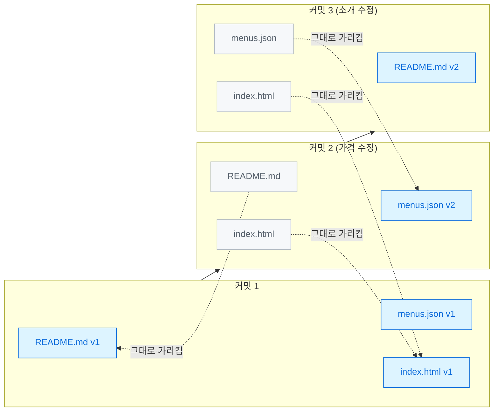
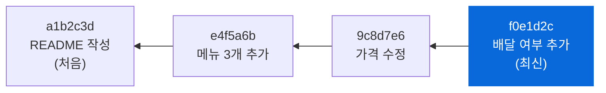
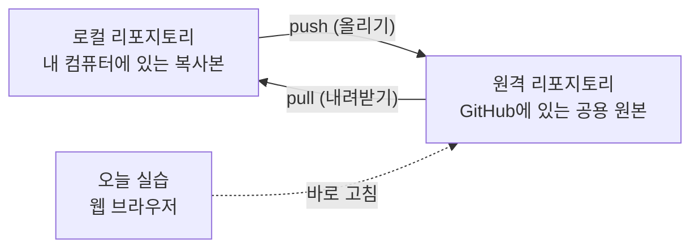
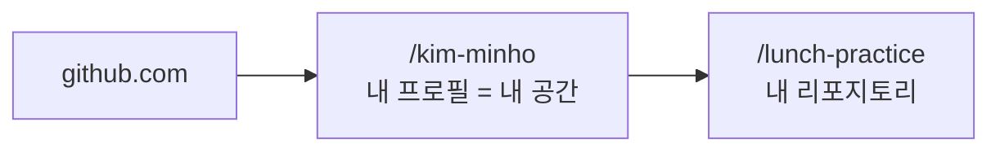
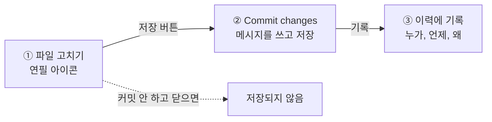

# 1교시. GitHub 시작하기

!!! abstract "이번 교시의 목표"
    버전 관리가 왜 필요한지 이해하고, GitHub에서 파일을 수정하고 변경 이력을 확인할 수 있습니다.

!!! info "오늘의 흐름에서 지금 위치"
    현업 요청 → 이슈 → 우선순위와 인수 조건 → PR → 검사와 리뷰 → 병합과 배포 → **이력 확인** → 보호 규칙

| 구간 | 시간 | 내용 |
|---|---|---|
| 개념 설명 | 15분 | 아래 [교안](#lecture). 버전 관리, Git과 GitHub, 커밋, 스냅샷, 해시, 로컬과 원격, 계정과 요금제, 커밋 메시지 |
| 따라하기 | 20분 | [실습 1-1 내 연습 리포지토리 만들기](lab-1.md) (8분), [실습 1-2 웹에서 고치고 커밋하기](lab-2.md) (8분), [실습 1-3 History로 이력 보기](lab-3.md) (4분) |
| 혼자 해보기 | 10분 | [혼자 해보기](practice.md#practice): 메뉴 1개 추가 커밋, 가격을 바꾼 커밋 찾기 |
| 확인 퀴즈와 정리 | 5분 | [확인 퀴즈](practice.md#quiz) 4문항 |

## 교안 { #lecture }

!!! question "이번 교시를 시작하며"
    - **왜 지금 하나요?** GitHub가 무엇이고 변경이 어떻게 기록되는지부터 봅니다. 오늘 하루의 모든 단계가 결국 커밋과 이력으로 남기 때문입니다.
    - **앞에서 만든 무엇을 쓰나요?** 아직 만든 것은 없습니다. 사전 준비에서 만든 GitHub 계정과 Starter 템플릿 `skilleat-labs/lunch-picker-starter`로 시작합니다.
    - **끝나면 무엇을 누구에게 넘기나요?** 내 연습 리포지토리 `lunch-practice`, 웹페이지 주소, 커밋 몇 개(README 수정, `docs/my-note.md`, 김치찌개 가격 수정)가 남습니다. 2교시에 이 리포지토리의 README를 꾸미고 이슈를 등록합니다.

1교시는 GitHub를 처음 만나는 시간입니다. GitHub가 왜 필요한지부터 시작해서, 커밋이 무엇이고 Git이 어떻게 기록을 저장하는지까지 원리를 같이 봅니다. 개념 설명 뒤에는 각자 내 리포지토리를 만들고 직접 커밋해 봅니다.

처음 듣는 용어가 많이 나오지만 외우실 필요는 없습니다. 실습에서 직접 눌러 보면 자연스럽게 익숙해집니다.

### 이런 파일, 익숙하시죠? { #familiar-files }

요구사항 문서를 메일로 주고받다 보면 폴더에 이런 파일들이 쌓입니다.

| 파일 이름 | 이 파일만 보고 알 수 있나요? |
|---|---|
| 요구사항_v1.docx | 누가 바꿨지? |
| 요구사항_v2_수정.docx | 언제 바꿨지? |
| 요구사항_최종.docx | 왜 바꿨지? |
| **요구사항_최종_진짜최종.docx** | 어느 것이 진짜 최신이지? |

파일 이름에 버전을 붙이는 방식은 누구나 한 번쯤 써 봤을 겁니다. 문제는 이 방식으로는 세 가지를 알 수 없다는 점입니다. 이 문장은 **누가** 바꿨는지, **언제** 바꿨는지, **왜** 바꿨는지가 파일 어디에도 남지 않습니다.

결국 "v2에서 가격 기준이 왜 바뀌었지?"라는 질문이 생기면 메일함을 뒤지거나 사람에게 물어봐야 합니다. 담당자가 휴가 중이거나 퇴사했다면 이유는 영영 사라집니다. 오늘 배울 **버전 관리**가 바로 이 문제를 푸는 도구입니다.

!!! tip "핵심"
    파일 이름으로는 누가, 언제, 왜를 알 수 없습니다.

### 버전 관리가 해 주는 네 가지 { #four-things }

버전 관리 도구는 파일이 바뀔 때마다 그 기록을 차곡차곡 남겨 주는 도구입니다. 하는 일은 네 가지로 정리됩니다.

| 기능 | 하는 일 | 오늘 해 보는 곳 |
|---|---|---|
| 기록 | 누가, 언제, 무엇을 바꿨는지 자동으로 남습니다 | 1교시 커밋과 History |
| 이유 | 바꿀 때마다 왜 바꿨는지 메시지를 남깁니다 | 1교시 커밋 메시지 |
| 되돌리기 | 잘못 바꿔도 이전 버전으로 복구할 수 있습니다 | 3교시 Revert |
| 실험 | 원본은 그대로 두고 사본(분기)에서 따로 작업합니다 | 3교시 분기와 Pull Request |

워드의 "변경 내용 추적"이나 구글 문서의 "버전 기록"을 떠올리시면 비슷합니다. 다른 점은 범위입니다. 워드는 문서 하나의 변경을 추적하지만, 버전 관리 도구는 **프로젝트 폴더 전체**(문서, 데이터, 웹페이지 파일 모두)의 변경을 한 번에 추적합니다.

오늘 하루 동안 이 네 가지를 전부 직접 해 봅니다.

### Git은 도구, GitHub는 협업 공간입니다 { #git-and-github }

이름이 비슷해서 가장 많이 헷갈리는 두 단어입니다.

| 구분 | Git | GitHub |
|---|---|---|
| 정체 | 버전 기록을 저장하는 **프로그램** | Git 위에 협업 기능을 얹은 **웹 서비스** |
| 어디서 | 내 컴퓨터에서도 혼자 동작합니다 | 인터넷(github.com)에 리포지토리를 보관합니다 |
| 하는 일 | 변경 이력 저장, 분기, 병합 | 이슈, 리뷰(Pull Request), 프로젝트 관리, 웹페이지 배포 |
| 참고 | 2005년 리누스 토발즈가 만들었습니다 | 전 세계 개발자 1억 명 이상이 씁니다 |

비유하면 Git은 문서 편집기의 "변경 내용 추적" 기능이고, GitHub는 그 문서를 팀이 함께 쓰는 클라우드 공간입니다. 오늘 실습은 GitHub 웹 화면에서만 진행합니다. 화면 뒤에서는 Git이 기록을 저장하고 있고, 7교시에 그 Git을 터미널에서 직접 만나 봅니다.

### 오늘 계속 나오는 용어 네 개 { #four-terms }

오늘 하루 종일 나오는 용어 네 개만 먼저 잡고 갑니다.

| 영어 | 우리말 | 뜻 | 비유 |
|---|---|---|---|
| Repository | 리포지토리 | 프로젝트 폴더. 파일과 그 파일의 모든 변경 기록이 함께 들어 있습니다 | 공유 드라이브의 프로젝트 폴더 + 변경 일지 |
| Commit | 커밋 | 저장 기록 한 건. 누가, 언제, 왜 저장했는지가 붙습니다 | 결재 도장이 찍힌 저장 |
| Branch | 분기 | 원본에 영향 없이 따로 작업하는 갈래 | 원본을 복사한 작업용 사본 |
| History | 이력 | 커밋을 시간 순서로 모은 목록. 언제든 돌아볼 수 있습니다 | 문서의 개정 이력표 |

이 네 단어만 기억하시면 오늘 내용의 절반은 따라오신 겁니다. 1교시에는 리포지토리, 커밋, 이력을 직접 다루고, 분기는 3교시에 다룹니다.

### Git은 바뀐 줄이 아니라 그 순간의 사진을 저장합니다 { #snapshot }

여기서부터는 Git이 속에서 어떻게 동작하는지 원리를 봅니다.

Git은 커밋할 때마다 그 순간 **프로젝트 전체의 사진**을 찍습니다. 이 사진을 **스냅샷**(snapshot)이라고 합니다. 그런데 매번 모든 파일을 새로 복사하면 용량이 금방 커지겠죠. 그래서 Git은 **바뀐 파일만 새로 저장하고, 안 바뀐 파일은 이전에 저장한 것을 그대로 가리킵니다.**

아래 그림에서 파란 칸은 그 커밋에서 새로 저장한 파일, 회색 칸은 이전 것을 그대로 가리키는 파일입니다.

- 커밋 1: 처음이라 세 파일을 모두 저장합니다.
- 커밋 2: menus.json만 바뀌었으므로 menus.json만 새로 저장합니다. README.md와 index.html은 커밋 1의 것을 가리킵니다.
- 커밋 3: README.md만 새로 저장합니다.

이 방식 덕분에 두 가지가 가능합니다. 첫째, 커밋을 수백 번 해도 용량이 크게 늘지 않습니다. 둘째, 어느 커밋을 고르든 **그 순간의 프로젝트 전체**를 바로 꺼내 볼 수 있습니다. 실습 1-3에서 "특정 시점의 파일 보기"를 해 보면 이 원리를 눈으로 확인할 수 있습니다.

!!! tip "핵심"
    커밋 하나 = 그 순간 프로젝트 전체의 사진.

### 커밋마다 고유 번호가 붙고, 바로 앞 커밋을 가리킵니다 { #hash }

커밋마다 `a1b2c3d` 같은 번호가 붙습니다. 이 번호를 **해시**(hash)라고 합니다. 해시는 커밋 내용(작성자, 시간, 메시지, 스냅샷, 앞 커밋 번호)을 넣어 계산한 고유 번호라서 같은 번호가 두 번 나오지 않습니다. 원래는 40자리지만 보통 **앞 7자리만** 써도 구분됩니다.

그리고 모든 커밋은 **바로 앞 커밋의 번호**를 함께 기억합니다. 그래서 커밋들이 사슬처럼 이어집니다.

화살표는 "앞 커밋을 가리킨다"는 뜻입니다. 최신 커밋에서 화살표를 따라가면 처음 커밋까지 거슬러 올라갈 수 있고, 이것이 바로 History 화면입니다.

| 커밋에 담기는 것 | 예 |
|---|---|
| 커밋 번호(해시) | `9c8d7e6` (전체는 40자리) |
| 작성자 | 내 GitHub 아이디 |
| 시간 | 2026-10-27 10:12 |
| 메시지 | 김치찌개 가격 9500원으로 수정 |
| 스냅샷 | 그 순간 프로젝트 전체 |
| 앞 커밋 번호 | `e4f5a6b` |

해시가 앞 커밋 번호까지 넣어서 계산된다는 점이 중요합니다. 누군가 중간 기록을 몰래 고치면 그 커밋의 해시가 바뀌고, 그 뒤의 모든 커밋 해시도 줄줄이 바뀝니다. 그래서 **기록을 몰래 고치면 바로 티가 납니다.** 감사 대응이나 변경 이력 증명에 Git이 믿을 만한 이유입니다.

### 내 컴퓨터의 리포지토리와 GitHub의 리포지토리 { #local-remote }

리포지토리는 두 군데에 있을 수 있습니다.

- **로컬 리포지토리**: 내 컴퓨터에 있는 복사본입니다. 개발자는 보통 여기서 작업합니다.
- **원격 리포지토리**: GitHub에 있는 공용 원본입니다. 팀원 모두가 이것을 기준으로 삼습니다.
- **push**: 내 컴퓨터에서 만든 커밋을 GitHub로 올리는 일입니다.
- **pull**: 다른 사람이 GitHub에 올린 커밋을 내 컴퓨터로 내려받는 일입니다.

오늘 오전과 오후 실습은 **웹 화면에서 원격 리포지토리를 바로 고치는 방식**이라 push와 pull 단계가 없습니다. 웹에서 Commit changes를 누르는 순간 GitHub의 리포지토리에 바로 커밋이 생깁니다. 7교시에 터미널로 push와 pull을 직접 해 보면서 이 그림을 다시 연결합니다.

### GitHub 계정은 세 가지 유형이 있습니다 { #account-types }

| 유형 | 누구의 것인가 | 특징 |
|---|---|---|
| 개인 계정 | 나 한 사람 | 모든 활동(커밋, 이슈, 리뷰)이 이 계정 이름으로 남습니다. **오늘 실습에 쓰는 계정**입니다 |
| 조직 계정 (Organization) | 팀, 회사 단위 | 여러 사람이 리포지토리를 함께 씁니다. 조직 계정으로 직접 로그인하지 않고, 개인 계정이 조직에 소속됩니다 |
| 엔터프라이즈 (Enterprise) | 여러 조직을 묶은 회사 전체 | 회사 전체의 정책, 청구, 계정을 한곳에서 관리합니다 |

회사에서 GitHub를 도입하면 보통 엔터프라이즈 하나 안에 부서별 조직을 두고, 직원은 각자 개인 계정으로 로그인해서 조직에 소속되는 구조를 씁니다. 오늘 쓰는 Starter 템플릿 `skilleat-labs/lunch-picker-starter`의 `skilleat-labs`가 바로 조직 계정입니다.

### 내 아이디가 곧 내 GitHub 공간입니다 { #my-space }

GitHub에 가입하면 아이디(Username)가 하나 생깁니다. 이 아이디가 곧 GitHub 안에서 **내 공간의 주소**입니다.

| 주소 | 열리는 곳 | 무엇이 있나 |
|---|---|---|
| `github.com/kim-minho` | 내 프로필 | 내가 만든 리포지토리 목록, 활동 기록 |
| `github.com/kim-minho/lunch-practice` | 내 리포지토리 | 오늘 실습하는 프로젝트 폴더 |

아이디는 오늘 하루 계속 씁니다. 짝꿍을 협력자로 초대할 때, 댓글에서 `@아이디`로 부를 때, 이슈 담당자를 정할 때, CODEOWNERS에 승인자를 적을 때 모두 아이디로 합니다. 그래서 처음에 내 아이디를 메모해 두면 편합니다.

!!! tip "핵심"
    `github.com/아이디`가 내 공간이고, 그 뒤에 리포지토리 이름이 붙습니다.

### 로그인하면 처음 보이는 화면, 대시보드 { #dashboard }

로그인하면 제일 먼저 **대시보드**(Dashboard)가 열립니다. 처음 보면 낯설지만 네 군데만 알면 됩니다.

| 번호 | 위치 | 무엇인가 |
|---|---|---|
| ① | 왼쪽 | **Top repositories**: 내 리포지토리 목록. 눌러서 바로 들어갑니다 |
| ② | 가운데 위 | **Ask anything** 입력 칸: AI 도우미 Copilot입니다. **오늘은 쓰지 않습니다** |
| ③ | 가운데 아래 | **Pull requests**, **Issues**: 나에게 온 PR과 이슈 |
| ④ | 오른쪽 위 | **+**(새로 만들기), 알림(종 모양), 프로필 사진(내 프로필, 설정) |

처음 가입한 계정은 리포지토리가 없어서 ①과 ③이 비어 있습니다. 1교시 실습을 마치면 ①에 `lunch-practice`가 생깁니다.

!!! tip "핵심"
    길을 잃으면 왼쪽 위 GitHub 로고(고양이)를 누르세요. 언제든 대시보드로 돌아옵니다.

### 오늘은 무료 요금제로 충분합니다 { #pricing }

| 요금제 | 대상 | 이런 기능이 더해짐 |
|---|---|---|
| **Free** | 개인, 작은 팀 | 공개, 비공개 리포지토리 무제한, 이슈, Pull Request, Projects, Actions 기본 제공 |
| Pro | 개인 개발자 | 비공개 리포지토리에서도 분기 보호, 필수 리뷰어 같은 고급 기능 |
| Team | 조직 | 팀 단위 권한 관리, 초안 Pull Request, 팀 리뷰어 |
| Enterprise | 회사 전체 | 회사 계정 로그인(SSO), 입사와 퇴사에 맞춘 계정 자동 관리, 고급 보안 |

오늘 쓰는 것은 **Free**입니다. 개인 계정 무료로도 이슈, Pull Request, Projects, Actions까지 오늘 배우는 기능을 모두 쓸 수 있습니다. 그래서 오늘 만드는 리포지토리는 모두 **Public**(공개)으로 만듭니다. 공개 리포지토리에서는 분기 보호 같은 고급 기능도 무료로 열려 있기 때문입니다.

가격과 세부 한도는 자주 바뀌므로, 실제 도입할 때는 github.com/pricing에서 확인하시면 됩니다.

### 고친 내용은 커밋해야 기록됩니다 { #commit-to-save }

GitHub 웹 화면에서 파일을 고쳤다고 바로 저장되는 것이 아닙니다. 연필 아이콘으로 고친 다음 **Commit changes** 버튼을 눌러야 비로소 커밋, 즉 기록이 됩니다. 웹 화면에서는 이 버튼이 **저장 버튼**이라고 생각하면 됩니다.

커밋에는 **반드시 메시지가 붙습니다.** 메시지 칸을 비워 두면 GitHub가 `Update README.md` 같은 기본 문구를 넣어 줍니다. 커밋은 되지만, 나중에 이력을 보면 무엇을 왜 바꿨는지 아무도 알 수 없습니다. 그래서 다음 내용처럼 메시지를 직접 씁니다.

!!! tip "핵심"
    Commit changes가 저장 버튼입니다. 커밋하지 않고 편집 화면을 닫으면 고친 내용은 사라집니다.

### 커밋 메시지는 무엇을 왜 바꿨는지 씁니다 { #commit-message }

실습에 들어가기 전에 커밋 메시지 하나만 짚고 갑니다.

| 이렇게 쓰면 나중에 아무도 모릅니다 | 이렇게 쓰면 이력만 봐도 이해됩니다 |
|---|---|
| 수정함 | 범위에서 회식 메뉴 제외 |
| ㅇㅇ | 메뉴에 배달 여부 항목 추가 |
| 최종 | 가격 기준을 만 원으로 변경 |
| Update README.md (기본값 그대로) | README에 만든 사람 추가 |

"수정함", "최종"이라고 쓰면 한 달 뒤에는 아무도 무슨 변경인지 모릅니다. 오른쪽처럼 **무엇을, 왜** 바꿨는지 한 줄로 쓰면 History 목록만 훑어봐도 프로젝트가 어떻게 흘러왔는지 보입니다.

좋은 커밋 메시지를 쓰는 요령은 세 가지입니다.

1. 첫 줄은 짧게(50자 안쪽) 무엇을 바꿨는지 씁니다.
2. 이유가 필요하면 설명 칸(Extended description)에 따로 씁니다.
3. 한 커밋에는 한 가지 변경만 담습니다. 가격 수정과 README 수정을 한 커밋에 섞지 않습니다.

GitHub 웹 화면에서 커밋하면 메시지 칸에 `Update README.md` 같은 기본값이 미리 들어 있습니다. 오늘 실습에서는 **기본값을 지우고 직접 씁니다.**

!!! tip "핵심"
    커밋 메시지는 미래의 동료에게 쓰는 메모입니다.

## 이번 교시 실습

| 실습 | 확인하는 것 |
|---|---|
| [실습 1-1 내 연습 리포지토리 만들기](lab-1.md) | 템플릿으로 내 리포지토리 `lunch-practice`를 만들고, 웹페이지가 열리는 것까지 확인합니다 |
| [실습 1-2 웹에서 고치고 커밋하기](lab-2.md) | 웹에서 파일을 고치고 새로 만들어 커밋 3개를 남기고, 웹페이지에 반영되는 것을 확인합니다 |
| [실습 1-3 History로 이력 보기](lab-3.md) | 커밋 목록, 해시, 바뀐 줄(diff), 파일별 이력, 특정 시점의 파일을 확인합니다 |
| [혼자 해보기와 확인 퀴즈](practice.md) | 메뉴 하나를 직접 추가하고, 이력에서 특정 커밋을 찾아봅니다 |
