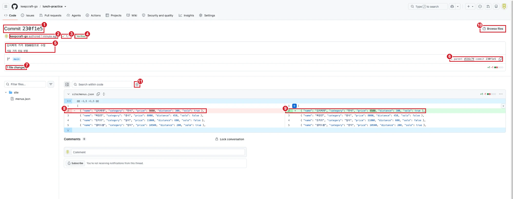

# 실습 1-3. 고치고 이력 보기

!!! abstract "이번 실습에서 할 것"
    - `site/menus.json`의 김치찌개 가격을 고치고 커밋한 뒤, 웹페이지에 반영되는 것을 확인합니다.
    - 커밋 목록에서 작성자, 메시지, 해시, 시간을 읽고, 커밋을 열어 바뀐 줄(diff)을 봅니다.
    - 가격을 고치기 전 시점의 리포지토리를 열어 스냅샷 원리를 눈으로 확인합니다.

**소요 시간** 약 7분  **실습 장소** 개인 연습 리포지토리 `lunch-practice`  **관련 교안** [1교시 교안](index.md#hash)

## 준비

- [실습 1-2](lab-2.md)를 마쳐서 `lunch-practice`가 **1 Commit**이고, 웹페이지가 열리는 상태여야 합니다.
- `lunch-practice` 리포지토리 탭과 웹페이지 탭을 열어 둡니다.

## STEP 1. 김치찌개 가격 고치고 커밋하기

실습 1-1에서 README를 고쳐 본 것과 같은 방법으로, 이번에는 웹페이지의 메뉴 데이터를 고칩니다. 지금 `site/menus.json`의 내용은 아래와 같습니다.

```json
--8<-- "starter/site/menus.json"
```

한 줄이 메뉴 하나입니다. `"price": 9000`이 가격, `"distance": 300`이 회사에서의 거리(미터)입니다.

1. 리포지토리 첫 화면에서 **site** 폴더 → **menus.json**을 클릭합니다.
2. 오른쪽 위 **연필 아이콘**(Edit this file)을 클릭합니다.
3. 2번째 줄, 김치찌개 줄에서 `9000`만 찾아 `9500`으로 바꿉니다. **숫자만** 바꾸고 쉼표, 따옴표, 중괄호는 건드리지 않습니다.

    고치기 전:

    ```json
      { "name": "김치찌개", "category": "한식", "price": 9000, "distance": 300, "solo": true },
    ```

    고친 뒤:

    ```json
      { "name": "김치찌개", "category": "한식", "price": 9500, "distance": 300, "solo": true },
    ```

4. 오른쪽 위 **Commit changes...** 버튼을 클릭합니다.
5. **Commit message** 칸의 기본값 `Update menus.json`을 지우고 아래처럼 씁니다.

    ```text
    김치찌개 가격 9500원으로 수정
    ```

6. 이번에는 **Extended description**(자세한 설명) 칸에 바꾼 이유도 적습니다.

    ```text
    식당 가격 인상 반영
    ```

7. **Commit directly to the `main` branch**가 선택되어 있는지 확인하고, **Commit changes**를 클릭합니다.

확인: menus.json 화면에서 김치찌개 줄이 `"price": 9500`으로 보이고, 위쪽 회색 줄에 `김치찌개 가격 9500원으로 수정`이 보입니다.

!!! warning "쉼표 하나가 웹페이지 전체를 멈춥니다"
    menus.json은 JSON이라는 엄격한 형식입니다. 메뉴 줄 끝의 쉼표를 지우거나, 따옴표를 하나 빠뜨리면 웹페이지가 메뉴를 하나도 읽지 못합니다. 숫자만 바꾸세요.

!!! note "Create a new branch for this commit and start a pull request는 무엇인가요?"
    대화상자 아래쪽의 두 번째 선택지입니다. 원본(main)을 바로 고치지 않고, 사본(분기)에 커밋한 뒤 검토를 요청하는 방식입니다. 혼자 쓰는 연습 리포지토리라 지금은 main에 바로 커밋합니다. 3교시에 두 번째 방식을 직접 해 봅니다.

## STEP 2. 웹페이지에 반영된 것 확인하기

`main`에 커밋이 생기면 **웹페이지 배포** 작업이 자동으로 다시 돕니다. 이번에는 Run workflow를 누를 필요가 없습니다.

1. 리포지토리 위쪽 탭에서 **Actions**를 클릭합니다.
2. 목록 맨 위에 `김치찌개 가격 9500원으로 수정`이라는 실행 기록이 노란 원(실행 중)으로 보입니다.
3. 1~2분 기다려 **초록 체크**로 바뀌는 것을 확인합니다.
4. 열어 둔 웹페이지 탭(`https://<내아이디>.github.io/lunch-practice/`)으로 가서 새로고침합니다.

확인: 김치찌개 카드의 가격이 **9,500원**으로 바뀌어 있습니다.

!!! note "커밋 하나가 웹페이지까지 가는 길"
    ```mermaid
    flowchart LR
        A["웹에서 menus.json 수정"] --> B["Commit changes<br/>(main에 커밋)"]
        B --> C["웹페이지 배포 작업<br/>자동 실행"]
        C --> D["웹페이지에<br/>9,500원 표시"]
    ```

## STEP 3. 커밋 목록 읽기

1. 위쪽 리포지토리 이름 `lunch-practice`를 클릭해 첫 화면으로 돌아갑니다.
2. 회색 줄 오른쪽 끝의 **2 Commits**를 클릭합니다.
3. **Commits** 화면이 열립니다. 위쪽에 `main` 분기 선택 상자가 있고, 아래에 `Commits on (날짜)` 묶음으로 커밋이 최신순으로 나옵니다.

    ```text
    김치찌개 가격 9500원으로 수정   ···                 Verified   230f1e5   ⧉   <>
    keepcraft-go authored 2 minutes ago · ✓ 1 / 1
    ─────────────────────────────────────────────────────────────────────────
    Initial commit                                      Verified   d516c79   ⧉   <>
    keepcraft-go authored 4 hours ago · ✕ 0 / 1
    ```

4. 맨 위 `김치찌개 가격 9500원으로 수정` 줄에서 아래 항목을 하나씩 찾아봅니다.

    | 화면 위치 | 무엇인가 | 예 |
    |---|---|---|
    | 줄 왼쪽 굵은 글씨 | 커밋 메시지. 옆의 `···`을 누르면 Extended description이 펼쳐집니다 | 김치찌개 가격 9500원으로 수정 |
    | 메시지 아래 아이디와 `authored` | 작성자와 시간. 시간에 마우스를 올리면 정확한 날짜와 시각이 나옵니다 | `keepcraft-go authored 2 minutes ago` |
    | 시간 옆 `✓ 1 / 1` 또는 `✕ 0 / 1` | 이 커밋을 계기로 돈 자동 작업(웹페이지 배포)의 결과. 1개 중 1개 성공이면 초록 체크 | 가격 수정은 `✓ 1 / 1`, Initial commit은 Pages를 켜기 전이라 `✕ 0 / 1` |
    | 오른쪽 초록 테두리 `Verified` | 커밋에 서명이 있고 GitHub가 그 서명을 확인했다는 표시. 웹에서 커밋하면 GitHub가 자동으로 서명합니다 | Verified |
    | 오른쪽 7자리 영문 숫자 | 커밋 해시 앞 7자리 | `230f1e5` (사람마다 다름) |
    | 해시 옆 겹친 네모 아이콘 | 전체 해시 복사. 누르면 40자리 해시가 복사됩니다 | |
    | 맨 오른쪽 `<>` 아이콘 | 이 시점의 리포지토리 보기 | STEP 5에서 씁니다 |

확인: 커밋 2개의 해시가 서로 다릅니다. 옆자리 사람과도 비교해 보세요. 같은 메시지로 커밋했어도 작성자와 시간이 달라서 해시가 전부 다릅니다.

!!! note "왜 해시가 전부 다른가요?"
    해시는 작성자, 시간, 메시지, 스냅샷, 앞 커밋 번호를 모두 넣어 계산한 번호입니다. 이 중 하나만 달라도 완전히 다른 번호가 나옵니다. 그래서 해시 7자리만 알려 주면 수많은 커밋 중에서 정확히 그 커밋 하나를 가리킬 수 있습니다. 교안의 [해시와 커밋 사슬](index.md#hash) 그림을 다시 떠올려 보세요.

## STEP 4. 커밋 하나 열어 바뀐 줄 보기

1. 커밋 목록에서 `김치찌개 가격 9500원으로 수정` 메시지를 클릭합니다.
2. 커밋 상세 화면이 열립니다. 아래 그림의 번호를 따라 위에서 아래로 읽어 봅니다.



| 번호 | 화면에 보이는 것 | 뜻 |
|---|---|---|
| ① | `Commit 230f1e5` | 이 커밋의 해시 앞 7자리. 커밋의 고유 번호입니다 |
| ② | `keepcraft-go authored 1 minute ago` | **누가, 언제** 커밋했는지 |
| ③ | `✓ 1 / 1` | 이 커밋을 계기로 돈 자동 작업 1개가 성공했다는 표시. 눌러 보면 **웹페이지 배포**가 보입니다 |
| ④ | `Verified` | 서명이 확인된 커밋이라는 표시. 웹에서 커밋하면 GitHub가 자동으로 서명해서 붙습니다 |
| ⑤ | `김치찌개 가격 9500원으로 수정`, 아래 줄 `식당 가격 인상 반영` | **무엇을, 왜**. 첫 줄은 Commit message, 둘째 줄은 Extended description입니다 |
| ⑥ | `1 parent d516c79 commit 230f1e5` | 바로 앞 커밋(parent)이 `d516c79`(Initial commit)라는 뜻. 교안의 **커밋 사슬**이 여기서 보입니다. `d516c79`를 누르면 앞 커밋으로 갑니다 |
| ⑦ | `1 file changed`, 오른쪽 `+1 -1` | 바뀐 파일 1개, 새로 생긴 줄 1개, 지워진 줄 1개 |
| ⑧ | 왼쪽 빨간 줄, 앞에 `-` | 지워진 줄(예전 내용). `"price": 9000` |
| ⑨ | 오른쪽 초록 줄, 앞에 `+` | 새로 생긴 줄(지금 내용). `"price": 9500`. 바뀐 글자는 더 진하게 강조됩니다 |
| ⑩ | **Browse files** | 이 커밋 시점의 리포지토리 전체 보기. STEP 5에서 씁니다 |
| ⑪ | 톱니바퀴 아이콘 | 보기 방식 바꾸기. **Split**은 그림처럼 왼쪽 예전, 오른쪽 지금으로 나란히, **Unified**는 빨간 줄과 초록 줄을 위아래로 보여 줍니다 |

빨간 줄과 초록 줄 위아래의 흰 줄(짜장면, 돈카츠 등)은 바뀌지 않은 줄입니다. 어디가 바뀌었는지 위치를 알려 주려고 앞뒤 몇 줄을 함께 보여 줍니다.

확인: 빨간 줄 `"price": 9000`, 초록 줄 `"price": 9500`이 보이고, ⑥에 Initial commit의 해시가 보입니다.

!!! note "diff란?"
    두 시점의 파일을 비교해 바뀐 줄만 보여 주는 화면을 **diff**(차이)라고 합니다. Git은 저장할 때는 스냅샷(사진)으로 저장하지만, 보여 줄 때는 앞 커밋(⑥의 parent)의 사진과 비교해서 바뀐 줄만 골라 보여 줍니다. 숫자 하나만 바꿔도 Git은 "줄 하나를 지우고 새 줄 하나를 넣었다"로 기록해서 `+1 -1`이 됩니다. 실습 1-1에서 README에 문장을 넣었을 때는 지운 줄이 없어서 초록 줄만 보였습니다.

## STEP 5. 고치기 전 시점의 리포지토리 보기

스냅샷 원리 덕분에 과거 어느 커밋이든 그 순간의 리포지토리 전체를 꺼내 볼 수 있습니다. 가격을 고치기 전, `Initial commit` 시점으로 가 봅니다.

1. 브라우저 뒤로 가기로 커밋 목록으로 돌아갑니다.
2. `Initial commit` 줄의 맨 오른쪽 **`<>`** 아이콘(마우스를 올리면 `Browse repository at this point`)을 클릭합니다.
3. 왼쪽 위 분기 선택 상자에 `main` 대신 **7자리 해시**가 보입니다. 지금 과거 시점을 보고 있다는 뜻입니다.
4. **site** → **menus.json**을 클릭합니다.

확인: 이 시점의 김치찌개 가격은 **9000**입니다.

다시 지금으로 돌아오려면 위쪽 리포지토리 이름 `lunch-practice`를 클릭합니다. 분기 선택 상자가 `main`으로 돌아옵니다.

!!! note "과거 시점에서 고치면 어떻게 되나요?"
    과거 시점 화면은 보기 전용입니다. 과거를 보는 것은 언제든 안전합니다. 과거 상태로 **되돌리는 것**은 3교시 Revert에서 배웁니다.

## 성공하면

- [x] `site/menus.json`의 김치찌개 가격이 `9500`이고, 웹페이지에서도 9,500원으로 보입니다.
- [x] 커밋 목록에서 작성자, 메시지, 해시 7자리, 시간을 찾았습니다.
- [x] `김치찌개 가격 9500원으로 수정` 커밋에서 빨간 줄 9000, 초록 줄 9500을 봤습니다.
- [x] `Initial commit` 시점의 menus.json에서 가격 9000을 봤습니다.

## 막히면

??? failure "연필 아이콘이 안 보입니다"
    왼쪽 위 분기 선택 상자에 `main` 대신 7자리 번호가 보이면 과거 시점의 보기 전용 화면입니다. 분기 선택 상자에서 **main**을 고릅니다. 아니라면 폴더 목록 화면에 있는 경우입니다. menus.json 파일 이름을 클릭해 **파일 내용이 보이는 화면**으로 들어가야 연필 아이콘이 보입니다. Starter(`skilleat-labs/lunch-picker-starter`) 화면에 있으면 편집 권한이 없어 "Fork this repository" 안내가 나옵니다. 주소창이 내 `lunch-practice`인지 확인합니다.

??? failure "웹페이지에 메뉴가 하나도 안 보입니다"
    menus.json을 고치다가 쉼표, 따옴표, 중괄호를 건드린 경우입니다. menus.json을 열고 김치찌개 줄이 위 "고친 뒤" 코드와 글자 하나까지 같은지 비교해 고친 뒤 다시 커밋합니다.

??? failure "Actions는 초록 체크인데 웹페이지 가격이 그대로입니다"
    브라우저가 예전 화면을 기억하고 있는 경우입니다. 강력 새로고침(Windows ++ctrl+shift+r++, Mac ++cmd+shift+r++)을 합니다. 그래도 그대로면 1분 정도 더 기다립니다.

??? failure "커밋 상세 화면에 바뀐 줄이 안 보이고 Load diff 버튼만 있습니다"
    **Load diff**를 클릭하면 바뀐 줄이 펼쳐집니다.

??? failure "과거 시점 화면에서 나오는 방법을 모르겠습니다"
    위쪽 리포지토리 이름 `lunch-practice`를 클릭하거나, 분기 선택 상자를 눌러 **main**을 고릅니다.

## 다음 실습으로 넘어가기 전에

- 이제 [혼자 해보기](practice.md)에서 메뉴 하나를 직접 추가하고, 새 메모 파일을 만들어 커밋을 찾아 적습니다.
- 오늘 만든 커밋은 모두 남겨 둡니다.
