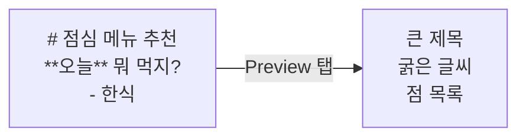
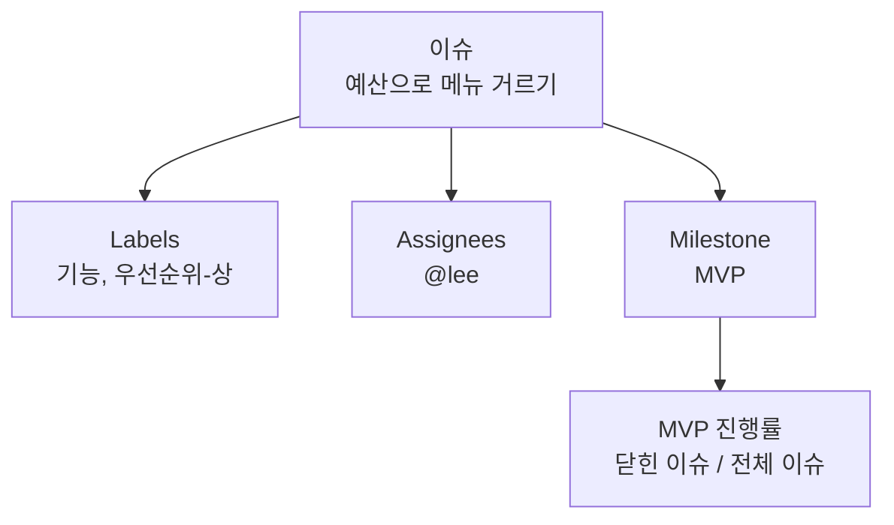
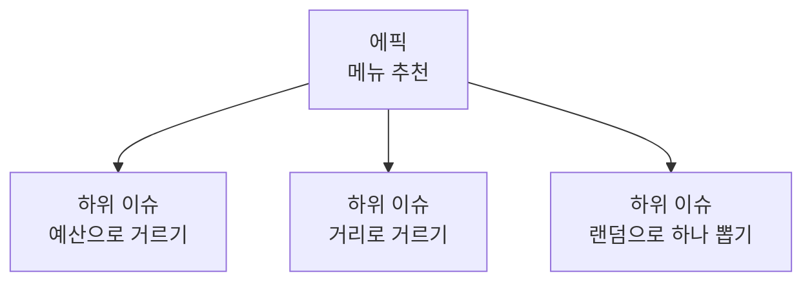
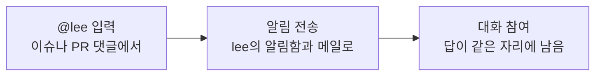
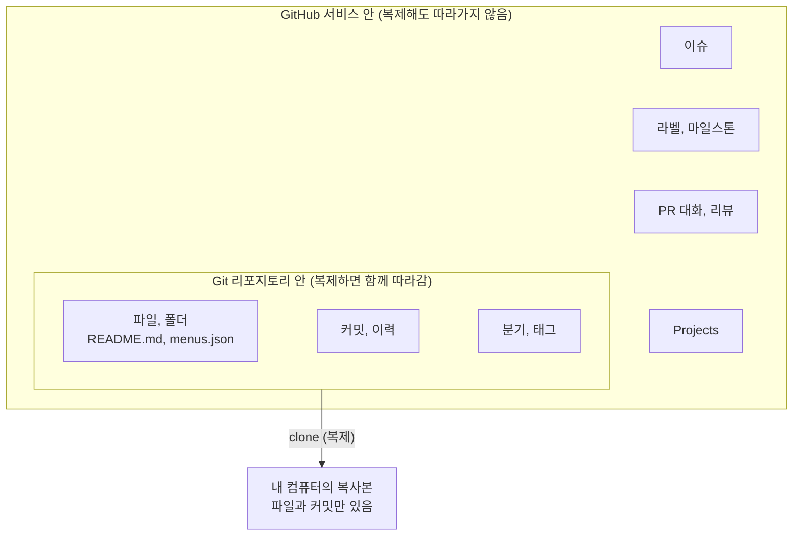

# 2교시. 문서와 할 일 관리

!!! abstract "이번 교시의 목표"
    Markdown으로 문서를 쓰고, 요구사항을 이슈로 등록하고 분류할 수 있습니다.

!!! info "오늘의 흐름에서 지금 위치"
    **현업 요청** → **이슈** → 우선순위와 인수 조건 → PR → 검사와 리뷰 → 병합과 배포 → 이력 확인 → 보호 규칙

| 구간 | 시간 | 내용 |
|---|---|---|
| 개념 설명 | 15분 | 아래 [교안](#lecture). README와 Markdown, Issue, 라벨과 담당자와 마일스톤, 이슈 템플릿, 하위 이슈, @멘션, Git과 GitHub가 관리하는 영역 |
| 따라하기 | 20분 | [실습 2-1 README 꾸미기](lab-1.md) (5분), [실습 2-2 이슈 등록과 분류](lab-2.md) (7분), [실습 2-3 이슈 템플릿 만들기](lab-3.md) (4분), [실습 2-4 하위 이슈와 멘션](lab-4.md) (4분) |
| 혼자 해보기 | 10분 | [혼자 해보기](practice.md#practice): 회의록에서 질문 이슈 2개, 사용자 스토리 1개 등록 |
| 확인 퀴즈와 정리 | 5분 | [확인 퀴즈](practice.md#quiz) 4문항 |

## 교안 { #lecture }

!!! question "이번 교시를 시작하며"
    - **왜 지금 하나요?** 지금까지는 파일을 고치고 기록을 남겼습니다. 이제 무엇을 고칠지 문서로 설명하고, 질문과 할 일을 이슈로 모읍니다. 커밋은 바꾼 결과를 남기고, 이슈는 바꾸기 전에 무엇을 할지 질문하고 합의하는 공간입니다.
    - **앞에서 만든 무엇을 쓰나요?** 1교시에 만든 `lunch-practice` 리포지토리입니다. 1교시에 이름을 넣은 README를 꾸미고, Starter에 들어 있는 `docs/00_현업요청.md`와 `docs/01_킥오프_회의록.md`를 읽어 이슈로 옮깁니다.
    - **끝나면 무엇을 누구에게 넘기나요?** 꾸민 README, 라벨 5개와 마일스톤 `MVP`, 이슈 템플릿 `사용자 스토리`, 이슈 #1~#5(에픽 #4와 하위 이슈)와 혼자 해보기 이슈 3개가 남습니다. 3교시에는 이 이슈들처럼 정한 일을 PR로 반영하는 방법을 배우고, 4교시에는 이 이슈들을 Projects 보드에 올립니다.

2교시는 문서와 할 일을 관리하는 시간입니다. 앞부분은 README와 Markdown으로 문서를 쓰는 법, 뒷부분은 Issue로 요구사항과 할 일을 관리하는 법입니다.

오후 팀 실습에서 가장 많이 쓰는 기능이 이슈라서 여기서 확실히 익혀 두면 좋습니다. 한 가지만 구분해서 들어 주세요. **문서는 기록으로 남기는 것, 이슈는 대화하며 진행하는 것**입니다. 1교시에 배운 커밋과 비교하면 더 분명해집니다. **커밋은 바꾼 결과를 남기고, 이슈는 바꾸기 전에 무엇을 할지 질문하고 합의하는 공간**입니다. 커밋에는 "김치찌개 가격을 9500원으로 수정"처럼 이미 끝난 일이 남고, 이슈에는 "만 원 넘는 메뉴도 보여 줄까요?"처럼 아직 정하지 않은 일과 그에 대한 의견이 모입니다. 그래서 순서도 이슈가 먼저입니다. 이슈에서 무엇을 할지 합의하고, 합의한 대로 파일을 바꾼 결과를 커밋으로 남깁니다.

### README는 리포지토리의 첫 화면입니다 { #readme }

리포지토리에 들어가면 파일 목록 아래에 `README.md`의 내용이 자동으로 펼쳐집니다. 그래서 README는 프로젝트의 첫 화면, 첫인상입니다. 리포지토리 맨 위 폴더에 `README.md`라는 이름으로 두면 GitHub가 알아서 보여 줍니다.

좋은 README에는 세 가지가 들어갑니다.

| 질문 | 들어갈 내용 | 점심 메뉴 추천 예 |
|---|---|---|
| 무엇 | 이 프로젝트는 무엇인지 한 문장, 누구를 위한 것인지 | 팀원들이 점심 메뉴를 5분 안에 고르게 돕는 웹페이지 |
| 왜 | 해결하려는 문제, 목표와 범위, 이번에 하지 않는 것 | 목표: 메뉴 결정 시간 5분 이내. 로그인, 자동 수집은 하지 않음 |
| 어디 | 더 볼 상세 문서 링크, 참여 방법 | 현업 요청, 킥오프 회의록 링크 |

기획 문서로 치면 표지와 목차 역할입니다. 처음 온 사람이 README만 읽고도 무슨 프로젝트인지 알 수 있어야 합니다. 지금 `lunch-practice`의 README는 제목과 한 줄 소개뿐이라 일부러 빈약합니다. 실습 2-1에서 이 세 가지를 채웁니다.

### 기호 몇 개로 문서 모양을 만듭니다 { #markdown }

README는 **Markdown**(마크다운)이라는 형식으로 씁니다. 워드처럼 서식 버튼을 누르는 대신, 글자 앞뒤에 기호를 붙여서 모양을 정합니다. 파일 이름 끝의 `.md`가 Markdown이라는 뜻입니다.

| 이렇게 쓰면 | 화면에서는 | 설명 |
|---|---|---|
| `# 점심 메뉴 추천` | **가장 큰 제목** | 샵 하나 + 띄어쓰기. 문서 제목 |
| `## 목표` | 중간 제목 | 샵 둘. 절 제목. 샵이 늘수록 작아집니다 |
| `**오늘** 뭐 먹지?` | **오늘** 뭐 먹지? | 별표 두 개로 감싸면 굵게 |
| `- 한식` | 점 목록 | 줄 앞에 빼기 + 띄어쓰기 |
| `1. 메뉴 고르기` | 번호 목록 | 줄 앞에 숫자, 점, 띄어쓰기 |
| `[회의록 보기](docs/01.md)` | <u>회의록 보기</u> (링크) | 대괄호 안은 보이는 글자, 괄호 안은 주소 |
| `` | 그림 | 링크 앞에 느낌표를 붙이면 그림 |
| 빈 줄 | 문단 나누기 | 줄을 바꾸려면 빈 줄을 하나 둡니다 |

처음엔 낯설어도 **제목, 굵게, 목록, 링크, 그림** 다섯 개만 외우면 문서 대부분을 쓸 수 있습니다. 편집 화면 위의 **Preview** 탭을 누르면 결과 모양을 바로 확인할 수 있어서 틀려도 금방 고칠 수 있습니다.



### GitHub에서는 체크박스, 표, 이슈 링크가 더해집니다 { #gfm }

GitHub는 기본 Markdown에 기능을 몇 개 더 얹었습니다. 이것을 GitHub 확장 문법(GitHub Flavored Markdown)이라고 합니다.

| 이렇게 쓰면 | 화면에서는 | 어디에 쓰나 |
|---|---|---|
| `- [ ] 메뉴 데이터 정리` | 빈 체크박스와 글자 | 진행 상황 체크. 이슈 본문에서는 클릭해서 체크할 수 있습니다 |
| `- [x] 웹페이지 만들기` | 체크된 체크박스 | 끝난 일 표시 |
| 세로 막대로 만든 표 (아래 예) | 표 | 메뉴, 일정, 담당자 정리 |
| `#12` | 12번 이슈로 가는 링크 | 관련 요구사항 연결 |
| `@kim` | kim에게 알림 | 검토, 질문 요청 |

표는 세로 막대(`|`)로 칸을 나누고, 둘째 줄에 빼기 기호(`---`)로 머리글 경계를 긋습니다.

```markdown
| 메뉴 | 가격 |
|---|---|
| 김치찌개 | 9,500원 |
```

이 중에서 오늘 정말 많이 쓸 두 가지는 `#숫자`와 `@아이디`입니다. `#숫자`는 그 번호의 이슈로 가는 링크가 되고, `@아이디`는 그 사람에게 알림을 보냅니다. **이 두 개가 GitHub 협업의 핵심 연결 고리**입니다.

### Issue는 할 일과 대화를 담는 카드입니다 { #issue }

**Issue**(이슈)는 할 일 카드입니다. 요구사항, 할 일, 질문, 버그 무엇이든 한 장의 카드로 만듭니다. 리포지토리의 **Issues** 탭에 모입니다.

이슈 한 장은 이렇게 생겼습니다.

| 부분 | 예 |
|---|---|
| 번호와 제목 | `#12 예산으로 메뉴 거르기` |
| 꼬리표 | 라벨 `기능`, `우선순위-상` / 담당자 `@lee` / 마일스톤 `MVP` |
| 본문 | 요구 내용, 인수 조건 체크박스 |
| 댓글 대화 | kim: 만 원 이하 메뉴만 보여 주세요<br/>lee: @kim 배달비도 포함인가요?<br/>kim: 네, 포함입니다 |
| 상태 | Open(진행 중) 또는 Closed(완료) |

kim이 요청하고 lee가 질문하고 kim이 답하는 대화가 요구사항 바로 아래에 그대로 남습니다. 메일이나 메신저로 주고받으면 흩어지는 대화가 이슈에서는 한곳에 모입니다. 일이 끝나면 이슈를 **Close**(닫기) 하면 됩니다. 닫힌 이슈도 지워지지 않고 Closed 목록에 남아서 나중에 "이거 왜 이렇게 정했지?"를 찾아볼 수 있습니다.

이슈 번호는 리포지토리마다 1번부터 자동으로 붙습니다. 이 번호를 `#1`처럼 쓰면 어디서든 그 이슈로 링크됩니다.

### 라벨, 담당자, 마일스톤으로 이슈를 정리합니다 { #organize }

이슈가 많아지면 정리가 필요합니다. 세 가지 도구가 있습니다. 모두 이슈 화면 오른쪽 사이드바에서 지정합니다.

| 도구 | 답하는 질문 | 예 | 좋은 점 |
|---|---|---|---|
| **Labels** (라벨) | 무슨 종류인가 | `기능`, `질문`, `우선순위-상` | 색깔 꼬리표로 한눈에 구분, 라벨로 걸러 보기 |
| **Assignees** (담당자) | 누가 맡았나 | `@lee` | 내 할 일만 모아 보기 |
| **Milestone** (마일스톤) | 언제까지 묶어 내나 | `MVP` (첫 출시) | 묶인 이슈 중 몇 퍼센트 끝났는지 자동 계산 |



라벨은 이슈 하나에 여러 개 붙일 수 있고, 마일스톤은 이슈 하나에 하나만 붙습니다. 마일스톤 화면에서는 "MVP: 3개 중 1개 완료, 33%"처럼 진행률이 막대로 보입니다. 라벨과 마일스톤은 이슈를 걸러 보는 기준도 됩니다. 이슈 목록 검색창에 `label:기능`을 넣으면 기능 이슈만 보입니다.

### 이슈 템플릿으로 요구사항 양식을 고정합니다 { #issue-template }

이슈를 아무렇게나 쓰게 두면 사람마다 제각각입니다.

| 빈 이슈 (사람마다 제각각) | 템플릿 이슈 (항목이 미리 채워짐) |
|---|---|
| "메뉴 추천 기능 필요" 한 줄 | 누구로서: |
| 누가 왜 필요한지 빠짐 | 무엇을 하고 싶다: |
| 다시 물어봐야 함 | 왜냐하면: |

**이슈 템플릿**(issue template)을 만들어 두면 새 이슈를 열 때 항목이 미리 채워져 있습니다. 쓰는 사람은 빈칸만 채우면 되고, 읽는 사람은 늘 같은 형식으로 봅니다. 기획 부서에서 요구사항 양식을 쓰는 것과 같은 원리입니다.

템플릿은 리포지토리 안의 정해진 폴더 `.github/ISSUE_TEMPLATE/`에 Markdown 파일로 만듭니다. 파일 맨 위에 템플릿 이름, 설명, 기본 제목, 자동으로 붙일 라벨을 적고, 그 아래에 본문 양식을 씁니다. 템플릿이 하나라도 있으면 **New issue**를 눌렀을 때 템플릿을 고르는 화면이 먼저 나옵니다.

오늘 만드는 템플릿은 **사용자 스토리** 형식입니다. "누구로서, 무엇을 하고 싶다, 왜냐하면"으로 요구를 쓰는 방식이고, 오후 팀 실습에서 BA 역할이 이 템플릿으로 요구사항을 씁니다.

템플릿 맨 아래에는 **인수 조건** 칸도 둡니다. 인수 조건은 "무엇이 되면 다 됐다고 받아들일지"를 화면에서 확인할 수 있는 문장으로 미리 적어 둔 체크 목록입니다. 개발자에게는 작업 범위가, 검토하는 사람에게는 확인 기준이 됩니다.

### 큰 요구는 하위 이슈로 쪼갭니다 { #sub-issue }

"메뉴 추천" 같은 큰 요구는 한 번에 끝낼 수 없습니다. 이런 큰 덩어리를 **에픽**(epic)이라고 부릅니다. 에픽 이슈 안에서 **Create sub-issue**(하위 이슈 만들기)를 누르면 작은 이슈로 쪼갤 수 있습니다.



하위 이슈는 그 자체로 완전한 이슈입니다. 번호, 담당자, 라벨이 따로 붙습니다. 하위 이슈를 하나 닫을 때마다 에픽 화면의 진행률(예: `1 of 3`)이 올라갑니다. 이미 만들어 둔 이슈를 **Add existing issue**로 하위 이슈로 연결할 수도 있습니다.

오후 팀 실습에서 PO가 에픽을 만들고 BA가 하위 이슈로 쪼개는 흐름으로 그대로 씁니다.

### @멘션 하나로 필요한 사람을 대화에 부릅니다 { #mention }

협업에서 가장 많이 쓰는 기능이 `@` 멘션입니다.



댓글에 `@`와 아이디를 쓰면 그 사람에게 알림이 갑니다. 알림은 GitHub 오른쪽 위의 종 모양 아이콘(알림함)과 가입한 메일로 옵니다. 알림을 받은 사람이 들어와서 답을 달면 질문과 답이 같은 이슈 안에 남습니다.

메신저로 따로 물어보면 그 대화는 나중에 아무도 못 찾지만, 이슈에서 멘션으로 물어보면 요구사항과 함께 기록됩니다. 오후에 개발자 역할이 BA에게 질문할 때 이 방법을 씁니다.

!!! tip "핵심"
    `#번호`는 이슈를 잇고, `@아이디`는 사람을 부릅니다.

### Git이 관리하는 것과 GitHub가 관리하는 것은 다릅니다 { #git-vs-github-data }

여기서 중요한 원리 하나를 짚습니다. 리포지토리를 다른 곳으로 복제(clone)하거나 옮길 때 무엇이 따라가고 무엇이 남는지입니다.



| 구분 | Git 리포지토리 안 | GitHub 서비스 안 |
|---|---|---|
| 무엇 | 파일, 폴더, 커밋, 분기, 태그 | 이슈, 라벨, 마일스톤, PR 대화, Projects |
| 누가 관리 | Git | GitHub라는 웹 서비스 |
| 복제(clone)하면 | **함께 따라감** | **따라가지 않음** |
| 어울리는 내용 | 오래 남겨야 하는 확정 문서 (README, 회의록, 요구사항 확정본) | 진행 중인 대화와 할 일 (질문, 요청, 결정 과정) |

이슈 템플릿 파일(`.github/ISSUE_TEMPLATE/user-story.md`)은 파일이라서 Git 쪽에 있지만, 그 템플릿으로 만든 이슈는 GitHub 쪽에 있습니다. 그래서 요구사항 문서처럼 오래 남겨야 하는 건 **파일로 커밋**하고, 진행 중인 대화와 할 일은 **이슈로 관리**하는 식으로 구분해서 씁니다.

!!! tip "핵심"
    문서는 커밋으로 남기고, 할 일과 대화는 이슈로 진행합니다.

## 이번 교시 실습

| 실습 | 확인하는 것 |
|---|---|
| [실습 2-1 README 꾸미기](lab-1.md) | Markdown 문법(제목, 그림, 굵게, 표, 체크박스, 링크)으로 README를 완성하고 Preview로 확인합니다 |
| [실습 2-2 이슈 등록과 분류](lab-2.md) | 라벨 5개와 마일스톤 MVP를 만들고, 회의록에서 뽑은 이슈 2개에 담당자, 라벨, 마일스톤을 붙입니다 |
| [실습 2-3 이슈 템플릿 만들기](lab-3.md) | 사용자 스토리 템플릿 파일을 만들고, 템플릿으로 이슈를 등록합니다 |
| [실습 2-4 하위 이슈와 멘션](lab-4.md) | 에픽에 하위 이슈를 연결해 진행률을 보고, `#번호` 링크와 `@멘션` 알림을 확인합니다 |
| [혼자 해보기와 확인 퀴즈](practice.md) | 회의록의 결정하지 못한 것과 요구를 스스로 이슈로 등록합니다 |
