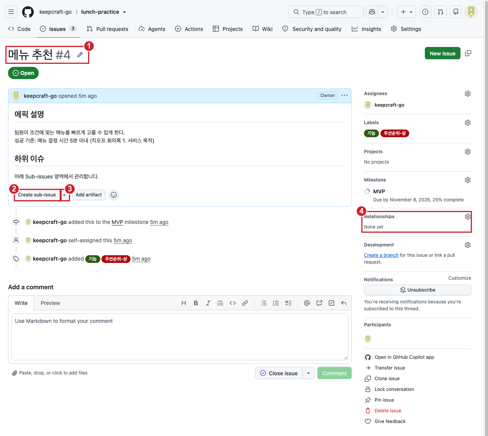
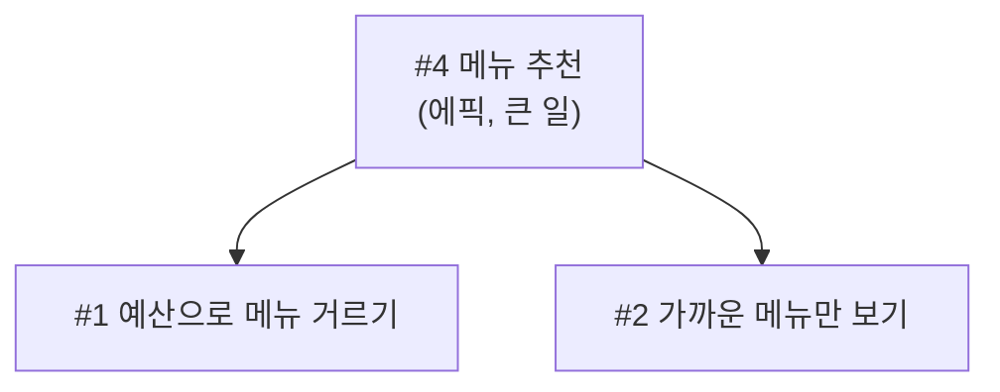

# 실습 2-4. 하위 이슈와 멘션

!!! abstract "이번 실습에서 할 것"
    - "메뉴 추천" 에픽 이슈를 만들고 하위 이슈를 연결해 진행률을 봅니다.
    - 댓글에 `#번호`와 커밋 해시를 써서 자동 링크를 확인합니다.
    - `@아이디`로 다른 사람을 멘션하고, 받은 사람은 알림을 확인합니다.

**소요 시간** 약 4분  **실습 장소** 개인 연습 리포지토리 `lunch-practice`  **관련 교안** [2교시 교안](index.md#sub-issue)

## 준비

- [실습 2-2](lab-2.md), [실습 2-3](lab-3.md)을 마쳐서 열린 이슈 3개가 있어야 합니다.

    | 번호 | 제목 |
    |---|---|
    | #1 | 예산으로 메뉴 거르기 |
    | #2 | 가까운 메뉴만 보기 |
    | #3 | [스토리] 혼밥 가능 표시 |

- 옆자리 사람의 GitHub 아이디를 미리 물어 두세요. 혼자 앉았다면 강사가 화면에 띄운 강사 아이디를 씁니다.

## STEP 1. 에픽 이슈 만들기

1. **Issues** 탭 → **New issue**를 클릭합니다.
2. 템플릿 고르는 화면이 나옵니다. 이번에는 아래쪽 **Blank issue**(빈 이슈)를 클릭합니다.
3. 제목:

    ```text
    메뉴 추천
    ```

4. 본문:

    ```markdown
    ## 에픽 설명
    팀원이 조건에 맞는 메뉴를 빠르게 고를 수 있게 한다.
    성공 기준: 메뉴 결정 시간 5분 이내 (킥오프 회의록 1. 서비스 목적)

    ## 하위 이슈
    아래 Sub-issues 영역에서 관리합니다.
    ```

5. 오른쪽 사이드바: **Assignees** 내 아이디, **Labels** `기능`, `우선순위-상`, **Milestone** `MVP`
6. **Create**를 클릭합니다.

확인: **메뉴 추천 #4** 이슈 화면이 열립니다. **지금 보고 있는 이 이슈가 바로 에픽입니다.**



| 번호 | 화면 | 뜻 |
|---|---|---|
| ① | `메뉴 추천 #4` | 이 이슈 자체가 에픽입니다. 화면 어디에도 "에픽"이라는 글자는 나오지 않습니다 |
| ② | **Create sub-issue** | 이 에픽 아래에 하위 이슈를 **새로** 만드는 버튼 (STEP 3) |
| ③ | ② 오른쪽 작은 **▼** | **이미 있는 이슈**를 이 에픽 아래로 넣는 메뉴 (STEP 2) |
| ④ | **Relationships** | 상위, 하위 관계가 표시되는 곳. 지금은 `None yet`(아직 없음) |

!!! note "에픽은 특별한 기능인가요?"
    아닙니다. GitHub에 "에픽"이라는 기능이나 버튼은 없습니다. 에픽도 그냥 이슈 하나이고, **하위 이슈를 거느린 큰 이슈**를 사람들이 에픽이라고 부를 뿐입니다. 그래서 이슈 본문 제목을 `## 에픽 설명`으로 써서 표시했습니다. 오후 팀 실습에서는 `에픽` 라벨을 따로 만들어 한눈에 구분합니다.

## STEP 2. 기존 이슈를 하위 이슈로 연결하기

지금 이슈 목록에는 이슈가 따로따로 놓여 있습니다. 그런데 2-2에서 만든 "예산으로 메뉴 거르기"(\#1)와 "가까운 메뉴만 보기"(\#2)는 사실 방금 만든 큰 일 "메뉴 추천"(\#4)의 **일부분**입니다. 이번 STEP에서는 이 관계를 GitHub에 알려 줍니다. 폴더 안에 파일을 넣듯, \#4 아래에 \#1과 \#2를 넣는다고 생각하면 됩니다.



이렇게 묶어 두면 \#4 하나만 열어도 "메뉴 추천을 위해 할 일이 몇 개이고, 그중 몇 개가 끝났는지"를 한눈에 볼 수 있습니다.

1. STEP 1을 마치면 방금 만든 **\#4 메뉴 추천** 이슈 화면이 열려 있습니다. (닫았다면 **Issues** 탭 → **메뉴 추천** 클릭)
2. 위 그림의 ②, ③을 찾습니다. **본문(에픽 설명) 바로 아래**, 댓글 칸보다 위에 회색 테두리 버튼 **Create sub-issue**(하위 이슈 만들기)가 있고, 그 오른쪽 끝에 작은 아래 화살표 **▼**가 붙어 있습니다.
    - 버튼 글자 부분을 누르면 하위 이슈를 **새로 만듭니다**. (STEP 3에서 씁니다)
    - 오른쪽 **▼**를 누르면 **이미 있는 이슈를 골라 넣는** 메뉴가 나옵니다. (지금 씁니다)
3. 오른쪽 **▼**를 클릭합니다. 펼쳐진 메뉴에서 **Add existing issue**(기존 이슈 추가)를 클릭합니다.
4. 작은 검색 창이 열리고 이 리포지토리의 이슈 목록이 보입니다. 목록에서 **예산으로 메뉴 거르기 \#1**을 클릭합니다. 안 보이면 검색 칸에 `예산`을 입력합니다.
5. 창이 닫히고 본문 아래에 **Sub-issues** 영역이 새로 생깁니다. 그 안에 \#1이 한 줄로 들어가 있습니다.
6. 같은 방법으로 \#2를 넣습니다. Sub-issues 영역 아래(또는 위)의 **Create sub-issue** 옆 **▼** → **Add existing issue** → **가까운 메뉴만 보기 \#2**를 클릭합니다.

확인: **Sub-issues** 영역에 \#1과 \#2 두 줄이 있고, 영역 제목 옆에 진행률 **0 of 2**(2개 중 0개 완료)가 보입니다. 둘 다 아직 열린 이슈라서 0입니다.

!!! tip "\#1을 열어 보면"
    Sub-issues 목록에서 **예산으로 메뉴 거르기**를 클릭해 \#1을 열어 봅니다. 오른쪽 **Relationships**(그림 ④ 자리)에 상위 이슈(Parent) `메뉴 추천 #4`가 표시됩니다. 화면에 따라 제목 위에 보이기도 합니다. 위아래 양쪽에서 관계가 보입니다. 확인했으면 브라우저 뒤로 가기로 \#4로 돌아옵니다.

## STEP 3. 새 하위 이슈 만들기

아직 이슈가 없는 조각은 에픽 안에서 바로 만듭니다.

1. Sub-issues 영역 아래의 **Create sub-issue** 버튼을 클릭합니다. (▼가 아니라 버튼 글자 부분)
2. 새 하위 이슈 작성 창이 열립니다. 템플릿 고르는 목록이 먼저 나오면 **Blank issue**를 고릅니다.
3. 제목:

    ```text
    랜덤으로 하나 뽑기
    ```

4. 본문:

    ```markdown
    ## 요구 내용
    도저히 못 고를 때 버튼 하나로 조건에 맞는 메뉴 중 하나를 골라 준다.

    ## 근거
    현업 요청 4번
    ```

5. **Create**를 클릭합니다.

확인: **#5 랜덤으로 하나 뽑기**가 만들어지고, #4의 Sub-issues 목록이 3개, 진행률이 **0 of 3**이 됩니다.

!!! tip "하위 이슈에도 라벨과 마일스톤을"
    \#5를 클릭해 열고 오른쪽 사이드바에서 **Labels** `기능`, `우선순위-중`, **Milestone** `MVP`를 붙여 두면 다른 이슈들과 같은 기준으로 정리됩니다. 열어 보면 오른쪽 **Relationships**(또는 제목 위)에 상위 이슈 `메뉴 추천 #4`가 표시되어 있는 것도 확인할 수 있습니다.

## STEP 4. 하위 이슈 닫고 진행률 보기

웹페이지에는 이미 **아무거나 골라 줘** 버튼이 있으니 #5는 완료된 것으로 처리합니다.

1. \#4의 Sub-issues 목록에서 **랜덤으로 하나 뽑기**를 클릭해 #5를 엽니다.
2. 아래 댓글 칸에 입력합니다.

    ```text
    웹페이지에 "아무거나 골라 줘" 버튼이 이미 있어 완료 처리합니다.
    ```

3. **Close with comment**를 클릭합니다.
4. 제목 위의 상위 이슈 링크 **메뉴 추천 #4**를 클릭해 에픽으로 돌아갑니다. (또는 **Issues** 탭에서 #4를 클릭합니다.)

확인: Sub-issues 진행률이 **1 of 3**으로 올라가고, #5 옆에 보라색 완료 표시가 보입니다. 이슈 목록에서도 #4 옆에 진행률 원이 조금 채워져 보입니다.

## STEP 5. #번호와 커밋 해시로 자동 링크 만들기

1. \#4 이슈 화면 맨 아래 댓글 칸에 아래 내용을 입력합니다. `#3`을 입력하는 순간 이슈 목록이 뜨는데, 무시하고 계속 입력하면 됩니다.

    ```text
    혼밥 표시 요구 #3 도 이 에픽과 관련이 있습니다.
    ```

2. 댓글 칸 위쪽 **Preview** 탭을 눌러 `#3`이 파란 링크로 바뀌었는지 확인합니다.
3. **Comment**(댓글 달기) 버튼을 클릭합니다.
4. 댓글의 `#3` 링크에 마우스를 올려 봅니다. #3의 제목과 상태가 작은 카드로 뜹니다.
5. `#3`을 클릭해 #3으로 이동합니다. 아래 대화 기록에 `mentioned this` 또는 `referenced this` 같은 문구와 함께 **메뉴 추천 #4**에서 언급했다는 기록이 남아 있습니다.

확인: #4 댓글의 `#3`이 링크이고, #3에도 #4에서 언급된 기록이 자동으로 생겼습니다.

이번에는 1교시에 본 커밋 해시를 이슈와 연결합니다.

1. 새 탭에서 리포지토리 **Code** 탭 → 커밋 수(예: **8 Commits**) 클릭 → `사용자 스토리 이슈 템플릿 추가` 줄의 복사 아이콘을 클릭해 해시를 복사합니다.
2. \#3 이슈로 돌아와 댓글 칸에 아래처럼 쓰고, `여기에붙여넣기` 자리에 복사한 해시를 붙여 넣습니다.

    ```text
    이 스토리는 템플릿 커밋 여기에붙여넣기 이후 처음 만든 스토리입니다.
    ```

3. **Comment**를 클릭합니다.

확인: 40자리 해시가 **7자리 코드 모양 링크**로 바뀌어 보이고, 클릭하면 그 커밋의 바뀐 줄 화면으로 이동합니다.

## STEP 6. @멘션으로 다른 사람 부르기

1. \#4 이슈 맨 아래 댓글 칸에 아래 내용을 입력합니다. `옆자리아이디`를 **옆자리 사람의 GitHub 아이디**(혼자라면 강사가 화면에 띄운 강사 아이디)로 바꿉니다. `@` 다음에 아이디 앞부분을 치면 후보가 뜰 수 있는데, 안 떠도 아이디를 끝까지 정확히 치면 됩니다.

    ```text
    @옆자리아이디 메뉴 추천 에픽을 만들었습니다. 하위 이슈 나눈 것 한번 봐 주세요.
    ```

2. **Preview** 탭에서 `@아이디`가 굵은 링크로 바뀌는지 확인합니다. 그냥 글자로 보이면 아이디 오타입니다.
3. **Comment**를 클릭합니다.

확인: 댓글의 `@아이디`가 링크로 보입니다.

**멘션을 받은 사람**이 할 일:

1. GitHub 화면 오른쪽 위의 **종 모양 아이콘**(Notifications, 알림)을 봅니다. 새 알림이 있으면 파란 점이 붙어 있습니다.
2. 종 아이콘을 클릭합니다. 알림함 목록에 `메뉴 추천` 이슈가 `mention` 이유로 보입니다.
3. 알림을 클릭하면 멘션된 댓글로 바로 이동합니다. 답글을 달아 봅니다.

    ```text
    확인했습니다. 예산, 거리, 랜덤 세 개로 나눈 것 좋네요.
    ```

확인: 상대방 화면에 내 멘션 알림이 왔고, 내 이슈 #4에 상대방의 답글이 달렸습니다.

!!! note "협력자가 아니어도 멘션이 가나요?"
    `lunch-practice`는 **Public**(공개) 리포지토리라서, 이 리포지토리에 초대받지 않은 사람도 멘션하면 알림이 갑니다. 공개 리포지토리는 누구나 읽을 수 있기 때문입니다. 알림이 바로 오지 않을 수 있으니 1분 정도 기다려 보세요. 그래도 안 오면 3교시 실습 3-1에서 짝꿍을 협력자(Collaborator)로 초대한 뒤 다시 멘션해 봅니다. 비공개 리포지토리에서는 접근 권한이 있는 사람만 멘션 알림을 받습니다.

## 성공하면

- [x] #4 `메뉴 추천`의 Sub-issues에 #1, #2, #5가 있고 진행률이 **1 of 3**입니다.
- [x] #4 댓글의 `#3`이 링크이고, #3에 #4에서 언급된 기록이 있습니다.
- [x] #3 댓글의 커밋 해시가 커밋 링크로 바뀌었습니다.
- [x] `@아이디` 멘션을 보냈고, 받은 사람의 종 아이콘 알림함에 알림이 왔습니다.

## 막히면

??? failure "Create sub-issue 버튼이 안 보입니다"
    이슈 본문 바로 아래, 반응 이모지 줄 근처에 있습니다. 화면이 좁으면 본문 오른쪽 위 **...**(더 보기) 메뉴 안에 **Create sub-issue**가 있을 수 있습니다. 그래도 안 보이면 브라우저를 새로고침합니다.

??? failure "Add existing issue 목록에 #1, #2가 안 보입니다"
    검색칸에 `예산` 또는 `1`을 입력해 찾습니다. 이미 다른 이슈의 하위 이슈로 연결된 이슈는 다시 연결할 수 없습니다. 실수로 엉뚱한 이슈에 연결했다면 Sub-issues 목록에서 그 줄의 **...** → **Remove sub-issue**로 뗍니다.

??? failure "#3 이 링크로 안 바뀝니다"
    `#`과 숫자 사이에 띄어쓰기가 있거나, `#3`이 다른 글자에 붙어 있는 경우입니다(`요구#3`). `#3` 앞뒤에 띄어쓰기를 둡니다.

??? failure "@아이디 가 링크로 안 바뀌고 글자로만 보입니다"
    아이디 오타입니다. 상대방에게 오른쪽 위 프로필 사진을 눌러 정확한 아이디를 다시 확인받습니다. 댓글은 오른쪽 위 **...** → **Edit**로 고칠 수 있습니다. 단, 이미 보낸 댓글을 고쳐서 넣은 멘션은 알림이 가지 않을 수 있으니 새 댓글로 다시 멘션합니다.

??? failure "멘션을 받았는데 종 아이콘에 아무것도 없습니다"
    1분 정도 기다린 뒤 새로고침합니다. 알림함 왼쪽의 **Inbox**가 선택되어 있는지 확인합니다. 알림이 메일로만 가도록 설정한 경우도 있으니 메일함도 확인합니다. 그래도 없으면 3교시에 협력자로 초대한 뒤 다시 해 봅니다.

## 다음 실습으로 넘어가기 전에

- 지금 이슈는 #1~#5입니다. #5만 닫혀 있고 나머지는 열려 있습니다. 지우지 않습니다.
- 4교시에 이 이슈들을 Projects 보드에 올려 우선순위와 일정을 관리합니다.
