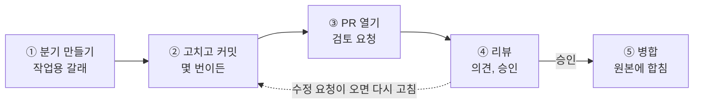
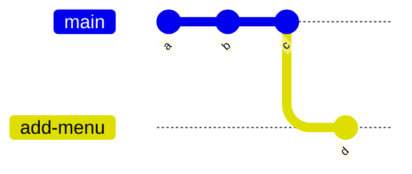
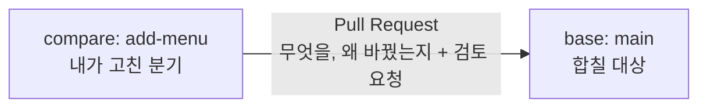
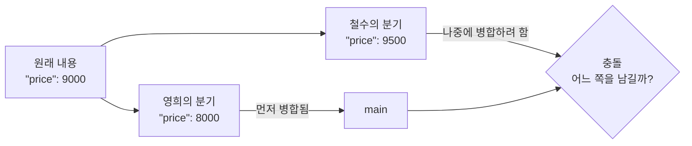

# 3교시. 변경 관리의 흐름

!!! abstract "이번 교시의 목표"
    분기에서 변경하고 PR로 검토받아 반영하며, 충돌을 해결하고 잘못된 변경을 되돌릴 수 있다.

!!! info "오늘의 흐름에서 지금 위치"
    현업 요청 → 이슈 → 우선순위와 인수 조건 → **PR** → **검사와 리뷰** → **병합과 배포** → 이력 확인 → 보호 규칙

| 구간 | 시간 | 내용 |
|---|---|---|
| 개념 설명 | 15분 | 분기, Pull Request, 리뷰, 병합 방식, 충돌, revert, Blame (이 페이지의 [교안](#lecture)) |
| 따라하기 | 20분 | [3-1 짝꿍 초대하기](lab-1.md), [3-2 분기 만들고 PR 열기](lab-2.md), [3-3 짝 리뷰와 병합](lab-3.md), [3-4 충돌 만들고 해결하기](lab-4.md), [3-5 Revert로 되돌리기](lab-5.md) |
| 혼자 해보기 | 10분 | [Blame으로 변경 이력 따라가기](practice.md) |
| 확인 퀴즈와 정리 | 5분 | [확인 퀴즈](practice.md#quiz) |

3교시는 오늘 과정의 핵심입니다. 변경을 어떻게 **안전하게** 반영하는지 배웁니다. 분기, Pull Request, 리뷰, 병합, 그리고 충돌과 되돌리기까지 다룹니다. 원리 설명이 조금 많지만 그림으로 하나씩 봅니다. 실습에서는 옆 사람과 서로 리뷰를 하고, 충돌을 일부러 만들어서 풀어 보고, 병합한 것을 되돌리는 것까지 직접 해 봅니다. 여기까지 하면 협업의 기본기는 다 갖춘 것입니다.

## 교안 {#lecture}

!!! question "이번 교시를 시작하며"
    - **왜 지금 하나요?** 이슈로 해야 할 일을 정했습니다. 이제 그 일을 반영할 때 원본을 바로 고치지 않고, 변경안을 만들어 동료의 검토를 받습니다. 이슈는 해야 할 일, PR은 그 일을 반영하기 위한 변경안입니다.
    - **앞에서 만든 무엇을 쓰나요?** 1~2교시에 쓴 `lunch-practice` 리포지토리의 `main` 분기와 `site/menus.json`, 그리고 짝꿍의 `lunch-practice`입니다. 2교시에 만든 이슈들은 그대로 두고, 이번에는 그 옆에 PR을 만듭니다.
    - **끝나면 무엇을 누구에게 넘기나요?** 병합된 PR 3개(`메뉴 추가: 비빔밥`, `김치찌개 가격 8000원으로 변경`, `김치찌개 가격 10000원으로 변경`)와 Revert PR 1개, 김치찌개 가격 8500이 남은 `main`이 남습니다. 4교시에는 2교시 이슈들을 Projects에 올리고, PR 본문의 `Closes #번호`로 이슈와 PR을 묶는 방법을 배웁니다.

### 이슈는 할 일, PR은 변경안입니다 {#issue-and-pr}

2교시에는 해야 할 일을 이슈로 등록했습니다. `예산으로 메뉴 거르기`, `[스토리] 혼밥 가능 표시`처럼 "이것을 하자"는 합의가 이슈에 담겨 있습니다. 하지만 이슈만으로는 파일이 한 줄도 바뀌지 않습니다. 이슈는 **무엇을 할지**를 적은 할 일 카드일 뿐입니다.

그 일을 실제로 파일에 반영하려면 변경안이 필요합니다. 그것이 이번 교시에 배우는 **PR**(Pull Request)입니다. PR에는 "이렇게 바꾸겠습니다"라는 실제 변경 내용이 들어 있고, 동료가 그 내용을 검토하고 승인해야 원본에 합쳐집니다. 회사 일로 치면 이슈는 업무 요청서, PR은 그 요청을 처리한 결과를 결재에 올린 기안입니다. 이슈 하나를 처리하려고 PR을 하나 열고, PR 본문에 이슈 번호를 적어 두면 "이 변경은 어떤 요청 때문에 했는가"가 이어집니다.

오늘 3교시 실습의 PR은 분기, 리뷰, 충돌을 익히기 위한 연습이라 이슈와 따로 엽니다. 오후 팀 실습에서는 이슈를 먼저 만들고, 그 이슈를 처리하는 PR을 엽니다. PR이 병합될 때 이슈를 자동으로 닫는 `Closes #번호`는 [4교시 교안](../class4/index.md#linking)에서 자세히 다룹니다.

!!! tip "핵심"
    이슈는 해야 할 일, PR은 그 일을 반영하기 위한 변경안입니다.

### 원본을 바로 고치면 생기는 문제 {#direct-edit}

1교시에는 `main`이라는 원본을 바로 고쳤습니다. 혼자 쓸 때는 괜찮습니다. 그런데 여러 사람이 같은 리포지토리를 쓰면 문제가 생깁니다.

| 원본(main)을 바로 고치면 | 사본에서 고치면 |
|---|---|
| 실수가 검토 없이 바로 모두에게 퍼집니다 | 원본은 그대로 안전합니다 |
| 누가 왜 바꿨는지 흐려집니다 | 변경 이유와 검토 기록이 남습니다 |
| 되돌리기도 어렵습니다 | 승인된 것만 원본에 합쳐집니다 |

예를 들어 점심 메뉴 웹페이지의 `menus.json`에서 누군가 쉼표 하나를 지우고 바로 `main`에 저장했다고 해 봅시다. 웹페이지는 곧바로 깨지고, 모두가 깨진 화면을 봅니다. 누가 왜 그 줄을 건드렸는지 물어볼 곳도 없습니다.

그래서 실무에서는 **사본에서 고치고, 다른 사람이 검토한 뒤에 원본에 합칩니다.** 회사에서 기안을 올리고 결재를 받은 뒤에 공식 문서에 반영하는 것과 같습니다. 이 사본이 **분기**(branch)이고, 검토를 요청하는 문서가 **PR**(Pull Request)입니다.

!!! tip "핵심"
    원본은 바로 고치지 않습니다. 사본(분기)에서 고치고, 검토(PR)를 거쳐 합칩니다.

### GitHub flow: 분기에서 고치고 검토받아 합칩니다 {#github-flow}

GitHub에서 변경을 반영하는 표준 흐름을 **GitHub flow**라고 합니다. 다섯 단계입니다.



1. **분기 만들기**: `main`에서 작업용 갈래를 하나 만듭니다. 이름은 하는 일을 알 수 있게 짓습니다. 예: `add-menu`
2. **고치고 커밋**: 그 분기에서 파일을 고치고 커밋합니다. 몇 번이든 괜찮습니다. `main`에는 아무 영향이 없습니다.
3. **PR 열기**: "이 분기의 변경을 main에 반영해 주세요"라고 검토를 요청합니다.
4. **리뷰**: 동료가 바뀐 줄을 보고 의견을 남기거나 승인합니다. 수정 요청이 오면 2단계로 돌아가 같은 분기에 다시 커밋합니다. PR은 새로 열지 않아도 되고, 새 커밋이 자동으로 PR에 붙습니다.
5. **병합**(merge): 승인되면 분기의 변경을 `main`에 합칩니다. 다 쓴 분기는 지웁니다.

오늘 오전 실습과 오후 역할극이 전부 이 흐름입니다.

!!! tip "핵심"
    분기, 커밋, PR, 리뷰, 병합. 이 다섯 단계만 기억하세요.

### 분기는 사본이 아니라 커밋을 가리키는 이름표입니다 {#branch-pointer}

분기라고 하면 파일 전체를 복사한 사본을 떠올리기 쉽습니다. 실제로는 **커밋 하나를 가리키는 이름표**입니다.

아래 그림에서 처음에는 `main` 이름표가 커밋 `c`를 가리키고 있습니다. 여기서 `add-menu` 분기를 만들면 파일은 하나도 복사되지 않고, 같은 커밋 `c`에 이름표만 하나 더 붙습니다. 그 상태에서 `add-menu`에 커밋하면 `add-menu` 이름표만 새 커밋 `d`로 옮겨 가고, `main`은 `c`에 그대로 있습니다.



| 하는 일 | 실제로 일어나는 일 |
|---|---|
| 분기를 만들면 | 파일을 복사하지 않고, 지금 커밋에 이름표만 하나 더 붙입니다 |
| 분기에서 커밋하면 | 그 분기의 이름표만 새 커밋으로 옮겨 갑니다. 다른 분기는 그대로입니다 |
| 분기를 지우면 | 이름표만 떼어 냅니다. 이미 병합된 커밋은 main에 남아 있습니다 |

그래서 분기는 몇 개를 만들어도 가볍고 빠릅니다. 부담 없이 만들고, 다 쓰면 지우면 됩니다. 1교시에 배운 것처럼 커밋은 그 시점 파일 전체의 스냅샷이고, 분기는 그 스냅샷 중 하나를 가리킬 뿐입니다.

!!! tip "핵심"
    분기는 사본이 아니라 이름표입니다. 만들 때도 지울 때도 파일은 복사되거나 사라지지 않습니다.

### Pull Request는 '이 변경을 반영해 주세요'라는 제안서입니다 {#pull-request}

**PR**(Pull Request)은 "내가 고친 이 분기를 원본에 반영해 주세요"라는 **제안서**입니다. PR을 만들 때 화면 위쪽에 두 분기를 고르는 칸이 있습니다.



| 칸 | 뜻 | 오늘 실습의 값 |
|---|---|---|
| **base** | 변경을 받아들일 대상, 합칠 곳 | `main` |
| **compare** | 내가 고친 분기, 합칠 내용 | `add-menu` |

화면에는 `base: main ← compare: add-menu`처럼 화살표로 표시됩니다. 화살표 방향이 "add-menu의 변경을 main으로 가져온다"는 뜻입니다.

PR을 열 때는 **제목**과 **본문**에 무엇을, 왜 바꿨는지 쓰고 **검토자**(Reviewers)를 지정합니다. 그러면 바뀐 줄이 자동으로 비교되어 **Files changed**(바뀐 파일) 탭에 보이고, 검토자는 그 줄 위에 의견을 답니다. 결재 문서에 변경 내용과 사유를 적어 올리는 것과 같은 구조입니다.

우리 Starter 리포지토리에는 PR이 열리거나 바뀔 때마다 `menus.json`을 자동으로 검사하는 **메뉴 데이터 검사**(`check`)가 들어 있습니다. 사람이 리뷰하기 전에 기계가 쉼표, 따옴표 같은 형식 실수를 먼저 잡아 줍니다. 이 자동 검사의 원리는 6교시에 자세히 봅니다.

!!! tip "핵심"
    PR은 compare(내 분기)를 base(main)에 합쳐 달라는 제안서입니다. 무엇을, 왜 바꿨는지 꼭 씁니다.

### 리뷰는 세 가지로 답합니다 {#review-types}

PR을 검토할 때는 **Review changes**(리뷰 제출) 버튼을 눌러 세 가지 중 하나로 답합니다.

| 선택지 | 뜻 | 언제 쓰나요 |
|---|---|---|
| **Comment** | 의견만 남깁니다. 승인도 반려도 아닙니다 | 궁금한 점, 참고 의견 |
| **Request changes** | 고쳐 주세요. 수정해야 병합할 수 있다는 뜻입니다 | 틀린 값, 빠진 내용. 무엇을 고칠지 구체적으로 씁니다 |
| **Approve** | 승인합니다. 병합해도 좋다는 뜻입니다 | 검토가 끝났고 문제가 없을 때 |

**Request changes**를 남길 때는 "다시 봐 주세요"처럼 막연하게 쓰지 말고 "비빔밥 가격이 메뉴판과 다릅니다. 8500원이 맞습니다"처럼 무엇을 어떻게 고칠지 구체적으로 쓰는 것이 예의입니다.

회사에서는 보통 "한 명 이상 Approve해야 병합할 수 있다"는 규칙을 걸어 둡니다. 지금 우리 리포지토리에는 그 규칙이 없어서 승인 없이도 병합 버튼이 눌립니다. 그 규칙은 7교시에 직접 설정합니다. 그리고 **자기 PR은 자기가 Approve할 수 없습니다.** 그래서 짝꿍이 필요합니다.

!!! tip "핵심"
    Comment는 의견, Request changes는 고쳐 주세요, Approve는 승인입니다.

### 변경 제안을 쓰면 버튼 한 번으로 반영됩니다 {#suggestion}

리뷰할 때 "가격 오타 있어요"라고 말로만 쓰면, 작성자가 다시 그 줄을 찾아서 직접 고치고 다시 커밋해야 합니다. 대신 **변경 제안**(suggestion) 기능을 쓰면 리뷰어가 고친 줄을 직접 써서 제안할 수 있습니다. 작성자는 **Apply suggestion**(제안 반영) 버튼 한 번만 누르면 그대로 커밋됩니다.

| 말로만 하면 | 변경 제안을 쓰면 |
|---|---|
| "가격 오타 있어요" | 고친 줄을 그대로 제안 |
| 작성자가 다시 찾아서 직접 고치고 다시 커밋 | 작성자는 **Apply suggestion** 버튼만 클릭 |

댓글 창에서 **Add a suggestion**(변경 제안 추가, ± 모양 아이콘)을 누르면 아래처럼 `suggestion` 블록이 들어가고, 그 안의 내용을 원하는 값으로 고치면 됩니다.

````markdown
```suggestion
  { "name": "비빔밥", "category": "한식", "price": 8500, "distance": 250, "solo": true }
```
````

종이 문서를 검토할 때 빨간 펜으로 직접 고쳐서 돌려주는 것과 같습니다. 3-3 짝 리뷰 실습에서 꼭 한 번 써 봅니다.

!!! tip "핵심"
    고칠 내용이 분명하면 말 대신 변경 제안으로 남깁니다. 작성자의 수고가 버튼 한 번으로 줄어듭니다.

### 병합 방식에 따라 이력 모양이 달라집니다 {#merge-methods}

PR을 병합할 때 **Merge pull request** 버튼 옆 ▼를 누르면 방식을 세 가지 중에 고를 수 있습니다. 결과로 만들어지는 파일 내용은 셋 다 같고, **이력의 모양만** 다릅니다. 아래 그림에서 `main`의 커밋은 a, b이고, 작업 분기 `add-menu`에서 커밋 x, y를 했다고 해 봅시다.

=== "Merge(그대로 합치기)"

    두 갈래를 그대로 합치고 **병합 커밋 M**을 하나 남깁니다. 갈라졌다가 합쳐진 흔적이 이력에 그대로 보입니다. 가장 기본 방식입니다.

    ```mermaid
    gitGraph
        commit id: "a"
        commit id: "b"
        branch add-menu
        checkout add-menu
        commit id: "x"
        commit id: "y"
        checkout main
        merge add-menu id: "M"
    ```

=== "Squash(하나로 뭉쳐 합치기)"

    작업 커밋 x, y를 **하나로 뭉쳐서** 커밋 S 하나만 `main`에 올립니다. 쉼표를 고쳤다가 다시 고친 것 같은 자잘한 커밋이 사라져 이력이 깔끔합니다. 커밋 메시지 끝에 `(#5)`처럼 PR 번호가 붙어서, 나중에 어떤 PR에서 온 변경인지 따라가기 쉽습니다. **오늘 같은 문서, 데이터 작업에 추천합니다.**

    ```mermaid
    gitGraph
        commit id: "a"
        commit id: "b"
        commit id: "S (x+y)"
    ```

=== "Rebase(한 줄로 이어 붙이기)"

    작업 커밋 x, y를 `main` 끝에 **일직선으로 다시 붙입니다.** 갈래 흔적은 없고 커밋은 하나하나 그대로 남습니다. 단, 다시 붙이면서 커밋의 이름(해시)이 새로 바뀝니다. 그래서 x', y'으로 표시합니다.

    ```mermaid
    gitGraph
        commit id: "a"
        commit id: "b"
        commit id: "x'"
        commit id: "y'"
    ```

| 방식 | GitHub 버튼 | 이력 모양 | 커밋 수 |
|---|---|---|---|
| Merge | **Create a merge commit** | 갈래가 합쳐진 흔적 + 병합 커밋 | 작업 커밋 전부 + 1 |
| Squash | **Squash and merge** | 일직선, 커밋 1개 | 1 |
| Rebase | **Rebase and merge** | 일직선, 커밋 그대로 | 작업 커밋 전부 |

오늘 실습에서는 모두 **Squash and merge**를 씁니다.

!!! tip "핵심"
    결과물은 같고 이력 모양만 다릅니다. PR 하나를 커밋 하나로 남기고 싶으면 Squash and merge.

### 같은 줄을 둘이 다르게 고치면 충돌이 납니다 {#conflict}

**충돌**(conflict)은 같은 파일의 **같은 줄**을 두 분기에서 **다르게** 고쳤을 때 생깁니다.

원래 김치찌개 가격이 9000원이었는데, 영희는 자기 분기에서 8000원으로, 철수는 자기 분기에서 9500원으로 고쳤다고 해 봅시다.



영희의 PR이 먼저 병합되면 `main`의 가격은 8000이 됩니다. 이어서 철수의 PR을 병합하려고 하면, Git은 8000과 9500 중 어느 쪽을 남겨야 할지 스스로 판단할 수 없어서 멈춥니다. 이것이 충돌입니다.

| 상황 | 결과 |
|---|---|
| 서로 **다른 파일**을 고침 | 자동으로 합쳐집니다 |
| 같은 파일의 **다른 줄**을 고침 | 자동으로 합쳐집니다 |
| 같은 파일의 **같은 줄**을 **다르게** 고침 | 충돌. 사람이 골라야 합니다 |

충돌은 오류나 고장이 아닙니다. "이건 사람이 정해 주세요"라는 신호입니다. 그리고 충돌을 해결하기 전까지는 `main`이 바뀌지 않으므로, 원본이 망가질 걱정은 하지 않아도 됩니다.

!!! tip "핵심"
    충돌은 고장이 아니라 사람에게 묻는 것입니다.

### 충돌 표시를 지우고 남길 내용만 고르면 해결됩니다 {#resolve-conflict}

충돌이 나면 GitHub가 PR 화면에 **This branch has conflicts that must be resolved**(이 분기에 해결해야 할 충돌이 있습니다)라고 알려 주고, **Resolve conflicts**(충돌 해결) 버튼을 누르면 파일에 아래처럼 표시를 해 줍니다.

```text
<<<<<<< price-b
  { "name": "김치찌개", "category": "한식", "price": 9500, "distance": 300, "solo": true },
=======
  { "name": "김치찌개", "category": "한식", "price": 8000, "distance": 300, "solo": true },
>>>>>>> main
```

| 표시 | 뜻 |
|---|---|
| `<<<<<<< price-b` | 여기부터 내 분기(PR의 분기)의 내용 |
| `=======` | 경계선. 위는 내 분기, 아래는 main |
| `>>>>>>> main` | 여기까지 main의 내용 |

해결 방법은 간단합니다. **표시 줄 세 개(`<<<<<<<`, `=======`, `>>>>>>>`)를 모두 지우고, 남길 내용만 남깁니다.** 둘 중 하나를 고를 수도 있고, 둘을 섞어 새로 쓸 수도 있습니다. 예를 들어 8000을 남기기로 했다면 결과는 이렇게 됩니다.

```json
  { "name": "김치찌개", "category": "한식", "price": 8000, "distance": 300, "solo": true },
```

다만 **무엇을 남길지는 관련된 사람과 상의해서 정해야 합니다.** 충돌은 기술 문제가 아니라 의사결정 문제인 경우가 많습니다. 표시 줄을 지운 뒤 **Mark as resolved**(해결됨으로 표시) → **Commit merge**(병합 커밋)를 누르면 해결한 결과가 내 분기에 커밋되고, PR을 다시 병합할 수 있게 됩니다.

웹 화면에서 바로 해결할 수 있으므로 실습 3-4에서 직접 해 봅니다.

!!! tip "핵심"
    `<<<<<<<`, `=======`, `>>>>>>>` 세 줄을 지우고, 상의해서 정한 내용만 남깁니다.

### 되돌릴 때는 기록을 남기는 revert를 씁니다 {#revert-reset}

이미 병합한 변경이 잘못되었을 때 되돌리는 방법은 두 가지입니다.

=== "reset: 기록 자체를 지움"

    커밋 c를 기록에서 **아예 지웁니다.** 이름표를 b로 되돌려 c가 없던 일이 됩니다.

    ```mermaid
    flowchart LR
        a((a)) --> b((b)) -.-> c((c 사라짐))
        style c stroke-dasharray: 5 5
    ```

=== "revert: 되돌리는 커밋을 새로 추가"

    c를 지우지 않고, **c를 취소하는 새 커밋 c'을 추가**합니다. c에서 추가한 줄은 c'에서 지우고, c에서 지운 줄은 c'에서 다시 넣습니다.

    ```mermaid
    gitGraph
        commit id: "a"
        commit id: "b"
        commit id: "c"
        commit id: "c' (c를 취소)"
    ```

| | reset | revert |
|---|---|---|
| 하는 일 | 커밋을 기록에서 지움 | 취소하는 커밋을 새로 추가 |
| 기록 | 실수한 사실이 사라짐 | 실수한 사실과 되돌린 사실이 모두 남음 |
| 혼자 쓰는 리포지토리 | 써도 됨 | 써도 됨 |
| 함께 쓰는 리포지토리 | **위험** | **이것을 씀** |
| GitHub 웹에서 | 버튼 없음(명령줄에서만) | 병합된 PR 화면의 **Revert** 버튼 |

**함께 쓰는 리포지토리에서 reset이 위험한 이유**는 이렇습니다. 동료가 이미 c가 들어간 이력을 내려받아 그 위에 작업을 이어 가고 있을 수 있습니다. 그런데 원본에서 c를 지워 버리면, 동료가 가진 이력과 원본의 이력이 서로 어긋납니다. 동료가 다시 올리면 지웠던 c가 되살아나기도 하고, 누가 무엇을 지웠는지 추적할 수도 없게 됩니다. 감사나 변경 이력 증빙이 필요한 업무라면 "기록이 지워졌다"는 것 자체가 문제가 됩니다.

반면 revert는 기존 기록을 건드리지 않고 새 커밋을 하나 더할 뿐이라 누구의 이력과도 어긋나지 않습니다. 회계 장부에서 틀린 항목을 지우개로 지우지 않고 **취소 분개**를 새로 적는 것과 같습니다. GitHub에서는 병합된 PR 화면의 **Revert** 버튼 하나로 할 수 있고, 되돌리는 것도 PR로 만들어져 검토를 거칩니다.

!!! tip "핵심"
    지우지 말고, 취소하는 기록을 남긴다.

### Blame은 줄마다 누가 언제 바꿨는지 보여 줍니다 {#blame}

**Blame**은 파일의 줄마다 **마지막으로** 누가, 언제, 어떤 커밋으로 바꿨는지 보여 주는 화면입니다. 파일을 연 뒤 위쪽의 **Blame** 버튼을 누르면 됩니다. 이름이 "탓하기"라서 무섭게 들리지만, 실제로는 "이 줄은 누구에게 물어보면 되지?"를 찾는 기능입니다.

| 마지막으로 바꾼 사람 | 언제 | 커밋 메시지 | 줄 내용 |
|---|---|---|---|
| kim | 3일 전 | 메뉴 3개 추가 | `{ "name": "김치찌개",` |
| **lee** | **1시간 전** | **가격 기준을 만 원으로 변경** | **`"price": 9000,`** |
| kim | 3일 전 | 메뉴 3개 추가 | `"category": "한식" }` |

가운데 가격 줄을 보면 lee가 한 시간 전에 "가격 기준을 만 원으로 변경"이라는 커밋으로 바꿨습니다. 그 커밋 메시지를 누르면 커밋 화면으로 가고, 거기서 그 변경을 가져온 **PR과 리뷰 대화**까지 따라가서 **왜** 바꿨는지 알 수 있습니다.

| 기능 | 보여 주는 것 | 질문 |
|---|---|---|
| **History**(1교시) | 파일 전체의 커밋 목록, 시간 순서 | 이 파일은 그동안 어떻게 바뀌었지? |
| **Blame** | 줄마다 마지막으로 바꾼 커밋 | 이 줄은 누가 언제 왜 바꿨지? |

Squash and merge로 병합하면 커밋 메시지 끝에 `(#5)`처럼 PR 번호가 붙어서 Blame에서 PR까지 바로 따라갈 수 있습니다. 6교시 이력 감사에서 이 기능을 씁니다.

!!! tip "핵심"
    Blame은 탓하는 기능이 아니라 "이 줄은 누구에게 물어보면 되지?"를 찾는 기능입니다. Blame → 커밋 → PR 순서로 따라가면 이유까지 보입니다.

## 이번 교시 실습

| 실습 | 확인하는 것 |
|---|---|
| [3-1 짝꿍 초대하기](lab-1.md) | 짝꿍을 내 리포지토리의 Collaborator로 초대해 서로 리뷰할 수 있는 상태를 만든다 |
| [3-2 분기 만들고 PR 열기](lab-2.md) | `add-menu` 분기에서 메뉴를 추가하고 PR을 열어, 자동 검사의 통과와 실패를 직접 본다 |
| [3-3 짝 리뷰와 병합](lab-3.md) | 변경 제안, Request changes, Approve를 주고받고 Squash and merge로 합친다 |
| [3-4 충돌 만들고 해결하기](lab-4.md) | `price-a`, `price-b`로 같은 줄을 다르게 고쳐 충돌을 만들고 웹에서 해결한다 |
| [3-5 Revert로 되돌리기](lab-5.md) | 병합한 PR을 Revert로 되돌리고, 기록이 지워지지 않고 남는 것을 확인한다 |
| [혼자 해보기와 확인 퀴즈](practice.md) | Blame에서 커밋, PR까지 따라가고, PR 검색 필터를 써 본다 |
