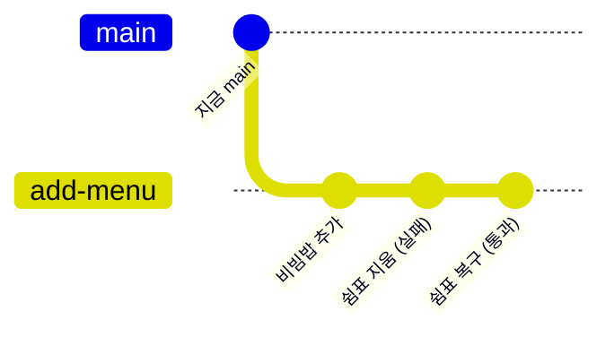

# 실습 3-2. 분기 만들고 PR 열기

!!! abstract "이번 실습에서 할 것"
    - `main`에서 `add-menu` 분기를 만들고, 그 분기에서 메뉴 1개를 추가합니다.
    - PR을 열어 짝꿍에게 리뷰를 요청하고, 자동 검사(`check`)가 통과하는 것을 봅니다.
    - 일부러 쉼표를 지워 자동 검사가 실패하는 모습과 고치면 다시 통과하는 모습을 봅니다.

**소요 시간** 약 5분  **실습 장소** 개인 연습 리포지토리 `lunch-practice`  **관련 교안** [3교시 교안](index.md#github-flow)

## 준비

- 내 리포지토리 `https://github.com/<내 아이디>/lunch-practice`의 **Code** 탭을 열어 둡니다.
- 3-1에서 짝꿍을 Collaborator로 초대했고 짝꿍이 수락한 상태여야 합니다.

### 시작 상태 확인하기

1교시 혼자 해보기에서 메뉴를 하나 추가했는지, 실습 1-2에서 김치찌개 가격을 바꿨는지에 따라 지금 파일 상태가 사람마다 다릅니다. 3교시 내내 이 값을 기준으로 확인하므로 먼저 메모합니다.

1. **Code** 탭에서 분기 드롭다운이 `main`인지 확인합니다.
2. `site` 폴더 → `menus.json`을 클릭합니다.
3. 메뉴 줄(`{ "name": ...`로 시작하는 줄)이 몇 개인지 셉니다. 1교시에 메뉴를 추가하지 않았다면 **6개**, 추가했다면 **7개**입니다.
4. 첫 줄 김치찌개의 `price` 값을 봅니다. 실습 1-2에서 바꿨다면 `9500`, 안 바꿨다면 `9000`입니다.
5. 맨 아래 마지막 메뉴의 이름을 봅니다. 메뉴가 6개면 `순두부찌개`, 7개면 1교시에 내가 추가한 메뉴입니다.
6. 아래처럼 메모해 둡니다. 이 페이지와 3-3, 3-4, 3-5, 혼자 해보기에서 **N**은 여기 적은 메뉴 개수입니다.

    ```text
    처음 메뉴 개수 N: 
    김치찌개 가격: 
    마지막 메뉴 이름: 
    ```

확인: 메모에 N(6 또는 7), 김치찌개 가격(9000 또는 9500), 마지막 메뉴 이름이 적혀 있습니다. 어느 값이든 **그대로 두고 진행합니다.**

!!! warning "1교시에 비빔밥을 이미 추가했다면"
    이번 실습에서 추가할 메뉴는 `비빔밥`입니다. 1교시 혼자 해보기에서 비빔밥을 이미 넣었다면 이름이 겹쳐 자동 검사가 실패합니다. 이때는 이 페이지와 3-3, 3-5의 `비빔밥`을 모두 `김밥`처럼 다른 이름으로 바꿔 읽고 진행합니다.

??? info "Starter의 원래 menus.json 보기"
    ```json
    --8<-- "starter/site/menus.json"
    ```

이번 실습의 흐름은 다음과 같습니다.



## STEP 1. add-menu 분기 만들기

`main`은 그대로 두고, 작업용 이름표 `add-menu`를 만듭니다.

1. **Code** 탭 파일 목록 왼쪽 위의 **분기 드롭다운**(분기 모양 아이콘과 `main`이라고 적힌 버튼)을 클릭합니다.
2. 드롭다운 위쪽 **Find or create a branch...**(분기 찾기 또는 만들기) 칸에 아래 이름을 입력합니다.

    ```text
    add-menu
    ```

3. 목록 아래에 나타난 **Create branch: add-menu from main**(main에서 add-menu 분기 만들기)을 클릭합니다.

확인: 분기 드롭다운 버튼의 글자가 `main`에서 **`add-menu`**로 바뀌었습니다. 파일 목록은 main과 똑같습니다. 분기는 이름표일 뿐이라 파일이 복사되지 않았기 때문입니다.

!!! warning "지금 분기가 add-menu인지 꼭 확인하세요"
    분기 드롭다운에 `main`이라고 보이는 상태에서 파일을 고치면 원본에 바로 커밋됩니다. 다음 STEP으로 가기 전에 드롭다운 글자가 `add-menu`인지 확인합니다.

## STEP 2. menus.json에 메뉴 1개 추가하기

1. 분기가 `add-menu`인 상태에서 `site` 폴더 → `menus.json`을 클릭합니다.
2. 오른쪽 위 **연필 아이콘**(Edit this file)을 클릭합니다.
3. 맨 아래 **마지막 메뉴 줄 끝**으로 커서를 옮깁니다. 메모한 마지막 메뉴(보통 `순두부찌개`, 1교시에 메뉴를 추가했다면 그 메뉴)의 줄입니다. 줄 끝의 `}` 바로 뒤에 **쉼표(`,`)**를 하나 입력합니다. 순두부찌개라면 다음과 같습니다.

    ```text
    고치기 전: ... "price": 8500, "distance": 350, "solo": true }
    고친 후:   ... "price": 8500, "distance": 350, "solo": true },
    ```

4. **Enter**를 눌러 새 줄을 만들고, 아래 한 줄을 붙여 넣습니다. 이 줄 뒤에는 쉼표를 **붙이지 않습니다**. 마지막 메뉴이기 때문입니다.

    ```json
      { "name": "비빔밥", "category": "한식", "price": 9000, "distance": 250, "solo": true }
    ```

    메뉴 이름, 가격, 거리는 원하는 대로 바꿔도 됩니다. 단, 이미 있는 메뉴 이름과 겹치면 자동 검사에서 실패합니다.

고친 뒤 파일 전체는 아래와 같아야 합니다. 아래는 메뉴 6개로 시작한 경우의 예입니다. 김치찌개 `price`는 **내 파일에 원래 있던 값**(9000 또는 9500) 그대로이고, 1교시에 메뉴를 추가했다면 순두부찌개와 비빔밥 사이에 내 메뉴 줄(끝에 쉼표 있음)이 하나 더 있습니다.

```json
[
  { "name": "김치찌개", "category": "한식", "price": 9000, "distance": 300, "solo": true },
  { "name": "짜장면", "category": "중식", "price": 8000, "distance": 450, "solo": false },
  { "name": "돈카츠", "category": "일식", "price": 11000, "distance": 600, "solo": false },
  { "name": "샐러드볼", "category": "양식", "price": 10500, "distance": 200, "solo": true },
  { "name": "쌀국수", "category": "아시안", "price": 9500, "distance": 700, "solo": false },
  { "name": "순두부찌개", "category": "한식", "price": 8500, "distance": 350, "solo": true },
  { "name": "비빔밥", "category": "한식", "price": 9000, "distance": 250, "solo": true }
]
```

!!! tip "파일 전체를 붙여 넣지 마세요"
    위 내용은 비교용입니다. 전체를 붙여 넣으면 1교시에 바꾼 김치찌개 가격과 1교시에 추가한 메뉴가 원래대로 돌아가 PR에 엉뚱한 변경이 섞입니다. 쉼표 하나와 새 줄 하나만 추가합니다.

확인: 원래 마지막 메뉴 줄 끝에 쉼표가 있고, 비빔밥 줄 끝에는 쉼표가 없고, 마지막 줄이 `]`입니다. 메뉴 줄은 처음 메모한 N개보다 1개 많은 **N+1개**입니다.

## STEP 3. add-menu 분기에 커밋하기

1. 오른쪽 위 초록색 **Commit changes...**(변경 저장) 버튼을 클릭합니다.
2. **Commit message** 칸에 아래 내용을 입력합니다.

    ```text
    메뉴 추가: 비빔밥
    ```

3. 아래 선택지에서 **Commit directly to the `add-menu` branch**(add-menu 분기에 바로 커밋)가 선택되어 있는지 확인합니다. 여기에 `main`이 적혀 있다면 STEP 1로 돌아가 분기를 다시 확인합니다.
4. **Commit changes** 버튼을 클릭합니다.

확인: 파일 화면 위쪽 분기 드롭다운이 여전히 `add-menu`이고, 비빔밥 줄이 보입니다.

## STEP 4. PR 만들기

1. 위쪽 **Code** 탭을 클릭합니다.
2. 파일 목록 위에 노란 배너 **add-menu had recent pushes**(add-menu에 최근 변경이 있습니다)가 보입니다. 오른쪽의 초록색 **Compare & pull request**(비교하고 PR 만들기) 버튼을 클릭합니다.
    - 배너가 안 보이면 **Pull requests** 탭 → **New pull request** → **compare** 드롭다운에서 `add-menu` 선택 → **Create pull request**를 클릭합니다.
3. 화면 위쪽 분기 선택 칸이 **`base: main` ← `compare: add-menu`**인지 확인합니다. 그 옆에 초록색 **Able to merge**(병합 가능)가 보이면 정상입니다.
4. **Add a title**(제목) 칸에 아래 내용을 입력합니다.

    ```text
    메뉴 추가: 비빔밥
    ```

5. **Add a description**(본문) 칸에 아래 내용을 입력합니다. 무엇을, 왜 바꿨는지 씁니다.

    ```markdown
    ## 무엇을
    - site/menus.json에 메뉴 1개(비빔밥, 한식, 9000원, 250m, 혼밥 가능)를 추가했습니다.

    ## 왜
    - 회사 근처 한식 메뉴가 김치찌개, 순두부찌개 두 개뿐이라 선택지를 늘리기 위해서입니다.

    ## 확인 부탁
    - 가격과 거리가 실제와 맞는지 봐 주세요.
    ```

6. 오른쪽 **Reviewers**(검토자) 옆 톱니바퀴 아이콘을 클릭하고, 짝꿍 아이디를 검색해 선택합니다. 빈 곳을 클릭해 창을 닫습니다.
7. 초록색 **Create pull request**(PR 만들기) 버튼을 클릭합니다.

확인: 제목 옆에 초록색 **Open** 표시와 `#번호`가 붙은 PR 화면이 열렸습니다. 오른쪽 Reviewers에 짝꿍 아이디가 보입니다.

!!! note "PR 번호가 1번이 아니에요"
    PR과 이슈는 같은 번호를 나눠 씁니다. 2교시 실습과 혼자 해보기까지 마쳤다면 이슈가 8개쯤 있어서, 이 PR은 `#9`처럼 그다음 번호를 받습니다. 번호는 사람마다 다르고, 정상입니다.

## STEP 5. 자동 검사 결과 보기

PR을 만들면 Starter에 들어 있는 **메뉴 데이터 검사**가 자동으로 실행됩니다.

1. PR 화면(**Conversation** 탭) 아래쪽, **Merge pull request** 버튼 위의 검사 상자를 봅니다.
2. 처음에는 노란 점과 함께 **Some checks haven't completed yet**(아직 끝나지 않은 검사가 있습니다)이 보입니다. 20~40초 기다립니다.
3. 초록 체크와 함께 **All checks have passed**(모든 검사 통과)로 바뀌면, 그 아래 **메뉴 데이터 검사 / check (pull_request)** 줄 오른쪽의 **Details**(자세히)를 클릭합니다.
4. 로그에서 `Run node scripts/check-menus.js` 단계를 클릭해 펼칩니다.

확인: 로그에 아래 문장이 보입니다. 숫자는 처음 메모한 N보다 1 큰 **N+1**입니다(6개로 시작했으면 7, 7개로 시작했으면 8). 숫자는 사람마다 다릅니다.

```text
[통과] 메뉴 N+1개를 검사했습니다. 문제가 없습니다.
```

브라우저의 **뒤로 가기**로 PR 화면에 돌아옵니다.

## STEP 6. 일부러 실패시켜 보기

자동 검사가 실제로 실수를 잡는지 확인합니다. 쉼표 실수는 가장 흔한 실패 원인입니다.

1. PR 화면 위쪽 **Files changed**(바뀐 파일) 탭을 클릭합니다.
2. `site/menus.json` 오른쪽의 **…** 메뉴 → **Edit file**(파일 편집)을 클릭합니다. `add-menu` 분기의 파일이 편집 화면으로 열립니다.
3. 비빔밥 **바로 위 줄**(원래 마지막 메뉴, 보통 순두부찌개) 끝의 쉼표(`,`)를 지웁니다.
4. **Commit changes...** → 메시지에 아래 내용 입력 → **Commit directly to the `add-menu` branch** 확인 → **Commit changes**를 클릭합니다.

    ```text
    테스트: 쉼표 지우기
    ```

5. PR의 **Conversation** 탭으로 돌아와 검사 상자를 봅니다.

확인: 잠시 뒤 빨간 X와 함께 **All checks have failed**(모든 검사 실패)가 보입니다. **Details**를 누르면 로그에 아래 문장이 있습니다.

```text
[실패] site/menus.json이 올바른 JSON 형식이 아닙니다.
       쉼표, 따옴표, 괄호가 빠지지 않았는지 확인하세요.
```

!!! note "왜 이렇게 하나요?"
    `main`을 바로 고쳤다면 이 실수가 곧바로 웹페이지를 깨뜨렸을 것입니다. 분기와 PR을 쓰면 실수가 `main`에 들어가기 전에 기계가 먼저 잡아 줍니다. 그래서 빨간 X가 떠도 원본은 안전합니다.

## STEP 7. 다시 고쳐서 통과시키기

1. STEP 6의 2번처럼 **Files changed** → `site/menus.json`의 **…** → **Edit file**을 클릭합니다.
2. 비빔밥 바로 위 줄 끝 `}` 뒤에 쉼표(`,`)를 다시 넣습니다.
3. 아래 메시지로 `add-menu` 분기에 커밋합니다.

    ```text
    쉼표 복구
    ```

4. **Conversation** 탭으로 돌아와 검사가 끝날 때까지 기다립니다.

확인: 검사 상자가 다시 초록 체크 **All checks have passed**로 바뀝니다. Conversation 탭 중간에는 커밋 3개(메뉴 추가, 쉼표 지우기, 쉼표 복구)가 순서대로 쌓여 있고, 각 커밋 옆에 빨간 X 또는 초록 체크가 붙어 있습니다.

## STEP 8. Files changed에서 바뀐 줄 보기

1. **Files changed** 탭을 클릭합니다.
2. `site/menus.json`의 변경 내용을 봅니다.

확인: 아래처럼 보입니다. 커밋은 3개였지만, Files changed는 **main과 지금 add-menu의 최종 차이**만 보여 줍니다.

| 표시 | 줄 | 뜻 |
|---|---|---|
| 빨간색 `-` | 쉼표 없는 원래 마지막 메뉴 줄 (보통 순두부찌개) | 지워진 줄 |
| 초록색 `+` | 쉼표 있는 같은 줄 | 추가된 줄 |
| 초록색 `+` | 비빔밥 줄 | 추가된 줄 |

쉼표 하나만 바꿔도 Git은 줄 단위로 비교하기 때문에 "그 줄을 지우고 새로 썼다"로 보입니다.

## 성공하면

- [x] `add-menu` 분기가 있고, 그 분기의 `menus.json`에 메뉴가 처음 메모한 N개보다 1개 많은 N+1개다
- [x] `main`의 `menus.json`은 여전히 메뉴 N개다 (분기 드롭다운을 `main`으로 바꿔 확인)
- [x] PR이 `base: main` ← `compare: add-menu`로 열려 있고, Reviewers에 짝꿍이 있다
- [x] 자동 검사가 빨간 X(실패)를 거쳐 지금은 초록 체크(통과)다

## 막히면

??? failure "Create branch: add-menu from main이 안 보이고 Create branch: add-menu from add-menu처럼 다른 분기 이름이 보여요"
    드롭다운을 열기 전에 다른 분기를 보고 있었습니다. 드롭다운에서 먼저 `main`을 클릭해 main으로 돌아간 뒤, 다시 드롭다운을 열어 `add-menu`를 입력하세요.

??? failure "실수로 main에 바로 커밋했어요"
    Commit changes 창에서 `main`이 선택된 채 저장한 경우입니다. 당황하지 않아도 됩니다.

    1. `main`의 `menus.json`을 다시 편집해 비빔밥 줄과 그 바로 위 줄 끝의 쉼표를 지우고 `main`에 커밋합니다. 메시지 예: `잘못 올린 비빔밥 되돌림`
    2. 분기 드롭다운에서 `add-menu`가 이미 있다면 그 분기로 바꾸고 STEP 2부터 다시 합니다.

??? failure "노란 배너 Compare & pull request가 안 보여요"
    배너는 몇 분 뒤 사라집니다. **Pull requests** 탭 → **New pull request** → **base**는 `main`, **compare**는 `add-menu`를 고르고 **Create pull request**를 누르면 같은 화면이 나옵니다.

??? failure "Reviewers 검색에 짝꿍이 안 나와요"
    짝꿍이 3-1의 초대를 아직 수락하지 않았습니다. Collaborator만 Reviewers에 지정할 수 있습니다. 짝꿍이 수락한 뒤 PR 화면 오른쪽 **Reviewers**의 톱니바퀴를 눌러 다시 지정하세요.

??? failure "검사 상자가 안 보이거나 계속 노란 점이에요"
    - **Actions** 탭에서 **메뉴 데이터 검사** 워크플로가 실행 중인지 봅니다. 처음 실행은 1분 가까이 걸릴 수 있습니다.
    - Actions 탭 왼쪽 목록에 **메뉴 데이터 검사**가 아예 없다면, 내 리포지토리가 Starter 템플릿으로 만든 것이 아닐 수 있습니다. `.github/workflows/check.yml` 파일이 있는지 확인하고, 없으면 강사에게 알려 주세요.
    - 검사가 실패가 아니라 회색으로 멈춰 있으면 페이지를 새로 고침합니다.

??? failure "쉼표를 다시 넣었는데도 빨간 X예요"
    Details 로그의 `[실패]` 문장을 읽어 봅니다.

    - `올바른 JSON 형식이 아닙니다`: 비빔밥 줄 **뒤**에 쉼표가 붙어 있거나, 따옴표나 `}`가 빠졌습니다. 위 STEP 2의 전체 내용과 한 줄씩 비교하세요.
    - `메뉴 이름이 겹칩니다`: 이미 있는 메뉴 이름을 썼습니다. 1교시에 비빔밥을 추가했다면 이 경우입니다. 다른 이름(예: `김밥`)으로 바꾸세요.
    - `price(가격)는 0보다 큰 숫자여야 합니다`: 가격을 `"9000"`처럼 따옴표로 감쌌습니다. 숫자는 따옴표 없이 씁니다.

## 다음 실습으로 넘어가기 전에

- 이 PR은 **병합하지 않고 열어 둡니다.** 3-3에서 짝꿍이 리뷰한 뒤 병합합니다.
- `add-menu` 분기를 지우지 마세요.
- 짝꿍도 같은 단계까지 왔는지 확인합니다. 3-3에서는 내가 짝꿍의 PR을 리뷰합니다.
