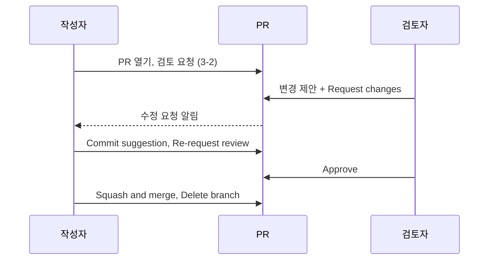
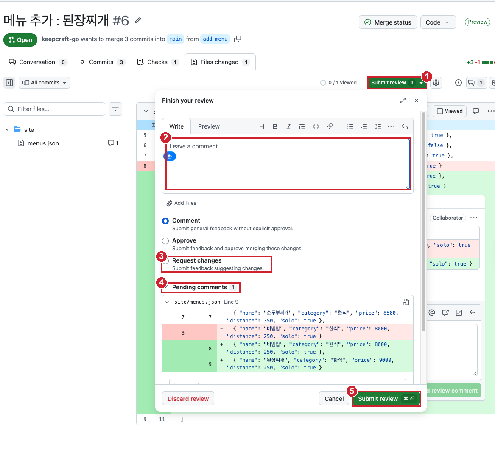

# 실습 3-3. 짝 리뷰와 병합

!!! abstract "이번 실습에서 할 것"
    - 짝꿍의 PR에 줄 단위 댓글과 **변경 제안**을 남기고 **Request changes**로 수정을 요청합니다.
    - 내 PR에 온 변경 제안을 **Commit suggestion**으로 반영하고 다시 리뷰를 요청합니다.
    - 짝꿍의 **Approve**를 받은 뒤 **Squash and merge**로 `main`에 합치고 분기를 지웁니다.

**소요 시간** 약 5분  **실습 장소** 짝꿍의 리포지토리(검토자 역할)와 내 리포지토리 `lunch-practice`(작성자 역할)  **관련 교안** [3교시 교안](index.md#review-types)

## 준비

- 3-2에서 만든 내 PR `메뉴 추가: 비빔밥`이 열려 있고, 자동 검사가 초록 체크입니다.
- 짝꿍도 자기 리포지토리에 같은 PR을 열어 두었고, Reviewers에 나를 지정했습니다.
- 이번 실습은 **한 사람이 두 역할**을 오갑니다. 짝꿍 PR에서는 **검토자**, 내 PR에서는 **작성자**입니다. 아래 순서표를 보며 진행합니다.

| 순서 | 검토자로서 (짝꿍 PR에서) | 작성자로서 (내 PR에서) |
|---|---|---|
| 1 | STEP 1~3: 댓글, 변경 제안, Request changes | |
| 2 | | STEP 4~5: 제안 반영, 다시 리뷰 요청 |
| 3 | STEP 6: Approve | |
| 4 | | STEP 7~8: Squash and merge, 결과 확인 |



## STEP 1. 짝꿍의 PR 열기 (검토자)

1. 아래 둘 중 하나로 짝꿍의 PR에 들어갑니다.
    - 주소창에 `https://github.com/<짝꿍 아이디>/lunch-practice/pulls`를 입력하고, 목록에서 짝꿍의 PR 제목을 클릭합니다.
    - 또는 github.com 오른쪽 위 **알림** 아이콘 → `requested your review`(리뷰를 요청함) 알림을 클릭합니다.
2. PR 위쪽에서 **Files changed**(바뀐 파일) 탭을 클릭합니다.

확인: 주소에 **짝꿍 아이디**가 들어 있고, 화면 위쪽에 **`<짝꿍 아이디> wants to merge ... into main from add-menu`**가 보입니다. 바뀐 줄이 초록색(`+`)과 빨간색(`-`)으로 보입니다.

!!! warning "내 PR과 헷갈리지 마세요"
    주소창의 아이디가 내 아이디라면 내 PR입니다. 자기 PR은 리뷰할 수 없으니 짝꿍 리포지토리로 이동합니다.

## STEP 2. 줄에 댓글과 변경 제안 남기기 (검토자)

짝꿍이 추가한 메뉴 줄 하나를 골라, 값 하나를 고쳐 달라고 **변경 제안**으로 남깁니다.

1. 짝꿍이 추가한 메뉴 줄(초록색 `+` 줄)에 마우스를 올립니다. 줄 번호 옆에 파란색 **+** 버튼이 나타납니다.
2. 파란색 **+** 버튼을 클릭합니다. 그 줄 바로 아래에 **댓글 창**(입력 칸, 위쪽 도구 모음, 아래쪽 버튼이 있는 상자)이 열립니다. 아래 3~6번은 **모두 이 댓글 창 안에서** 합니다.
3. 댓글 창 위쪽 도구 모음에서 **Add a suggestion**(변경 제안 추가, 문서 아이콘에 ± 표시) 아이콘을 클릭합니다. Ctrl+G(맥은 Cmd+G)로도 됩니다.
4. 댓글 창에 `suggestion` 블록이 생기고, 그 안에 짝꿍의 줄 내용이 그대로 들어갑니다. **블록 안의 가격 숫자 하나만** 고칩니다. 짝꿍이 비빔밥을 추가했다면 9000을 8500으로 고쳐 아래처럼 됩니다.

    ````markdown
    ```suggestion
      { "name": "비빔밥", "category": "한식", "price": 8500, "distance": 250, "solo": true }
    ```
    ````

    !!! warning "위 예시를 그대로 붙여 넣지 않습니다"
        블록 안에는 짝꿍의 줄이 **이미** 들어 있습니다. 그 줄에서 숫자만 고칩니다. 짝꿍이 `된장찌개`처럼 다른 메뉴를 추가했는데 위 예시를 붙여 넣으면, 가격뿐 아니라 메뉴 이름까지 `비빔밥`으로 바뀌는 엉뚱한 제안이 됩니다.

5. 같은 댓글 창 입력 칸에서, 블록의 마지막 줄(` ``` `) **다음 줄**에 커서를 두고 이유를 한 줄 씁니다.

    ```text
    메뉴판을 보니 가격이 8500원입니다. 가격을 맞춰 주세요.
    ```

    입력 칸 전체는 이런 모양이 됩니다. (메뉴 줄은 짝꿍의 줄)

    ````markdown
    ```suggestion
      { "name": "(짝꿍 메뉴)", "category": "한식", "price": 8500, "distance": 250, "solo": true }
    ```
    메뉴판을 보니 가격이 8500원입니다. 가격을 맞춰 주세요.
    ````

6. 댓글 창 **오른쪽 아래** 버튼을 봅니다. 화면에 따라 두 가지 중 하나입니다.

    | 보이는 버튼 | 누를 버튼 |
    |---|---|
    | **Add single comment**와 **Start a review** 두 개 | **Start a review**(리뷰 시작). **Add single comment**(댓글 하나만 달기)는 누르지 않습니다 |
    | **Cancel**과 초록 **Add review comment** (화면 오른쪽 위에 `Preview` 표시가 있는 새 화면) | **Add review comment**(리뷰 댓글 추가). Start a review와 같은 역할입니다 |

    누르면 댓글 창이 닫히고 그 자리에 방금 쓴 댓글이 남습니다. **이 버튼은 댓글을 쓰는 동안에만 보입니다.** 이미 눌러서 댓글에 Pending이 붙었다면 다시 찾을 필요가 없습니다.

확인: 댓글에 **Pending**(대기 중) 표시가 붙고, `Suggested change` 아래에 빨간 줄(짝꿍의 원래 값)과 초록 줄(내가 제안한 값)이 보입니다. 두 줄은 **가격 숫자만** 달라야 합니다. 화면 오른쪽 위 초록 버튼에 대기 중인 댓글 수가 `1`로 붙습니다. 아직 짝꿍에게는 보이지 않습니다.

!!! tip "Pending이 된 뒤에 잘못된 걸 알았다면"
    이유를 빠뜨렸거나 메뉴 이름까지 바뀌었다면, 그 댓글 오른쪽 위 **...** → **Edit**(편집)로 고친 뒤 **Update comment**를 누릅니다. 아직 제출 전이라 짝꿍에게는 고친 결과만 보입니다.

!!! danger "suggestion 블록 안의 쉼표를 지우지 마세요"
    블록 안의 내용은 **줄 전체를 그대로 바꿔 넣는** 내용입니다. 짝꿍 줄이 마지막 메뉴라 쉼표가 없으면 쉼표 없이, 쉼표가 있으면 쉼표까지 그대로 둡니다. 쉼표를 건드리면 반영 후 자동 검사가 실패합니다.

## STEP 3. Request changes로 리뷰 제출하기 (검토자)

STEP 2의 댓글은 아직 대기 중입니다. 리뷰 전체를 한 번에 제출합니다.

1. Files changed 화면 오른쪽 위 초록색 버튼(아래 그림 ①)을 클릭합니다. 화면에 따라 **Submit review**(옆에 대기 중인 댓글 수 `1`), **Review changes**, **Finish your review** 중 하나로 보입니다.
2. **Finish your review**(리뷰 마치기) 창이 열립니다. 아래 그림의 번호 순서대로 합니다.

    

    | 번호 | 할 일 |
    |---|---|
    | ① | 이 버튼을 눌러 창을 엽니다 |
    | ② | **Leave a comment** 칸에 리뷰 전체 의견을 씁니다 (아래 코드 블록) |
    | ③ | 세 가지 중 **Request changes**(수정 요청)를 고릅니다. 기본값은 **Comment**로 골라져 있으니 꼭 바꿉니다 |
    | ④ | **Pending comments**에서 STEP 2의 제안이 함께 제출되는지 확인합니다. 제안 내용이 이상하면 **Cancel**로 창을 닫고 STEP 2 팁대로 고친 뒤 다시 엽니다 |
    | ⑤ | 창 아래 **Submit review**(리뷰 제출)를 클릭합니다. **Discard review**(리뷰 버리기)는 대기 중인 댓글까지 모두 지우니 누르지 않습니다 |

    ②에 쓸 의견:

    ```text
    전체적으로 좋습니다. 가격 한 군데만 메뉴판과 다르니 제안한 대로 고쳐 주세요.
    ```

확인: 짝꿍 PR의 **Conversation** 탭에 내 리뷰가 **requested changes**(수정을 요청함)로 표시되고, 아래 병합 상자에 빨간 표시와 **Changes requested**가 보입니다.

!!! note "왜 Request changes인가요?"
    Comment는 의견만, Approve는 승인입니다. 고칠 것이 분명히 있으므로 Request changes가 맞습니다. 지금 리포지토리에는 "승인이 있어야 병합" 규칙이 없어서 버튼 자체는 눌리지만, 실무에서는 이 상태면 병합할 수 없습니다. 그 규칙은 7교시에 직접 설정합니다.

## STEP 4. 받은 변경 제안 반영하기 (작성자)

이제 역할을 바꿔 **내 PR**로 갑니다. 짝꿍이 STEP 3까지 하면 내 PR에도 변경 제안이 와 있습니다.

1. 내 리포지토리 **Pull requests** 탭 → `메뉴 추가: 비빔밥` PR을 클릭합니다.
2. **Conversation** 탭에서 짝꿍의 리뷰와 suggestion 댓글을 찾습니다.
3. 제안 아래 **Commit suggestion**(제안 반영) 버튼을 클릭합니다.
4. 커밋 메시지는 기본값(`Update site/menus.json`)이나 아래 내용으로 씁니다.

    ```text
    리뷰 반영: 비빔밥 가격 8500원
    ```

5. **Commit changes** 버튼을 클릭합니다.

확인: suggestion 댓글에 **Outdated**(이미 바뀜) 표시가 붙고, Conversation 탭 아래에 새 커밋이 추가되었습니다. 자동 검사가 다시 돌아 초록 체크가 됩니다.

!!! tip "필요하면 답글도 남기세요"
    댓글 아래 **Reply...** 칸에 `반영했습니다. 확인 부탁드립니다.`처럼 남기면 검토자가 알기 쉽습니다. 반영이 끝난 대화는 **Resolve conversation**(대화 종료)으로 접어 둘 수 있습니다.

## STEP 5. 다시 리뷰 요청하기 (작성자)

고쳤다는 사실을 검토자에게 알립니다.

1. 내 PR 오른쪽 **Reviewers** 영역에서 짝꿍 아이디 옆 **Re-request review**(다시 리뷰 요청, 동그란 화살표) 아이콘을 클릭합니다.

확인: 짝꿍 아이디 옆 표시가 빨간 아이콘에서 노란 점(리뷰 대기)으로 바뀝니다. 짝꿍에게 알림이 갑니다.

## STEP 6. Approve하기 (검토자)

다시 **짝꿍 PR**로 갑니다. 짝꿍이 제안을 반영했는지 확인하고 승인합니다.

1. 짝꿍 PR의 **Files changed** 탭에서 내가 제안한 값으로 바뀌었는지 확인합니다.
2. 오른쪽 위 **Review changes** 버튼을 클릭합니다.
3. 의견 칸에 아래 내용을 입력합니다.

    ```text
    반영 확인했습니다. 병합해도 좋습니다.
    ```

4. **Approve**(승인)를 선택하고 **Submit review**를 클릭합니다.

확인: 짝꿍 PR의 Conversation 탭에 **approved these changes**(이 변경을 승인함)가 초록색으로 보이고, 병합 상자에 **Changes approved**가 보입니다.

## STEP 7. Squash and merge로 병합하기 (작성자)

내 PR이 짝꿍의 Approve를 받았으면 병합합니다.

1. 내 PR의 **Conversation** 탭 아래 병합 상자에서 **Changes approved**와 **All checks have passed**를 확인합니다.
2. 초록색 **Merge pull request**(PR 병합) 버튼 오른쪽의 **▼**를 클릭합니다.
3. **Squash and merge**(하나로 뭉쳐 병합)를 선택합니다. 버튼 글자가 **Squash and merge**로 바뀝니다.
4. **Squash and merge** 버튼을 클릭합니다.
5. 커밋 제목이 `메뉴 추가: 비빔밥 (#번호)`인지 확인하고, 아래 설명 칸은 그대로 둡니다.
6. **Confirm squash and merge**(병합 확인)를 클릭합니다.
7. **Pull request successfully merged and closed** 안내 오른쪽의 **Delete branch**(분기 삭제) 버튼을 클릭합니다.

확인: PR 제목 옆 표시가 보라색 **Merged**(병합됨)로 바뀌고, `add-menu` 분기가 삭제되었다는 안내가 보입니다.

!!! note "왜 Squash and merge인가요?"
    `add-menu`에는 메뉴 추가, 쉼표 지우기, 쉼표 복구, 리뷰 반영까지 커밋이 4개 있습니다. Squash and merge는 이것을 커밋 1개로 뭉쳐 `main`에 올립니다. `main`의 이력에는 `메뉴 추가: 비빔밥 (#번호)` 한 줄만 남아 깔끔하고, PR 번호로 리뷰 대화까지 따라갈 수 있습니다. 분기를 지워도 병합된 내용은 `main`에 남아 있습니다.

## STEP 8. 결과 확인하기 (작성자)

1. **Code** 탭으로 가서 분기 드롭다운이 `main`인지 확인합니다.
2. `site` 폴더 → `menus.json`을 엽니다.
3. 1~2분 뒤 내 웹페이지 `https://<내 아이디>.github.io/lunch-practice/`를 새로 고침합니다.

확인:

- `main`의 `menus.json`에 메뉴가 3-2 준비에서 메모한 N개보다 1개 많은 **N+1개**이고, 비빔밥 가격이 리뷰에서 고친 값입니다.
- 웹페이지에 비빔밥 카드가 새로 보입니다. **main에 병합되면** 웹페이지 배포가 자동으로 실행되기 때문입니다.
- **Code** 탭 위쪽의 커밋 수를 누르면 맨 위에 `메뉴 추가: 비빔밥 (#번호)` 커밋 1개가 보입니다.

## 성공하면

- [x] 짝꿍 PR에 변경 제안과 **Request changes** 리뷰를 남겼고, 이어서 **Approve**했다
- [x] 내 PR에 온 변경 제안을 **Commit suggestion**으로 반영했다
- [x] 내 PR이 보라색 **Merged** 상태이고, `add-menu` 분기는 지워졌다
- [x] `main`의 `menus.json`에 메뉴가 N+1개(처음 메모한 N개보다 1개 많음)이고, 웹페이지에도 새 메뉴가 보인다

## 막히면

??? failure "Review changes에서 Approve와 Request changes가 회색이라 선택이 안 돼요"
    **자기 PR**을 보고 있습니다. GitHub에서는 자기 PR을 자기가 승인하거나 수정 요청할 수 없고 Comment만 됩니다. 주소창의 아이디를 확인하고 짝꿍 리포지토리의 PR로 이동하세요.

??? failure "줄 번호 옆에 + 버튼이 안 나와요"
    - **Conversation** 탭이 아니라 **Files changed** 탭에서 해야 합니다.
    - 마우스를 줄 번호 바로 오른쪽에 천천히 올려 보세요. 휴대폰이나 좁은 창에서는 잘 안 보이니 창을 넓힙니다.

??? failure "Add a suggestion 아이콘이 안 보여요"
    댓글 창 도구 모음의 아이콘이 창 너비 때문에 숨었을 수 있습니다. 창을 넓히거나, 댓글 칸에 직접 아래처럼 입력해도 같습니다. 가운데 줄은 짝꿍의 줄을 복사해 값 하나만 고칩니다.

    ````markdown
    ```suggestion
      { "name": "비빔밥", "category": "한식", "price": 8500, "distance": 250, "solo": true }
    ```
    ````

??? failure "Commit suggestion 버튼이 안 보이거나 눌리지 않아요"
    - 검토자가 리뷰를 아직 **Submit** 하지 않았으면 작성자에게 보이지 않습니다. 짝꿍에게 STEP 3을 마쳤는지 물어보세요.
    - 이미 반영했거나 그 줄이 다른 커밋으로 바뀌었으면 **Outdated**가 되어 버튼이 사라집니다. 이때는 Files changed에서 직접 고치면 됩니다.

??? failure "제안을 반영했더니 자동 검사가 빨간 X예요"
    검토자가 suggestion 블록에서 쉼표를 지우거나 더했을 가능성이 큽니다. **Files changed** → `menus.json`의 **…** → **Edit file**로 쉼표를 바로잡고 커밋하세요. 마지막 메뉴 뒤에는 쉼표가 없어야 합니다.

??? failure "짝꿍이 아직 리뷰를 못 했어요"
    기다리는 동안 내가 짝꿍 PR을 먼저 리뷰합니다(STEP 1~3). 그래도 오래 걸리면 다음 실습 3-4를 먼저 진행하고, 리뷰가 오면 돌아와 STEP 4부터 이어서 합니다. 3-5는 이 실습의 PR을 쓰므로 3-3을 마친 뒤에 합니다.

??? failure "웹페이지에 새 메뉴가 안 보여요"
    **Actions** 탭에서 **웹페이지 배포**가 초록 체크인지 봅니다. 노란 점이면 끝날 때까지 기다리고, 초록 체크인데도 안 보이면 브라우저 캐시 때문이니 Ctrl+Shift+R(맥은 Cmd+Shift+R)로 새로 고침합니다.

## 다음 실습으로 넘어가기 전에

- 병합한 PR `메뉴 추가: 비빔밥`은 3-5에서 **Revert**로 되돌릴 때 다시 씁니다. PR 번호를 기억해 두세요.
- 3-4부터는 짝꿍 없이 내 리포지토리에서 혼자 합니다.
