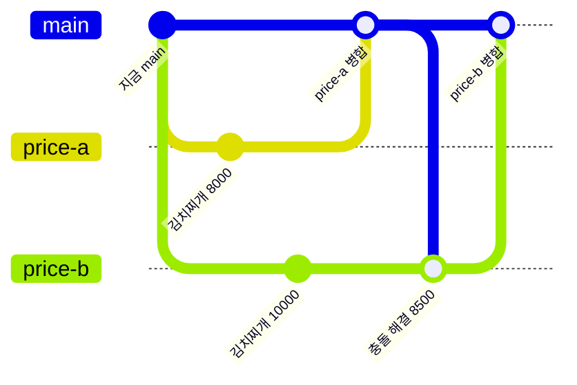

# 실습 3-4. 충돌 만들고 해결하기

!!! abstract "이번 실습에서 할 것"
    - `main`에서 `price-a`, `price-b` 두 분기를 만들고, 두 분기에서 김치찌개 가격 **같은 줄**을 서로 다르게 고칩니다.
    - `price-a`를 먼저 병합한 뒤 `price-b` PR에서 충돌이 나는 것을 확인합니다.
    - 웹 편집기에서 충돌 표시를 지우고 합의한 값만 남겨 해결하고 병합합니다.

**소요 시간** 약 5분  **실습 장소** 개인 연습 리포지토리 `lunch-practice` (혼자)  **관련 교안** [3교시 교안](index.md#conflict)

## 준비

- 3-3까지 마쳐서 `main`의 `menus.json`에 메뉴가 N+1개(3-2 준비에서 메모한 N개보다 1개 많음)입니다. (3-3이 아직이어도 이 실습은 할 수 있습니다. 메뉴 개수는 이 실습과 상관없습니다.)
- 내 리포지토리 **Code** 탭을 열고, 분기 드롭다운이 **`main`**인지 확인합니다.
- 이번 실습은 짝꿍 없이 **혼자 두 사람 역할**을 합니다. `price-a`는 영희, `price-b`는 철수라고 생각합니다.
- 지금 김치찌개 `price`는 3-2 준비에서 메모한 값(9000 또는 9500)입니다. 어느 쪽이든 상관없습니다. 두 분기 모두 이 값을 8000, 10000으로 바꾸므로, 원래 값이 무엇이든 같은 줄이 서로 다르게 바뀌어 충돌이 납니다.

이번 실습에서 만들 상황은 다음과 같습니다.



## STEP 1. price-a 분기에서 8000으로 고치기

1. **Code** 탭에서 분기 드롭다운이 `main`인지 확인하고 클릭합니다.
2. **Find or create a branch...** 칸에 아래 이름을 입력하고 **Create branch: price-a from main**을 클릭합니다.

    ```text
    price-a
    ```

3. 분기 드롭다운이 `price-a`인지 확인하고, `site` → `menus.json` → **연필 아이콘**을 클릭합니다.
4. 첫 메뉴 김치찌개 줄의 `price` 값을 **8000**으로 고칩니다. 이 줄만 고칩니다.

    ```json
      { "name": "김치찌개", "category": "한식", "price": 8000, "distance": 300, "solo": true },
    ```

5. **Commit changes...** → 메시지에 아래 내용 입력 → **Commit directly to the `price-a` branch** 확인 → **Commit changes**를 클릭합니다.

    ```text
    김치찌개 가격 8000원으로 변경
    ```

확인: `price-a` 분기의 `menus.json`에서 김치찌개 가격이 8000입니다.

## STEP 2. main으로 돌아가 price-b 분기 만들기

!!! danger "반드시 main으로 돌아간 뒤에 만드세요"
    분기는 **지금 보고 있는 분기**를 출발점으로 만들어집니다. `price-a`를 보는 상태에서 `price-b`를 만들면 `price-a`의 8000이 이미 들어간 채로 출발해서 충돌이 나지 않습니다. 드롭다운 아래에 **from main**이라고 보이는지 꼭 확인합니다.

1. **Code** 탭을 클릭합니다.
2. 분기 드롭다운(지금은 `price-a`)을 클릭하고 목록에서 **`main`**을 클릭합니다.
3. 드롭다운 글자가 `main`으로 바뀌었는지 확인합니다.
4. 다시 분기 드롭다운을 클릭하고 아래 이름을 입력합니다.

    ```text
    price-b
    ```

5. **Create branch: price-b from main**을 클릭합니다. `from price-a`라고 보이면 멈추고 2번부터 다시 합니다.

확인: 분기 드롭다운이 `price-b`이고, 이 분기의 `menus.json`을 열면 김치찌개 가격이 메모한 원래 값(9000 또는 9500)입니다. 8000이 아닙니다.

## STEP 3. price-b 분기에서 10000으로 고치기

1. 분기가 `price-b`인 상태에서 `site` → `menus.json` → **연필 아이콘**을 클릭합니다.
2. 김치찌개 줄의 `price` 값을 **10000**으로 고칩니다.

    ```json
      { "name": "김치찌개", "category": "한식", "price": 10000, "distance": 300, "solo": true },
    ```

3. 아래 메시지로 **`price-b` 분기에** 커밋합니다.

    ```text
    김치찌개 가격 10000원으로 변경
    ```

확인: `price-b` 분기의 김치찌개 가격이 10000입니다. 이제 같은 줄이 `price-a`에서는 8000, `price-b`에서는 10000입니다.

## STEP 4. price-a PR을 만들고 먼저 병합하기

1. **Pull requests** 탭 → 초록색 **New pull request**를 클릭합니다.
2. **base**는 `main`, **compare**는 `price-a`를 고릅니다.
3. **Able to merge**가 보이는지 확인하고 **Create pull request**를 클릭합니다.
4. 제목은 그대로(`김치찌개 가격 8000원으로 변경`) 두고 다시 **Create pull request**를 클릭합니다.
5. 자동 검사가 초록 체크가 될 때까지 기다립니다.
6. **Merge pull request** 옆 **▼** → **Squash and merge** → **Squash and merge** → **Confirm squash and merge**를 클릭합니다.
7. **Delete branch**를 클릭합니다.

확인: `price-a` PR이 보라색 **Merged**이고, `main`의 김치찌개 가격이 8000입니다.

## STEP 5. price-b PR을 만들고 충돌 확인하기

1. **Pull requests** 탭 → **New pull request**를 클릭합니다.
2. **base**는 `main`, **compare**는 `price-b`를 고릅니다.
3. 이번에는 빨간 글씨로 **Can't automatically merge.**(자동으로 병합할 수 없습니다)가 보입니다. 그래도 PR은 만들 수 있습니다. **Create pull request**를 클릭합니다.
4. 제목은 그대로(`김치찌개 가격 10000원으로 변경`) 두고 **Create pull request**를 클릭합니다.

확인: PR 화면 아래 병합 상자에 아래 문장과 회색 **Resolve conflicts**(충돌 해결) 버튼이 보이고, **Merge pull request** 버튼은 눌리지 않습니다.

```text
This branch has conflicts that must be resolved
Conflicting files
site/menus.json
```

!!! note "왜 충돌이 났나요?"
    `price-a`와 `price-b`는 같은 `main`에서 출발해 **같은 줄**을 각각 8000과 10000으로 고쳤습니다. `price-a`가 먼저 병합되어 `main`이 8000이 되었으니, `price-b`를 합치려면 8000과 10000 중 하나를 골라야 합니다. Git은 이것을 스스로 정할 수 없어서 사람에게 묻습니다. 충돌이 해결되기 전까지 `main`은 바뀌지 않으니 안심해도 됩니다.

## STEP 6. 웹 편집기에서 충돌 해결하기

영희와 철수가 상의해서 **8500원으로 합의**했다고 해 봅시다.

1. **Resolve conflicts** 버튼을 클릭합니다. 충돌 편집기가 열립니다.
2. 김치찌개 줄 근처에 아래와 같은 표시가 보입니다. 위쪽은 내 분기(`price-b`), 아래쪽은 `main`의 내용입니다.

    ```text
    [
    <<<<<<< price-b
      { "name": "김치찌개", "category": "한식", "price": 10000, "distance": 300, "solo": true },
    =======
      { "name": "김치찌개", "category": "한식", "price": 8000, "distance": 300, "solo": true },
    >>>>>>> main
      { "name": "짜장면", "category": "중식", "price": 8000, "distance": 450, "solo": false },
    ```

3. 아래 세 줄을 **줄째로** 지웁니다.
    - `<<<<<<< price-b`
    - `=======`
    - `>>>>>>> main`
4. 남은 김치찌개 줄 두 개 중 **하나를 지웁니다.** 이제 김치찌개 줄은 하나만 남아야 합니다.
5. 남은 줄의 가격을 합의한 **8500**으로 고칩니다.

해결한 뒤 파일 앞부분은 아래와 같아야 합니다.

```json
[
  { "name": "김치찌개", "category": "한식", "price": 8500, "distance": 300, "solo": true },
  { "name": "짜장면", "category": "중식", "price": 8000, "distance": 450, "solo": false },
```

6. 편집기 오른쪽 위 **Mark as resolved**(해결됨으로 표시) 버튼을 클릭합니다.
7. 버튼이 초록색 **Commit merge**(병합 커밋)로 바뀌면 클릭합니다.

확인: PR 화면으로 돌아오고, 병합 상자에 **This branch has no conflicts with the base branch**(base 분기와 충돌이 없습니다)가 보입니다. Conversation 탭에 `Merge branch 'main' into price-b` 커밋이 새로 생겼습니다.

!!! warning "Mark as resolved가 눌리지 않으면"
    파일 어딘가에 `<<<<<<<`, `=======`, `>>>>>>>` 중 하나가 남아 있습니다. 편집기에서 찾아 지웁니다. 김치찌개 줄이 두 개 남아 있으면 자동 검사에서 `메뉴 이름이 겹칩니다: 김치찌개`로 실패하니 하나만 남깁니다.

## STEP 7. 검사 통과 후 병합하기

1. 자동 검사가 다시 돌아 초록 체크 **All checks have passed**가 될 때까지 기다립니다.
2. **Merge pull request** 옆 **▼** → **Squash and merge**를 고릅니다.
3. **Squash and merge**를 클릭하고, 커밋 제목을 아래처럼 바꿉니다. `(#번호)`는 화면에 있는 그대로 둡니다.

    ```text
    김치찌개 가격 8500원으로 합의 (#번호)
    ```

4. **Confirm squash and merge** → **Delete branch**를 클릭합니다.

확인: `price-b` PR이 보라색 **Merged**이고, `main`의 `menus.json`에서 김치찌개 가격이 **8500**입니다. 1~2분 뒤 웹페이지의 김치찌개 카드도 8,500원이 됩니다.

!!! note "웹 편집기로 풀 수 없는 충돌도 있습니다"
    GitHub 웹 편집기는 **글자로 된 파일의 줄 충돌**만 풀 수 있습니다. 한 분기에서는 파일을 지우고 다른 분기에서는 고친 경우, 파일 이름을 서로 다르게 바꾼 경우, 그림 같은 바이너리 파일이 충돌한 경우에는 **Resolve conflicts** 버튼이 회색으로 비활성화되고 "too complex to resolve in the web editor"(웹 편집기에서 풀기에 너무 복잡함) 같은 안내가 나옵니다. 이때는 명령줄(터미널)에서 Git으로 풀어야 합니다. 명령줄은 7교시에 처음 써 봅니다. 실무에서는 개발자에게 도움을 요청하세요.

## 성공하면

- [x] `price-a` PR과 `price-b` PR이 모두 보라색 **Merged**다
- [x] `price-b` PR에서 **This branch has conflicts that must be resolved**를 보고, **Resolve conflicts**로 직접 해결했다
- [x] `main`의 김치찌개 가격이 8500이고, 메뉴 개수는 그대로다 (3-3을 마쳤다면 N+1개)
- [x] `price-a`, `price-b` 분기는 지워졌다

## 막히면

??? failure "price-b PR에 충돌이 안 나고 Able to merge가 보여요"
    `price-b`를 `main`이 아니라 `price-a`에서 만들었을 가능성이 큽니다. 이 경우 `price-b`에는 8000에서 10000으로 바꾼 기록만 있어 충돌이 나지 않습니다.

    1. 이 PR은 **Close pull request**로 닫고, **Code** 탭 → 분기 드롭다운 → **View all branches**에서 `price-b` 오른쪽 휴지통 아이콘으로 분기를 지웁니다.
    2. 분기 드롭다운에서 `main`으로 돌아간 뒤 STEP 1부터 다시 합니다. `price-a`는 이미 지워졌으니 같은 이름으로 다시 만들 수 있습니다. 이번에는 `price-a`에서 **7000**, `price-b`에서 **10000**으로 고칩니다. 두 분기 모두 **from main**으로 만드는 것만 지키면 됩니다.

??? failure "price-a PR도 충돌이 나요"
    `price-a`를 만들기 전이나 후에 `main`의 김치찌개 줄이 다른 PR로 바뀌었습니다. 이 실습 STEP 6과 같은 방법으로 먼저 풀어 병합하면 됩니다.

??? failure "충돌 편집기에서 무엇을 지워야 할지 모르겠어요"
    한 번에 하나씩 지웁니다. 화살표 7개(`<<<<<<<`), 등호 7개(`=======`), 화살표 7개(`>>>>>>>`)로 시작하는 줄 3개를 먼저 지우고, 남은 김치찌개 두 줄 중 하나를 지웁니다. 망쳤다고 생각되면 편집기를 닫고(브라우저 뒤로 가기) 다시 **Resolve conflicts**를 누르면 처음 상태로 돌아갑니다.

??? failure "해결하고 나서 자동 검사가 빨간 X예요"
    Details 로그를 봅니다.

    - `올바른 JSON 형식이 아닙니다`: 김치찌개 줄 끝의 쉼표를 같이 지웠습니다. 김치찌개 줄 끝에는 쉼표가 있어야 합니다.
    - `메뉴 이름이 겹칩니다: 김치찌개`: 김치찌개 줄이 두 개 남아 있습니다.

    **Files changed** → `menus.json`의 **…** → **Edit file**로 `price-b` 분기에서 고쳐 커밋하면 검사가 다시 돕니다.

## 다음 실습으로 넘어가기 전에

- 김치찌개 가격 8500은 **혼자 해보기**에서 Blame으로 추적할 대상입니다. 다시 고치지 마세요.
- 다음 실습 3-5에서는 3-3에서 병합한 `메뉴 추가: 비빔밥` PR을 되돌립니다.
