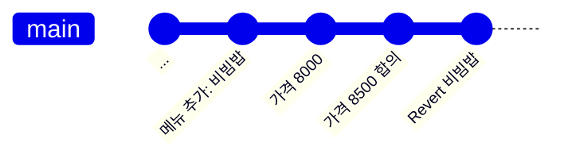

# 실습 3-5. Revert로 되돌리기

!!! abstract "이번 실습에서 할 것"
    - 3-3에서 병합한 `메뉴 추가: 비빔밥` PR을 **Revert** 버튼으로 되돌립니다.
    - 되돌리는 것도 PR로 만들어져 검사를 거친 뒤 병합되는 것을 봅니다.
    - 원래 커밋과 되돌린 커밋이 **둘 다** 기록에 남는 것을 확인합니다.

**소요 시간** 약 3분  **실습 장소** 개인 연습 리포지토리 `lunch-practice` (혼자)  **관련 교안** [3교시 교안](index.md#revert-reset)

## 준비

- 3-3에서 `메뉴 추가: 비빔밥` PR을 병합해 `main`의 메뉴가 N+1개(3-2 준비에서 메모한 N개보다 1개 많음)입니다.
- 3-4에서 김치찌개 가격을 8500으로 병합했습니다.
- 상황 설정: 박지은 과장이 "비빔밥 집이 이번 달에 문을 닫았어요. 목록에서 빼 주세요"라고 연락해 왔습니다. 추가했던 변경을 통째로 되돌립니다.



## STEP 1. 되돌릴 PR 찾기

1. 내 리포지토리 **Pull requests** 탭을 클릭합니다.
2. 목록 위쪽의 **Closed**(닫힘) 탭을 클릭합니다. 병합된 PR은 닫힌 PR 목록에 있습니다.
3. 보라색 Merged 아이콘이 붙은 **`메뉴 추가: 비빔밥`** PR(3-3에서 짝꿍 리뷰를 받은 PR)을 클릭합니다.

확인: PR 제목 옆에 보라색 **Merged**가 보이고, Conversation 탭에 짝꿍의 리뷰 기록(requested changes, approved)이 그대로 남아 있습니다.

## STEP 2. Revert 버튼으로 되돌리는 PR 만들기

1. **Conversation** 탭 맨 아래로 스크롤합니다.
2. **Pull request successfully merged and closed** 안내 옆(또는 아래)의 **Revert**(되돌리기) 버튼을 클릭합니다.
3. 잠시 뒤 새 PR 작성 화면이 열립니다. 아래 내용을 확인합니다.
    - 분기: **`base: main` ← `compare: revert-<번호>-add-menu`** (GitHub가 되돌리기용 분기를 자동으로 만들었습니다)
    - 제목: **`Revert "메뉴 추가: 비빔밥"`**
    - 본문: `Reverts <내 아이디>/lunch-practice#<번호>`
4. 화면 아래로 스크롤해 바뀐 내용을 봅니다.

확인: 3-3에서 **추가했던** 비빔밥 줄이 이번에는 **빨간색 `-`(삭제)**로 보이고, 그 바로 위 줄(원래 마지막 메뉴, 보통 순두부찌개)은 쉼표가 빠진 모양으로 바뀝니다. 3-3의 변경을 정확히 반대로 하는 내용입니다.

5. 본문 아래에 이유를 한 줄 덧붙입니다.

    ```text
    비빔밥 식당이 폐업해서 메뉴에서 제외합니다. (박지은 과장 요청)
    ```

6. **Create pull request**를 클릭합니다.

확인: `Revert "메뉴 추가: 비빔밥"` PR이 초록색 **Open** 상태로 열렸습니다.

!!! note "왜 되돌리는 것도 PR인가요?"
    되돌리기도 변경입니다. 잘못 되돌리면 또 다른 사고가 나므로, 되돌리는 것도 검토와 자동 검사를 거칩니다. 실무에서는 여기서도 리뷰를 받습니다. 오늘은 혼자 진행합니다.

## STEP 3. 검사 통과 후 병합하기

1. 자동 검사가 초록 체크 **All checks have passed**가 될 때까지 기다립니다. Details를 누르면 `[통과] 메뉴 N개를 검사했습니다.`가 보입니다. 숫자는 3-2 준비에서 메모한 처음 개수 N(6 또는 7)과 같습니다. 숫자는 사람마다 다릅니다.
2. **Merge pull request** 옆 **▼** → **Squash and merge** → **Squash and merge** → **Confirm squash and merge**를 클릭합니다.
3. **Delete branch**를 클릭합니다.

확인: Revert PR이 보라색 **Merged**가 되었습니다.

## STEP 4. 메뉴가 사라졌는지, 기록은 남았는지 확인하기

1. **Code** 탭 → 분기 `main` → `site` → `menus.json`을 엽니다.
2. 파일 위쪽 **History**(이력) 버튼(시계 아이콘)을 클릭합니다.
3. 1~2분 뒤 웹페이지 `https://<내 아이디>.github.io/lunch-practice/`를 새로 고침합니다.

확인:

- `menus.json`에 비빔밥 줄이 **없고** 메뉴가 3교시를 시작할 때 메모한 N개로 돌아왔습니다. 김치찌개 가격은 3-4에서 합의한 **8500 그대로**입니다. Revert는 그 PR의 변경만 정확히 취소합니다.
- History 목록에 아래 커밋이 **모두** 남아 있습니다. 위가 최근입니다.

    | 커밋 | 의미 |
    |---|---|
    | `Revert "메뉴 추가: 비빔밥" (#번호)` | 되돌린 기록 (3-5) |
    | `김치찌개 가격 8500원으로 합의 (#번호)` | 3-4 |
    | `김치찌개 가격 8000원으로 변경 (#번호)` | 3-4 |
    | `메뉴 추가: 비빔밥 (#번호)` | 원래 추가한 기록 (3-3), **지워지지 않음** |

- 웹페이지에서 비빔밥 카드가 사라졌습니다.

!!! note "reset과 무엇이 다른가요?"
    **reset**은 `메뉴 추가: 비빔밥` 커밋을 이력에서 아예 지웁니다. 그러면 "비빔밥을 추가했었다"는 사실도, 짝꿍과 주고받은 리뷰가 어떤 커밋에 대한 것이었는지도 흐려집니다. 짝꿍이 이미 그 이력을 받아 갔다면 서로의 기록이 어긋납니다. **revert**는 기존 기록은 그대로 두고 "취소한다"는 새 커밋을 더합니다. 그래서 위 History처럼 추가한 사실, 되돌린 사실, 되돌린 이유(PR 본문)가 모두 남습니다. GitHub 웹 화면에는 reset 버튼이 없고, 함께 쓰는 리포지토리에서는 revert를 씁니다.

## 성공하면

- [x] `Revert "메뉴 추가: 비빔밥"` PR이 보라색 **Merged**다
- [x] `main`의 `menus.json`에 비빔밥이 없고 메뉴가 처음 메모한 N개이며, 김치찌개는 8500이다
- [x] History에 `메뉴 추가: 비빔밥` 커밋과 `Revert "메뉴 추가: 비빔밥"` 커밋이 **둘 다** 있다
- [x] 웹페이지에서 비빔밥 카드가 사라졌다

## 막히면

??? failure "Revert 버튼이 안 보여요"
    아래를 차례로 확인합니다.

    - **병합된 PR인지**: 제목 옆이 보라색 **Merged**여야 합니다. 빨간색 **Closed**는 병합하지 않고 닫은 PR이라 되돌릴 것이 없습니다.
    - **내 리포지토리인지**: 주소창의 아이디가 내 아이디인지 봅니다. Revert는 쓰기 권한이 있어야 보입니다. 짝꿍 리포지토리에서는 짝꿍이 초대를 취소했다면 버튼이 보이지 않습니다.
    - **맨 아래까지 내렸는지**: Revert 버튼은 Conversation 탭 맨 아래 병합 완료 안내 옆에 있습니다.

    그래도 안 보이면 직접 되돌립니다. `main`에서 분기를 하나 만들고(예: `revert-add-menu`), `menus.json`에서 비빔밥 줄과 그 바로 위 줄 끝의 쉼표를 지워 커밋한 뒤 PR을 열어 병합합니다. 제목은 `Revert "메뉴 추가: 비빔밥"`으로 씁니다. 결과는 Revert 버튼과 같습니다.

??? failure "Revert를 눌렀더니 Sorry, this pull request couldn't be reverted automatically라고 나와요"
    그 PR 이후에 같은 줄이 다른 PR로 또 바뀌어서 자동으로 되돌릴 수 없는 경우입니다. 예를 들어 병합 뒤에 비빔밥 줄을 다시 고쳤다면 이렇게 됩니다. 바로 위 항목의 "직접 되돌립니다" 방법을 씁니다.

??? failure "Revert PR의 자동 검사가 빨간 X예요"
    Details 로그를 봅니다. `올바른 JSON 형식이 아닙니다`라면 되돌린 뒤 마지막 메뉴(보통 순두부찌개, 1교시에 메뉴를 추가했다면 그 메뉴) 끝에 쉼표가 남은 경우입니다. **Files changed** → **…** → **Edit file**에서 마지막 메뉴 뒤 쉼표를 지우고 커밋합니다.

??? failure "3-3을 아직 마치지 못했어요"
    짝꿍 리뷰가 끝나지 않아 `메뉴 추가: 비빔밥` PR이 아직 열려 있다면 이 실습은 3-3을 마친 뒤에 합니다. 시간이 부족하면 3-4에서 병합한 `김치찌개 가격 8500원으로 합의` PR로 연습해도 됩니다. 단, 그러면 김치찌개 가격이 8000으로 돌아가고, 혼자 해보기의 Blame 결과가 달라집니다.

## 다음 실습으로 넘어가기 전에

- 지금까지 만든 PR들(비빔밥, 가격 8000, 가격 8500 합의, Revert)은 **혼자 해보기**에서 검색할 대상입니다. 닫거나 지우지 마세요.
- `main`에는 메뉴 N개(3교시를 시작할 때와 같은 개수), 김치찌개 8500인 상태로 4교시를 시작합니다.
