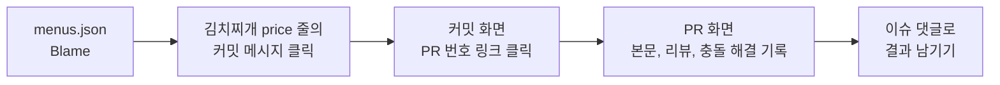

# 3교시 혼자 해보기와 확인 퀴즈

!!! abstract "목표"
    `site/menus.json`의 김치찌개 가격 줄을 **누가, 언제, 왜** 마지막으로 바꿨는지 **Blame → 커밋 → PR** 순서로 따라가 찾고, PR 검색 필터로 지금까지의 PR을 골라 봅니다. 찾은 결과는 이슈 댓글로 남깁니다.

**소요 시간** 약 10분 (퀴즈 5분 별도)  **실습 장소** 개인 연습 리포지토리 `lunch-practice`  **관련 교안** [3교시 교안](index.md#blame)

이 과제는 6교시 **이력 감사**의 예행연습입니다. 6교시에는 팀 리포지토리에서 "누가 언제 왜 바꿨는지"를 증명해야 합니다.



## 할 일

1. `main` 분기의 `site/menus.json`을 **Blame** 화면으로 엽니다.
2. 김치찌개 `price` 줄을 마지막으로 바꾼 **커밋**을 찾습니다. (누가, 언제, 커밋 메시지)
3. 그 커밋 화면에서 연결된 **PR 번호**를 찾아 PR까지 들어갑니다.
4. **Pull requests** 탭 검색창에 아래 세 가지 필터를 하나씩 써 보고, 각각 PR이 몇 개 나오는지 셉니다.
    - `is:pr is:merged`
    - `is:pr is:closed`
    - `is:pr author:@me`
5. 결과를 이슈 하나에 댓글로 남깁니다.

## 완료 조건

- [ ] Blame 화면에서 김치찌개 줄의 커밋 메시지를 확인했다
- [ ] 그 커밋에 연결된 PR 번호를 찾아 PR 화면을 열었다
- [ ] 검색 필터 세 가지의 결과 개수를 셌다
- [ ] 결과를 이슈 댓글로 남겼다

## 힌트

??? tip "힌트 1. Blame은 어디에 있나요?"
    **Code** 탭에서 분기가 `main`인지 확인하고 `site` → `menus.json`을 엽니다. 파일 내용 바로 위 왼쪽에 **Code** | **Blame** 버튼이 나란히 있습니다. **Blame**을 클릭하면 줄마다 왼쪽에 커밋 정보가 붙습니다. 김치찌개는 첫 번째 메뉴라 2번째 줄에 있습니다.

??? tip "힌트 2. 커밋에서 PR로 어떻게 가나요?"
    Blame 화면 왼쪽의 **커밋 메시지**를 클릭하면 커밋 화면으로 갑니다. Squash and merge로 병합한 커밋은 제목 끝에 `(#번호)`가 붙어 있습니다. 이 `#번호`가 바로 PR 번호이고, 클릭하면 PR로 이동합니다. 커밋 화면 위쪽 분기 이름 옆에도 `main (#번호)`처럼 PR 링크가 보입니다.

??? tip "힌트 3. 검색 필터는 어디에 쓰나요?"
    **Pull requests** 탭 목록 위에 `is:pr is:open`이 미리 들어 있는 검색창이 있습니다. 그 내용을 지우고 필터를 입력한 뒤 **Enter**를 누릅니다.

    | 필터 | 뜻 |
    |---|---|
    | `is:pr` | 이슈 말고 PR만 |
    | `is:merged` | 병합된 것만 |
    | `is:closed` | 닫힌 것 전부 (병합된 것 + 병합하지 않고 닫은 것) |
    | `author:@me` | 내가 만든 것만 (`@me`는 로그인한 나) |

    필터는 띄어쓰기로 여러 개를 이어 쓸 수 있고, 이은 조건을 모두 만족하는 것만(AND) 남깁니다. 예: `is:pr is:merged author:@me`

## 결과 남기기

1. **Issues** 탭 → **New issue**를 클릭합니다. 2교시에 만든 "사용자 스토리" 템플릿 선택 화면이 나오면 아래쪽 **Blank issue**(빈 이슈)를 고릅니다.
2. 제목에 아래 내용을 입력하고 **Create**(또는 **Submit new issue**)를 클릭합니다.

    ```text
    3교시 혼자 해보기: 김치찌개 가격 이력 추적
    ```

3. 만든 이슈 아래 댓글 칸에 아래 양식을 붙여 넣고, `< >` 부분을 내가 찾은 값으로 채운 뒤 **Comment**를 클릭합니다.

    ```markdown
    ## 김치찌개 가격 줄 추적 결과
    - 현재 값: <8500>
    - 마지막으로 바꾼 사람: <아이디>
    - 언제: <예: 10분 전>
    - 커밋 메시지: <커밋 메시지>
    - 연결된 PR: #<번호>
    - 바꾼 이유(PR에서 확인): <예: price-a와 price-b 충돌을 8500으로 합의해 해결>

    ## PR 검색 결과
    - is:pr is:merged : <개수>개
    - is:pr is:closed : <개수>개
    - is:pr author:@me : <개수>개
    ```

??? success "정답 예시"
    3-1~3-5를 순서대로 마쳤다면 대체로 아래와 같습니다. PR 번호는 2교시에 만든 이슈 개수에 따라 다릅니다.

    **Blame 결과**

    | 마지막으로 바꾼 사람 | 언제 | 커밋 메시지 | 줄 내용 |
    |---|---|---|---|
    | 내 아이디 | 몇 분 전 | 김치찌개 가격 8500원으로 합의 (#7) | `{ "name": "김치찌개", "category": "한식", "price": 8500, ... },` |

    - 3-5에서 Revert를 했지만 Revert는 비빔밥 줄과 그 바로 위 줄(원래 마지막 메뉴)만 바꿨으므로, 김치찌개 줄을 마지막으로 바꾼 커밋은 여전히 3-4의 **`김치찌개 가격 8500원으로 합의 (#7)`**입니다.
    - 커밋 메시지의 `#7`을 누르면 `price-b` PR(`김치찌개 가격 10000원으로 변경`)이 열립니다. 그 안에 `Merge branch 'main' into price-b` 커밋, 즉 충돌을 해결한 기록이 남아 있습니다.

    **검색 결과**

    | 필터 | 개수 | 나오는 PR |
    |---|---|---|
    | `is:pr is:merged` | 4개 | 메뉴 추가: 비빔밥, 김치찌개 가격 8000원으로 변경, 김치찌개 가격 10000원으로 변경, Revert "메뉴 추가: 비빔밥" |
    | `is:pr is:closed` | 4개 | 위와 같음 (병합하지 않고 닫은 PR이 있으면 그만큼 더 많음) |
    | `is:pr author:@me` | 4개 | 내가 만든 PR 전부. 열린 것과 닫힌 것을 모두 보여 줍니다. 짝꿍이 내 리포지토리에 PR을 만들었다면 그것은 빠집니다 |

    !!! note "author:@me 결과가 이상하면"
        검색창 기본값의 `is:open`을 지우지 않은 채 `author:@me`만 덧붙이면 열린 PR만 찾게 되어 0개가 나옵니다. 검색창 내용을 전부 지우고 `is:pr author:@me`만 넣으면 내가 만든 PR 4개가 모두 나옵니다.

    **이슈 댓글 예시**

    ```markdown
    ## 김치찌개 가격 줄 추적 결과
    - 현재 값: 8500
    - 마지막으로 바꾼 사람: nurikim
    - 언제: 10분 전
    - 커밋 메시지: 김치찌개 가격 8500원으로 합의 (#7)
    - 연결된 PR: #7
    - 바꾼 이유(PR에서 확인): price-a(8000)와 price-b(10000)가 같은 줄을 고쳐 충돌, 8500으로 합의해 해결

    ## PR 검색 결과
    - is:pr is:merged : 4개
    - is:pr is:closed : 4개
    - is:pr author:@me : 4개
    ```

## 확인 퀴즈 {#quiz}

??? question "Q1. 분기를 만들면 파일 전체가 복사된 사본이 생긴다. (O / X)"
    **정답: X**

    분기는 사본이 아니라 **커밋 하나를 가리키는 이름표**입니다. 분기를 만들면 파일은 복사되지 않고, 지금 커밋에 이름표만 하나 더 붙습니다. 그 분기에서 커밋하면 그 분기의 이름표만 새 커밋으로 옮겨 갑니다. 그래서 분기는 몇 개를 만들어도 가볍습니다.

??? question "Q2. 다음 중 충돌이 나는 경우는?"
    1. A 분기는 `README.md`를, B 분기는 `menus.json`을 고쳤다
    2. A 분기와 B 분기가 `menus.json`의 서로 다른 줄을 고쳤다
    3. A 분기와 B 분기가 `menus.json`의 같은 줄을 서로 다른 값으로 고쳤다
    4. A 분기만 `menus.json`을 고쳤다

    **정답: 3**

    충돌은 **같은 파일의 같은 줄을 두 분기에서 다르게** 고쳤을 때만 납니다. 다른 파일이나 다른 줄이면 Git이 알아서 둘 다 합칩니다. 3-4에서 `price-a`와 `price-b`가 김치찌개 가격 줄을 각각 8000과 10000으로 고쳐 충돌이 났습니다.

??? question "Q3. 작업 분기에 커밋이 4개 있는 PR을 Squash and merge로 병합하면 main에는 커밋이 몇 개 추가되나요?"
    **정답: 1개**

    Squash and merge는 작업 커밋 여러 개를 **하나로 뭉쳐** main에 커밋 1개만 올립니다. 커밋 제목 끝에 `(#번호)`로 PR 번호가 붙어 나중에 PR까지 따라가기 쉽습니다. 참고로 Create a merge commit은 작업 커밋 4개 + 병합 커밋 1개, Rebase and merge는 작업 커밋 4개가 그대로 main에 들어갑니다.

??? question "Q4. 여러 사람이 함께 쓰는 리포지토리에서 이미 병합된 잘못된 변경을 되돌릴 때 revert를 쓰는 이유는?"
    **정답: 기록을 지우지 않고, 취소하는 새 커밋을 남기기 때문입니다.**

    reset은 커밋을 이력에서 지웁니다. 다른 사람이 이미 그 이력을 받아 갔다면 서로의 기록이 어긋나 혼란이 생기고, 무엇이 왜 지워졌는지 추적할 수 없습니다. revert는 기존 기록을 그대로 두고 "그 변경을 취소한다"는 커밋을 새로 더하므로, 실수한 사실과 되돌린 사실이 모두 남습니다. GitHub에서는 병합된 PR 화면의 **Revert** 버튼으로 합니다.

??? question "Q5. 내가 연 PR을 내가 직접 Approve할 수 있나요?"
    **정답: 없습니다.**

    GitHub에서는 PR 작성자가 자기 PR을 **Approve**하거나 **Request changes**할 수 없습니다. **Comment**만 남길 수 있습니다. 그래서 3-3에서 짝꿍과 서로의 PR을 리뷰했습니다. 7교시에 "승인 1명 이상이 있어야 병합" 규칙을 걸면, 다른 사람의 승인 없이는 main에 아무것도 합칠 수 없게 됩니다.

## 다음 교시 시작 상태 확인

4교시를 시작하기 전에 아래 상태인지 확인합니다.

| 항목 | 이 상태여야 합니다 |
|---|---|
| 리포지토리 | 내 계정의 `lunch-practice` (Public). 짝꿍이 Collaborator로 들어 있습니다 |
| 현재 분기 | `main`. `add-menu`, `price-a`, `price-b`, Revert용 분기는 병합 후 모두 지웠습니다 |
| 남겨 둘 이슈, PR | 병합된 PR 3개(`메뉴 추가: 비빔밥`, `김치찌개 가격 8000원으로 변경`, `김치찌개 가격 10000원으로 변경`)와 Revert PR `Revert "메뉴 추가: 비빔밥"`. 2교시 이슈 #1~#5와 혼자 해보기 이슈들, 방금 만든 `3교시 혼자 해보기: 김치찌개 가격 이력 추적` 이슈. 닫거나 지우지 않습니다 |
| 데이터 상태 | `site/menus.json` 메뉴는 3교시 시작 개수 N과 같습니다 (비빔밥을 추가했다가 Revert했으므로 6개 또는 7개). 김치찌개 가격은 3-4 충돌 해결값 **8500** |
| 다음에 열 화면 | 내 프로필의 **Projects** 탭 (`https://github.com/<내 아이디>?tab=projects`). 4교시 실습 4-1에서 `내 연습 보드`를 만듭니다 |
