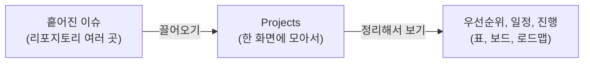
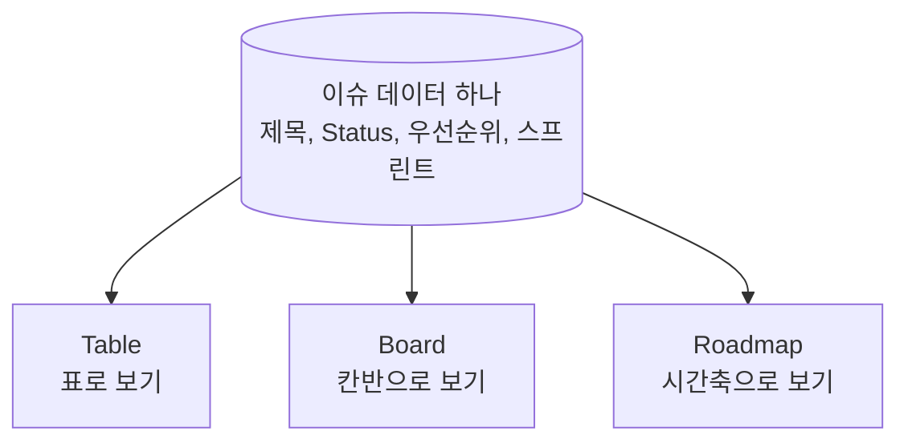
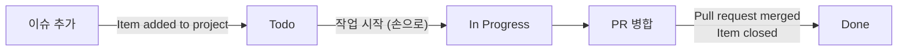
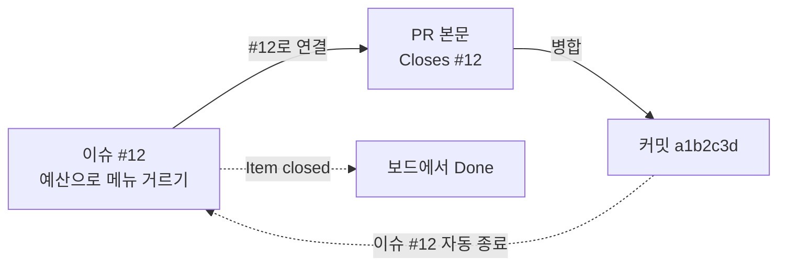
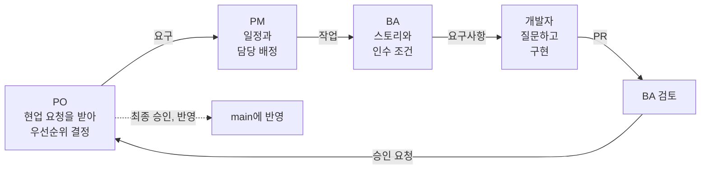

# 4교시. 일정, 우선순위 관리와 팀 구성

!!! abstract "이번 교시의 목표"
    Projects로 우선순위와 일정을 관리하고, 협업 역할과 요구 흐름을 이해할 수 있다.

!!! info "오늘의 흐름에서 지금 위치"
    현업 요청 → 이슈 → **우선순위와 인수 조건** → PR → 검사와 리뷰 → 병합과 배포 → 이력 확인 → 보호 규칙

| 구간 | 시간 | 내용 |
|---|---|---|
| 개념 설명 | 10분 | Projects, 뷰, 필드, 자동화, MoSCoW와 MVP, #번호 연결 ([교안](#lecture)) |
| 따라하기 | 15분 | [실습 4-1 Projects 보드 만들기](lab-1.md), [실습 4-2 필드, 보드 뷰, 자동화](lab-2.md) (개인 `lunch-practice`) |
| 역할 소개 | 5분 | PO, PM, BA, 개발자와 요구 흐름 ([역할](#roles)) |
| 팀 구성 | 20분 | [실습 4-3 팀 구성과 그룹 리포지토리](lab-3.md) |
| 확인 퀴즈 | 남는 시간 | [확인 퀴즈](practice.md) |

오전에는 요청을 이슈로, 변경을 PR로 관리했습니다. 이제 여러 이슈 중 무엇부터 할지 정합니다. 4교시는 개인 실습의 마지막 개념인 **Projects**를 배우고, 바로 오후 팀을 꾸립니다. 앞부분 이론과 따라하기는 지금까지처럼 개인 연습 리포지토리 `lunch-practice`에서 하고, 마지막 20분에 팀 리포지토리 `lunch-picker-team<번호>`를 만듭니다.

## 교안 {#lecture}

!!! question "이번 교시를 시작하며"
    - **왜 지금 하나요?** 변경 한 건을 검토하고 반영하는 방법을 배웠습니다. 오전에는 요청을 이슈로, 변경을 PR로 관리했습니다. 이제 여러 이슈 중 무엇부터, 누가, 언제 할지 Projects에서 정합니다.
    - **앞에서 만든 무엇을 쓰나요?** `lunch-practice`에 2교시에 만든 이슈들(#1~#5와 혼자 해보기 이슈)과 라벨 `우선순위-상`, `우선순위-중`, `우선순위-하`입니다. 이 이슈들을 개인 프로젝트 `내 연습 보드`에 담습니다. 3교시에 만든 PR은 `Closes #번호`로 이슈와 묶는 방법을 볼 때 떠올립니다.
    - **끝나면 무엇을 누구에게 넘기나요?** 개인 보드 `내 연습 보드`는 복습용으로 남고, 팀 리포지토리 `lunch-picker-team<번호>`와 팀 Projects `점심 메뉴 추천 팀<번호>`가 새로 생깁니다. 5교시에 팀이 이 빈 공간에서 현업 요청을 이슈로 옮기고, 우선순위와 인수 조건을 정합니다.

### Projects는 이슈를 모아 보는 기획판입니다 {#projects}

이슈가 서너 개일 때는 Issues 목록만 봐도 충분합니다. 그런데 이슈가 수십 개가 되면 목록만으로는 "무엇부터 해야 하지?", "이번 주에 끝낼 것은 뭐지?", "지금 누가 무엇을 하고 있지?"가 보이지 않습니다.

**Projects**는 흩어진 이슈를 한 화면에 모아서 우선순위, 일정, 진행 상황을 관리하는 기획판입니다. 엑셀로 할 일 표를 만들어 관리하던 일을 GitHub 안에서 한다고 보면 됩니다. 엑셀과 다른 점은 **이슈와 실시간으로 연결되어 있다**는 것입니다. 엑셀은 이슈가 닫혀도 누군가 손으로 "완료"라고 고쳐야 하지만, Projects는 이슈를 닫으면 자동으로 완료로 바뀝니다.

Projects는 리포지토리 안에 있는 것이 아니라 **사람(계정)이나 조직에 속합니다.** 그래서 한 프로젝트에 여러 리포지토리의 이슈를 함께 담을 수 있고, 리포지토리의 **Projects** 탭에서 **Link a project**(프로젝트 연결)로 이어 두면 리포지토리에서도 바로 찾아갈 수 있습니다.

!!! tip "핵심"
    Projects는 이슈를 모아 우선순위, 일정, 진행을 관리하는 기획판입니다. 이슈와 실시간으로 연결되어 있어 따로 손으로 맞출 필요가 없습니다.

### 같은 이슈를 세 가지 모양으로 봅니다 {#views}

Projects는 같은 이슈들을 세 가지 모양(뷰, View)으로 보여 줍니다.

| 뷰 | 모양 | 좋을 때 |
|---|---|---|
| **Table**(표) | 엑셀처럼 줄과 칸 | 한눈에 훑어보기, 필드로 정렬하고 묶기 |
| **Board**(보드) | Todo, In Progress, Done 칸에 카드 | 매일 진행 상황 확인, 카드를 끌어서 상태 바꾸기 (칸반 방식) |
| **Roadmap**(로드맵) | 시간축 위의 막대 | 일정 보고, 스프린트와 마일스톤 확인 |

중요한 점은 **데이터는 하나이고 보는 방식만 바뀐다**는 것입니다. 보드에서 카드를 Done 칸으로 옮기면 표의 Status 칸도 Done으로 바뀌고, 표에서 우선순위를 고치면 보드 카드에도 바로 반영됩니다. 같은 엑셀 파일을 피벗 표로 보느냐, 차트로 보느냐의 차이와 비슷합니다.

!!! tip "핵심"
    표는 정리할 때, 보드는 매일 진행을 볼 때, 로드맵은 보고할 때 씁니다. 셋은 같은 데이터입니다.

### 필드를 직접 만들어 원하는 기준으로 관리합니다 {#fields}

필드(Field)는 표의 칸 하나라고 생각하면 됩니다. 기본으로 Title, Assignees, Status 같은 필드가 있고, 필요한 필드를 직접 만들 수 있습니다.

| 필드 종류 | 화면 이름 | 예시 |
|---|---|---|
| 단일 선택 | **Single select** | 우선순위: 상, 중, 하 중 하나 / MoSCoW: Must, Should, Could, Won't 중 하나 |
| 반복 | **Iteration** | 스프린트: 1주 단위로 스프린트 1, 2, 3이 자동으로 생김 |
| 숫자, 날짜, 글 | **Number**, **Date**, **Text** | 작업 크기, 마감일, 메모 |

**스프린트**(Sprint)는 일을 짧은 기간 단위로 나누어 끝내는 방식입니다. 반복 필드에 시작일과 기간(1주)만 정해 두면 GitHub가 기간을 자동으로 이어서 만들어 줍니다.

필드를 만들면 그 필드로 표를 정렬하거나 묶을(Group by) 수 있습니다. 예를 들어 우선순위로 묶으면 "상" 묶음, "중" 묶음, "하" 묶음이 생겨서 무엇부터 해야 할지 바로 보입니다.

!!! tip "핵심"
    필드는 내가 관리하고 싶은 기준입니다. 필드를 만들면 그 기준으로 정렬하고, 묶고, 보드 칸을 나눌 수 있습니다.

### 상태 변경은 자동화에 맡깁니다 {#automation}

Projects에는 기본 자동화(**Workflows**)가 들어 있습니다. 담당자가 매번 보드 카드를 손으로 옮길 필요가 없습니다.

| 자동화 이름 | 언제 | 무엇을 |
|---|---|---|
| **Item added to project** | 이슈를 프로젝트에 추가하면 | Status를 Todo로 |
| **Item closed** | 이슈가 닫히면 | Status를 Done으로 |
| **Pull request merged** | PR이 병합되면 | Status를 Done으로 |

자동화는 프로젝트 오른쪽 위 **...** 메뉴의 **Workflows**에서 켜고 끕니다. 오후 실습에서 PR을 병합했을 때 카드가 스스로 Done으로 가는 것을 직접 보게 됩니다.

!!! tip "핵심"
    이슈가 닫히면 보드도 알아서 Done이 됩니다. 사람은 일을 하고, 상태 정리는 자동화에 맡깁니다.

### Must만 모은 것이 MVP입니다 {#mvp}

무엇부터 할지 정할 때 **MoSCoW**(모스크바) 기법을 씁니다. 네 단어의 앞 글자를 딴 이름입니다.

| 등급 | 뜻 | 점심 메뉴 서비스 예 |
|---|---|---|
| **Must** | 없으면 출시 못 함 | 메뉴 목록 보기, 예산으로 거르기 |
| **Should** | 중요하지만 미룰 수 있음 | 거리로 거르기 |
| **Could** | 있으면 좋음 | 혼밥 가능 표시 |
| **Won't** | 이번에는 안 함 | 팀원 투표 (로그인이 필요해서) |

이 중 **Must만 모은 것이 MVP**(Minimum Viable Product, 최소 기능 제품)입니다. "가치를 확인할 수 있는 가장 작은 출시"라는 뜻입니다. 킥오프 회의록의 "첫 출시는 최대한 작게 한다"가 바로 MVP 이야기입니다.

주의할 점은 **Must가 많아지면 MVP가 아니라는 것**입니다. 요청자는 대부분 "다 급하다"고 말합니다. 모든 것이 Must면 사실상 우선순위가 없는 것과 같습니다. 오후 실습에서는 Must를 **3개 이하**로 제한합니다. 고르기 어렵다면 "이것이 없으면 정말 출시를 못 하나?"를 물어보세요.

!!! tip "핵심"
    Must만 모은 것이 MVP입니다. Must가 많으면 MVP가 아닙니다.

### #번호 하나로 이슈, PR, 커밋이 연결됩니다 {#linking}

GitHub에서는 `#12`처럼 샵 뒤에 번호를 쓰면 12번 이슈나 PR로 가는 링크가 자동으로 만들어집니다. `@아이디`는 사람에게, 커밋 번호 앞 7자리(예: `a1b2c3d`)는 그 커밋으로 가는 링크가 됩니다.

여기서 한 걸음 더 나가, PR 본문에 `Closes #12`라고 쓰면 12번 이슈와 그 PR이 **연결**됩니다. 그리고 PR이 병합되는 순간 12번 이슈가 **자동으로 닫힙니다.** 앞에서 본 Projects 자동화(Item closed)와 합치면, PR 하나 병합으로 이슈 종료와 보드 이동이 한 번에 일어납니다.

`Closes` 대신 `Fixes`, `Resolves`도 같은 동작을 합니다. 이렇게 이슈, PR, 커밋이 서로 링크로 이어져 있어서 어느 하나에서 시작해도 나머지를 따라갈 수 있습니다. "이 코드는 왜 바뀌었지?"에서 커밋, PR, 리뷰 대화, 원래 요구 이슈까지 거슬러 올라갈 수 있는 것, 이것이 **이력 추적**의 기반입니다. 6교시 이력 감사에서 바로 이 연결을 씁니다.

!!! tip "핵심"
    PR 본문에 `Closes #번호`를 쓰면 병합할 때 이슈가 자동으로 닫히고, 보드도 Done으로 갑니다.

### 오후에는 네 가지 역할로 협업합니다 {#roles}

오후 5~7교시는 3~4명이 한 팀이 되어 역할극을 합니다. 실제 회사의 서비스 기획팀처럼 역할을 나누어 요구를 주고받습니다.

| 역할 | 풀어 쓰면 | 한마디로 | 하는 일 |
|---|---|---|---|
| **PO** | Product Owner, 제품 책임자 | 무엇을, 왜 | 현업 요청을 받아 우선순위와 MVP를 정하고 최종 승인 |
| **PM** | Project Manager, 프로젝트 관리자 | 언제, 누가 | 일정과 담당 배정, 보드와 병합 관리 |
| **BA** | Business Analyst, 업무 분석가 | 구체적으로 | 요구를 사용자 스토리와 인수 조건으로 상세화, 결과가 요구를 충족하는지 검토 |
| **개발자** | Developer | 만든다 | 요구사항을 받아 질문하고 구현해 PR을 올림 |

**3명 팀은 PO가 PM을 겸합니다.** 오늘 과정의 수강생은 대부분 PM, BA, 기획 업무를 하시지만, 일부러 평소와 다른 역할을 맡아 보는 것도 좋습니다. 개발자 역할을 해 보면 "요구사항이 애매하면 무엇이 힘든지"가 바로 보입니다.

!!! tip "핵심"
    PO는 무엇을 왜, PM은 언제 누가, BA는 구체적으로, 개발자는 만든다. 3명 팀은 PO가 PM을 겸합니다.

### 요구는 PO에서 개발자까지 차례로 흐릅니다 {#flow}

역할 사이에 요구가 흐르는 순서입니다. PO가 현업 요청을 받아 우선순위를 정하면, PM이 일정과 담당을 정하고, BA가 사용자 스토리와 인수 조건으로 구체화해서 개발자에게 넘깁니다. 개발자가 구현하면 BA가 요구를 충족했는지 검토하고, PO가 최종 승인해서 반영됩니다.

이 주고받기는 메신저나 구두가 아니라 **이슈 댓글과 PR 리뷰**로 남깁니다. 그래야 나중에 "누가, 언제, 왜 이렇게 정했지?"를 기록으로 증명할 수 있습니다.

!!! tip "핵심"
    요구는 PO, PM, BA, 개발자 순서로 흐르고, 결과는 BA 검토와 PO 승인을 거쳐 반영됩니다. 모든 대화는 이슈와 PR에 남깁니다.

## 이번 교시 실습

- [실습 4-1 Projects 보드 만들기](lab-1.md): 개인 프로젝트 `내 연습 보드`를 만들고 `lunch-practice`의 이슈를 담아 리포지토리와 연결합니다.
- [실습 4-2 필드, 보드 뷰, 자동화](lab-2.md): 우선순위와 스프린트 필드, 보드 뷰, 로드맵, 자동화를 써 보고 세 뷰가 같은 데이터임을 확인합니다.
- [실습 4-3 팀 구성과 그룹 리포지토리](lab-3.md): 팀 리포지토리와 팀 Projects를 만들고 팀원 권한과 웹페이지까지 준비합니다.
- [확인 퀴즈](practice.md): 뷰의 차이, MVP, `Closes #`, 역할 차이를 확인합니다.
