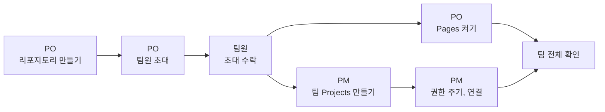

# 실습 4-3. 팀 구성과 그룹 리포지토리

!!! abstract "이번 실습에서 할 것"
    - 팀 번호와 역할을 받고, PO가 팀 리포지토리 `lunch-picker-team<번호>`를 만들어 팀원을 초대합니다.
    - PO가 팀 웹페이지(GitHub Pages)를 켭니다.
    - PM이 팀 Projects `점심 메뉴 추천 팀<번호>`를 만들어 팀원에게 권한을 주고 팀 리포지토리와 연결합니다.

**소요 시간** 약 20분  **실습 장소** 팀 리포지토리 `lunch-picker-team<번호>`  **관련 교안** [4교시 교안](index.md#roles)

## 준비

### 팀과 역할 받기

강사가 팀 번호와 역할을 배정합니다. 14명 기준으로 **4인 2팀, 3인 2팀**입니다.

| 팀 | 인원 | 역할 |
|---|---|---|
| 1, 2팀 | 4명 | PO, PM, BA, 개발자 각 1명 |
| 3, 4팀 | 3명 | PO(PM 겸함), BA, 개발자 각 1명 |

!!! warning "3인 팀"
    3인 팀은 **PO가 PM을 겸합니다.** 이 페이지와 5~6교시 미션에서 "PM"이라고 적힌 일은 모두 PO가 합니다.

받은 내용을 아래처럼 메모해 두세요. 이 페이지 전체에서 `<번호>`는 내 팀 번호, `PO아이디`는 우리 팀 PO의 GitHub 아이디로 바꿔 읽습니다.

```text
우리 팀 번호: 
내 역할: 
PO 아이디: 
PM 아이디: 
BA 아이디: 
개발자 아이디: 
```

### 역할 카드 요약

| 역할 | 한마디로 | 오늘 오후에 주로 하는 일 | 4-3에서 할 일 |
|---|---|---|---|
| **PO** | 무엇을, 왜 | 에픽 등록, MVP 결정, 최종 승인, 릴리스 발행 | 리포지토리 만들기, 팀원 초대, Pages 켜기 |
| **PM** | 언제, 누가 | 라벨, 마일스톤, 보드, 담당 배정, 병합 관리 | 팀 Projects 만들기, 권한 주기, 연결 |
| **BA** | 구체적으로 | 사용자 스토리, 인수 조건, PR 검토 | 초대 수락, 현업 요청 문서 미리 읽기 |
| **개발자** | 만든다 | 질문 댓글, 구현, PR 올리기 | 초대 수락, 메뉴 데이터 미리 보기 |

역할마다 더 자세한 설명은 [5교시 역할 카드](../class5/index.md#role-cards)에 있습니다.

### 전체 순서

| 순서 | 누가 | 무엇을 | 끝나면 누구에게 |
|---|---|---|---|
| 1 | PO | Starter로 `lunch-picker-team<번호>` 만들기 (Public) | 팀원 |
| 2 | PO | **Collaborators**로 팀원 초대 | 팀원 |
| 3 | 팀원 | 초대 수락 | PM |
| 4 | PO | Pages 켜고 웹페이지 배포 실행 | 팀 전체 |
| 5 | PM | 팀 Projects `점심 메뉴 추천 팀<번호>` 만들기 | PM |
| 6 | PM | 프로젝트에 팀원 권한 주기 (Write) | 팀원 |
| 7 | PM | 팀 리포지토리에 프로젝트 연결 | 팀 전체 |
| 8 | 팀 전체 | 확인 체크리스트 | 강사 |



### 가져가는 것과 새로 만드는 것

팀 리포지토리를 만들기 전에, 오전에 만든 것 중 무엇이 팀 공간으로 따라가는지 확인합니다. 결론부터 말하면 **오전 리포지토리의 내용은 하나도 옮겨지지 않습니다.** 팀 리포지토리는 Starter 템플릿에서 새로 만들기 때문입니다.

| 구분 | 무엇 | 어디에 있나요 |
|---|---|---|
| 그대로 남는 것 (옮기지 않음) | 오전 개인 리포지토리 `lunch-practice`의 이슈, 라벨, 마일스톤 `MVP`, 이슈 템플릿 `사용자 스토리`, PR 기록, 개인 보드 `내 연습 보드` | 내 계정에 복습용으로 그대로 남습니다. 7교시 7-1에서 `lunch-practice`를 다시 씁니다 |
| 새로 시작하는 것 | 팀 리포지토리 `lunch-picker-team<번호>` | Starter와 똑같은 상태입니다. 메뉴 6개, 김치찌개 9000원, 이슈 없음, 라벨은 GitHub 기본 라벨뿐입니다 |
| 다시 만드는 것 | 팀 라벨, 마일스톤 `MVP`, 이슈 템플릿 `사용자 스토리`, 팀 Projects | 5교시에 팀 리포지토리에 다시 만듭니다. 팀 Projects는 이번 실습에서 PM이 만듭니다 |
| 가져가는 것 | 손에 익힌 방법 (커밋, 이슈, PR, 리뷰, 보드 만들기), 내 GitHub 아이디, 팀원 아이디 | 내 머리와 위 메모 |

오전 리포지토리에서 바꾼 메뉴(직접 추가한 메뉴, 김치찌개 8500원)는 팀 리포지토리에 없습니다. 팀 웹페이지에 메뉴 카드가 6개, 김치찌개가 9,000원으로 보이는 것이 정상입니다.

!!! note "왜 옮기지 않나요?"
    이슈, 라벨, 마일스톤은 Git이 아니라 GitHub 서비스가 리포지토리마다 따로 관리하는 데이터입니다(2교시 [Git과 GitHub가 관리하는 영역](../class2/index.md#git-vs-github-data)). 템플릿으로 새 리포지토리를 만들면 Starter의 **파일**만 복사되고, 오전에 쌓은 이슈와 라벨은 따라오지 않습니다. 그래서 5교시에 라벨과 이슈 템플릿을 팀 리포지토리에 다시 만듭니다. 오전에 한 번 해 봤으니 이번에는 팀이 함께 빠르게 만들 수 있습니다.

## 역할별 할 일

아래 탭에서 내 역할을 고르세요. 한 번 고르면 5교시 미션 페이지까지 같은 탭이 선택됩니다.

=== "PO"

    **STEP 1. 팀 리포지토리 만들기**

    1. 주소창에 Starter 템플릿 주소를 입력합니다.

        ```text
        https://github.com/skilleat-labs/lunch-picker-starter
        ```

    2. 오른쪽 위 초록색 **Use this template**(이 템플릿 사용) → **Create a new repository**를 클릭합니다.
    3. **Owner**(소유자)가 내 아이디인지 확인합니다.
    4. **Repository name**(리포지토리 이름)에 팀 번호를 넣어 입력합니다. 예: 3팀이면 `lunch-picker-team3`.

        ```text
        lunch-picker-team<번호>
        ```

    5. **Public**(공개)을 고릅니다.
    6. **Create repository**(리포지토리 만들기)를 클릭합니다.

    확인: 주소가 `github.com/PO아이디/lunch-picker-team<번호>`이고, `README.md`, `docs`, `site` 폴더가 보이면 성공입니다.

    **STEP 2. 팀원 초대하기**

    1. 팀 리포지토리에서 **Settings**(설정) 탭을 클릭합니다.
    2. 왼쪽 메뉴에서 **Collaborators**(협업자)를 클릭합니다. 비밀번호나 인증 확인 창이 뜨면 본인이 직접 확인합니다.
    3. **Add people**(사람 추가)을 클릭합니다.
    4. 팀원 아이디를 입력하고 목록에서 고른 뒤 **Add 아이디 to this repository**를 클릭합니다.
    5. 팀원 수만큼 반복합니다. (4인 팀은 3명, 3인 팀은 2명)
    6. 팀원에게 "초대 보냈습니다"라고 말로 알립니다.

    확인: **Collaborators** 목록에 팀원이 모두 `Pending invite`(초대 대기) 또는 이름으로 보이면 성공입니다.

    **STEP 3. 웹페이지(Pages) 켜기**

    템플릿으로 만든 리포지토리는 Pages 설정이 따라오지 않습니다. 그래서 리포지토리를 만들자마자 돈 첫 "웹페이지 배포"는 실패(빨간 X)하는 것이 정상입니다. 설정을 켜고 한 번 다시 실행합니다.

    1. **Settings** → 왼쪽 메뉴 **Pages**를 클릭합니다.
    2. **Build and deployment**(빌드와 배포) 아래 **Source**(소스)를 **GitHub Actions**로 바꿉니다.
    3. 위쪽 **Actions** 탭을 클릭합니다.
    4. 왼쪽 목록에서 **웹페이지 배포**를 클릭합니다.
    5. 오른쪽 **Run workflow**(워크플로 실행) → 초록색 **Run workflow**를 클릭합니다.
    6. 1분쯤 기다리면 목록 맨 위 실행 기록에 초록색 체크가 생깁니다.
    7. **Settings** → **Pages**로 돌아가 위쪽에 보이는 주소 옆 **Visit site**를 클릭합니다.

        ```text
        https://PO아이디.github.io/lunch-picker-team<번호>/
        ```

    확인: 메뉴 카드 6개와 예산, 거리 필터, "아무거나 골라 줘" 버튼이 있는 웹페이지가 열리면 성공입니다. 이 주소를 팀원에게 알려 주세요.

    **기다리는 동안 할 일**

    - `docs/00_현업요청.md`와 `docs/01_킥오프_회의록.md`를 읽고, 5교시에 등록할 에픽(큰 요구) 3개를 머릿속으로 정리합니다.
    - 회의록의 "결정하지 못한 것" 2개에 대해 내 생각을 정해 둡니다. 5교시에 PO가 결정합니다.

=== "PM"

    **STEP 1. 초대 수락하기**

    1. PO가 초대를 보내면 GitHub 가입 이메일을 열거나, 아래 주소로 이동합니다.

        ```text
        https://github.com/PO아이디/lunch-picker-team<번호>/invitations
        ```

    2. **Accept invitation**(초대 수락)을 클릭합니다.

    확인: 팀 리포지토리가 열리고, 파일을 열었을 때 연필 아이콘(편집)이 보이면 성공입니다.

    **STEP 2. 팀 Projects 만들기**

    팀 프로젝트는 **PM 개인 계정 소유**로 만듭니다. (3인 팀은 PO가 PO 계정으로 만듭니다.)

    1. 오른쪽 위 **프로필 사진** → **Your projects**를 클릭합니다.
    2. **New project** → **Table**을 고릅니다.
    3. **Project name**에 팀 번호를 넣어 입력합니다. 예: 3팀이면 `점심 메뉴 추천 팀3`.

        ```text
        점심 메뉴 추천 팀<번호>
        ```

    4. **Create project**를 클릭합니다.

    확인: 빈 표 화면 왼쪽 위에 `점심 메뉴 추천 팀<번호>`가 보이면 성공입니다.

    **STEP 3. 팀원에게 프로젝트 권한 주기**

    리포지토리 초대와 프로젝트 권한은 따로입니다. 프로젝트에도 팀원을 초대해야 팀원이 카드를 옮기고 값을 바꿀 수 있습니다.

    1. 프로젝트 오른쪽 위 **...** → **Settings**(설정)를 클릭합니다.
    2. 왼쪽 메뉴에서 **Manage access**(접근 관리)를 클릭합니다.
    3. **Invite collaborators**(협업자 초대) 칸에 팀원 아이디를 입력하고 고릅니다.
    4. 오른쪽 역할을 **Write**(쓰기)로 고르고 **Invite**를 클릭합니다.
    5. 팀원 모두(PO, BA, 개발자)에게 반복합니다.

    확인: **Manage access** 아래 목록에 팀원이 모두 `Write`로 보이면 성공입니다.

    **STEP 4. 팀 리포지토리에 프로젝트 연결하기**

    1. 팀 리포지토리 `lunch-picker-team<번호>`로 이동합니다.
    2. **Projects** 탭 → **Link a project**를 클릭합니다.
    3. 목록에서 **점심 메뉴 추천 팀<번호>**를 클릭합니다.

    확인: 팀 리포지토리 **Projects** 탭에 `점심 메뉴 추천 팀<번호>`가 보이면 성공입니다. 팀원에게 "프로젝트 연결했습니다"라고 알립니다.

    **기다리는 동안 할 일**

    - 5교시에 만들 팀 라벨 7개(`에픽`, `스토리`, `확인 필요`, `변경요청`, `우선순위-상`, `우선순위-중`, `우선순위-하`)를 미리 확인해 둡니다.
    - 팀 프로젝트 오른쪽 위 **Workflows**에서 Item closed, Pull request merged, Item added to project가 켜져 있는지 봅니다. 꺼져 있으면 실습 4-2처럼 켭니다.

=== "BA"

    **STEP 1. 초대 수락하기**

    1. PO가 초대를 보내면 GitHub 가입 이메일을 열거나, 아래 주소로 이동합니다.

        ```text
        https://github.com/PO아이디/lunch-picker-team<번호>/invitations
        ```

    2. **Accept invitation**을 클릭합니다.

    확인: 팀 리포지토리가 열리고, 파일을 열었을 때 연필 아이콘이 보이면 성공입니다.

    **STEP 2. 프로젝트 권한 확인하기**

    1. PM이 프로젝트 권한을 주면 알림이 옵니다. 팀 리포지토리 **Projects** 탭에서 `점심 메뉴 추천 팀<번호>`를 엽니다.
    2. 표 아래 **+ Add item**이 보이는지 확인합니다. (아직 아무것도 추가하지 않습니다.)

    확인: 프로젝트가 열리고 **+ Add item**이 보이면 편집 권한이 있는 것입니다.

    **기다리는 동안 할 일**

    - 팀 리포지토리의 `docs/00_현업요청.md`를 열어 "바라는 점" 6가지를 읽습니다. 5교시에 이것을 사용자 스토리로 바꿉니다.
    - `docs/02_현행_업무.md`의 "불편한 점" 표를 읽고, 스토리의 "왜냐하면" 부분에 쓸 말을 찾아 둡니다.

=== "개발자"

    **STEP 1. 초대 수락하기**

    1. PO가 초대를 보내면 GitHub 가입 이메일을 열거나, 아래 주소로 이동합니다.

        ```text
        https://github.com/PO아이디/lunch-picker-team<번호>/invitations
        ```

    2. **Accept invitation**을 클릭합니다.

    확인: 팀 리포지토리가 열리고, 파일을 열었을 때 연필 아이콘이 보이면 성공입니다.

    **STEP 2. 프로젝트 권한 확인하기**

    1. 팀 리포지토리 **Projects** 탭에서 `점심 메뉴 추천 팀<번호>`를 엽니다.
    2. 표 아래 **+ Add item**이 보이는지 확인합니다.

    확인: 프로젝트가 열리고 **+ Add item**이 보이면 성공입니다.

    **기다리는 동안 할 일**

    - 팀 리포지토리의 `site/menus.json`을 열어 메뉴 6개의 항목(name, category, price, distance, solo)을 봅니다. 6교시에 이 파일을 고칩니다.
    - PO가 알려 준 웹페이지 주소를 열어 예산, 거리 필터를 직접 써 보고, 애매한 점을 메모합니다. 5교시에 질문 댓글로 씁니다.

## 성공하면 (팀 전체 확인)

팀원 모두가 아래를 확인하고, 다 되면 강사에게 손을 들어 알려 주세요.

- [x] 팀 리포지토리 `lunch-picker-team<번호>`가 PO 계정에 Public으로 있다
- [x] 팀원 모두 팀 리포지토리 파일에서 **연필 아이콘**(편집)이 보인다
- [x] 팀 Projects `점심 메뉴 추천 팀<번호>`가 있고, 팀원 모두 **+ Add item**이 보인다 (편집 가능)
- [x] 팀 리포지토리 **Projects** 탭에 팀 프로젝트가 연결되어 있다
- [x] 팀원 모두 `https://PO아이디.github.io/lunch-picker-team<번호>/` 웹페이지가 열린다

## 막히면

??? failure "초대가 보이지 않습니다"
    이메일은 늦게 오거나 스팸함에 들어갈 수 있습니다. 이메일을 기다리지 말고 `https://github.com/PO아이디/lunch-picker-team<번호>/invitations` 주소로 직접 들어가세요. 그래도 "초대가 없다"고 나오면 PO가 **Settings** → **Collaborators**에서 아이디 철자가 맞는지 확인하고, 틀렸으면 그 줄을 지우고 다시 초대합니다.

??? failure "팀원에게 프로젝트가 보이지 않습니다"
    새 프로젝트는 기본으로 **Private**(비공개)입니다. 비공개 프로젝트는 권한을 받은 사람만 볼 수 있습니다. PM이 **...** → **Settings** → **Manage access**에서 그 팀원을 `Write`로 초대했는지 확인하세요. 같은 **Settings** 화면의 **Visibility**(공개 범위)를 **Public**으로 바꾸면 누구나 볼 수는 있지만, 편집하려면 여전히 권한이 필요합니다.

??? failure "프로젝트는 보이는데 값을 바꿀 수 없습니다"
    권한이 `Read`로 들어가 있습니다. PM이 **Manage access** 목록에서 그 팀원의 역할을 **Write**로 바꿉니다.

??? failure "Link a project 목록에 팀 프로젝트가 없습니다"
    목록에는 지금 로그인한 사람이 볼 수 있는 프로젝트만 나옵니다. 프로젝트를 만든 PM이 직접 연결하세요. PM이 리포지토리 초대를 아직 수락하지 않았다면 수락부터 합니다.

??? failure "웹페이지 주소가 404 Not Found 입니다"
    순서대로 확인합니다.

    1. **Settings** → **Pages**의 **Source**가 **GitHub Actions**인지 확인합니다. `Deploy from a branch`로 되어 있으면 바꿉니다.
    2. **Actions** 탭 → **웹페이지 배포**의 가장 최근 실행이 초록색 체크인지 봅니다. 빨간 X라면 Source를 바꾸기 전에 돈 실행입니다. **Run workflow**로 다시 실행합니다.
    3. 초록색 체크가 된 직후에는 1~2분 늦게 열릴 수 있습니다. 잠시 뒤 새로고침합니다.
    4. 주소 끝의 리포지토리 이름이 정확한지 확인합니다. 대소문자와 하이픈(`-`)까지 같아야 합니다.

??? failure "Actions 탭에 '웹페이지 배포'가 없습니다"
    Starter 템플릿이 아닌 빈 리포지토리를 만든 경우입니다. 리포지토리에 `site` 폴더와 `.github/workflows` 폴더가 있는지 확인하세요. 없다면 PO가 STEP 1부터 다시 만듭니다. 잘못 만든 리포지토리는 강사에게 알려 주세요.

## 다음 실습으로 넘어가기 전에

- 팀 리포지토리, 팀 프로젝트, 웹페이지는 5~7교시 내내 씁니다. 지우거나 이름을 바꾸지 마세요.
- 개인 연습 리포지토리 `lunch-practice`도 7교시 7-1에서 다시 씁니다. 지우지 마세요.
- [확인 퀴즈](practice.md)를 풀고 5교시를 기다립니다.
