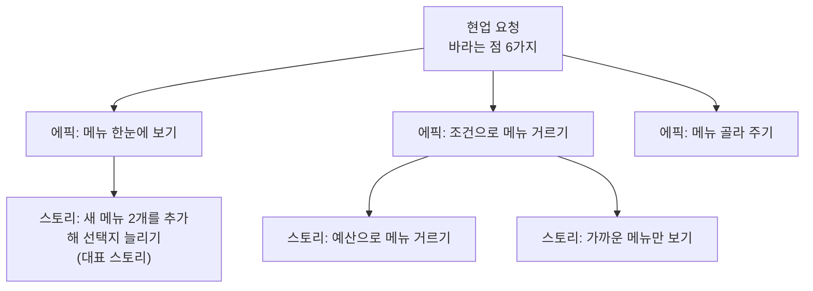
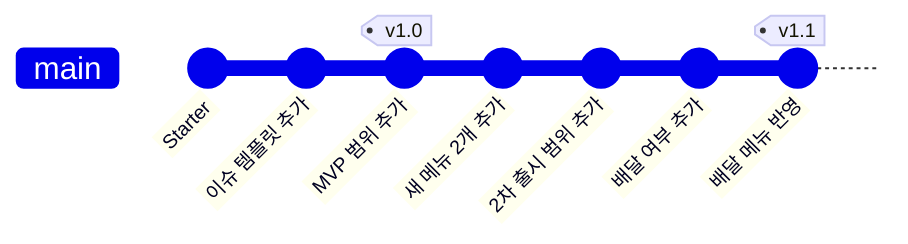
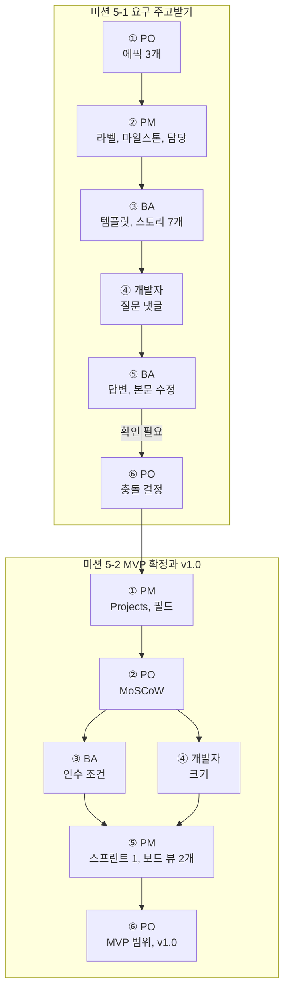

# 5교시. 팀 실습 ① 요구사항 주고받기

!!! abstract "이번 교시의 목표"
    역할에 따라 요구를 주고받으며 요구사항을 구체화하고, MVP를 확정해 기준선으로 관리할 수 있다.

!!! info "오늘의 흐름에서 지금 위치"
    **현업 요청** → **이슈** → **우선순위와 인수 조건** → PR → 검사와 리뷰 → 병합과 배포 → 이력 확인 → 보호 규칙

    5교시에는 앞의 세 단계를 팀으로 다시 돌립니다.

| 구간 | 시간 | 내용 |
|---|---|---|
| 복습 | 5분 | 오전에 배운 기능을 오후에 어떻게 쓰는지 ([교안](#lecture)) |
| 교안 | 5분 | 사용자 스토리, 인수 조건, Release ([교안](#user-story)) |
| 미션 5-1 | 20분 | [미션 5-1 요구 주고받기](mission-1.md) |
| 미션 5-2 | 15분 | [미션 5-2 MVP 확정과 v1.0](mission-2.md) |
| 회고 | 5분 | [회고](review.md) |

5교시부터 본격적인 팀 역할극입니다. 이번 교시의 목표는 요구사항을 주고받아 **MVP 범위를 확정하고, 요구사항 v1.0을 발행하는 것**까지입니다. 모든 작업은 팀 리포지토리 `lunch-picker-team<번호>`와 팀 Projects `점심 메뉴 추천 팀<번호>`에서 합니다.

시작 전에 아래 [역할 카드](#role-cards)를 다시 읽고, **내가 누구에게서 무엇을 받아 누구에게 넘기는지** 확인하세요. 막히면 다음 역할에게 바로 `@멘션`으로 물어보면 됩니다.

## 교안 {#lecture}

!!! question "이번 교시를 시작하며"
    - **왜 지금 하나요?** 개인 공간에서 기능을 익혔으니, 이제 새 팀 공간에서 역할을 나눕니다. 같은 요구를 읽고 질문과 결정을 주고받으며 팀의 작업 범위를 합의합니다.
    - **앞에서 만든 무엇을 쓰나요?** 4-3에서 PO가 만든 팀 리포지토리 `lunch-picker-team<번호>`와 팀 Projects `점심 메뉴 추천 팀<번호>`, 그 안의 `docs/` 폴더(현업 요청, 킥오프 회의록, 현행 업무)를 씁니다. 2교시에 배운 이슈, 하위 이슈, 멘션과 4교시에 배운 Projects 필드, 보드 뷰를 그대로 씁니다.
    - **끝나면 무엇을 누구에게 넘기나요?** 에픽 3개, 스토리 7개(대표 스토리 포함), Must 스토리의 인수 조건, 보드 뷰 두 개(`MVP 보드`, `진행 보드`), README의 MVP 범위와 Release `v1.0`을 6교시에 넘깁니다. 6교시에는 개발자가 대표 스토리를 구현하고 BA가 그 인수 조건으로 검토합니다.

### 오전에 배운 기능을 이렇게 씁니다 {#recap}

오늘 미션에서 쓰는 기능은 대부분 오전에 배운 것입니다. 새로 쓰는 것은 Release 하나뿐입니다.

| 기능 | 배운 때 | 오후 역할극에서 쓰는 곳 |
|---|---|---|
| **Issue** | 2교시 | PO의 요청(에픽), BA의 요구사항(스토리), 개발자의 질문을 주고받는 곳 |
| **@멘션** | 2교시 | 다음 역할에게 넘기고, 질문하고, 결정을 요청할 때 |
| **Projects** | 4교시 | PM이 일정과 우선순위를 정리하고, PO가 MVP를 정하는 곳 |
| **Release** | 새로 | 확정된 요구사항에 v1.0 이름표를 붙여 기준선으로 남김 |

메신저로 "이거 어떻게 하죠?"라고 묻는 대신 이슈 댓글로 묻고, "다 했어요"라고 말하는 대신 `@다음사람`을 멘션합니다. 그래야 대화가 요구사항 바로 옆에 기록으로 남습니다.

!!! tip "핵심"
    이슈에서 주고받고, 멘션으로 넘기고, Projects에서 정리하고, Release로 확정합니다.

### 사용자 스토리는 누가, 무엇을, 왜로 씁니다 {#user-story}

BA가 요구사항을 쓸 때 쓰는 형식이 **사용자 스토리**(User Story)입니다.

```text
[누구]로서, [무엇]을 하고 싶다. 왜냐하면 [이유] 때문이다.
```

예시:

```text
팀원으로서, 오늘 예산에 맞는 메뉴만 보고 싶다.
왜냐하면 점심값을 만 원 이하로 쓰고 싶기 때문이다.
```

"예산 필터 기능"처럼 기능 이름만 쓰면 개발자는 "누가 쓰지? 왜 필요하지? 그럼 예산을 안 넣으면 어떻게 하지?"를 스스로 짐작해야 합니다. 누가 왜 필요한지가 적혀 있으면 개발자가 무엇을 만들어야 할지 판단하기 쉽고, 애매한 부분은 질문할 거리도 분명해집니다.

큰 요구는 **에픽**(Epic), 그 에픽을 잘게 나눈 요구를 **스토리**라고 부릅니다. 오늘은 PO가 현업 요청을 에픽 이슈로 올리고, BA가 에픽 아래에 하위 이슈(sub-issue)로 스토리를 만듭니다. 2교시에 만든 "사용자 스토리" 이슈 템플릿이 바로 이 형식입니다.



!!! tip "핵심"
    사용자 스토리는 기능 이름이 아니라 "누가, 무엇을, 왜"입니다. 왜가 있어야 개발자가 판단할 수 있습니다.

### 인수 조건은 '다 됐다'의 기준입니다 {#acceptance}

**인수 조건**(Acceptance Criteria)은 이 스토리가 다 됐다고 판단하는 기준입니다. **Given, When, Then** 세 부분으로 씁니다.

| 부분 | 뜻 | 예 |
|---|---|---|
| **Given** | 이런 상황에서 | 메뉴 6개가 있을 때 |
| **When** | 이렇게 하면 | 예산 칸에 10000을 입력하면 |
| **Then** | 이런 결과가 나온다 | 10000원이 넘는 메뉴(돈카츠, 샐러드볼)는 보이지 않는다 |

중요한 것은 **확인할 수 있어야 한다**는 점입니다.

| 측정할 수 없으면 | 측정할 수 있으면 |
|---|---|
| "추천이 잘 된다" | "예산 1만 원을 넣으면, 1만 원 넘는 메뉴가 없다" |
| "가까운 곳이 잘 보인다" | "거리 칸에 500을 넣으면, 쌀국수(700m)와 돈카츠(600m)가 보이지 않는다" |
| "빠르게 고를 수 있다" | "'아무거나 골라 줘'를 누르면, 화면에 보이는 메뉴 중 하나의 이름이 나타난다" |

"잘 된다"는 사람마다 판단이 다릅니다. 숫자와 화면 결과로 쓰면 누가 봐도 통과인지 아닌지 알 수 있습니다. 6교시에 BA가 개발자의 PR을 검토할 때 바로 이 인수 조건을 기준으로 봅니다.

!!! tip "핵심"
    인수 조건은 Given, When, Then으로, 누가 봐도 통과인지 알 수 있게 숫자와 화면 결과로 씁니다.

### Release로 '확정본'에 이름을 붙입니다 {#release}

**Release**(릴리스)는 특정 커밋에 `v1.0` 같은 이름표, 정확히는 **태그**(Tag)를 붙여서 발행하는 기능입니다. 커밋 번호 `a1b2c3d`는 기억하기 어렵지만, `v1.0`은 누구나 알아봅니다.

오늘은 요구사항이 확정된 시점에 `v1.0`을 붙여 **기준선**(Baseline)으로 씁니다. 기획에서 "요구사항 확정본"을 정해 두는 것과 같습니다. 기준선이 있으면 그 뒤에 들어오는 요구는 "변경 요청"으로 따로 관리할 수 있습니다. 6교시에 변경 요청이 반영되면 `v1.1`을 붙이고, 두 버전을 비교하면 그 사이의 모든 변경이 한 화면에 보입니다.



| 용어 | 뜻 |
|---|---|
| **Tag**(태그) | 커밋 하나에 붙이는 이름표. 한 번 붙이면 그 커밋을 가리킨 채 움직이지 않습니다 |
| **Release**(릴리스) | 태그에 제목과 설명을 붙여 발행한 것. 리포지토리 오른쪽 **Releases**에 보입니다 |
| **기준선** | 합의된 확정본. 이후 변경은 기준선과 비교해 관리합니다 |

**태그가 고정하는 것은 커밋된 파일뿐입니다.** `v1.0` 태그는 그 시점의 `README.md`, `site/menus.json` 같은 **파일**을 그대로 붙잡아 둡니다. 하지만 이슈 본문, 댓글, Projects의 MoSCoW 값은 파일이 아니라서 태그에 들어가지 않습니다. 누군가 나중에 스토리 본문의 인수 조건을 고치거나 MoSCoW를 Should로 바꾸면, `v1.0`을 열어 봐도 "그때 무엇을 Must로 정했는지"를 되돌려 볼 수 없습니다.

| 태그로 고정됨 | 태그로 고정되지 않음 |
|---|---|
| 커밋된 파일 (`README.md`, `site/menus.json`, `docs/` 등) | 이슈 본문과 댓글, 라벨, 마일스톤 |
| | Projects의 필드 값 (`MoSCoW`, `크기`, `스프린트`) |

그래서 `v1.0`을 붙이기 전에 PO가 README의 "MVP 범위"에 **Must별 핵심 인수 조건과 결정 요약**을 적어 파일로 남깁니다. 그래야 `v1.0` 안에 "무엇을, 어떤 기준으로, 왜"가 함께 고정됩니다.

!!! tip "핵심"
    Release는 확정된 시점의 파일에 이름표를 붙이는 것입니다. 지켜야 할 합의는 README에 적어 파일로 남긴 뒤 v1.0을 붙입니다.

## 역할 카드 {#role-cards}

미션을 시작하기 전에 내 역할 카드를 읽으세요. **3인 팀은 PO가 PM 카드도 함께 맡습니다.**

=== "PO"

    **한 줄 정의**: 제품 책임자. **무엇을, 왜** 만들지 정하고 최종 결정합니다.

    **이번 교시에 할 일**

    - 현업 요청을 읽고 에픽 이슈 3개를 등록합니다. (5-1)
    - 회의록에서 결론 못 낸 충돌 2건을 결정해 이슈 댓글로 남깁니다. (5-1)
    - 스토리마다 MoSCoW를 정합니다. Must는 최대 3개입니다. (5-2)
    - README에 MVP 범위(Must별 핵심 인수 조건과 결정 요약)를 쓰고 Release `v1.0`을 발행합니다. (5-2)

    **받는 것과 넘기는 것**

    | 받는 것 | 누구에게서 | 넘기는 것 | 누구에게 |
    |---|---|---|---|
    | 현업 요청, 회의록 | 현업(`docs/` 폴더) | 에픽 이슈 3개 | PM |
    | `확인 필요` 질문 | BA | 결정 댓글 | BA, 개발자 |
    | 정리된 스토리 목록 | PM | MoSCoW, MVP 범위, v1.0 | 팀 전체 |

    **기다리는 동안 할 일**

    - BA가 스토리를 쓰는 동안 회의록의 "결정하지 못한 것" 2개를 어떻게 결정할지, 이유와 함께 정리해 둡니다.
    - 어떤 스토리가 Must인지 미리 골라 둡니다.

=== "PM"

    **한 줄 정의**: 프로젝트 관리자. **언제, 누가** 할지 정하고 진행을 관리합니다.

    **이번 교시에 할 일**

    - 팀 라벨 7개를 만들고, 에픽에 라벨과 마일스톤 `MVP`를 붙입니다. (5-1)
    - 에픽 담당자를 BA로 정하고 멘션으로 넘깁니다. (5-1)
    - 팀 Projects에 스토리를 모두 담고 `MoSCoW`, `크기`, `스프린트` 필드를 만듭니다. (5-2)
    - Must 스토리를 스프린트 1에 넣고, 보드 뷰 두 개(`MVP 보드`는 MoSCoW로, `진행 보드`는 Status로)를 만듭니다. (5-2)

    **받는 것과 넘기는 것**

    | 받는 것 | 누구에게서 | 넘기는 것 | 누구에게 |
    |---|---|---|---|
    | 에픽 이슈 3개 | PO | 라벨, 마일스톤 붙은 에픽 | BA |
    | 스토리 이슈 | BA | `MVP 보드`, `진행 보드` | PO, 개발자 |
    | MoSCoW, 크기 | PO, 개발자 | 스프린트 1 계획 | 팀 전체 |

    **기다리는 동안 할 일**

    - BA가 스토리를 쓰는 동안 팀 Projects에 필드(`MoSCoW`, `크기`, `스프린트`)를 미리 만들어 둡니다.
    - 새로 생기는 스토리 이슈에 `스토리` 라벨과 `MVP` 마일스톤이 붙었는지 확인합니다.

=== "BA"

    **한 줄 정의**: 업무 분석가. 요구를 **구체적인** 요구사항으로 만들고, 결과가 요구를 충족하는지 검토합니다.

    **이번 교시에 할 일**

    - 팀 리포지토리에 이슈 템플릿 "사용자 스토리"를 만듭니다. (5-1)
    - 에픽마다 하위 이슈로 스토리를 2개 이상, 모두 7개 씁니다. 마지막 스토리는 6교시에 구현할 대표 스토리 `[스토리] 새 메뉴 2개를 추가해 선택지 늘리기`입니다. (5-1)
    - 개발자의 질문에 답하고 스토리 본문을 고칩니다. 혼자 못 정하는 것은 PO에게 넘깁니다. (5-1)
    - Must 스토리에 Given-When-Then 인수 조건을 2개 이상 씁니다. (5-2)

    **받는 것과 넘기는 것**

    | 받는 것 | 누구에게서 | 넘기는 것 | 누구에게 |
    |---|---|---|---|
    | 라벨 붙은 에픽 | PM | 스토리 이슈 7개 (대표 스토리 포함) | 개발자 |
    | 질문 댓글 | 개발자 | 답변, 고친 스토리 | 개발자 |
    | | | 정하지 못한 질문 (`확인 필요`) | PO |
    | Must 결정 | PO | 인수 조건 | 개발자 (6교시 구현 기준) |

    **기다리는 동안 할 일**

    - PO가 에픽을 올리는 동안 이슈 템플릿 파일을 먼저 만들어 둡니다.
    - `docs/02_현행_업무.md`의 "불편한 점"에서 스토리의 "왜냐하면"에 쓸 말을 고릅니다.

=== "개발자"

    **한 줄 정의**: 요구사항을 받아 **질문하고 만듭니다.** 애매한 것을 짐작으로 만들지 않고 묻는 것이 오늘의 핵심입니다.

    **이번 교시에 할 일**

    - 내게 배정된 스토리마다 질문 댓글을 남깁니다. 모두 3개 이상. (5-1)
    - Must 스토리의 크기를 S, M, L로 정합니다. L이면 이유를 댓글로 씁니다. (5-2)

    **받는 것과 넘기는 것**

    | 받는 것 | 누구에게서 | 넘기는 것 | 누구에게 |
    |---|---|---|---|
    | 스토리 이슈 | BA | 질문 댓글 (`@BA`) | BA |
    | 답변, 고친 스토리 | BA | 크기 (S, M, L) | PM |

    **기다리는 동안 할 일**

    - 스토리가 오기 전에 팀 웹페이지와 `site/menus.json`, `site/index.html`을 살펴보며 "이 요구를 만들려면 무엇이 정해져야 하지?"를 메모합니다.
    - 다른 스토리에 달린 질문과 답변도 읽어 둡니다. 6교시에 구현할 때 기준이 됩니다.

## 전체 흐름



## 이번 교시 실습

- [미션 5-1 요구 주고받기](mission-1.md): 에픽, 스토리, 질문, 답변, 결정을 이슈와 멘션으로 주고받아 요구사항을 구체화합니다.
- [미션 5-2 MVP 확정과 v1.0](mission-2.md): Projects로 MoSCoW와 크기를 정해 MVP를 확정하고 Release `v1.0`으로 기준선을 남깁니다.
- [회고](review.md): 요구를 주고받으며 느낀 점을 나누고 6교시를 준비합니다.
