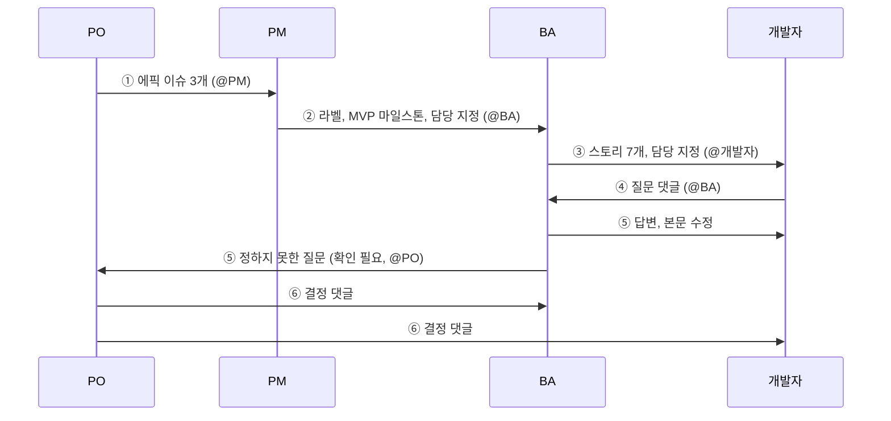

# 미션 5-1. 요구 주고받기

!!! abstract "이번 미션에서 할 것"
    - PO가 현업 요청을 에픽 이슈로 올리고, PM이 분류해 BA에게 넘깁니다.
    - BA가 에픽을 사용자 스토리로 나누고, 개발자가 질문하고, BA가 답합니다.
    - BA가 정하지 못한 충돌 요구를 PO가 결정해 기록으로 남깁니다.

**소요 시간** 약 20분  **실습 장소** 팀 리포지토리 `lunch-picker-team<번호>`  **관련 교안** [5교시 교안](index.md#user-story), [역할 카드](index.md#role-cards)

## 준비

- 팀원 모두 팀 리포지토리 `lunch-picker-team<번호>`를 엽니다.
- PO와 BA는 `docs/00_현업요청.md`, `docs/01_킥오프_회의록.md`를 다른 탭에 열어 둡니다.
- 아래 예시 글은 **그대로 써도 되고, 팀 상황에 맞게 고쳐도 됩니다.**
- 이슈 번호는 팀마다 다릅니다. 예시의 `#1`, `#4`, `#10`은 우리 팀 이슈 번호로 바꿔 읽으세요. 이 가이드는 에픽 `#1`~`#3`, 스토리 `#4`~`#9`, 대표 스토리 `#10` 순서로 만들었다고 보고 설명합니다.

!!! warning "3인 팀"
    3인 팀은 **PO가 PM을 겸합니다.** 아래 ② 단계(PM)는 PO가 이어서 합니다. PM 탭을 PO가 함께 보세요.

## 전체 흐름

| 순서 | 누가 | 무엇을 | 누구에게 넘김 |
|---|---|---|---|
| ① | PO | 현업 요청을 읽고 에픽 이슈 3개 등록 | PM (`@PM` 멘션) |
| ② | PM | 팀 라벨 7개, 마일스톤 `MVP` 만들기. 에픽에 라벨, 마일스톤, 담당자(BA) 지정 | BA (`@BA` 멘션) |
| ③ | BA | 이슈 템플릿 만들기, 에픽마다 스토리 하위 이슈 2개 이상 (모두 7개, 마지막이 대표 스토리), 담당자(개발자) 지정 | 개발자 (`@개발자` 멘션) |
| ④ | 개발자 | 스토리에 질문 댓글 3개 이상 | BA (`@BA` 멘션) |
| ⑤ | BA | 답변하고 스토리 본문 수정. 못 정하는 질문은 `확인 필요` 라벨 | PO (`@PO` 멘션) |
| ⑥ | PO | 회의록의 충돌 2건 결정을 댓글로 남기고 `확인 필요` 제거 | BA, 개발자 |



## 역할별 할 일

아래에서 **내 역할 탭**을 누릅니다. 단계마다 맨 위 **언제 시작하나요?** 상자를 먼저 봅니다.

- **바로 시작합니다**라고 되어 있으면 지금 시작합니다.
- 누군가를 기다리는 단계라면 상자에 적힌 화면을 확인합니다. **아직이면** 앞 사람이 하는 중이니, 탭 맨 아래 **기다리는 동안 할 일**을 하며 기다립니다.
- 내 단계가 끝나면 적힌 대로 다음 사람을 `@아이디`로 멘션하거나 말로 알립니다. 다음 사람은 그 알림이 시작 신호입니다.

=== "PO"

    ### ① 에픽 이슈 3개 등록하기

    !!! info "언제 시작하나요?"
        - **바로 시작합니다.** 5-1에서 가장 먼저 움직이는 사람입니다. 다른 팀원은 PO가 에픽을 다 만들 때까지 기다립니다.

    현업 요청의 "바라는 점" 6가지를 큰 묶음 3개로 나누어 **에픽**(큰 요구) 이슈로 올립니다.

    | 에픽 | 묶은 바라는 점 |
    |---|---|
    | 메뉴 한눈에 보기 | 1번 (메뉴 이름, 종류, 가격, 거리), 5번 (혼밥 표시) |
    | 조건으로 메뉴 거르기 | 2번 (예산), 3번 (거리) |
    | 메뉴 골라 주기 | 4번 (아무거나 하나), 6번 (투표) |

    1. 팀 리포지토리 → **Issues** → **New issue**를 클릭합니다.
        - 템플릿 고르는 화면이 나오면 아래쪽 **Blank issue**(빈 이슈)를 고릅니다.
    2. **Title**(제목)과 본문을 입력합니다. 첫 번째 에픽 예시:

        ```text
        [에픽] 메뉴 한눈에 보기
        ```

        ```markdown
        ## 배경
        점심 메뉴를 정하는 데 15~20분이 걸립니다. 가격과 거리를 몰라 메신저로 다시 묻는 일이 많습니다.

        ## 바라는 점
        - 회사 근처 메뉴의 이름, 종류, 가격, 거리를 한눈에 보고 싶다.
        - 혼자 먹기 편한 곳인지 표시가 있으면 좋겠다.

        ## 출처
        - 현업 요청: docs/00_현업요청.md 바라는 점 1번, 5번
        - 킥오프 회의록: docs/01_킥오프_회의록.md 2장, 6장
        ```

    3. **Create**(만들기)를 클릭합니다.
    4. 같은 방법으로 나머지 두 에픽을 만듭니다.

        ```text
        [에픽] 조건으로 메뉴 거르기
        ```

        ```markdown
        ## 배경
        오늘 쓸 수 있는 예산과 멀리 가기 싫은 날의 거리를 매번 따로 따져야 합니다.

        ## 바라는 점
        - 오늘 예산을 넣으면 그 안에서 고를 수 있는 메뉴만 보고 싶다.
        - 가까운 곳만 볼 수 있으면 좋겠다. (걸어서 10분 안쪽)

        ## 출처
        - 현업 요청: docs/00_현업요청.md 바라는 점 2번, 3번 (요청자가 가장 급하다고 함)
        - 킥오프 회의록: docs/01_킥오프_회의록.md 3장, 5장
        ```

        ```text
        [에픽] 메뉴 골라 주기
        ```

        ```markdown
        ## 배경
        도저히 못 고를 때 의견을 모으는 데 시간이 오래 걸립니다.

        ## 바라는 점
        - 못 고르겠을 때 버튼 하나로 아무거나 하나 골라 주면 좋겠다.
        - 팀원들이 후보 중에 투표해서 정하는 기능도 있으면 재미있겠다.

        ## 출처
        - 현업 요청: docs/00_현업요청.md 바라는 점 4번, 6번
        - 킥오프 회의록: docs/01_킥오프_회의록.md 4장
        ```

    5. 에픽 3개를 다 만들었으면 첫 번째 에픽 `[에픽] 메뉴 한눈에 보기`(#1)에 PM을 부르는 댓글을 남깁니다. 아래쪽 댓글 칸에 입력하고 **Comment**(댓글)를 클릭합니다.

        ```text
        @PM아이디 에픽 3개(#1, #2, #3) 등록했습니다. 라벨과 마일스톤 정리, 담당 배정 부탁드립니다.
        ```

    확인: **Issues** 목록에 `[에픽]`으로 시작하는 이슈 3개가 보이면 성공입니다.

    **기다리는 동안 할 일**

    `docs/01_킥오프_회의록.md`의 "결정하지 못한 것" 2개를 어떻게 결정할지 정해 둡니다. ⑥에서 댓글로 씁니다.

    - 충돌 ①: 박지은 "만 원 이하만 보여 주자" vs 이민호 "회식용 만 원 넘는 메뉴도 추천해 달라"
    - 충돌 ②: 박지은 "하나만 딱 골라 주자" vs 이민호 "후보 여러 개 보여 주고 투표하자"

    판단 기준: 서비스 목적("메뉴 결정 시간 5분 이내"), 결정 사항("첫 출시는 최대한 작게", "로그인은 이번에 안 함")

    ### ⑥ 충돌 2건 결정하기

    !!! info "언제 시작하나요?"
        - BA가 `확인 필요` 라벨을 붙이고 나를 멘션하면 시작합니다. 개발자 질문 → BA 답변 다음이라 5-1에서 가장 늦게 오는 순서입니다.
        - **아직이면:** **Issues** 검색창에 `is:issue label:"확인 필요"`를 넣었을 때 0개면 BA가 아직 넘기지 않은 것입니다. **기다리는 동안 할 일**을 하며 기다립니다.

    BA가 `확인 필요` 라벨을 붙이고 나를 멘션하면 알림이 옵니다. (오른쪽 위 종 모양 **Notifications**, 또는 **Issues**에서 라벨 `확인 필요`를 눌러 거르기)

    1. `확인 필요` 라벨이 붙은 이슈를 엽니다. 예시대로라면 `[스토리] 예산으로 메뉴 거르기`와 `[스토리] 버튼 하나로 메뉴 추천받기` 두 개입니다. 새 이슈를 만들지 않고 **그 이슈 안에** 결정 댓글을 씁니다.
    2. 질문과 BA의 의견을 읽고, 결정을 댓글로 남깁니다. **결정, 이유, 출처**를 함께 씁니다.

        충돌 ① 결정 예시 (`[스토리] 예산으로 메뉴 거르기`에):

        ```markdown
        **[PO 결정] 만 원 넘는 메뉴도 목록에 남깁니다.**

        - 결정: 메뉴 데이터에서 만 원 넘는 메뉴를 빼지 않습니다. 예산을 입력하면 그 금액 이하만 보이고, 예산을 비워 두면 전부 보입니다.
        - 이유: 예산 필터가 있으면 박지은 과장님은 10000을 넣어 만 원 이하만 보고, 이민호 님 팀은 금요일에 예산을 높여 회식 메뉴를 볼 수 있습니다. 두 요구를 모두 만족합니다.
        - 기본 예산 값은 넣지 않습니다.
        - 출처: 킥오프 회의록 3장, 결정하지 못한 것 1번

        @BA아이디 @개발자아이디 이 기준으로 스토리 본문과 구현을 맞춰 주세요.
        ```

        충돌 ② 결정 예시 (`[스토리] 버튼 하나로 메뉴 추천받기`에):

        ```markdown
        **[PO 결정] MVP에서는 하나만 골라 줍니다. 투표는 이번에 하지 않습니다.**

        - 결정: "아무거나 골라 줘" 버튼은 지금 화면에 보이는 메뉴 중 하나만 고릅니다. 후보 여러 개와 투표는 Won't(이번에는 안 함)로 둡니다.
        - 이유: 투표는 사람마다 로그인이 필요한데, 로그인은 이번 범위가 아닙니다. 첫 출시는 최대한 작게 하기로 했습니다. 써 본 뒤 2차 출시에서 다시 검토합니다.
        - 출처: 킥오프 회의록 4장, 결정 사항 3번, 4번, 결정하지 못한 것 2번

        @BA아이디 @개발자아이디 투표 스토리는 닫지 말고 Won't로 남겨 주세요.
        ```

    3. 이슈 오른쪽 **Labels** 옆 톱니바퀴를 눌러 `확인 필요` 체크를 해제합니다.

    확인: 두 이슈에 `[PO 결정]` 댓글이 있고, `확인 필요` 라벨이 붙은 이슈가 하나도 없으면 성공입니다.

=== "PM"

    ### ② 라벨, 마일스톤, 담당 배정하기

    !!! info "언제 시작하나요?"
        - PO가 첫 번째 에픽(#1)에서 나를 멘션하면 시작합니다.
        - **아직이면:** **Issues** 탭에 `[에픽]`으로 시작하는 이슈가 3개가 안 되면 PO가 아직 만드는 중입니다. 라벨과 마일스톤은 에픽과 상관없으니 **먼저 만들어 두어도 됩니다.**

    **라벨 7개 만들기**

    1. 팀 리포지토리 → **Issues** → 목록 위쪽 **Labels**(라벨)를 클릭합니다.
    2. **New label**(새 라벨)을 클릭합니다.
    3. **Label name**에 `에픽`을 입력하고 **Create label**을 클릭합니다. 색은 자유입니다.
    4. 같은 방법으로 아래 7개를 모두 만듭니다. 이름은 띄어쓰기와 하이픈까지 **그대로** 입력합니다.

        ```text
        에픽
        스토리
        확인 필요
        변경요청
        우선순위-상
        우선순위-중
        우선순위-하
        ```

    확인: **Labels** 목록에 7개가 모두 보이면 성공입니다. (GitHub 기본 라벨 `bug`, `documentation` 등은 그대로 두어도 됩니다.)

    **마일스톤 `MVP` 만들기**

    1. **Issues** → 목록 위쪽 **Milestones**(마일스톤)를 클릭합니다.
    2. **New milestone**(새 마일스톤)을 클릭합니다.
    3. **Title**에 아래 이름을 입력합니다. 마감일과 설명은 비워 둡니다.

        ```text
        MVP
        ```

    4. **Create milestone**을 클릭합니다.

    **에픽 3개 정리하기**

    PO가 멘션하면 에픽 이슈를 하나씩 열어 오른쪽 사이드바를 채웁니다.

    1. **Labels** 톱니바퀴 → `에픽`과 우선순위 라벨을 체크합니다. 현업 요청에서 "1, 2번이 제일 급하다"고 했으니 아래처럼 붙입니다.

        | 에픽 | 라벨 |
        |---|---|
        | [에픽] 메뉴 한눈에 보기 | `에픽`, `우선순위-상` |
        | [에픽] 조건으로 메뉴 거르기 | `에픽`, `우선순위-상` |
        | [에픽] 메뉴 골라 주기 | `에픽`, `우선순위-중` |

    2. **Milestone** 톱니바퀴 → `MVP`를 고릅니다.
    3. **Assignees** 톱니바퀴 → BA 아이디를 고릅니다.
    4. 바깥을 클릭하면 저장됩니다.
    5. 세 에픽 모두 끝나면 첫 번째 에픽 `[에픽] 메뉴 한눈에 보기`(#1)에 BA를 부르는 댓글을 남깁니다. PO가 남긴 댓글 바로 아래에 이어서 씁니다.

        ```text
        @BA아이디 에픽 3개에 라벨과 MVP 마일스톤 붙이고 담당자로 지정했습니다. 에픽마다 사용자 스토리로 나눠 주세요. 우선순위-상인 두 에픽부터 부탁드립니다.
        ```

    확인: **Issues** 목록에서 에픽 3개에 `에픽` 라벨, 우선순위 라벨, 마일스톤 표시, BA 프로필 사진이 보이면 성공입니다.

    **기다리는 동안 할 일**

    - 미션 5-2에서 쓸 팀 Projects 필드(`MoSCoW`, `크기`, `스프린트`)를 미리 만들어 두면 시간이 절약됩니다. 방법은 [미션 5-2](mission-2.md)의 PM 탭에 있습니다.
    - BA가 만든 스토리에 `스토리` 라벨이 자동으로 붙었는지 보고, 스토리에도 마일스톤 `MVP`를 붙입니다.
    - 질문과 답변이 오가는 것을 지켜보다가, 오래 답이 없는 이슈가 있으면 해당 역할을 멘션해 챙깁니다.

=== "BA"

    ### ③-1 이슈 템플릿 만들기

    !!! info "언제 시작하나요?"
        - PM이 팀 라벨을 만든 뒤 시작합니다. 템플릿이 `스토리` 라벨을 자동으로 붙이기 때문입니다.
        - **아직이면:** **Issues** → **Labels**에 `스토리` 라벨이 없으면 PM이 아직 만드는 중입니다. 그사이 `docs/00_현업요청.md`와 회의록을 읽어 둡니다.

    2교시에 개인 연습 리포지토리에 만든 이슈 템플릿은 팀 리포지토리에는 없습니다. 팀 리포지토리에 같은 템플릿을 만듭니다. (PO가 에픽을 쓰는 동안 먼저 해 두세요.)

    1. 팀 리포지토리 → **Code** 탭 → **Add file**(파일 추가) → **Create new file**(새 파일 만들기)을 클릭합니다.
    2. 파일 이름 칸에 아래 경로를 그대로 입력합니다. `/`를 입력하면 폴더가 자동으로 나뉩니다.

        ```text
        .github/ISSUE_TEMPLATE/user-story.md
        ```

    3. 본문 칸에 아래 내용을 전부 붙여 넣습니다.

        ```markdown
        ---
        name: 사용자 스토리
        about: 누가, 무엇을, 왜 원하는지 적는 요구사항
        title: "[스토리] "
        labels: 스토리
        assignees: ''
        ---

        ## 사용자 스토리
        [누구]로서, [무엇]을 하고 싶다. 왜냐하면 [이유] 때문이다.

        ## 상세 내용
        - 

        ## 인수 조건
        - [ ] Given (이런 상황에서) When (이렇게 하면) Then (이런 결과가 나온다)

        ## 참고
        - 출처:
        ```

    4. 오른쪽 위 **Commit changes...**(변경 저장)를 클릭합니다.
    5. 커밋 메시지를 입력하고 **Commit directly to the main branch**가 선택된 상태로 **Commit changes**를 클릭합니다.

        ```text
        사용자 스토리 이슈 템플릿 추가
        ```

    확인: **Issues** → **New issue**를 누르면 **사용자 스토리** 템플릿이 목록에 보이면 성공입니다. (확인만 하고 창을 닫습니다.)

    !!! note "labels: 스토리"
        템플릿으로 만든 이슈에 `스토리` 라벨이 자동으로 붙습니다. 단, 라벨은 PM이 먼저 만들어 두어야 붙습니다. 라벨이 안 붙었다면 PM에게 라벨을 만들었는지 확인하세요.

    ### ③-2 에픽마다 스토리 하위 이슈 만들기

    !!! info "언제 시작하나요?"
        - PM이 #1에서 나를 멘션하면 시작합니다.
        - **아직이면:** 에픽 오른쪽 **Assignees**에 내 아이디가 없으면 PM이 아직 배정하지 않은 것입니다. 그사이 ③-1 템플릿을 만듭니다.

    PM이 멘션하면 시작합니다. 에픽 하나에 스토리 2개 이상, **모두 7개** 만듭니다. 아래 6개를 먼저 만들고, **마지막 7번째로 대표 스토리**를 만듭니다.

    1. 에픽 이슈 하나를 엽니다. 예: `[에픽] 조건으로 메뉴 거르기`
    2. 본문 아래 **Create sub-issue**(하위 이슈 만들기)를 클릭합니다. 버튼 옆 **▼**가 있으면 **Create sub-issue**를 고릅니다.
    3. 템플릿을 고르는 칸이 보이면 **사용자 스토리**를 고릅니다.
    4. 제목과 본문을 입력하고 **Create**를 클릭합니다.
    5. 에픽 화면으로 돌아오면 본문 아래 **Sub-issues** 목록에 방금 만든 스토리가 보입니다. 같은 방법으로 나머지 스토리를 만듭니다.

    아래 예시를 참고하세요. 인수 조건은 미션 5-2에서 Must 스토리만 채우므로 지금은 템플릿 그대로 두어도 됩니다.

    **에픽: 메뉴 한눈에 보기**

    ```text
    [스토리] 메뉴 목록을 카드로 보기
    ```

    ```markdown
    ## 사용자 스토리
    팀원으로서, 회사 근처 메뉴의 이름, 종류, 가격, 거리를 한 화면에서 보고 싶다. 왜냐하면 "거기 얼마였죠?", "거기 멀지 않아요?"를 매번 다시 묻고 싶지 않기 때문이다.

    ## 상세 내용
    - 메뉴마다 카드 하나로 보여 준다.
    - 카드에 이름, 종류, 가격(원), 거리(m)를 표시한다.

    ## 참고
    - 출처: 현업 요청 바라는 점 1번, 현행 업무 "불편한 점"
    ```

    ```text
    [스토리] 혼밥 가능한 메뉴 표시 보기
    ```

    ```markdown
    ## 사용자 스토리
    혼자 먹는 직원으로서, 혼자 가기 편한 곳인지 카드에서 바로 보고 싶다. 왜냐하면 혼자 가도 되는 곳을 매번 물어보기 어렵기 때문이다.

    ## 상세 내용
    - 혼밥 가능한 메뉴 카드에 "혼밥 가능" 표시를 붙인다.

    ## 참고
    - 출처: 현업 요청 바라는 점 5번, 킥오프 회의록 6장 (이민호 "꼭 있었으면")
    ```

    **에픽: 조건으로 메뉴 거르기**

    ```text
    [스토리] 예산으로 메뉴 거르기
    ```

    ```markdown
    ## 사용자 스토리
    팀원으로서, 오늘 예산에 맞는 메뉴만 보고 싶다. 왜냐하면 점심값을 정해 둔 금액 안에서 쓰고 싶기 때문이다.

    ## 상세 내용
    - 예산(원)을 입력하면 그 금액 이하의 메뉴만 보인다.

    ## 참고
    - 출처: 현업 요청 바라는 점 2번, 킥오프 회의록 3장
    ```

    ```text
    [스토리] 가까운 메뉴만 보기
    ```

    ```markdown
    ## 사용자 스토리
    멀리 가기 싫은 팀원으로서, 정한 거리 안의 메뉴만 보고 싶다. 왜냐하면 점심시간에 이동하는 데 시간을 쓰고 싶지 않기 때문이다.

    ## 상세 내용
    - 거리(m) 칸에 숫자를 입력하면 그 미터 이하의 메뉴만 보인다.

    ## 참고
    - 출처: 현업 요청 바라는 점 3번, 킥오프 회의록 5장
    ```

    **에픽: 메뉴 골라 주기**

    ```text
    [스토리] 버튼 하나로 메뉴 추천받기
    ```

    ```markdown
    ## 사용자 스토리
    메뉴를 못 고르는 팀원으로서, 버튼 하나로 메뉴를 추천받고 싶다. 왜냐하면 의견을 모으는 데 15~20분씩 쓰고 싶지 않기 때문이다.

    ## 상세 내용
    - "아무거나 골라 줘" 버튼을 누르면 메뉴를 골라 보여 준다.

    ## 참고
    - 출처: 현업 요청 바라는 점 4번, 킥오프 회의록 4장
    ```

    ```text
    [스토리] 후보 메뉴에 팀원이 투표하기
    ```

    ```markdown
    ## 사용자 스토리
    팀장으로서, 후보 메뉴 몇 개에 팀원들이 투표해서 정하고 싶다. 왜냐하면 하나만 골라 주면 마음에 안 들어 하는 사람이 있기 때문이다.

    ## 상세 내용
    - 후보 서너 개를 보여 주고 팀원이 투표한다.

    ## 참고
    - 출처: 현업 요청 바라는 점 6번, 킥오프 회의록 4장 (투표는 로그인이 필요하다는 의견 있음)
    ```

    **마지막 7번째: 대표 스토리 (에픽: 메뉴 한눈에 보기)**

    6개를 다 만든 뒤, `[에픽] 메뉴 한눈에 보기`를 다시 열고 **Create sub-issue**로 아래 스토리를 만듭니다. 스토리 중 **마지막**으로 만들어야 번호가 가장 큽니다. (이 가이드의 예시 번호는 `#10`)

    ```text
    [스토리] 새 메뉴 2개를 추가해 선택지 늘리기
    ```

    ```markdown
    ## 사용자 스토리
    팀원으로서, 늘 가던 곳 말고 새로운 메뉴도 후보로 보고 싶다. 왜냐하면 매번 같은 메뉴만 먹게 되기 때문이다.

    ## 상세 내용
    - 메뉴 데이터(site/menus.json)에 새 메뉴 2개를 추가한다.
    - 비빔밥: 한식, 8000원, 250m, 혼밥 가능
    - 마라탕: 중식, 10000원, 500m, 혼밥 어려움
    - 화면(site/index.html)은 고치지 않는다. 지금 화면이 메뉴 데이터를 그대로 카드로 보여 준다.

    ## 인수 조건
    - [ ] Given (이런 상황에서) When (이렇게 하면) Then (이런 결과가 나온다)

    ## 참고
    - 출처: 현행 업무 docs/02_현행_업무.md 불편한 점 "또 김치찌개요?" (늘 가던 곳만 감)
    ```

    !!! note "이 스토리가 대표 스토리입니다"
        Starter 화면에는 메뉴 카드, 예산 칸, 거리 칸, "아무거나 골라 줘" 버튼이 **이미 있습니다.** 그래서 다른 스토리는 6교시에 새로 만들 것이 거의 없습니다. 이 스토리는 6교시에 개발자가 **실제로 구현할 대표 스토리**입니다. 5교시에 PO가 Must로 정하고, BA가 인수 조건을 쓰고, 6교시에 개발자가 `story-10` 분기에서 구현하고, 6-3 이력 감사에서 다시 찾습니다. 하루 끝까지 같은 이슈를 쓰므로 번호를 기억해 두세요.

    ### ③-3 개발자에게 넘기기

    !!! info "언제 시작하나요?"
        - ③-2에서 스토리 7개를 다 만든 직후 바로 합니다.

    1. 스토리를 하나씩 열어 오른쪽 **Assignees** 톱니바퀴 → 개발자 아이디를 고릅니다.
    2. 마지막 스토리에 개발자를 부르는 댓글을 남깁니다.

        ```text
        @개발자아이디 스토리 7개(#4~#10)를 담당으로 지정했습니다. 이 중 #10 "새 메뉴 2개를 추가해 선택지 늘리기"가 6교시에 실제로 구현할 대표 스토리입니다. 만들기 전에 애매한 점은 각 스토리에 댓글로 질문해 주세요.
        ```

    확인: 에픽 3개 각각의 **Sub-issues**에 스토리가 2개 이상 있고(`[에픽] 메뉴 한눈에 보기`에는 대표 스토리까지 3개), 모든 스토리에 `스토리` 라벨과 개발자 담당자가 있으면 성공입니다.

    ### ⑤ 질문에 답하고 본문 고치기

    !!! info "언제 시작하나요?"
        - 개발자가 스토리에 질문 댓글을 달고 나를 멘션하면 시작합니다. 질문 3개가 다 올 때까지 기다리지 말고 **하나 올 때마다 바로** 답합니다.
        - **아직이면:** 오른쪽 위 받은편지함 아이콘에 파란 점이 없으면 개발자가 아직 질문을 쓰는 중입니다.

    개발자의 질문 댓글이 오면 알림을 보고 답합니다.

    **내가 정할 수 있는 질문**은 답 댓글을 남기고, **스토리 본문도 고칩니다.** 댓글에만 답하면 나중에 본문만 읽는 사람이 놓칩니다.

    1. 질문이 달린 **그 스토리 이슈**를 열고, 맨 아래 댓글 칸에 답을 씁니다. 질문 댓글 오른쪽 위 **...** → **Quote reply**를 누르면 질문을 인용한 채로 답할 수 있어 어느 질문의 답인지 분명해집니다.

        ```text
        @개발자아이디 거리는 걸어서 걸리는 시간이 아니라 미터(m) 기준입니다. 킥오프 회의에서 일단 미터로 넣기로 했습니다(회의록 5장). 지금 화면의 거리 칸에 미터 숫자를 넣는 방식 그대로 갑니다. 본문 상세 내용에 반영했습니다.
        ```

    2. 스토리 본문 오른쪽 위 **...** → **Edit**(편집)를 클릭해 상세 내용을 고치고 **Save**(저장)를 클릭합니다.

        ```markdown
        ## 상세 내용
        - 거리(m) 칸에 숫자를 입력하면 그 미터 이하의 메뉴만 보인다. 예: 500을 넣으면 500m 이하만 보인다.
        - 거리는 회사에서 식당까지 미터(m) 기준이다. (회의록 5장)
        - 거리 칸을 비워 두면 모든 메뉴가 보인다.
        ```

    **스스로 정할 수 없는 질문**(회의록에서 결론이 안 난 것, 요청자끼리 의견이 다른 것)은 PO에게 넘깁니다. 새 이슈를 만들지 않고, **그 질문이 달린 스토리 이슈에서** 합니다.

    1. 질문이 달린 스토리 이슈 오른쪽 **Labels** 톱니바퀴 → `확인 필요`를 체크합니다.
    2. 같은 이슈에 PO를 멘션하는 댓글을 남깁니다. 개발자 질문 예시 기준으로는 아래 두 곳입니다.

        `[스토리] 예산으로 메뉴 거르기`의 "만 원이 넘는 메뉴는 데이터에서 빼나요?" 질문에:

        ```text
        @PO아이디 결정이 필요합니다. 킥오프에서 박지은 과장님은 "만 원 이하만", 이민호 님은 "회식용으로 만 원 넘는 메뉴도"라고 하셔서 결론이 안 났습니다(회의록 3장). 만 원 넘는 메뉴를 보여 줄지 정해 주세요.
        제 의견: 예산 필터가 있으니 메뉴는 남기고, 예산으로 거르게 하면 두 분 요구를 다 맞출 수 있을 것 같습니다.
        ```

        `[스토리] 버튼 하나로 메뉴 추천받기`의 "추천은 하나만 보여 주나요?" 질문에:

        ```text
        @PO아이디 결정이 필요합니다. 추천을 하나만 할지(박지은 과장님), 후보 여러 개를 보여 주고 투표할지(이민호 님) 결론이 안 났습니다(회의록 4장). 투표는 로그인이 필요하다는 의견도 있었습니다.
        ```

    3. PO가 결정 댓글을 남기면 그 결정을 스토리 본문 상세 내용에 반영합니다.

    대표 스토리에 온 질문에는 이렇게 답할 수 있습니다.

    ```text
    @개발자아이디 예산은 "그 금액 이하"를 보여 주므로, 예산 칸에 10000을 넣으면 10000원인 마라탕도 보여야 합니다. 경계값이라 5-2에서 인수 조건으로 넣겠습니다.
    ```

    !!! note "지금 화면에 없는 기능을 답으로 만들지 않습니다"
        답을 쓸 때는 팀 웹페이지(`site/index.html`)에 지금 있는 것을 기준으로 합니다. 지금 화면에는 예산 칸, 거리 칸(숫자 입력), "아무거나 골라 줘" 버튼, "혼밥 가능", "배달 가능" 배지가 있습니다. 거리 선택 목록이나 기본값처럼 화면에 없는 것을 답에 넣으면, 그 답이 새 요구가 되어 범위가 커집니다. 꼭 필요하면 PO에게 `확인 필요`로 넘깁니다.

    확인: 모든 질문에 답 댓글이 있고, 답에 따라 스토리 본문이 고쳐져 있으면 성공입니다.

    **기다리는 동안 할 일**

    - 개발자의 질문을 기다리는 동안, 만든 스토리의 "왜냐하면"이 기능 이름의 반복이 아니라 진짜 이유인지 다시 읽어 봅니다.
    - 미션 5-2에서 쓸 인수 조건을 [교안](index.md#acceptance)을 보며 미리 생각해 둡니다.

=== "개발자"

    ### ④ 스토리에 질문 댓글 남기기

    !!! info "언제 시작하나요?"
        - BA가 대표 스토리(#10)에서 나를 멘션하면 시작합니다.
        - **아직이면:** **Issues** 탭에 `[스토리]`가 7개가 안 되거나, 스토리 **Assignees**에 내 아이디가 없으면 BA가 아직 만드는 중입니다. **기다리는 동안 할 일**을 하며 기다립니다.

    BA가 멘션하면 내게 배정된 스토리를 하나씩 엽니다. "이대로 만들면 되나?"를 생각하며 읽고, **짐작해야 하는 부분**을 질문합니다. 모두 **3개 이상** 남깁니다. 질문은 꼭 `@BA아이디`로 시작해 BA에게 알림이 가게 합니다.

    1. 스토리 이슈 아래 댓글 칸에 질문을 입력합니다.
    2. **Comment**를 클릭합니다.

    질문 예시 (스토리에 맞게 골라 쓰거나 고쳐 쓰세요):

    `[스토리] 가까운 메뉴만 보기`에:

    ```text
    @BA아이디 거리는 걸어서 몇 분 기준인가요, 미터 기준인가요? 현업 요청에는 "걸어서 10분 안쪽"이라고 되어 있는데 메뉴 데이터는 미터(distance)로 되어 있습니다.
    ```

    `[스토리] 예산으로 메뉴 거르기`에:

    ```text
    @BA아이디 예산을 안 넣으면 전부 보여 주나요, 아무것도 안 보여 주나요?
    ```

    ```text
    @BA아이디 만 원이 넘는 메뉴(돈카츠, 샐러드볼)는 데이터에서 아예 빼나요, 예산으로만 거르나요? 회의록 3장에서 결론이 안 난 것 같습니다.
    ```

    `[스토리] 버튼 하나로 메뉴 추천받기`에:

    ```text
    @BA아이디 추천은 하나만 보여 주나요, 여러 개를 보여 주나요? 예산이나 거리로 거른 상태에서 누르면 걸러진 메뉴 중에서만 고르나요?
    ```

    `[스토리] 새 메뉴 2개를 추가해 선택지 늘리기`(대표 스토리)에:

    ```text
    @BA아이디 마라탕이 딱 10000원인데, 예산 칸에 10000을 넣으면 마라탕이 보여야 하나요, 안 보여야 하나요?
    ```

    `[스토리] 혼밥 가능한 메뉴 표시 보기`에:

    ```text
    @BA아이디 혼밥 가능 여부는 누가 정하나요? 지금 메뉴 데이터의 solo 값을 그대로 쓰면 되나요?
    ```

    확인: 내 질문 댓글이 3개 이상 있고, 모두 `@BA아이디`가 파란 링크로 보이면 성공입니다.

    !!! note "왜 이렇게 하나요?"
        애매한 요구를 짐작으로 만들면, 6교시 검토에서 "이게 아닌데요"가 나오고 다시 만들어야 합니다. 질문을 이슈 댓글로 남기면 답이 요구사항 바로 옆에 기록되어, 다른 팀원도 같은 질문을 반복하지 않습니다.

    **기다리는 동안 할 일**

    - BA의 답이 오면 읽고, 본문이 답에 맞게 고쳐졌는지 확인합니다. 답이 더 애매하면 이어서 질문합니다.
    - PO의 결정 댓글이 달리면 읽어 둡니다. 6교시 구현의 기준이 됩니다.
    - `site/menus.json`과 웹페이지를 보며 각 스토리가 이미 어느 정도 되어 있는지 메모합니다. 미션 5-2에서 크기를 정할 때 씁니다.

## 완료 조건 (팀 단위)

- [x] `[에픽]` 이슈 3개가 있고, 모두 `에픽` 라벨, 우선순위 라벨, 마일스톤 `MVP`, 담당자(BA)가 있다
- [x] 팀 라벨 7개(`에픽`, `스토리`, `확인 필요`, `변경요청`, `우선순위-상`, `우선순위-중`, `우선순위-하`)가 있다
- [x] `.github/ISSUE_TEMPLATE/user-story.md`가 있고 **New issue**에 "사용자 스토리" 템플릿이 보인다
- [x] 에픽마다 하위 이슈(Sub-issues)로 스토리가 2개 이상, 모두 7개 있다
- [x] 대표 스토리 `[스토리] 새 메뉴 2개를 추가해 선택지 늘리기`가 `[에픽] 메뉴 한눈에 보기`의 하위 이슈로, 스토리 중 마지막 번호로 있다
- [x] 모든 스토리에 `스토리` 라벨과 담당자(개발자)가 있다
- [x] 개발자의 질문 댓글이 3개 이상 있고, 모두 BA의 답이 달렸다
- [x] PO의 `[PO 결정]` 댓글이 2개 있고, `확인 필요` 라벨이 남은 이슈가 없다

## 막히면

??? failure "Create sub-issue 버튼이 보이지 않습니다"
    에픽 이슈 본문 바로 아래, 댓글 목록 위에 있습니다. 화면을 조금 내려 보세요. 그래도 없으면 스토리를 **New issue**로 먼저 만든 뒤, 에픽에서 **Create sub-issue** 옆 **▼** → **Add existing issue**(기존 이슈 추가)로 연결할 수 있습니다.

??? failure "템플릿으로 만들었는데 스토리 라벨이 붙지 않았습니다"
    템플릿 파일보다 라벨이 늦게 만들어졌거나, 라벨 이름이 다릅니다. **Labels**에 `스토리`가 정확히 있는지 확인하고, 이미 만든 스토리는 사이드바 **Labels**에서 직접 붙이세요.

??? failure "New issue에 사용자 스토리 템플릿이 보이지 않습니다"
    파일 경로가 정확해야 합니다. **Code** 탭에서 `.github` → `ISSUE_TEMPLATE` → `user-story.md` 순서로 있는지 확인하세요. 폴더 이름의 대소문자(`ISSUE_TEMPLATE`)와 파일 첫 줄의 `---`도 확인합니다.

??? failure "Assignees 목록에 팀원이 없습니다"
    담당자는 리포지토리 협업자만 지정할 수 있습니다. 그 팀원이 리포지토리 초대를 수락했는지 확인하세요. 수락 전이면 [실습 4-3](../class4/lab-3.md)의 초대 수락부터 합니다.

??? failure "멘션했는데 상대에게 알림이 안 갔다고 합니다"
    `@` 뒤 아이디가 정확해야 파란 링크가 됩니다. 댓글을 올린 뒤 아이디가 파란색인지 확인하세요. 아이디를 입력하다 뜨는 목록에서 골라 넣으면 실수가 없습니다.

## 다음 미션으로 넘어가기 전에

- 에픽, 스토리, 질문과 결정 댓글은 지우지 않습니다. 6교시 이력 감사에서 "왜 이렇게 만들었는지"의 근거가 됩니다.
- 투표 스토리처럼 이번에 안 할 스토리도 **닫지 않습니다.** 미션 5-2에서 Won't로 표시합니다.
- 대표 스토리의 이슈 번호를 팀 모두가 알아 둡니다. 5-2에서 Must로 정하고, 6교시에 구현합니다.
