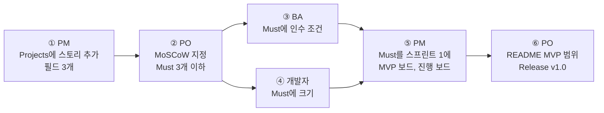

# 미션 5-2. MVP 확정과 v1.0

!!! abstract "이번 미션에서 할 것"
    - 팀 Projects에 스토리를 모으고 `MoSCoW`, `크기`, `스프린트`로 정리합니다.
    - PO가 Must를 3개 이하로 골라 MVP를 확정하고, BA가 Must 스토리에 인수 조건을 씁니다. Must 중 대표 스토리 하나가 6교시에 실제로 구현할 스토리입니다.
    - PM이 보드 뷰 두 개(`MVP 보드`, `진행 보드`)를 만듭니다.
    - PO가 README에 MVP 범위(Must별 핵심 인수 조건과 결정 요약)를 쓰고 Release `v1.0`(요구사항 기준선)을 발행합니다.

**소요 시간** 약 15분  **실습 장소** 팀 리포지토리 `lunch-picker-team<번호>`, 팀 Projects `점심 메뉴 추천 팀<번호>`  **관련 교안** [MVP](../class4/index.md#mvp), [인수 조건](index.md#acceptance), [Release](index.md#release)

## 준비

- [미션 5-1](mission-1.md)의 완료 조건을 모두 채웠는지 확인합니다. 스토리 7개(마지막이 대표 스토리 `[스토리] 새 메뉴 2개를 추가해 선택지 늘리기`)와 PO 결정 댓글 2개가 있어야 합니다.
- 팀 리포지토리 **Projects** 탭에서 `점심 메뉴 추천 팀<번호>`를 열어 둡니다.
- 아래 예시 글은 그대로 써도 되고 팀 상황에 맞게 고쳐도 됩니다.

!!! warning "3인 팀"
    3인 팀은 **PO가 PM을 겸합니다.** ①과 ⑤(PM)도 PO가 합니다.

## 전체 흐름

| 순서 | 누가 | 무엇을 | 누구에게 넘김 |
|---|---|---|---|
| ① | PM | 팀 Projects에 스토리 전부 추가, 필드 `MoSCoW`, `크기`, `스프린트` 만들기 | PO (`@PO` 멘션) |
| ② | PO | 스토리마다 MoSCoW 지정 (Must 최대 3개), Must 이유 댓글 | BA, 개발자 (`@` 멘션) |
| ③ | BA | Must 스토리 본문 "인수 조건"에 Given-When-Then 2개 이상 (대표 스토리는 ①~④) | 개발자 |
| ④ | 개발자 | Must 스토리 크기 S, M, L 지정 (L이면 이유 댓글) | PM |
| ⑤ | PM | Must를 스프린트 1에 배정, 보드 뷰 두 개 만들기 (`MVP 보드`는 MoSCoW로, `진행 보드`는 Status로) | PO |
| ⑥ | PO | README에 "## MVP 범위"(Must별 핵심 인수 조건, 결정 요약) 추가 커밋, Release `v1.0` 발행 | 팀 전체 |



③과 ④는 동시에 해도 됩니다.

## 역할별 할 일

=== "PO"

    ### ② MoSCoW 정하기

    PM이 멘션하면 팀 Projects를 엽니다.

    1. 표에서 스토리마다 `MoSCoW` 칸을 클릭해 값을 고릅니다. 에픽 이슈는 비워 둡니다.
    2. **Must는 최대 3개**입니다. "이것이 없으면 정말 출시를 못 하나?"를 기준으로 고르세요.
    3. 미션 5-1에서 결정한 대로 투표 스토리는 `Won't`로 둡니다.

    예시 (Must는 이 세 개로 맞춰 주세요. Should 아래는 팀마다 달라도 됩니다):

    | 스토리 | MoSCoW | 이유 | 6교시에 할 일 |
    |---|---|---|---|
    | 메뉴 목록을 카드로 보기 | Must | 메뉴가 안 보이면 서비스가 아님 | Starter에 이미 있음, 인수 조건으로 확인만 |
    | 예산으로 메뉴 거르기 | Must | 요청자가 가장 급하다고 한 2번 | Starter에 이미 있음, 인수 조건으로 확인만 |
    | 새 메뉴 2개를 추가해 선택지 늘리기 (대표 스토리) | Must | "또 김치찌개요?"를 줄이는 요구. 화면에 아직 없는 유일한 Must | **6교시에 구현** |
    | 버튼 하나로 메뉴 추천받기 | Should | 목적에 직접 연결되지만 Starter에 버튼이 이미 있음 | 없음 |
    | 가까운 메뉴만 보기 | Should | 중요하지만 메뉴가 적어 당장은 눈으로 거를 수 있음 | 없음 |
    | 혼밥 가능한 메뉴 표시 보기 | Could | 있으면 좋음 | 없음 |
    | 후보 메뉴에 팀원이 투표하기 | Won't | 로그인이 필요해서 이번 범위 아님 | 없음 |

    !!! note "이미 있는 기능도 Must로 정하나요?"
        네. MoSCoW는 "만들 일"이 아니라 "출시에 꼭 있어야 하는 것"을 고르는 기준입니다. Starter에 이미 있는 기능이라도 Must로 정하고 인수 조건을 써 두면, 6교시에 다른 변경이 들어와도 이 기능이 깨지지 않았는지 확인하는 기준이 됩니다. 실제로 손대는 것은 대표 스토리 하나입니다.

    4. Must로 고른 스토리마다 이유를 댓글로 남깁니다. 스토리 이슈를 열어 댓글을 씁니다.

        ```text
        [PO] Must로 정했습니다. 요청자가 가장 급하다고 한 요구이고(현업 요청 바라는 점 2번), 예산을 매번 따로 따지는 것이 결정이 늦어지는 큰 이유입니다.
        @BA아이디 인수 조건 부탁드립니다. @개발자아이디 크기 정해 주세요.
        ```

        대표 스토리에는 이렇게 남깁니다. 이 댓글은 6-3 이력 감사에서 "누가 Must로 정했나"의 근거가 됩니다.

        ```text
        [PO] Must로 정했습니다. 현행 업무의 불편한 점 "또 김치찌개요?"를 줄이는 요구이고(docs/02_현행_업무.md), Must 중 지금 화면에 없는 유일한 스토리라서 6교시에 실제로 구현합니다. 나머지 Must 두 개(#4, #6)는 Starter에 이미 있어 인수 조건으로 확인만 합니다.
        @BA아이디 인수 조건 ①~④ 부탁드립니다. @개발자아이디 크기 정해 주세요.
        ```

    확인: 모든 스토리에 `MoSCoW` 값이 있고, Must가 3개 이하이며 대표 스토리가 Must에 들어 있고, Must 스토리마다 PO 이유 댓글이 있으면 성공입니다.

    **기다리는 동안 할 일**

    BA와 개발자가 ③, ④를 하는 동안 ⑥의 README 문구를 미리 준비합니다. 아래 예시를 우리 팀 결정에 맞게 고쳐 두세요.

    ### ⑥-1 README에 MVP 범위 쓰기

    PM이 스프린트 정리를 마치고 멘션하면 시작합니다.

    !!! warning "v1.0 태그는 파일만 고정합니다"
        Release 태그가 고정하는 것은 **그 시점에 커밋된 파일**뿐입니다. 이슈 본문의 인수 조건, PO 결정 댓글, Projects의 MoSCoW 값은 나중에 누가 바꿔도 `v1.0`으로 되돌려 볼 수 없습니다. 그래서 v1.0을 붙이기 전에 README에 Must 목록만이 아니라 **Must별 핵심 인수 조건과 결정 요약**까지 적어 파일로 남깁니다.

    1. 팀 리포지토리 **Code** 탭에서 `README.md`를 클릭합니다.
    2. 오른쪽 위 연필 아이콘(**Edit this file**, 파일 편집)을 클릭합니다.
    3. 기존 내용 아래에 MVP 범위 섹션을 추가합니다. 파일 전체는 아래처럼 됩니다. 이슈 번호는 우리 팀 번호로 바꿉니다.

        ```markdown
        # 점심 메뉴 추천 서비스

        팀원들이 점심 메뉴를 빨리 고를 수 있게 돕는 서비스입니다.

        ## MVP 범위

        목표: 점심 메뉴 결정 시간을 5분 이내로 줄인다.

        | 구분 | 스토리 | 6교시에 할 일 |
        |---|---|---|
        | Must | #4 메뉴 목록을 카드로 보기 | Starter에 있음, 인수 조건으로 확인 |
        | Must | #6 예산으로 메뉴 거르기 | Starter에 있음, 인수 조건으로 확인 |
        | Must | #10 새 메뉴 2개를 추가해 선택지 늘리기 | 대표 스토리, 6교시에 구현 |
        | Should | #8 버튼 하나로 메뉴 추천받기 | |
        | Should | #7 가까운 메뉴만 보기 | |
        | Could | #5 혼밥 가능한 메뉴 표시 보기 | |
        | Won't | #9 후보 메뉴에 팀원이 투표하기 (로그인 필요, 2차 출시에서 검토) | |

        ### Must별 핵심 인수 조건

        **#4 메뉴 목록을 카드로 보기**

        - 웹페이지를 열면 메뉴마다 카드가 하나씩 보인다.
        - 카드에 이름, 종류, 가격(원), 거리(m)가 보인다. 예: 김치찌개, 한식, 9,000원, 300m

        **#6 예산으로 메뉴 거르기**

        - 예산 칸에 10000을 넣으면 10000원이 넘는 메뉴(돈카츠, 샐러드볼)는 보이지 않는다.
        - 예산 칸을 비워 두면 모든 메뉴가 보인다.

        **#10 새 메뉴 2개를 추가해 선택지 늘리기**

        - 웹페이지를 열면 메뉴 카드가 8개 보인다.
        - 새 메뉴 카드에 종류, 가격, 거리가 보이고, 비빔밥에는 "혼밥 가능"이 보인다.
        - 예산 칸에 10000을 넣으면 마라탕(10000원)이 보인다. (경계값)
        - PR의 자동 검사가 초록 체크다.

        ### 결정 요약

        | 결정 | 내용 | 근거 |
        |---|---|---|
        | 충돌 ① 만 원 넘는 메뉴 | 목록에 남긴다. 예산을 입력하면 그 금액 이하만 보이고, 비워 두면 전부 보인다. 기본 예산 값은 없다 | PO 결정 댓글(#6), 킥오프 회의록 3장 |
        | 충돌 ② 추천 방식 | "아무거나 골라 줘"는 화면에 보이는 메뉴 중 하나만 고른다. 투표는 Won't | PO 결정 댓글(#8), 킥오프 회의록 4장 |
        | 비범위 | 식당 정보 자동 수집과 로그인은 하지 않는다 | 킥오프 회의록 결정 사항 |
        | 범위 변경 | v1.0 이후 범위 변경은 `변경요청` 라벨 이슈로 관리한다 | 5교시 팀 합의 |
        ```

    4. **Commit changes...**를 클릭합니다.
    5. 커밋 메시지를 입력하고 **Commit directly to the main branch**로 **Commit changes**를 클릭합니다.

        ```text
        README에 MVP 범위 추가
        ```

    확인: 리포지토리 첫 화면 README 아래에 "MVP 범위" 표, "Must별 핵심 인수 조건", "결정 요약" 표가 보이고, `#4` 같은 번호가 파란 링크로 보이면 성공입니다.

    ### ⑥-2 Release v1.0 발행하기

    지금 이 커밋이 "요구사항 확정본"입니다. 여기에 `v1.0` 이름표를 붙입니다. 이 태그에는 방금 README에 적은 Must, 인수 조건, 결정 요약이 파일로 함께 고정됩니다. 이슈와 Projects의 값은 태그에 들어가지 않습니다.

    1. 팀 리포지토리 **Code** 탭 오른쪽 사이드바에서 **Releases**를 클릭합니다.
        - 사이드바에 "No releases published"와 **Create a new release** 링크가 보이면 그 링크를 눌러도 됩니다.
    2. **Draft a new release**(새 릴리스 작성)를 클릭합니다.
    3. **Choose a tag**(태그 고르기)를 클릭하고 칸에 아래를 입력합니다.

        ```text
        v1.0
        ```

    4. 아래에 나타나는 **+ Create new tag: v1.0 on publish**(발행할 때 새 태그 만들기)를 클릭합니다.
    5. **Target**(대상)이 `main`인지 확인합니다.
    6. **Release title**(릴리스 제목)에 아래를 입력합니다.

        ```text
        요구사항 기준선 v1.0
        ```

    7. 설명 칸을 채웁니다. 두 방법 중 하나를 고릅니다.
        - **Generate release notes**(릴리스 노트 자동 생성)를 클릭해 GitHub가 변경 목록을 자동으로 채우게 합니다.
        - 또는 아래처럼 MVP 범위를 직접 씁니다.

        ```markdown
        점심 메뉴 추천 서비스의 요구사항 기준선입니다. 이후 변경은 변경 요청(CR)으로 관리합니다.

        ## MVP (Must)
        - #4 메뉴 목록을 카드로 보기 (Starter에 있음, 확인만)
        - #6 예산으로 메뉴 거르기 (Starter에 있음, 확인만)
        - #10 새 메뉴 2개를 추가해 선택지 늘리기 (대표 스토리, 6교시에 구현)

        ## 이번에 하지 않는 것 (Won't)
        - #9 후보 메뉴에 팀원이 투표하기

        Must별 핵심 인수 조건과 결정 요약은 이 태그에 포함된 README의 "MVP 범위"를 봅니다.
        ```

    8. 아래 **Set as the latest release**가 체크되어 있는지 확인합니다.
    9. **Publish release**(릴리스 발행)를 클릭합니다.

    확인: Releases 화면에 `요구사항 기준선 v1.0`과 초록색 **Latest** 표시가 보이면 성공입니다. 그리고 **Code** 탭 → 분기 선택 버튼(`main`) → **Tags** 탭을 누르면 `v1.0`이 보입니다.

    마지막으로 팀에 알립니다. 첫 번째 에픽 `[에픽] 메뉴 한눈에 보기`(#1)에 댓글을 남깁니다.

    ```text
    @PM아이디 @BA아이디 @개발자아이디 MVP 범위를 README에 정리하고 요구사항 기준선 v1.0을 발행했습니다. 이후 범위 변경은 변경요청 라벨로 따로 관리합니다.
    ```

=== "PM"

    ### ① 팀 Projects에 스토리 담고 필드 만들기

    **스토리 전부 추가하기**

    1. 팀 Projects `점심 메뉴 추천 팀<번호>`를 엽니다.
    2. 표 아래 **+ Add item** 옆, 또는 오른쪽 위 **...** → **Add items from repository**를 클릭합니다.
    3. 리포지토리로 `lunch-picker-team<번호>`를 고릅니다.
    4. 스토리 이슈를 모두 체크합니다. 에픽도 함께 담아도 됩니다.
    5. **Add selected items**를 클릭합니다.

    확인: 표에 스토리 7개(대표 스토리 포함)가 모두 보이면 성공입니다.

    **필드 3개 만들기**

    표 머리 맨 오른쪽 **+** → **+ New field**로 아래 3개를 만듭니다. 방법은 실습 4-2와 같습니다. 이름과 선택지를 **그대로** 입력합니다.

    | Field name | Field type | 설정 |
    |---|---|---|
    | `MoSCoW` | **Single select** | 선택지 `Must`, `Should`, `Could`, `Won't` |
    | `크기` | **Single select** | 선택지 `S`, `M`, `L` |
    | `스프린트` | **Iteration** | **Starts on** 오늘, **Duration** `1` weeks |

    필드를 다 만들면 PO를 부릅니다. 대표 스토리 `[스토리] 새 메뉴 2개를 추가해 선택지 늘리기`(#10)에 댓글을 남깁니다.

    ```text
    @PO아이디 팀 Projects에 스토리를 모두 담고 MoSCoW, 크기, 스프린트 필드를 만들었습니다. MoSCoW를 정해 주세요. Must는 3개까지입니다.
    ```

    확인: 표 머리에 `MoSCoW`, `크기`, `스프린트` 칸이 보이면 성공입니다.

    **기다리는 동안 할 일**

    - 팀 Projects **...** → **Workflows**에서 **Item closed**, **Pull request merged**, **Item added to project**가 켜져 있는지 확인합니다.
    - 스토리마다 마일스톤 `MVP`가 붙어 있는지 확인합니다. Won't 스토리는 MoSCoW가 정해진 뒤 마일스톤을 빼 둡니다.

    ### ⑤ 스프린트 배정과 보드 뷰 두 개 만들기

    개발자가 크기를 정하면 시작합니다. 보드 뷰는 쓰는 때가 다른 두 개를 만듭니다.

    | 뷰 이름 | Layout | Column by | 쓰는 때 |
    |---|---|---|---|
    | `MVP 보드` | Board | MoSCoW | 5교시 범위 확인 |
    | `진행 보드` | Board | Status (Todo, In Progress, Done) | 6교시 진행 관리. PR이 병합되면 카드가 Done으로 자동 이동 |

    **스프린트 배정**

    1. 표에서 Must 스토리의 `스프린트` 칸을 클릭해 첫 번째 기간(스프린트 1)을 고릅니다.
    2. Should 스토리는 두 번째 기간을 고릅니다. Could, Won't는 비워 둡니다.

    **`MVP 보드` 만들기**

    1. **+ New view** → 검색창 오른쪽 톱니바퀴 **View options**(뷰 설정) → **Layout** → **Board**를 클릭합니다.
    2. 같은 **View options** → **Column by** → **MoSCoW**를 클릭합니다.
    3. 뷰 탭 이름을 더블클릭해 아래 이름으로 바꾸고 Enter를 누릅니다.

        ```text
        MVP 보드
        ```

    4. **Save**를 클릭합니다.

    **`진행 보드` 만들기**

    1. 다시 **+ New view** → 검색창 오른쪽 톱니바퀴 **View options**(뷰 설정) → **Layout** → **Board**를 클릭합니다.
    2. 같은 **View options** → **Column by** → **Status**를 클릭합니다. `Todo`, `In Progress`, `Done` 칸이 생깁니다.
    3. 뷰 탭 이름을 더블클릭해 아래 이름으로 바꾸고 Enter를 누릅니다.

        ```text
        진행 보드
        ```

    4. **Save**를 클릭합니다.
    5. PO에게 알립니다.

        ```text
        @PO아이디 Must 스토리를 스프린트 1에, Should를 스프린트 2에 배정했습니다. 범위를 보는 MVP 보드(MoSCoW 기준)와 6교시 진행을 보는 진행 보드(Status 기준)를 만들었습니다. MVP 범위 확정과 v1.0 발행 부탁드립니다.
        ```

    확인: 뷰 탭에 `MVP 보드`와 `진행 보드`가 있습니다. `MVP 보드`에 Must, Should, Could, Won't 칸이 있고 Must 칸 카드가 3개 이하(대표 스토리 포함)이며, `진행 보드`에 Todo, In Progress, Done 칸이 있고, 표에서 Must 스토리의 스프린트가 모두 첫 번째 기간이면 성공입니다.

    !!! note "Group by와 Column by"
        표 뷰에서 묶을 때는 **Group by**, 보드 뷰에서 칸을 나눌 때는 **Column by**를 씁니다. 보드에서 **Group by**까지 쓰면 칸 안을 가로줄로 한 번 더 나눌 수 있습니다. 예를 들어 Column by `MoSCoW`, Group by `스프린트`.

=== "BA"

    ### ③ Must 스토리에 인수 조건 쓰기

    PO가 MoSCoW를 정하고 멘션하면 Must 스토리를 하나씩 엽니다. Must 스토리마다 **Given-When-Then 인수 조건을 2개 이상** 씁니다.

    1. 스토리 본문 오른쪽 위 **...** → **Edit**를 클릭합니다.
    2. `## 인수 조건` 아래를 고칩니다. **숫자와 화면 결과**로 누가 봐도 통과인지 알 수 있게 씁니다. PO의 결정 댓글 내용도 반영합니다.
    3. **Save**를 클릭합니다.

    `[스토리] 예산으로 메뉴 거르기` 예시:

    ```markdown
    ## 인수 조건
    - [ ] Given 메뉴 6개가 있을 때, When 예산 칸에 10000을 입력하면, Then 10000원이 넘는 메뉴(돈카츠 11000원, 샐러드볼 10500원)는 보이지 않는다.
    - [ ] Given 메뉴 6개가 있을 때, When 예산 칸에 10000을 입력하면, Then 10000원 이하 메뉴 4개(김치찌개, 짜장면, 쌀국수, 순두부찌개)가 모두 보인다.
    - [ ] Given 예산 칸이 비어 있을 때, When 화면을 열면, Then 메뉴 6개가 모두 보인다. (PO 결정: 만 원 넘는 메뉴도 목록에 둔다)
    ```

    `[스토리] 메뉴 목록을 카드로 보기` 예시:

    ```markdown
    ## 인수 조건
    - [ ] Given 메뉴 데이터에 메뉴가 있을 때, When 웹페이지를 열면, Then 메뉴마다 카드가 하나씩 보인다. (지금은 6개)
    - [ ] Given 김치찌개 카드를 볼 때, When 카드를 읽으면, Then "김치찌개", "한식", "9,000원", "300m"가 모두 보인다.
    ```

    `[스토리] 새 메뉴 2개를 추가해 선택지 늘리기`(대표 스토리) 예시. 6교시 PR 검토에서 이 ①~④를 하나씩 확인합니다.

    ```markdown
    ## 인수 조건
    - [ ] ① Given 웹페이지를 열었을 때, When 메뉴 목록을 보면, Then 메뉴 카드가 8개 보인다.
    - [ ] ② Given 새 메뉴 카드에서, When 내용을 보면, Then 종류, 가격, 거리가 보이고 비빔밥에는 "혼밥 가능"이 보인다.
    - [ ] ③ Given 예산 칸에 10000을 넣었을 때, When 목록을 보면, Then 마라탕(10000원)이 보인다. (경계값)
    - [ ] ④ Given PR을 열었을 때, When 자동 검사가 끝나면, Then 초록 체크다.
    ```

    !!! note "예산 인수 조건과 대표 스토리 ③은 이어집니다"
        예산 스토리는 "10000원 **넘는** 메뉴는 안 보인다"를, 대표 스토리 ③은 "딱 10000원인 마라탕은 **보인다**"를 확인합니다. 둘을 함께 보면 "이하"라는 기준의 양쪽 끝을 모두 확인하게 됩니다. 경계에 있는 값을 일부러 넣어 확인하는 것을 **경계값** 확인이라고 합니다.

    확인: Must 스토리마다 `## 인수 조건`에 Given, When, Then이 들어간 줄이 2개 이상 있으면 성공입니다.

    !!! note "왜 이렇게 하나요?"
        6교시에 개발자가 PR을 올리면, BA는 이 인수 조건을 체크리스트처럼 하나씩 확인하며 검토합니다. "잘 된다"처럼 쓰면 검토할 때 판단 기준이 없습니다. 지금 숫자로 써 두어야 6교시에 "통과", "고쳐 주세요"를 분명히 말할 수 있습니다.

    **기다리는 동안 할 일**

    - 쓴 인수 조건을 개발자에게 보여 주고 "이대로 확인할 수 있는지" 물어봅니다. 애매하면 고칩니다.
    - Should 스토리에도 시간이 남으면 인수 조건을 1개씩 써 둡니다.

=== "개발자"

    ### ④ Must 스토리 크기 정하기

    PO가 MoSCoW를 정하고 멘션하면 팀 Projects를 엽니다.

    1. 표에서 Must 스토리의 `크기` 칸을 클릭해 `S`, `M`, `L` 중 하나를 고릅니다. Starter에 이미 있는 두 Must와 대표 스토리(메뉴 데이터 2줄 추가)는 모두 `S`가 자연스럽습니다.

        | 크기 | 기준 (오늘 실습 기준) |
        |---|---|
        | `S` | 지금 화면에 거의 있음. 데이터나 문구만 조금 바꾸면 됨 |
        | `M` | 화면이나 데이터를 몇 군데 고쳐야 함 |
        | `L` | 새 기능이 필요하거나 정해지지 않은 것이 남아 있음 |

    2. 시간이 남으면 Should, Could 스토리도 크기를 정합니다.
    3. `L`로 정한 스토리가 있으면 그 스토리에 이유 댓글을 남깁니다. 예를 들어 시간이 남아 투표 스토리(Won't)에도 크기를 매겼다면:

        ```text
        @PO아이디 @PM아이디 크기를 L로 정했습니다. 투표는 지금 화면에 없는 새 기능이고, 누가 투표했는지 구분하려면 로그인이 필요합니다. 로그인은 이번 범위가 아닙니다.
        ```

    4. 다 정하면 PM에게 알립니다.

        ```text
        @PM아이디 Must 스토리 크기를 모두 정했습니다.
        ```

    확인: Must 스토리 모두 `크기` 값이 있고, `L`인 스토리에는 이유 댓글이 있으면 성공입니다.

    !!! note "크기를 왜 개발자가 정하나요?"
        만드는 사람이 가장 정확하게 압니다. PO와 PM은 이 크기를 보고 스프린트 1에 다 들어가는지 판단합니다. 크기가 너무 크면 Must를 줄이거나 스토리를 더 잘게 나눕니다.

    **기다리는 동안 할 일**

    - BA가 쓴 인수 조건을 읽고, 실제로 확인할 수 있는지 봅니다. 애매하면 스토리에 질문 댓글을 남깁니다.
    - 6교시에 대표 스토리를 구현할 분기 이름 `story-<이슈번호>`를 미리 생각해 둡니다. 예: 대표 스토리가 10번이면 `story-10`. 번호는 팀마다 다릅니다.

## 완료 조건 (팀 단위)

- [x] 팀 Projects에 스토리가 모두 있고, `MoSCoW`, `크기`, `스프린트` 필드가 있다
- [x] 모든 스토리에 MoSCoW 값이 있고, **Must는 3개 이하**이며 대표 스토리가 Must에 있고, Must마다 PO의 이유 댓글이 있다
- [x] Must 스토리마다 Given-When-Then 인수 조건이 2개 이상 있고, 대표 스토리에는 ①~④가 있다
- [x] Must 스토리마다 크기가 있고, `L`이면 이유 댓글이 있다
- [x] Must 스토리가 모두 스프린트 1에 있고, MoSCoW로 칸이 나뉜 `MVP 보드`와 Status로 칸이 나뉜 `진행 보드`가 있다
- [x] `README.md`에 "## MVP 범위" 섹션이 있고, Must별 핵심 인수 조건과 결정 요약(충돌 2건 결정 포함)이 들어 있다
- [x] Releases에 `요구사항 기준선 v1.0`이 있고, **Tags**에 `v1.0`이 보인다

## 막히면

??? failure "Add items from repository에 팀 리포지토리가 없습니다"
    프로젝트를 만든 PM 계정이 팀 리포지토리 협업자여야 합니다. 리포지토리 초대를 수락했는지 확인하세요. 또는 **+ Add item**에 `#`을 입력한 뒤 `lunch-picker`를 입력해 검색합니다.

??? failure "팀원이 MoSCoW나 크기 값을 바꿀 수 없습니다"
    프로젝트 권한이 없거나 `Read`입니다. PM이 **...** → **Settings** → **Manage access**에서 그 팀원을 `Write`로 바꿉니다. [실습 4-3](../class4/lab-3.md)의 PM STEP 3을 보세요.

??? failure "Must를 3개로 줄이기 어렵습니다"
    정상입니다. 그 고민이 이번 미션의 핵심입니다. "이것이 없으면 정말 출시를 못 하나?"를 하나씩 물어보세요. 서비스 목적은 "메뉴 결정 시간 5분 이내"입니다. 이 목적을 시험해 보는 데 꼭 필요한 것만 Must입니다. 그래도 정하지 못하면 PO가 결정하고, 이유를 댓글로 남깁니다.

??? failure "Choose a tag에 v1.0을 입력했는데 Create new tag가 보이지 않습니다"
    입력 칸에 `v1.0`을 정확히 입력했는지 확인합니다. 이미 `v1.0` 태그가 있다면 목록에서 기존 태그가 선택됩니다. 다른 팀원이 먼저 만들었는지 **Tags**에서 확인하세요.

??? failure "Release를 잘못된 제목으로 발행했습니다"
    Releases 화면에서 그 릴리스 오른쪽 연필 아이콘(**Edit**)을 눌러 제목과 설명을 고치고 **Update release**를 클릭합니다. 태그는 그대로 둡니다.

??? failure "README를 고쳤는데 표가 깨져 보입니다"
    표 바로 위에 빈 줄이 있어야 합니다. 그리고 `|---|---|` 줄의 칸 수가 머리 줄과 같아야 합니다. 연필 아이콘으로 다시 열어 **Preview**(미리 보기) 탭에서 확인한 뒤 저장하세요.

## 다음 교시로 넘어가기 전에

- `v1.0` 릴리스와 태그는 지우지 않습니다. 6교시에 `v1.1`과 비교합니다.
- 6교시에는 팀 Projects의 `진행 보드`를 씁니다. PM이 대표 스토리를 In Progress로 옮기고, PR이 병합되면 카드가 Done으로 자동 이동합니다. `MVP 보드`는 범위를 다시 확인할 때 봅니다.
- Must 스토리의 인수 조건은 6교시 PR 검토의 기준입니다. 6교시 시작 전에 고칠 것이 있으면 지금 고치세요. v1.0 이후 범위가 바뀌면 `변경요청`으로 관리합니다.
