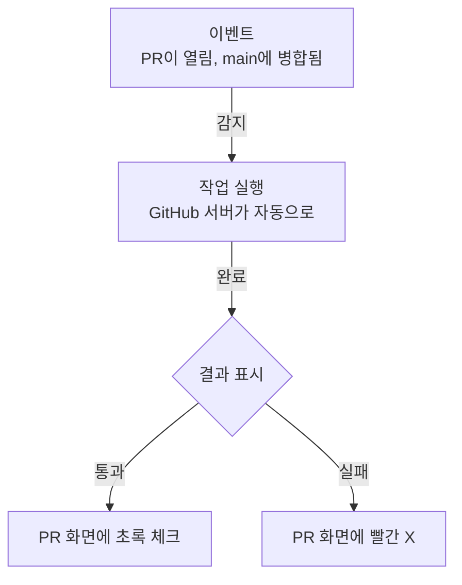
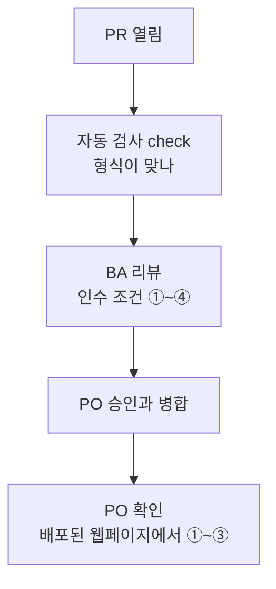
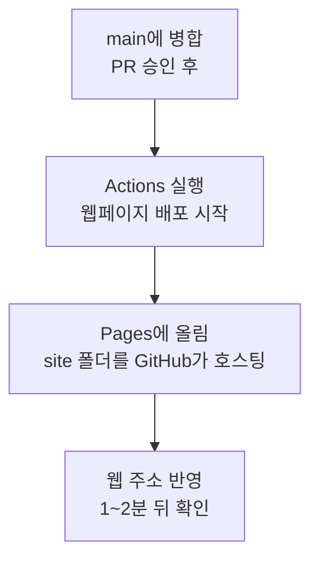
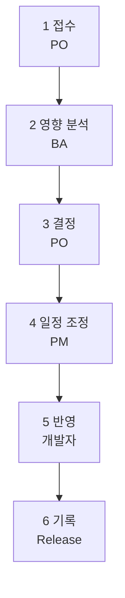

# 6교시. 팀 실습 ② 구현, 검토, 변경

!!! abstract "이번 교시의 목표"
    검토를 거쳐 변경을 반영하고, 누가 언제 왜 변경했는지 이력으로 증명할 수 있습니다.

!!! info "오늘의 흐름에서 지금 위치"
    현업 요청 → 이슈 → 우선순위와 인수 조건 → **PR** → **검사와 리뷰** → **병합과 배포** → **이력 확인** → 보호 규칙

    6교시에는 3교시에 혼자 해 본 뒤쪽 단계를 팀으로 다시 돌립니다.

| 구간 | 시간 | 내용 |
|---|---|---|
| 복습 | 5분 | [3교시 흐름을 팀으로](#team-flow). 분기, PR, 리뷰, Blame |
| 기술 설명 | 10분 | 아래 [교안](#lecture). Actions, 워크플로 파일, 검사 통과와 요구 충족, Pages 배포, 변경 요청 6단계 |
| 미션 6-1 | 15분 | [미션 6-1 구현과 검토](mission-1.md). 대표 스토리 1개를 PR로 구현, 검토, 병합, 배포 |
| 미션 6-2 | 12분 | [미션 6-2 변경 요청 처리](mission-2.md). CR-001 접수부터 v1.1 발행까지 |
| 미션 6-3 | 5분 | [미션 6-3 이력 감사](mission-3.md). 감사 질문 5개에 GitHub 링크로 답하기 |
| 회고 | 3분 | [회고](review.md) |

## 교안 { #lecture }

!!! question "이번 교시를 시작하며"
    - **왜 지금 하나요?** 팀이 작업 범위와 완료 기준을 합의했습니다. 이제 그중 한 가지 변경을 PR로 반영하고, 합의한 기준으로 검토합니다.
    - **앞에서 만든 무엇을 쓰나요?** 5교시에 만든 팀 리포지토리 `lunch-picker-team<번호>`의 대표 스토리 `[스토리] 새 메뉴 2개를 추가해 선택지 늘리기`(예시 `#10`)와 그 인수 조건 ①~④, 팀 Projects의 `진행 보드`, Release `v1.0`을 씁니다. 3교시에 배운 분기, PR, 리뷰, Squash and merge, Blame도 그대로 씁니다.
    - **끝나면 무엇을 누구에게 넘기나요?** 메뉴 8개에 `delivery` 항목까지 들어간 `main`, Release `v1.0`과 `v1.1`, CR-001 이슈의 감사 답변 댓글을 남깁니다. 7교시에는 이 팀 리포지토리에 PO가 **Settings**에서 분기 보호 규칙을 걸어, 오늘 약속으로 지킨 검토를 규칙으로 바꿉니다.

6교시는 개발자가 실제로 구현하고, BA가 검토하고, PO가 승인해서 웹페이지에 반영하는 시간입니다. 그리고 중간에 강사가 현업 고객으로서 **변경 요청**을 하나 던집니다. 요청을 받은 팀은 접수, 분석, 결정, 반영, 기록까지 GitHub 안에서 처리합니다.

시작 전에 PR을 열면 자동으로 돌아가는 검사, **GitHub Actions**의 원리를 먼저 봅니다. 이번 교시가 끝나면 우리 팀 웹페이지에 변경이 실제로 반영되는 것을 직접 보게 됩니다.

### 3교시에 배운 흐름을 팀으로 돌립니다 { #team-flow }

이번 교시에 새로 배우는 기능은 거의 없습니다. 3교시에 혼자 또는 짝과 해 본 흐름을 이번에는 네 명이 역할을 나눠 돌립니다.

| 3교시에 배운 것 | 6교시에 누가 어떻게 쓰나 |
|---|---|
| 분기와 PR (3교시) | 개발자가 분기에서 구현하고 PR로 검토를 요청합니다 |
| 리뷰 (3교시) | BA는 5교시에 쓴 **인수 조건**을 기준으로 검토하고, PO는 최종 승인합니다 |
| Blame과 이력 (3교시) | 변경 요청을 처리한 뒤 누가 언제 왜 바꿨는지 증명합니다 |

3교시에도 Request changes와 변경 제안을 써 봤습니다. 다만 그때는 실습용으로 정해 준 값(김치찌개 가격 등)을 두고 리뷰 **절차**를 연습했습니다. 지금은 BA가 "대표 스토리의 인수 조건 ①~④가 정말 만족되나?"를 기준으로 판단합니다. 리뷰의 기준이 정해진 연습 값에서 팀이 5교시에 **합의한 인수 조건**으로 바뀌는 것이 차이입니다.

특히 BA는 리뷰할 때 **Request changes**(수정 요청)를 꼭 한 번 써 보세요. 고쳐 달라고 요청하고, 개발자가 반영하고, 다시 승인하는 왕복을 경험하는 것이 이번 교시의 핵심입니다. 3교시 내용이 기억나지 않으면 실습 중에 손을 들어 주세요.

!!! tip "핵심"
    새 기능이 아니라 3교시 흐름을 역할을 나눠 돌리는 것입니다. 리뷰 기준은 인수 조건입니다.

### Actions는 '이런 일이 생기면, 이 작업을 해라'입니다 { #actions }

**GitHub Actions**는 "이런 일이 생기면, 이 작업을 자동으로 해라"를 정해 두는 기능입니다. 여기서 "이런 일"을 **이벤트**라고 부릅니다. PR이 열렸다, PR에 커밋이 추가됐다, main에 병합됐다 같은 일입니다.

이벤트가 생기면 GitHub 서버가 정해진 작업을 자동으로 실행하고, 결과를 PR 화면에 초록 체크(통과) 또는 빨간 X(실패)로 보여 줍니다. 사람이 버튼을 누를 필요가 없습니다.



우리 Starter에는 메뉴 데이터 형식을 검사하는 작업이 미리 들어 있습니다. 개발자가 `site/menus.json`에서 쉼표 하나만 빠뜨려도 PR에 빨간 실패가 뜹니다. 회사로 비유하면, 결재 서류가 올라오면 총무팀이 양식부터 확인하는 것과 같습니다. 양식 확인은 기계가 하고, 사람은 내용 검토에 집중할 수 있습니다.

!!! tip "핵심"
    사람이 놓치는 실수를 자동화가 먼저 잡아 줍니다. Actions는 이벤트가 생기면 정해진 작업을 자동으로 실행합니다.

### 워크플로 파일 한 장에 언제, 어디서, 무엇을이 들어 있습니다 { #workflow-file }

자동화 내용은 리포지토리의 `.github/workflows` 폴더에 있는 파일 한 장에 들어 있습니다. 이 파일을 **워크플로**(workflow, 작업 흐름) 파일이라고 부릅니다. 팀 리포지토리에서 **Code** 탭 → `.github` → `workflows` → `check.yml`을 열면 아래 내용이 보입니다.

```yaml title=".github/workflows/check.yml"
--8<-- "starter/.github/workflows/check.yml"
```

코드를 다 읽을 필요는 없습니다. 세 부분만 보면 됩니다.

| 항목 | 뜻 | 이 파일에서는 |
|---|---|---|
| `on` | **언제** 실행할지 | `pull_request`: PR이 열리거나 커밋이 추가될 때. `workflow_dispatch`: Actions 탭에서 사람이 직접 실행할 때 |
| `runs-on` | **어디서** 실행할지 | `ubuntu-latest`: GitHub가 잠시 빌려주는 리눅스 서버 |
| `steps` | **무엇을** 할지 | 리포지토리 파일을 받고(checkout), Node.js를 준비하고, `node scripts/check-menus.js`로 메뉴 데이터를 검사 |

맨 위 `name: 메뉴 데이터 검사`는 Actions 탭과 PR 화면에 보이는 이름입니다. `jobs:` 아래 `check:`는 작업 이름이고, 7교시에 분기 보호를 설정할 때 "이 검사가 통과해야 병합 가능"으로 고르는 이름이 바로 이 `check`입니다.

검사 프로그램은 메뉴마다 이름, 종류, 가격(숫자), 거리(숫자)가 있는지, `solo`와 `delivery`가 `true` 또는 `false`인지, 메뉴 이름이 겹치지 않는지를 확인합니다. 통과하면 이렇게 출력합니다.

```text
[통과] 메뉴 6개를 검사했습니다. 문제가 없습니다.
```

쉼표나 괄호가 틀리면 이렇게 실패합니다.

```text
[실패] site/menus.json이 올바른 JSON 형식이 아닙니다.
       쉼표, 따옴표, 괄호가 빠지지 않았는지 확인하세요.
```

!!! tip "핵심"
    이 파일만 있으면 누가 PR을 올리든 똑같은 검사가 자동으로 돌아갑니다. 볼 것은 on(언제), runs-on(어디서), steps(무엇을) 세 가지입니다.

### 검사 통과와 요구 충족은 다릅니다 { #check-vs-acceptance }

자동 검사 `check`가 보는 것은 메뉴 데이터의 **형식**뿐입니다. 쉼표가 맞는지, 가격과 거리가 숫자인지, `solo`가 `true` 또는 `false`인지를 봅니다. 그래서 비빔밥의 `solo`를 `true`가 아니라 `false`로 잘못 넣어도, 마라탕 가격을 `10000`이 아니라 `1000`으로 잘못 넣어도 형식은 맞으니 초록 체크가 뜹니다.

| 누가 | 무엇을 확인 | 확인하는 곳 |
|---|---|---|
| 자동 검사 (`check`) | 데이터 형식 (쉼표, 숫자, true/false) | PR의 체크 |
| BA | 인수 조건을 만족하는가 | PR의 Files changed |
| PO | 사용자가 보는 화면에서 정말 되는가 | 배포된 웹페이지 |



회사로 비유하면 총무팀이 결재 양식을 확인해 주는 것과 담당 부서가 내용을 검토하는 것은 다른 일입니다. 양식이 맞아도 내용이 틀릴 수 있습니다.

!!! tip "핵심"
    초록 체크는 "형식이 맞다"는 뜻일 뿐, "요구를 충족했다"는 뜻이 아닙니다. 요구 충족은 BA가 인수 조건으로, PO가 화면으로 확인합니다.

### 병합하면 웹페이지가 자동으로 바뀝니다 { #pages-deploy }

**GitHub Pages**는 리포지토리의 파일을 웹페이지로 공개해 주는 기능입니다. 따로 서버를 빌리지 않아도 `https://<아이디>.github.io/<리포지토리>/` 주소로 누구나 볼 수 있습니다. 팀 리포지토리의 웹 주소는 `https://<PO아이디>.github.io/lunch-picker-team<번호>/`입니다.

Starter에는 main에 병합되면 웹페이지를 자동으로 다시 배포하는 워크플로가 하나 더 들어 있습니다.



```yaml title=".github/workflows/pages.yml"
--8<-- "starter/.github/workflows/pages.yml"
```

| 항목 | 이 파일에서는 |
|---|---|
| `on` | `push: branches: [main]`: main에 새 커밋이 들어올 때(PR 병합 포함). `workflow_dispatch`: 직접 실행 |
| `permissions` | Pages에 올릴 수 있는 권한을 받습니다 |
| `steps` | 파일을 받고, Pages 설정을 확인하고, `site` 폴더만 묶어 올리고(`path: site`), 배포합니다 |

그래서 개발자가 메뉴를 추가하고 PR이 병합되면 Actions가 돌고, Pages에 올라가서, 1~2분 뒤 웹 주소에 변경이 보입니다. PO는 코드를 열어 보지 않아도 웹페이지에서 바로 결과를 확인할 수 있습니다. 웹 주소는 리포지토리 **Settings** → **Pages** 화면 맨 위에도 나옵니다.

!!! note "배포가 끝났는지 보는 곳"
    **Actions** 탭 왼쪽 목록에서 **웹페이지 배포**를 누르면 실행 기록이 나옵니다. 노란 원은 실행 중, 초록 체크는 완료, 빨간 X는 실패입니다. 초록 체크가 뜬 뒤 웹 주소를 새로 고침하세요.

!!! tip "핵심"
    병합이 곧 배포입니다. main에 들어간 것이 웹페이지에 보이는 것입니다. 그래서 main에 들어가기 전 검토가 중요합니다.

### 변경 요청은 여섯 단계로 처리합니다 { #change-request }

미션 중간에 강사가 현업 고객(경영지원팀 박지은 과장)으로서 변경 요청을 하나 드립니다. 요구사항 기준선(v1.0)을 정한 뒤에 들어오는 요청은 바로 고치지 않고 정해진 절차로 처리합니다. 그래야 "누가 언제 무엇을 왜 바꾸기로 했는가"가 남습니다.



| 단계 | 누가 | 무엇을 | GitHub에 남는 곳 |
|---|---|---|---|
| 1. 접수 | PO | 요청을 이슈로 등록합니다 | 이슈 (라벨 `변경요청`) |
| 2. 영향 분석 | BA | 어떤 문서, 데이터, 화면, 검사가 바뀌는지 정리합니다 | 이슈 댓글 |
| 3. 결정 | PO | 수용할지, 언제 할지 결정합니다 | 이슈 댓글 |
| 4. 일정 조정 | PM | 마일스톤과 스프린트에 넣고, 밀려나는 일을 정리합니다 | 마일스톤 `2차 출시`, Projects 스프린트 |
| 5. 반영 | 개발자 (문서는 BA) | 분기에서 고치고 PR로 검토받아 병합합니다 | PR, 리뷰, 커밋 |
| 6. 기록 | PO | 새 버전으로 발행합니다 | Release `v1.1` |

회사에서 쓰는 변경 관리 대장(CR 대장)과 같은 내용입니다. 다른 점은 대장을 따로 쓰지 않아도 이슈 댓글, PR, Release가 그대로 증거가 된다는 것입니다. 미션 6-3 이력 감사에서 이 증거를 링크로 찾아 답합니다.

!!! note "미션에서는 순서를 조금 바꿉니다"
    실습 시간이 짧아서 미션 6-2에서는 PO가 접수 직후 수용 결정 댓글을 먼저 달고, BA의 영향 분석이 이어서 붙습니다. 실무에서는 영향 분석을 보고 결정하는 것이 원칙입니다.

!!! tip "핵심"
    각 단계가 이슈 댓글, PR, Release로 남아 나중에 그대로 증명됩니다.

## 이번 교시 실습

- [미션 6-1 구현과 검토](mission-1.md): 대표 스토리 1개가 분기, PR, 자동 검사, 인수 조건 기준 리뷰(수정 요청 포함), 승인, 병합, 배포까지 가는지, PO가 웹페이지에서 인수 조건을 확인하는지 봅니다.
- [미션 6-2 변경 요청 처리](mission-2.md): CR-001을 6단계로 처리하고 웹페이지에 "배달 가능" 배지가 보이는지, v1.0과 v1.1 비교 화면이 나오는지 확인합니다.
- [미션 6-3 이력 감사](mission-3.md): 감사 질문 5개에 말이 아니라 GitHub 링크로 답할 수 있는지 확인합니다.
- [회고](review.md): 팀이 겪은 일을 짧게 돌아봅니다.
