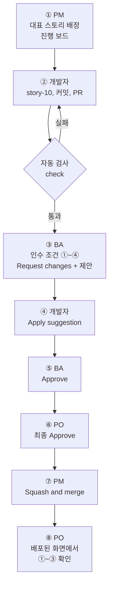

# 미션 6-1. 구현과 검토

!!! abstract "이번 미션에서 할 것"
    - 대표 스토리 `[스토리] 새 메뉴 2개를 추가해 선택지 늘리기`를 개발자가 분기 `story-10`에서 구현하고 PR로 검토를 요청합니다.
    - BA가 인수 조건 ①~④를 기준으로 수정 요청과 변경 제안을 하고, 개발자가 반영합니다.
    - BA와 PO가 승인하면 PM이 병합하고, PO가 배포된 웹페이지에서 인수 조건 ①~③을 직접 확인합니다.

**소요 시간** 약 15분  **실습 장소** 팀 리포지토리 `lunch-picker-team<번호>`  **관련 교안** [6교시 교안](index.md#team-flow), [Actions](index.md#actions), [검사 통과와 요구 충족](index.md#check-vs-acceptance), [Pages 배포](index.md#pages-deploy)

## 준비

- 5교시에 만든 팀 리포지토리 `lunch-picker-team<번호>`를 엽니다. 이슈(에픽 3개, 스토리 7개), 마일스톤 `MVP`, Release `v1.0`, 팀 Projects `점심 메뉴 추천 팀<번호>`의 `진행 보드`가 있어야 합니다.
- 대표 스토리 `[스토리] 새 메뉴 2개를 추가해 선택지 늘리기`의 이슈 번호를 확인합니다. 이 페이지는 `#10`으로 설명합니다. **번호는 팀마다 다릅니다.** 우리 팀 번호가 12번이면 `#10`은 `#12`로, `story-10`은 `story-12`로 바꿔 읽으세요.
- 지금 `site/menus.json`에는 메뉴가 6개 있습니다. 이 미션이 끝나면 8개가 됩니다.
- PO는 다른 탭에 팀 웹페이지 `https://<PO아이디>.github.io/lunch-picker-team<번호>/`를 열어 둡니다. 안 열리면 4-3에서 한 Pages 설정(**Settings** → **Pages** → Source를 **GitHub Actions**로)을 다시 확인하세요.
- 모두 자기 역할 탭을 고르세요. 한 번 고르면 이 가이드의 모든 페이지가 같은 탭으로 바뀝니다.

!!! info "3인 팀은"
    PO가 PM을 겸합니다. PO 탭과 PM 탭의 할 일을 PO 한 사람이 모두 합니다.

## 전체 흐름

| 순서 | 누가 | 무엇을 | 누구에게 넘김 |
|---|---|---|---|
| ① | PM | `진행 보드`에서 대표 스토리를 개발자에게 배정, Status를 In Progress로 | 개발자 |
| ② | 개발자 | 분기 `story-10`에서 메뉴 2개 추가, 커밋, PR 열기, 리뷰어 지정, 자동 검사 확인 | BA, PO |
| ③ | BA | 인수 조건 ①~④ 기준으로 검토, **Request changes**와 **Add a suggestion** | 개발자 |
| ④ | 개발자 | **Apply suggestion**으로 반영, 답글, 다시 리뷰 요청 | BA |
| ⑤ | BA | **Approve** | PO |
| ⑥ | PO | 최종 **Approve** | PM |
| ⑦ | PM | **Squash and merge**, 분기 삭제, 이슈와 `진행 보드` 확인 | PO |
| ⑧ | PO | Actions 배포 확인, 배포된 웹페이지에서 인수 조건 ①~③ 확인, 결과 댓글 | 팀 전체 |



## 역할별 할 일

아래에서 **내 역할 탭**을 누릅니다. 단계마다 맨 위 **언제 시작하나요?** 상자를 먼저 봅니다.

- **바로 시작합니다**라고 되어 있으면 지금 시작합니다.
- 누군가를 기다리는 단계라면 상자에 적힌 화면을 확인합니다. **아직이면** 앞 사람이 하는 중이니, 탭 맨 아래 **기다리는 동안 할 일**을 하며 기다립니다.
- 내 단계가 끝나면 적힌 대로 다음 사람을 `@아이디`로 멘션하거나 말로 알립니다. 다음 사람은 그 알림이 시작 신호입니다.

입력 예시는 그대로 써도 되고, 팀 상황에 맞게 고쳐도 됩니다. `#10`, `story-10` 같은 번호는 여러분 팀 대표 스토리의 실제 이슈 번호로 바꾸세요.

=== "PO"

    **① 대표 스토리 확인**

    !!! info "언제 시작하나요?"
        - 미션 시작과 동시에 합니다. PM이 보드를 옮기는 동안 함께 봅니다.

    1. PM이 `진행 보드`에서 대표 스토리를 In Progress로 옮길 때 함께 봅니다. 5교시에 내가 Must로 정한 이유 댓글이 스토리에 있는지 확인합니다.

    **⑥ 최종 승인** (BA가 Approve한 뒤)

    !!! info "언제 시작하나요?"
        - BA가 Approve하고 나를 멘션하면 시작합니다.
        - **아직이면:** PR 병합 상자에 BA의 승인(초록 체크와 `approved`)이 없으면 BA가 아직 검토 중입니다.

    1. 리포지토리 위쪽 **Pull requests** 탭 → 개발자가 연 PR 클릭
    2. **Conversation**(대화) 탭에서 BA의 리뷰와 개발자의 답글을 읽고, 변경 내용이 스토리의 의도("늘 가던 곳 말고 새 메뉴도 후보로")와 맞는지 봅니다.
    3. **Files changed** 탭 → 오른쪽 위 초록 **Submit review**(리뷰 제출, 화면에 따라 **Review changes**) 클릭 → **Finish your review** 창이 열립니다
    4. 댓글 칸에 아래 예시를 입력합니다.

        ```text
        BA가 인수 조건 ①~④로 검토하고 수정 요청이 반영된 것을 확인했습니다. 스토리 의도와 맞습니다.
        병합 후 배포된 웹페이지에서 ①~③을 직접 확인하겠습니다. 최종 승인합니다.
        ```

    5. **Approve**(승인) 선택 → **Submit review**(리뷰 제출) 클릭
    6. PM에게 알립니다. PR 화면(**Conversation** 탭) 맨 아래 댓글 칸에 `@PM아이디 최종 승인했습니다. 병합 부탁드립니다.`라고 남겨도 됩니다.

    확인: PR의 **Conversation** 탭에 `<PO아이디> approved these changes`가 보입니다.

    **⑧ 배포된 웹페이지에서 인수 조건 확인** (PM이 병합한 뒤)

    !!! info "언제 시작하나요?"
        - PM이 병합하고, **Actions** 탭의 **웹페이지 배포**가 초록 체크가 되면 시작합니다.
        - **아직이면:** PR 제목 아래 표시가 보라색 **Merged**가 아니거나, 배포가 노란 점이면 기다립니다.

    자동 검사와 BA 리뷰는 PR 안에서 본 것입니다. 사용자가 실제로 보는 화면에서 정말 되는지는 PO가 배포된 웹페이지에서 확인합니다.

    1. 리포지토리 위쪽 **Actions** 탭 클릭
    2. 왼쪽 목록에서 **웹페이지 배포** 클릭. 맨 위 실행 기록의 제목이 방금 병합한 PR 제목인지 봅니다.
    3. 노란 원(실행 중)이 초록 체크(완료)로 바뀔 때까지 1~2분 기다립니다.
    4. 미리 열어 둔 웹페이지 탭으로 가서 강력 새로 고침합니다. Windows는 ++ctrl+shift+r++, Mac은 ++cmd+shift+r++
    5. 인수 조건 ①~③을 하나씩 직접 확인합니다.

        | 인수 조건 | 웹페이지에서 할 일 | 이렇게 보이면 통과 |
        |---|---|---|
        | ① | 예산, 거리 칸을 비운 채로 카드를 셉니다 | 메뉴 카드가 8개 |
        | ② | 비빔밥, 마라탕 카드를 읽습니다 | 종류, 가격, 거리가 보이고 비빔밥에 "혼밥 가능" |
        | ③ | 예산 칸에 `10000`을 입력합니다 | 마라탕(10,000원)이 보임 |

    6. 대표 스토리 이슈(이미 Closed)에 결과 댓글을 남깁니다. 모두 통과했다면:

        ```text
        [PO 확인] 배포된 웹페이지에서 인수 조건을 확인했습니다. https://<PO아이디>.github.io/lunch-picker-team<번호>/
        - ① 메뉴 카드 8개: 통과
        - ② 비빔밥, 마라탕 카드에 종류, 가격, 거리 표시, 비빔밥 "혼밥 가능": 통과
        - ③ 예산 10000 입력 시 마라탕 보임: 통과
        ```

        통과하지 못한 것이 있으면 무엇이 어떻게 보였는지 적고 개발자를 멘션합니다. 이슈를 다시 열려면 **Reopen issue**를 누릅니다.

        ```text
        [PO 확인] ③ 미통과: 예산 10000을 넣으면 마라탕이 보이지 않습니다. 화면에는 가격이 1,000원으로 나옵니다.
        @개발자아이디 확인 부탁드립니다.
        ```

    확인: 대표 스토리 이슈에 `[PO 확인]` 댓글이 있고, ①~③이 모두 통과입니다.

    **기다리는 동안 할 일**

    - 대표 스토리의 인수 조건 ①~③을 다시 읽고, 웹페이지에서 무엇을 보면 "다 됐다"고 할지 정해 둡니다. 지금 웹페이지의 카드가 6개인 것도 미리 봐 둡니다.
    - 다음 미션 6-2의 변경 요청이 들어오면 PO가 가장 먼저 움직입니다. [미션 6-2](mission-2.md)의 PO 탭을 미리 읽어 두세요.

=== "PM"

    **① 대표 스토리 배정하기**

    !!! info "언제 시작하나요?"
        - **바로 시작합니다.** 6-1에서 가장 먼저 움직이는 사람입니다.

    이번 미션에서 구현할 스토리는 5교시에 정한 **대표 스토리** `[스토리] 새 메뉴 2개를 추가해 선택지 늘리기`입니다. 다른 Must 두 개는 Starter에 이미 있으므로 구현하지 않습니다.

    1. 리포지토리 위쪽 **Projects** 탭 → `점심 메뉴 추천 팀<번호>` 클릭 → 뷰 탭에서 `진행 보드` 클릭
    2. `Todo` 열에서 대표 스토리 카드를 찾습니다. (Status가 비어 있으면 **No Status** 열에 있습니다.)
    3. 카드를 클릭해 오른쪽에 열리는 이슈 창에서 **Assignees**(담당자) → 개발자 아이디 선택
    4. 같은 창의 **Status**(상태)를 `In Progress`로 바꿉니다. 카드를 `In Progress` 열로 끌어다 놓아도 됩니다.
    5. 대표 스토리 이슈(#10)에 댓글로 개발자에게 넘깁니다. 카드를 눌러 열린 오른쪽 이슈 창 맨 아래 댓글 칸에 써도 되고, 이슈 제목을 눌러 이슈 화면에서 써도 됩니다.

        ```text
        @개발자아이디 이번 스프린트 첫 구현으로 대표 스토리(#10)를 배정합니다.
        분기 이름은 story-10으로 만들어 주세요. 완료 기준은 본문의 인수 조건 ①~④입니다.
        ```

    확인: `진행 보드`에서 대표 스토리 카드가 `In Progress` 열에 있고 개발자 프로필 사진이 붙어 있습니다.

    **⑦ 병합하기** (PO가 최종 승인한 뒤)

    !!! info "언제 시작하나요?"
        - PO가 최종 승인하고 나를 멘션하면 시작합니다.
        - **아직이면:** PR 병합 상자에 승인이 BA와 PO 두 개가 보이지 않으면 기다립니다.

    1. **Pull requests** 탭 → 해당 PR 클릭
    2. 아래쪽에 BA와 PO의 승인, 자동 검사 `check` 통과(초록 체크)가 모두 보이는지 확인합니다.
    3. **Merge pull request** 버튼 오른쪽 화살표(▼) 클릭 → **Squash and merge**(커밋을 하나로 합쳐 병합) 선택
    4. **Squash and merge** 클릭 → 커밋 메시지는 그대로 두고 **Confirm squash and merge**(병합 확인) 클릭
    5. 보라색 **Merged** 표시가 뜨면 바로 옆 **Delete branch**(분기 삭제) 클릭
    6. **Issues** 탭으로 가서 해당 스토리 이슈가 **Closed**(닫힘)인지 확인합니다.
    7. **Projects** → `진행 보드`에서 대표 스토리 카드가 `Done` 열로 자동으로 옮겨졌는지 확인합니다.
    8. 병합한 PR 화면(**Conversation** 탭) 맨 아래 댓글 칸에 PO에게 알립니다. `@PO아이디 병합했습니다. 배포 확인 부탁드립니다.`

    확인: PR이 보라색 Merged, 대표 스토리 이슈가 Closed, `진행 보드`의 카드가 Done입니다.

    !!! note "왜 Squash and merge인가요?"
        개발자의 커밋과 제안 반영 커밋이 여러 개여도, main에는 "스토리 하나 = 커밋 하나"로 깔끔하게 남습니다. 3교시에 본 병합 방식 중 하나입니다. 나중에 이력 감사에서 이 커밋 하나만 찾으면 됩니다.

    **기다리는 동안 할 일**

    - `진행 보드`를 보며 카드가 Todo, In Progress, Done 중 어디에 있는지 팀에 알려 줍니다.
    - 미션 6-2에서 PM은 마일스톤 `2차 출시`를 만듭니다. [미션 6-2](mission-2.md)의 PM 탭을 미리 읽어 두세요.

=== "BA"

    **③ 인수 조건 ①~④ 기준으로 검토하기** (개발자가 리뷰를 요청하면)

    !!! info "언제 시작하나요?"
        - 개발자가 PR을 열고 나를 리뷰어로 지정하면 시작합니다.
        - **아직이면:** **Pull requests** 탭이 비어 있거나, PR의 자동 검사가 아직 노란 점이면 기다립니다. **기다리는 동안 할 일**을 하며 기다립니다.

    1. 리뷰 요청 알림이 오거나 개발자가 알려 주면 **Pull requests** 탭 → 해당 PR 클릭
    2. **Conversation** 탭에서 PR 본문의 `Closes #10`을 눌러 대표 스토리 이슈를 새 탭으로 열고, **인수 조건 ①~④**를 확인합니다.
    3. 인수 조건 ④: 자동 검사 `check`가 초록 체크인지 봅니다. 빨간 X라면 개발자가 먼저 고쳐야 합니다. 초록 체크여도 형식만 맞다는 뜻이니, 내용은 아래에서 직접 봅니다.
    4. **Files changed**(바뀐 파일) 탭 클릭. 초록 줄은 추가, 빨간 줄은 삭제입니다. 인수 조건 ①~③에 맞는지 줄마다 확인합니다.

        | 인수 조건 | Files changed에서 볼 것 |
        |---|---|
        | ① 카드 8개 | 기존 6줄은 그대로이고, 비빔밥과 마라탕 2줄이 초록으로 추가됐는가 |
        | ② 종류, 가격, 거리, 혼밥 | 비빔밥 `"category": "한식"`, `"price": 8000`, `"distance": 250`, `"solo": true`. 마라탕 `"category": "중식"`, `"distance": 500`, `"solo": false` |
        | ③ 예산 10000에 마라탕 | 마라탕 `"price": 10000` (0이 네 개) |

    5. 인수 조건과 맞지 않는 줄에 마우스를 올리고, 줄 번호 옆 파란 **+** 클릭
    6. 댓글 창 위쪽 도구 모음에서 **Add a suggestion**(변경 제안, 종이에 ± 모양 아이콘) 클릭. 그 줄이 `suggestion` 블록으로 복사됩니다.
    7. 블록 안의 내용을 고친 줄로 바꾸고, 블록 위에 **어느 인수 조건 때문인지** 이유를 씁니다. 예시:

        비빔밥의 `solo`가 `false`로 들어간 경우:

        ````text
        인수 조건 ② "비빔밥에는 '혼밥 가능'이 보인다"를 만족하지 않습니다.
        solo가 false라서 화면에 혼밥 가능 배지가 나오지 않습니다. 자동 검사는 형식만 보므로 통과했습니다.
        ```suggestion
          { "name": "비빔밥", "category": "한식", "price": 8000, "distance": 250, "solo": true },
        ```
        ````

        마라탕 가격에 오타가 있는 경우:

        ````text
        인수 조건 ③ "예산 10000을 넣으면 마라탕(10000원)이 보인다"를 확인하려면 가격이 10000이어야 합니다.
        지금은 1000으로 들어가 있습니다.
        ```suggestion
          { "name": "마라탕", "category": "중식", "price": 10000, "distance": 500, "solo": false }
        ```
        ````

    8. 댓글 창 오른쪽 아래 **Add review comment**(리뷰 댓글 추가, 예전 화면은 **Start a review**) 클릭. 댓글에 노란 **Pending**이 붙으면 됩니다. 의견이 더 있으면 5~8을 반복합니다.
    9. 오른쪽 위 초록 **Submit review**(리뷰 제출, 화면에 따라 **Review changes**) 클릭 → **Finish your review** 창에서 **Leave a comment** 칸에 전체 의견 입력 → 기본값 **Comment** 대신 **Request changes**(수정 요청) 선택 → 창 아래 **Submit review**. (창 모양은 [실습 3-3 STEP 3 그림](../class3/lab-3.md#step-3-request-changes) 참고)

        ```text
        인수 조건 ①~④ 기준으로 검토했습니다.
        ① 통과, ② 미통과(비빔밥 solo), ③ 통과, ④ 통과(자동 검사 초록 체크)
        ②에 제안 1건 남겼습니다. 반영되면 다시 확인하고 승인하겠습니다.
        ```

    확인: PR의 **Conversation** 탭에 빨간 아이콘과 함께 `<BA아이디> requested changes`가 보입니다.

    **⑤ 다시 검토하고 승인하기** (개발자가 다시 리뷰를 요청하면)

    !!! info "언제 시작하나요?"
        - 개발자가 제안을 반영하고 다시 리뷰를 요청하면 시작합니다.
        - **아직이면:** PR 오른쪽 **Reviewers**에서 내 이름 옆에 노란 점(리뷰 대기)이 없으면 개발자가 아직 반영하는 중입니다.

    1. PR을 엽니다. 맨 위에 노란 띠 `<개발자아이디> requested your review on this pull request.`(리뷰를 다시 요청했습니다)와 오른쪽 초록 **Add your review**(리뷰 남기기) 버튼이 보입니다. **Add your review**를 클릭합니다. **Files changed** 탭으로 바로 이동합니다.
        - 노란 띠가 안 보이면 PR 위쪽 탭에서 **Files changed**를 직접 클릭해도 됩니다.
    2. 제안이 반영됐는지 확인합니다. `site/menus.json`의 비빔밥 줄이 `"solo": true`로 바뀌어 있으면 반영된 것입니다.
        - 바뀐 부분만 보고 싶으면 파일 목록 위 왼쪽 **All commits**(모든 커밋) 드롭다운을 누르고 **Changes since your last review**(지난 리뷰 이후 바뀐 것)를 고릅니다. 화면에 이 항목이 없으면 그냥 전체를 보면 됩니다.
    3. 오른쪽 위 초록 **Submit review**(리뷰 제출, 화면에 따라 **Review changes**)를 클릭합니다. **Finish your review** 창이 열리면 아래 예시를 입력하고, 세 가지 중 **Approve**(승인)를 고른 뒤 창 아래 **Submit review**를 클릭합니다.

        ```text
        제안 반영 확인했습니다. 인수 조건 ①~④를 모두 만족합니다.
        ① 메뉴 8줄, ② 비빔밥 solo true와 종류, 가격, 거리, ③ 마라탕 price 10000, ④ check 초록 체크. 승인합니다.
        ```

    4. PO에게 넘깁니다. PR 화면(**Conversation** 탭) 맨 아래 댓글 칸에 `@PO아이디 BA 검토 완료했습니다. 최종 승인 부탁드립니다.`

    확인: `<BA아이디> approved these changes`가 보입니다.

    !!! note "왜 꼭 Request changes를 한 번 쓰나요?"
        "좋아 보여요"만 주고받으면 검토가 형식이 됩니다. 수정 요청, 반영, 재승인의 왕복이 PR에 남아야 나중에 "검토를 거쳤다"를 증명할 수 있습니다. 미션 6-3 감사 질문 3번이 바로 이 기록을 찾습니다.

    **기다리는 동안 할 일**

    - 개발자가 구현하는 동안 대표 스토리의 인수 조건 ①~④를 다시 읽고, Files changed에서 무엇을 볼지 위 표처럼 정리해 둡니다.
    - `docs/02_현행_업무.md`의 "또 김치찌개요?"와 README의 "MVP 범위"를 열어 이번 스토리의 근거를 다시 봅니다.

=== "개발자"

    **② 분기에서 대표 스토리 구현하고 PR 열기**

    !!! info "언제 시작하나요?"
        - PM이 대표 스토리(#10)에서 나를 멘션하면 시작합니다.
        - **아직이면:** `진행 보드`에서 대표 스토리 카드가 `In Progress`에 없거나, **Assignees**에 내 아이디가 없으면 PM이 아직 배정하지 않은 것입니다.

    1. 배정받은 대표 스토리 이슈 번호를 확인합니다. 아래에서는 `#10`으로 설명합니다. 팀마다 번호가 다르니 우리 팀 번호로 바꿔 쓰세요.
    2. 리포지토리 **Code** 탭 → 왼쪽 위 분기 버튼(`main` ▼) 클릭 → 입력 칸에 아래 이름 입력 → **Create branch story-10 from main**(main에서 분기 만들기) 클릭

        ```text
        story-10
        ```

    3. 분기 버튼이 `story-10`으로 바뀐 것을 확인하고, `site` → `menus.json`을 엽니다.
    4. 파일 오른쪽 위 연필 아이콘(**Edit this file**, 파일 편집) 클릭 → 파일 전체를 아래 내용으로 바꿉니다. 기존 6개 아래에 비빔밥, 마라탕 2개를 추가한 것입니다. 마지막 메뉴(마라탕) 뒤에는 쉼표가 없고, 순두부찌개 줄 끝에는 쉼표가 새로 붙습니다.

        ```json
        [
          { "name": "김치찌개", "category": "한식", "price": 9000, "distance": 300, "solo": true },
          { "name": "짜장면", "category": "중식", "price": 8000, "distance": 450, "solo": false },
          { "name": "돈카츠", "category": "일식", "price": 11000, "distance": 600, "solo": false },
          { "name": "샐러드볼", "category": "양식", "price": 10500, "distance": 200, "solo": true },
          { "name": "쌀국수", "category": "아시안", "price": 9500, "distance": 700, "solo": false },
          { "name": "순두부찌개", "category": "한식", "price": 8500, "distance": 350, "solo": true },
          { "name": "비빔밥", "category": "한식", "price": 8000, "distance": 250, "solo": true },
          { "name": "마라탕", "category": "중식", "price": 10000, "distance": 500, "solo": false }
        ]
        ```

        !!! tip "리뷰 왕복 연습을 하려면"
            BA가 **Request changes**를 써 보려면 고칠 거리가 있어야 합니다. 강사가 안내하면 붙여 넣은 뒤 비빔밥 줄의 `"solo": true`를 `"solo": false`로 바꿔 커밋해 보세요. 형식은 맞으니 자동 검사는 통과하지만, 인수 조건 ②("비빔밥에는 '혼밥 가능'이 보인다")는 만족하지 못합니다. [검사 통과와 요구 충족이 다르다](index.md#check-vs-acceptance)는 것을 BA 리뷰에서 직접 확인하게 됩니다.

    5. 오른쪽 위 **Commit changes...**(변경 저장) 클릭 → 커밋 메시지 입력 → **Commit directly to the story-10 branch**가 선택된 것을 확인 → **Commit changes** 클릭

        ```text
        새 메뉴 2개(비빔밥, 마라탕) 추가 (#10)
        ```

    6. 위쪽에 노란 띠 **story-10 had recent pushes** → **Compare & pull request**(비교하고 PR 만들기) 클릭. 띠가 없으면 **Pull requests** 탭 → **New pull request** → compare를 `story-10`으로 선택
    7. 제목과 본문을 입력합니다. 본문의 `Closes #10`이 있어야 병합할 때 이슈가 자동으로 닫히고 `진행 보드`의 카드가 Done으로 옮겨집니다. 인수 조건 체크리스트는 BA가 리뷰하며 확인하도록 비워 둡니다.

        ```text
        [스토리 #10] 새 메뉴 2개를 추가해 선택지 늘리기
        ```

        ```markdown
        ## 무엇을 바꿨나요
        - site/menus.json에 메뉴 2개를 추가했습니다.
          - 비빔밥: 한식, 8000원, 250m, 혼밥 가능
          - 마라탕: 중식, 10000원, 500m
        - 화면(site/index.html)은 바꾸지 않았습니다.

        ## 왜 바꿨나요
        - 대표 스토리 #10 "늘 가던 곳 말고 새로운 메뉴도 후보로 보고 싶다"를 구현했습니다. (출처: 현행 업무 "또 김치찌개요?")

        ## 인수 조건 확인 (BA가 리뷰하며 체크)
        - [ ] ① 웹페이지를 열면 메뉴 카드가 8개 보인다
        - [ ] ② 새 메뉴 카드에 종류, 가격, 거리가 보이고 비빔밥에는 "혼밥 가능"이 보인다
        - [ ] ③ 예산 칸에 10000을 넣으면 마라탕(10000원)이 보인다
        - [ ] ④ 자동 검사(메뉴 데이터 검사)가 초록 체크다

        Closes #10
        ```

    8. 오른쪽 **Reviewers**(검토자) 톱니 클릭 → BA 아이디, PO 아이디 선택 → 빈 곳 클릭으로 닫기
    9. **Create pull request**(PR 만들기) 클릭
    10. PR 아래쪽 검사 영역에서 **메뉴 데이터 검사 / check**가 노란 원에서 초록 체크로 바뀌는지 1분 정도 기다립니다.

    확인: PR이 열려 있고, Reviewers에 BA와 PO가 있고, `check`가 초록 체크입니다.

    !!! warning "자동 검사가 빨간 X라면"
        검사 이름(화면에 따라 **Details**) 클릭 → 로그에서 `[실패]`로 시작하는 줄을 읽습니다. 대부분 쉼표 문제입니다. **Files changed**에서 파일 오른쪽 **...** → **Edit file**로 같은 분기에서 고치고 커밋하면, 검사가 자동으로 다시 돕니다. 고칠 때마다 PR에 커밋이 추가되는 것도 정상입니다.

    !!! note "시간이 남으면 하는 선택 과제"
        아래 두 예시는 대표 스토리와 별개입니다. 기본 작업은 위의 메뉴 2개 추가이고, 대표 스토리 PR이 병합된 뒤 시간이 남을 때만, 같은 흐름(분기, PR, 리뷰, 병합)으로 한 번 더 해 봅니다. 분기 이름은 그 스토리의 이슈 번호로 만듭니다.

    ??? example "선택 과제 예시 2. 화면 안내 문구 바꾸기 (`site/index.html`)"
        스토리 예: "팀원으로서 화면을 열면 무엇을 하면 되는지 바로 알고 싶다." 30번째 줄쯤의 아래 줄을 찾습니다.

        ```html
            <p>오늘 점심, 5분 안에 정해 봅시다.</p>
        ```

        이렇게 바꿉니다. 앞의 `<p>`와 뒤의 `</p>`는 지우지 마세요.

        ```html
            <p>예산과 거리를 넣고 "아무거나 골라 줘"를 누르면 오늘 점심이 정해집니다.</p>
        ```

    ??? example "선택 과제 예시 3. 혼밥 정보 고치기 (`site/menus.json`의 solo 값)"
        스토리 예: "혼자 먹는 팀원으로서 혼밥 가능한 메뉴를 정확히 알고 싶다." 현행 업무 메모(`docs/02_현행_업무.md`)를 보면 돈카츠집에 1인석이 있다고 가정하고, 돈카츠 줄의 `solo`를 바꿉니다.

        ```json
          { "name": "돈카츠", "category": "일식", "price": 11000, "distance": 600, "solo": true },
        ```

        `true`, `false`는 따옴표 없이 씁니다. `"true"`처럼 따옴표를 붙이면 자동 검사에서 실패합니다.

    **④ 제안 반영하고 다시 리뷰 요청하기** (BA가 Request changes를 하면)

    !!! info "언제 시작하나요?"
        - BA가 Request changes를 남기면 시작합니다.
        - **아직이면:** PR **Conversation** 탭에 BA의 리뷰가 없으면 BA가 아직 검토 중입니다.

    1. PR의 **Conversation** 탭에서 BA의 제안 댓글을 찾습니다.
    2. 제안 아래 **Apply suggestion**(제안 반영) 클릭 → 커밋 메시지는 그대로 두고 **Commit changes** 클릭
    3. 그 댓글 스레드에 답글을 남기고 **Resolve conversation**(대화 해결) 클릭

        ```text
        제안대로 반영했습니다. 감사합니다.
        ```

    4. 오른쪽 **Reviewers**에서 BA 이름 옆 동그란 화살표 아이콘(**Re-request review**, 다시 리뷰 요청) 클릭
    5. 자동 검사가 다시 초록 체크인지 확인합니다.

    확인: PR에 `Apply suggestion`으로 만든 커밋이 추가되어 있고, BA 이름 옆에 다시 노란 점(리뷰 대기)이 보입니다.

    **기다리는 동안 할 일**

    - BA가 리뷰하는 동안 PR의 **Checks** 탭에서 자동 검사 로그를 열어 `[통과] 메뉴 8개를 검사했습니다.` 같은 문장을 찾아봅니다.
    - 미션 6-2에서 개발자는 모든 메뉴에 `delivery` 항목을 추가합니다. [미션 6-2](mission-2.md)의 개발자 탭을 미리 읽어 두세요.

## 성공하면

- [x] 대표 스토리 이슈가 개발자에게 배정되고 `진행 보드`에서 In Progress를 거쳐 Done이 되었다
- [x] 분기 `story-10`(우리 팀 번호)에서 PR이 열렸고, 본문에 `Closes #10`과 인수 조건 ①~④ 체크리스트가 있다
- [x] PR에 자동 검사 `check` 초록 체크가 있다
- [x] PR에 인수 조건과 연결된 BA의 Request changes 1회 이상, Add a suggestion 1개 이상이 있다
- [x] 개발자가 Apply suggestion으로 반영하고 다시 리뷰를 요청했다
- [x] BA와 PO가 Approve했다
- [x] PM이 Squash and merge로 병합하고 분기를 삭제했다
- [x] 이슈가 자동으로 Closed 되었다
- [x] 팀 웹페이지에 메뉴 카드가 8개 보이고, PO가 인수 조건 ①~③ 확인 결과를 대표 스토리 이슈에 댓글로 남겼다

## 막히면

??? failure "Reviewers 목록에 팀원 이름이 안 나와요"
    팀원이 협력자 초대를 아직 수락하지 않은 경우입니다. PO가 **Settings** → **Collaborators**에서 상태를 확인하고, 팀원은 메일이나 `https://github.com/notifications`에서 초대를 수락합니다.

??? failure "BA나 PO 화면에 Approve 선택지가 없어요"
    자기가 연 PR에는 승인할 수 없습니다. PR을 연 사람이 개발자인지 확인하세요. 또는 **Files changed** 탭에 들어가야 **Submit review**(화면에 따라 **Review changes**) 버튼이 보입니다.

??? failure "Add a suggestion 아이콘이 안 보여요"
    줄 옆 **+**로 연 댓글 창에서만 보입니다. PR 맨 아래 일반 댓글 칸에는 없습니다. 아이콘을 못 찾으면 댓글에 직접 ```` ```suggestion ````으로 시작하는 블록을 써도 됩니다.

??? failure "자동 검사가 '[실패] site/menus.json이 올바른 JSON 형식이 아닙니다.'로 실패해요"
    쉼표 문제가 가장 흔합니다. 메뉴 줄 끝마다 쉼표가 있고, 마지막 메뉴 뒤에만 쉼표가 없어야 합니다. 큰따옴표(`"`)가 짝이 맞는지, `true`, `false`에 따옴표를 붙이지 않았는지도 보세요.

??? failure "병합했는데 이슈가 안 닫혀요"
    `Closes #10`을 PR 제목에만 쓰고 본문에 안 썼거나, 번호가 틀린 경우입니다. 이슈를 직접 열어 **Close issue**로 닫고, `진행 보드`의 카드도 Done으로 옮기세요. 다음 PR부터는 본문에 씁니다.

??? failure "진행 보드의 카드가 Done으로 안 옮겨져요"
    4-2에서 설정한 자동화(Item closed → Done, Pull request merged → Done)가 팀 Projects에는 꺼져 있을 수 있습니다. Projects 오른쪽 위 **Workflows** → **Item closed**를 켜거나, 이번에는 `진행 보드`에서 카드를 직접 Done으로 옮기세요.

??? failure "웹페이지에 변경이 안 보여요"
    **Actions** 탭에서 **웹페이지 배포**가 아직 노란 원이면 기다립니다. 초록 체크인데도 그대로면 브라우저 캐시 때문이니 강력 새로 고침(++ctrl+shift+r++ 또는 ++cmd+shift+r++)을 합니다. 빨간 X면 **Settings** → **Pages**에서 Source가 **GitHub Actions**인지 확인하고, Actions 탭에서 **웹페이지 배포** → **Run workflow**로 다시 실행합니다.

## 다음 미션으로 넘어가기 전에

- 병합된 PR과 닫힌 이슈는 지우지 마세요. 미션 6-3 이력 감사에서 링크로 씁니다.
- 이제 `site/menus.json`에는 메뉴가 8개(기존 6개와 비빔밥, 마라탕) 있습니다. 미션 6-2는 이 8개를 기준으로 합니다.
- 시간이 남으면 개발자 탭의 선택 과제(예시 2, 3)를 같은 흐름으로 진행해도 됩니다. 강사가 변경 요청을 발표하면 바로 [미션 6-2](mission-2.md)로 넘어갑니다.
