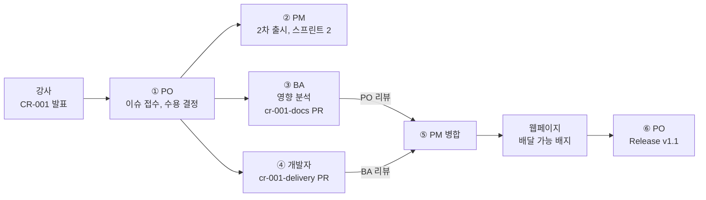

# 미션 6-2. 변경 요청 처리

!!! abstract "이번 미션에서 할 것"
    - 현업의 변경 요청 CR-001을 이슈로 접수하고, 영향 분석, 결정, 일정 조정을 GitHub에 남깁니다.
    - BA는 요구사항 문서를, 개발자는 메뉴 데이터를 각자 분기에서 고치고 서로 다른 사람이 검토합니다.
    - 반영이 끝나면 Release `v1.1`을 발행하고 `v1.0`과 비교합니다.

**소요 시간** 약 12분  **실습 장소** 팀 리포지토리 `lunch-picker-team<번호>`  **관련 교안** [변경 요청 6단계](index.md#change-request)

## 준비

- 미션 6-1이 끝나 main에 대표 스토리가 병합되어 있어야 합니다. 이제 `site/menus.json`에는 메뉴가 **8개**(기존 6개와 비빔밥, 마라탕) 있습니다. 이 미션의 메뉴 데이터 예시는 모두 이 8개를 기준으로 합니다.
- 선택 과제 PR이 진행 중이면 먼저 병합하거나 닫고 시작합니다. 열린 채로 두면 같은 `site/menus.json`을 고쳐 충돌이 날 수 있습니다.
- 강사가 현업 고객(경영지원팀 박지은 과장) 역할로 아래 변경 요청을 화면에 발표합니다.

> **[변경 요청 CR-001] 경영지원팀 박지은 과장**
>
> 비 오는 날이 많아서 배달 가능한 메뉴도 추천해 주세요. 배달 가능 여부가 화면에 보였으면 좋겠습니다.

!!! info "3인 팀은"
    PO가 PM을 겸합니다. PO 탭과 PM 탭의 할 일을 PO 한 사람이 모두 합니다. 리뷰는 PO가 BA의 PR을, BA가 개발자의 PR을 보면 됩니다.

!!! note "화면은 이미 준비되어 있습니다"
    Starter의 `site/index.html`은 메뉴에 `"delivery": true`가 있으면 초록색 **배달 가능** 배지를 보여 주도록 미리 만들어 두었습니다. 그래서 이번 변경은 데이터(`site/menus.json`)와 문서(`README.md`)만 고치면 됩니다. 실무라면 화면 수정도 영향 분석에 들어갑니다.

## 전체 흐름

| 순서 | 누가 | 무엇을 | 누구에게 넘김 |
|---|---|---|---|
| ① | PO | CR 이슈 등록(라벨 `변경요청`), 수용 결정 댓글 | BA, PM |
| ② | PM | 마일스톤 `2차 출시` 만들기, 이슈를 `2차 출시`와 스프린트 2에, 밀려나는 항목 댓글 | 개발자 |
| ③ | BA | 영향 분석 댓글, 분기 `cr-001-docs`에서 README 범위 수정 PR | PO(리뷰) |
| ④ | 개발자 | 분기 `cr-001-delivery`에서 모든 메뉴에 `delivery` 추가 PR, 자동 검사 | BA(리뷰) |
| ⑤ | PO, BA, PM | BA의 PR은 PO가, 개발자의 PR은 BA가 승인. PM이 둘 다 병합. 웹페이지 배지 확인 | PO |
| ⑥ | PO | Release `v1.1` 발행, `v1.0...v1.1` 비교 | 팀 전체 |



## 역할별 할 일

아래에서 **내 역할 탭**을 누릅니다. 단계마다 맨 위 **언제 시작하나요?** 상자를 먼저 봅니다.

- **바로 시작합니다**라고 되어 있으면 지금 시작합니다.
- 누군가를 기다리는 단계라면 상자에 적힌 화면을 확인합니다. **아직이면** 앞 사람이 하는 중이니, 탭 맨 아래 **기다리는 동안 할 일**을 하며 기다립니다.
- 내 단계가 끝나면 적힌 대로 다음 사람을 `@아이디`로 멘션하거나 말로 알립니다. 다음 사람은 그 알림이 시작 신호입니다.

=== "PO"

    **① 변경 요청 접수하고 수용 결정하기**

    !!! info "언제 시작하나요?"
        - **바로 시작합니다.** 6-2에서 가장 먼저 움직이는 사람입니다. 다른 팀원은 PO가 수용 결정 댓글을 달 때까지 기다립니다.

    1. **Issues** 탭 → **New issue** 클릭. 템플릿 선택 화면이 나오면 아래쪽 **Blank issue**(빈 이슈) 선택
    2. 제목과 본문을 입력합니다.

        ```text
        [변경요청] CR-001 배달 가능 메뉴 표시
        ```

        ```markdown
        ## 요청자
        경영지원팀 박지은 과장 (요청일: 오늘)

        ## 요청 내용
        > 비 오는 날이 많아서 배달 가능한 메뉴도 추천해 주세요.
        > 배달 가능 여부가 화면에 보였으면 좋겠습니다.

        ## 수용 여부 판단 기준
        - MVP(v1.0) 범위에 영향이 있는가
        - 이번 스프린트 일정 안에 할 수 있는가
        - 기존 메뉴 데이터와 자동 검사에 문제가 생기지 않는가

        ## 처리 담당
        - 영향 분석: BA
        - 일정 조정: PM
        - 반영: 개발자(메뉴 데이터), BA(요구사항 문서)
        ```

    3. 오른쪽 **Labels** → `변경요청` 선택. **Assignees** → 자기 자신 선택
    4. **Create**(만들기) 클릭. 이슈 번호(예: `#12`)를 팀에 알립니다.
    5. 같은 이슈에 수용 결정 댓글을 남깁니다.

        ```text
        [결정] CR-001을 수용합니다.
        - 이유: 화면에 배지 표시 기능이 이미 있어 데이터와 문서만 고치면 되므로 일정 영향이 작습니다.
        - 반영 시점: 2차 출시
        @PM아이디 일정 조정 부탁드립니다. @BA아이디 영향 분석 부탁드립니다. @개발자아이디 메뉴 데이터 반영 부탁드립니다.
        ```

    확인: 이슈에 `변경요청` 라벨과 결정 댓글이 있습니다.

    **⑤ BA의 PR 리뷰하기** (BA가 `cr-001-docs` PR을 열면)

    !!! info "언제 시작하나요?"
        - BA가 `cr-001-docs` PR을 열고 나를 리뷰어로 지정하면 시작합니다.
        - **아직이면:** **Pull requests** 탭에 BA의 PR이 없으면 기다립니다.

    1. **Pull requests** 탭 → BA의 PR → **Files changed** 탭에서 README의 바뀐 부분을 읽습니다.
    2. **Review changes** → 아래 예시 입력 → **Approve** → **Submit review**

        ```text
        2차 출시 범위에 배달 표시가 들어간 것을 확인했습니다. 결정 내용과 맞습니다. 승인합니다.
        ```

    3. PM에게 병합을 요청합니다. `@PM아이디 문서 PR 승인했습니다. 병합 부탁드립니다.`

    **⑤ 웹페이지 확인** (PM이 개발자의 PR까지 병합한 뒤)

    !!! info "언제 시작하나요?"
        - PM이 두 PR을 모두 병합하고, **웹페이지 배포**가 초록 체크가 되면 시작합니다.
        - **아직이면:** **Pull requests** 탭에 열린 PR이 남아 있으면 기다립니다.

    1. **Actions** → **웹페이지 배포**가 초록 체크인지 확인합니다.
    2. 팀 웹페이지를 강력 새로 고침(++ctrl+shift+r++ 또는 ++cmd+shift+r++)하고 초록색 **배달 가능** 배지가 보이는지 확인합니다.
    3. CR 이슈에 댓글을 남깁니다.

        ```text
        웹페이지에서 김치찌개, 짜장면, 쌀국수, 마라탕에 "배달 가능" 배지가 보이는 것을 확인했습니다. 메뉴 카드는 8개 그대로입니다.
        ```

    **⑥ Release v1.1 발행하고 비교하기**

    !!! info "언제 시작하나요?"
        - 웹페이지 확인 직후 바로 합니다.

    1. **Code** 탭 오른쪽 **Releases** → **Draft a new release**(새 릴리스 작성) 클릭
    2. **Choose a tag**(태그 고르기) → 칸에 `v1.1` 입력 → **Create new tag: v1.1 on publish**(발행할 때 새 태그 만들기) 클릭. Target은 `main` 그대로
    3. **Previous tag**(이전 태그)가 보이면 `v1.0` 선택 → **Generate release notes**(릴리스 노트 자동 생성) 클릭
    4. 제목과 설명을 입력합니다. 자동 생성된 내용 위에 붙여도 됩니다.

        ```text
        배달 메뉴 반영 v1.1
        ```

        ```markdown
        ## 변경 요청
        - CR-001 배달 가능 메뉴 표시 (#12)

        ## 바뀐 것
        - README: 2차 출시 범위에 배달 가능 표시 추가
        - site/menus.json: 모든 메뉴에 delivery(배달 가능) 항목 추가
        - 웹페이지: 배달 가능한 메뉴에 "배달 가능" 배지 표시
        ```

    5. **Publish release**(릴리스 발행) 클릭
    6. 브라우저 주소창에 비교 주소를 입력합니다. `<PO아이디>`와 `<번호>`는 바꿔 넣으세요.

        ```text
        https://github.com/<PO아이디>/lunch-picker-team<번호>/compare/v1.0...v1.1
        ```

    7. 위쪽에 커밋 수와 **files changed**(바뀐 파일 수)가 보입니다. 아래로 내리면 파일마다 바뀐 줄이 초록, 빨강으로 보입니다.
    8. 이 주소를 CR 이슈에 댓글로 남기고, **Close issue**로 이슈를 닫습니다(개발자 PR로 이미 닫혔으면 댓글만).

    확인: **Releases**에 `v1.0`과 `v1.1` 두 개가 보이고, 비교 화면에 `README.md`와 `site/menus.json`이 바뀐 파일로 나옵니다.

    **기다리는 동안 할 일**

    - BA와 개발자가 작업하는 동안 `v1.0` 릴리스 화면을 다시 열어 그때 무엇을 기준선으로 정했는지 읽어 둡니다.
    - 미션 6-3 감사 질문 1번(누가 요청하고 누가 결정했나)의 답은 PO가 남긴 댓글입니다. 댓글 링크 복사 방법을 [미션 6-3](mission-3.md#copy-links)에서 미리 봐 두세요.

=== "PM"

    **② 일정 조정하기** (PO가 수용 결정 댓글을 달면)

    !!! info "언제 시작하나요?"
        - PO가 CR 이슈에 수용 결정 댓글을 달면 시작합니다. BA, 개발자와 **동시에** 움직입니다.
        - **아직이면:** **Issues** 탭에 `[변경요청]` 이슈가 없거나, 이슈에 PO의 결정 댓글이 없으면 기다립니다.

    1. **Issues** 탭 → 위쪽 **Milestones** → **New milestone**(새 마일스톤) 클릭
    2. Title에 아래 이름 입력, Due date(마감일)는 비워 두거나 다음 주 금요일로 → **Create milestone**

        ```text
        2차 출시
        ```

    3. CR 이슈로 돌아가 오른쪽 **Milestone** → `2차 출시` 선택
    4. 오른쪽 **Projects** → `점심 메뉴 추천 팀<번호>` 선택(아직 없으면). 이슈 오른쪽에 프로젝트 필드가 나타나면 **스프린트**를 두 번째 반복(스프린트 2)으로 고르고, **MoSCoW**는 `Should`, **크기**는 `S`로 정합니다.
    5. CR 이슈에 일정 조정 댓글을 남깁니다. 밀려나는 항목은 여러분 보드의 실제 이슈로 바꾸세요.

        ```text
        [일정 조정] CR-001을 마일스톤 "2차 출시", 스프린트 2에 넣었습니다.
        - 대신 밀려나는 항목: #8 (Should, 버튼 하나로 메뉴 추천받기) → 스프린트 3으로 이동
        - MVP(v1.0) 범위는 바뀌지 않습니다.
        @개발자아이디 스프린트 2 첫 작업으로 진행해 주세요.
        ```

    6. 밀려나는 이슈의 **스프린트** 값도 실제로 다음 반복으로 바꿉니다.

    확인: CR 이슈 오른쪽에 Milestone `2차 출시`가 보이고, 보드에서 스프린트 2로 들어가 있습니다.

    **⑤ 두 PR 병합하기** (각 PR이 승인되면)

    !!! info "언제 시작하나요?"
        - PR이 승인되면 하나씩 바로 병합합니다. 두 PR이 다 승인될 때까지 기다리지 않아도 됩니다.
        - **아직이면:** PR 병합 상자에 승인 표시가 없으면 리뷰어(BA 또는 PO)가 아직 검토 중입니다.

    1. **Pull requests** 탭 → 승인된 PR부터 엽니다. 승인과 `check` 초록 체크를 확인합니다. (BA의 문서 PR은 `site/menus.json`을 건드리지 않아도 검사가 돌고 통과합니다.)
    2. **Merge pull request** ▼ → **Squash and merge** → **Confirm squash and merge** → **Delete branch**
    3. 다른 PR도 같은 방법으로 병합합니다.
    4. 두 PR이 모두 병합되면 PO에게 알립니다. `@PO아이디 CR-001 PR 두 건 병합했습니다. 웹페이지 확인과 v1.1 발행 부탁드립니다.`

    확인: 두 PR이 모두 보라색 Merged입니다.

    **기다리는 동안 할 일**

    - 보드에서 `2차 출시` 마일스톤 화면(**Issues** → **Milestones** → `2차 출시`)을 열어 진행률이 어떻게 보이는지 봅니다.
    - 미션 6-3 감사 질문 4번(v1.0과 v1.1 사이 바뀐 파일 수)은 PO가 발행한 비교 주소로 답합니다.

=== "BA"

    **③ 영향 분석 댓글 달기**

    !!! info "언제 시작하나요?"
        - PO가 CR 이슈에 수용 결정 댓글을 달면 시작합니다. PM, 개발자와 **동시에** 움직입니다.
        - **아직이면:** CR 이슈에 PO의 결정 댓글이 없으면 기다립니다.

    1. CR 이슈를 열고 아래 예시처럼 표로 영향 분석 댓글을 남깁니다. Markdown 표는 미리 보기(**Preview**)로 확인할 수 있습니다.

        ```markdown
        [영향 분석] CR-001 배달 가능 메뉴 표시

        | 바뀌는 것 | 무엇이 | 어떻게 |
        |---|---|---|
        | 요구사항 문서 | README의 범위 섹션 | 2차 출시 범위에 "배달 가능 여부 표시" 추가 |
        | 메뉴 데이터 | site/menus.json의 delivery 항목 | 메뉴 8개(6-1에서 추가한 비빔밥, 마라탕 포함) 모두에 "delivery": true 또는 false 추가 |
        | 화면 배지 | site/index.html | 이미 delivery=true면 "배달 가능" 배지를 보여 줌. 수정 없음 |
        | 자동 검사 | scripts/check-menus.js | delivery가 true/false가 아니면 실패. 수정 없음, 데이터만 맞추면 됨 |
        | 테스트할 인수 조건 | 웹페이지 | Given 메뉴 화면에서, When 배달 가능 메뉴를 보면, Then 초록색 "배달 가능" 배지가 보인다 |

        영향 범위가 작아 2차 출시에 반영 가능합니다. 문서는 제가 cr-001-docs 분기로 고치겠습니다.
        ```

    **③ 요구사항 문서 고치기**

    !!! info "언제 시작하나요?"
        - 영향 분석 댓글을 단 직후 바로 합니다.

    1. **Code** 탭 → 분기 버튼(`main` ▼) → `cr-001-docs` 입력 → **Create branch cr-001-docs from main** 클릭

        ```text
        cr-001-docs
        ```

    2. `README.md` 클릭 → 연필 아이콘 → 5교시에 쓴 MVP 범위 섹션 아래에 아래 내용을 추가합니다. 섹션 이름은 팀 README에 맞게 고치세요.

        ```markdown
        ## 2차 출시 범위

        - 배달 가능 여부 표시: 배달 가능한 메뉴에 "배달 가능" 배지를 보여 준다 (CR-001, 요청자 경영지원팀 박지은 과장)
        ```

    3. **Commit changes...** → 메시지 입력 → `cr-001-docs` 분기에 커밋

        ```text
        CR-001 배달 표시를 2차 출시 범위에 추가
        ```

    4. **Compare & pull request** → 제목과 본문 입력 → **Reviewers**에 PO 지정 → **Create pull request**

        ```text
        [CR-001] 2차 출시 범위에 배달 표시 추가
        ```

        ```markdown
        ## 무엇을 바꿨나요
        - README에 "2차 출시 범위" 섹션을 추가하고 배달 가능 여부 표시를 넣었습니다.

        ## 왜 바꿨나요
        - 변경 요청 #12(CR-001) 수용 결정에 따라 요구사항 문서를 갱신합니다.

        Refs #12
        ```

    확인: PR이 열리고 Reviewers에 PO가 있습니다.

    !!! note "왜 BA는 Closes가 아니라 Refs인가요?"
        `Closes`를 쓰면 이 PR이 병합될 때 CR 이슈가 닫힙니다. 데이터 반영(개발자 PR)이 끝나야 CR이 완료되므로, 문서 PR은 이슈에 연결만 하는 `Refs`를 씁니다.

    **⑤ 개발자의 PR 리뷰하기** (개발자가 `cr-001-delivery` PR을 열면)

    !!! info "언제 시작하나요?"
        - 개발자가 `cr-001-delivery` PR을 열고 자동 검사가 초록 체크가 되면 시작합니다.
        - **아직이면:** **Pull requests** 탭에 개발자의 PR이 없거나, 자동 검사가 노란 점이면 기다립니다.

    1. **Files changed** 탭에서 메뉴 8개 모두에 `"delivery"`가 있는지, 값이 `true` 또는 `false`인지, 영향 분석의 인수 조건과 맞는지 봅니다. 6-1에서 추가한 비빔밥, 마라탕 줄이 빠지거나 바뀌지 않았는지도 확인합니다.
    2. 고칠 곳이 있으면 6-1처럼 **Add a suggestion**으로 제안합니다. 없으면 **Review changes** → **Approve** → **Submit review**

        ```text
        영향 분석 표의 메뉴 데이터 항목대로 모든 메뉴에 delivery가 들어간 것을 확인했습니다. 자동 검사도 통과했습니다. 승인합니다.
        ```

    3. PM에게 병합을 요청합니다.

    **기다리는 동안 할 일**

    - 개발자가 작업하는 동안 `docs/00_현업요청.md`를 열어 박지은 과장의 원래 요청 6가지와 CR-001이 어떻게 이어지는지 확인합니다.
    - 미션 6-3 감사 질문 3번(개발자 PR에서 어떤 리뷰 의견이 반영됐나)은 BA의 리뷰가 근거가 됩니다.

=== "개발자"

    **④ 모든 메뉴에 배달 정보 추가하기** (PO가 수용 결정 댓글을 달면)

    !!! info "언제 시작하나요?"
        - PO가 CR 이슈에 수용 결정 댓글을 달면 시작합니다. BA, PM과 **동시에** 움직입니다.
        - **아직이면:** **Issues** 탭에 `[변경요청]` 이슈가 없거나, 이슈에 PO의 결정 댓글이 없으면 기다립니다.

    1. **Code** 탭 → 분기 버튼(`main` ▼) → `cr-001-delivery` 입력 → **Create branch cr-001-delivery from main** 클릭

        ```text
        cr-001-delivery
        ```

    2. `site` → `menus.json` 클릭 → 연필 아이콘
    3. 모든 메뉴 줄 끝의 `}` 앞에 `, "delivery": true` 또는 `, "delivery": false`를 추가합니다. 6-1에서 대표 스토리(비빔밥, 마라탕 추가)를 병합한 메뉴 8개 상태라면 파일 전체를 아래 내용으로 바꿔도 됩니다. 배달 가능은 김치찌개, 짜장면, 쌀국수, 마라탕 4개입니다.

        ```json
        [
          { "name": "김치찌개", "category": "한식", "price": 9000, "distance": 300, "solo": true, "delivery": true },
          { "name": "짜장면", "category": "중식", "price": 8000, "distance": 450, "solo": false, "delivery": true },
          { "name": "돈카츠", "category": "일식", "price": 11000, "distance": 600, "solo": false, "delivery": false },
          { "name": "샐러드볼", "category": "양식", "price": 10500, "distance": 200, "solo": true, "delivery": false },
          { "name": "쌀국수", "category": "아시안", "price": 9500, "distance": 700, "solo": false, "delivery": true },
          { "name": "순두부찌개", "category": "한식", "price": 8500, "distance": 350, "solo": true, "delivery": false },
          { "name": "비빔밥", "category": "한식", "price": 8000, "distance": 250, "solo": true, "delivery": false },
          { "name": "마라탕", "category": "중식", "price": 10000, "distance": 500, "solo": false, "delivery": true }
        ]
        ```

        !!! warning "지금 파일이 위와 다르다면"
            6-1 선택 과제로 값을 더 바꿨다면(예: 돈카츠 `solo`를 `true`로), 위 내용을 그대로 붙이면 그 변경이 사라집니다. 이 경우 파일 전체를 바꾸지 말고, 지금 파일의 각 줄 끝에 `, "delivery": false`를 하나씩 붙인 뒤 김치찌개, 짜장면, 쌀국수, 마라탕만 `true`로 바꾸세요. 붙이기 전에 **Code** 탭에서 지금 `site/menus.json`에 메뉴가 8개인지 먼저 확인합니다.

    4. **Commit changes...** → 메시지 입력 → `cr-001-delivery` 분기에 커밋

        ```text
        CR-001 모든 메뉴에 배달 가능 여부(delivery) 추가 (#12)
        ```

    5. **Compare & pull request** → 제목과 본문 입력 → **Reviewers**에 BA 지정 → **Create pull request**

        ```text
        [CR-001] 메뉴에 배달 가능 여부 추가
        ```

        ```markdown
        ## 무엇을 바꿨나요
        - site/menus.json의 모든 메뉴에 delivery(배달 가능) 항목을 추가했습니다.
        - 메뉴 8개 모두에 delivery를 넣었고, 배달 가능은 김치찌개, 짜장면, 쌀국수, 마라탕입니다.

        ## 왜 바꿨나요
        - 변경 요청 CR-001 "배달 가능 여부가 화면에 보였으면 좋겠다"를 반영합니다.

        ## 인수 조건 확인
        - [x] 배달 가능 메뉴에 초록색 "배달 가능" 배지가 보인다
        - [x] 자동 검사(메뉴 데이터 검사)를 통과한다

        Closes #12
        ```

    6. **메뉴 데이터 검사 / check**가 초록 체크가 될 때까지 기다립니다.

    확인: PR이 열리고, `check`가 초록 체크이고, Reviewers에 BA가 있습니다.

    !!! note "delivery에 \"yes\"라고 쓰면 어떻게 되나요?"
        자동 검사는 `delivery`가 `true` 또는 `false`가 아니면 실패합니다. 예를 들어 `"delivery": "yes"`나 `"delivery": "true"`(따옴표 있음)로 쓰면 **Details**의 로그에 이렇게 나옵니다.

        ```text
        [실패] 2번째 메뉴(짜장면): delivery(배달 가능)는 true 또는 false여야 합니다.
        ```

        사람 눈에는 "yes"도 맞는 말 같지만, 화면 프로그램은 약속한 값만 알아듣습니다. 시간이 있으면 일부러 한 줄을 `"yes"`로 바꿔 커밋해 실패를 보고, 다시 `true`로 고쳐 통과시켜 보세요. 실패와 수정 커밋이 모두 PR에 남습니다.

    **기다리는 동안 할 일**

    - BA가 리뷰하는 동안 **Checks** 탭에서 `[통과] 메뉴 8개를 검사했습니다.` 로그를 확인합니다.
    - BA의 문서 PR(`cr-001-docs`)을 열어 무엇이 바뀌는지 읽어 봅니다. 승인은 PO가 하지만 댓글은 누구나 남길 수 있습니다.

## 성공하면

- [x] `[변경요청] CR-001 배달 가능 메뉴 표시` 이슈에 `변경요청` 라벨, 수용 결정, 일정 조정, 영향 분석 댓글이 있다
- [x] 마일스톤 `2차 출시`가 있고 CR 이슈가 들어가 있다. 보드에서 스프린트 2에 있다
- [x] BA의 `cr-001-docs` PR이 PO 승인 후 병합되었다
- [x] 개발자의 `cr-001-delivery` PR이 BA 승인 후 병합되었고, CR 이슈가 닫혔다
- [x] 팀 웹페이지에 "배달 가능" 배지가 보인다
- [x] Release `v1.1` "배달 메뉴 반영 v1.1"이 발행되었고, `v1.0...v1.1` 비교 화면을 열었다

## 막히면

??? failure "New issue를 누르니 템플릿만 나오고 빈 이슈를 못 만들어요"
    템플릿 목록 아래쪽 **Blank issue** 링크를 찾으세요. 없으면 "사용자 스토리" 템플릿으로 열고 본문을 모두 지운 뒤 위 예시를 붙여 넣어도 됩니다.

??? failure "이슈 오른쪽에 스프린트 필드가 안 보여요"
    이슈가 아직 프로젝트에 들어가지 않은 것입니다. 오른쪽 **Projects**에서 팀 보드를 먼저 고르면 그 아래 필드가 나타납니다. 그래도 안 보이면 보드에서 카드를 클릭해 바꿉니다.

??? failure "개발자 PR의 자동 검사가 실패해요"
    검사 이름(화면에 따라 **Details**)을 눌러 로그에서 `[실패]` 줄을 읽습니다. 쉼표 빠짐, `"delivery": "true"`처럼 따옴표를 붙인 값, `delivery` 철자 오류(`delivary`)가 흔합니다. **Files changed** → 파일 오른쪽 **...** → **Edit file**로 같은 분기에서 고칩니다.

??? failure "배지가 안 보여요"
    1) PR이 정말 병합됐는지, 2) **Actions** → **웹페이지 배포**가 초록 체크인지, 3) 강력 새로 고침을 했는지 순서대로 봅니다. `delivery`가 `true`인 메뉴에만 배지가 나옵니다.

??? failure "compare 주소가 404(페이지 없음)로 나와요"
    아이디나 팀 번호 오타, 또는 `v1.0`이나 `v1.1` 태그가 없는 경우입니다. **Releases** 화면에서 두 태그가 다 있는지 확인하세요. 주소 가운데는 점 세 개(`...`)입니다.

??? failure "Generate release notes를 누르니 PR이 너무 많이 나와요"
    `v1.0` 이후 병합된 PR이 모두 나오는 것이 정상입니다. 6-1에서 병합한 스토리 PR도 같이 나옵니다. 그대로 두거나 CR-001 관련 내용만 남겨도 됩니다.

## 다음 미션으로 넘어가기 전에

- CR 이슈, 두 PR, `v1.1` 릴리스는 지우지 마세요. 바로 다음 [미션 6-3 이력 감사](mission-3.md)에서 이 기록을 근거로 답합니다.
- CR 이슈 번호와 비교 주소를 팀 모두가 알 수 있게 이슈 댓글에 남겨 두세요.
