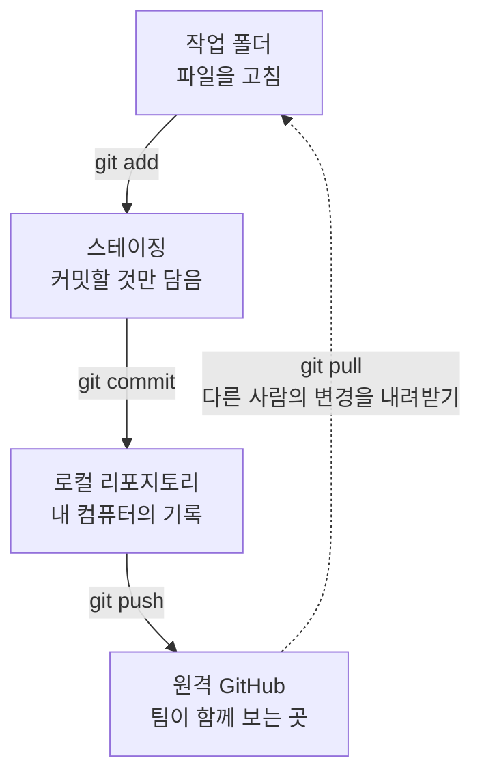
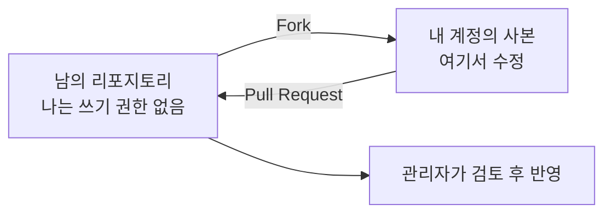

# 7교시. 안전한 운영과 보안

!!! abstract "이번 교시의 목표"
    웹 동작 뒤의 Git을 터미널로 직접 다루고, 비밀 파일을 올리지 않는 습관과 계정 보안을 갖출 수 있습니다.

!!! info "오늘의 흐름에서 지금 위치"
    현업 요청 → 이슈 → 우선순위와 인수 조건 → PR → 검사와 리뷰 → 병합과 배포 → 이력 확인 → **안전한 운영**

| 구간 | 시간 | 내용 |
|---|---|---|
| 기술 설명 | 15분 | 아래 [교안](#lecture) 앞부분. 웹 동작과 Git 명령, 네 단계, .gitignore, Fork, 인증 방식 |
| 실습 7-1 | 15분 | [실습 7-1 터미널로 Git 다루기](lab-1.md) (개인 `lunch-practice`, Codespaces) |
| 설명 | 5분 | 아래 [교안](#permissions) 뒷부분. 권한, 보안 기능 |
| 실습 7-2 | 5분 | [실습 7-2 2단계 인증 켜기](lab-2.md) (개인) |
| 정리 | 5분 | [오늘의 정리](wrap-up.md) |

## 교안 { #lecture }

!!! question "이번 교시를 시작하며"
    - **왜 지금 하나요?** 지금까지는 웹 화면에서 GitHub를 썼습니다. 마지막으로 그 뒤에서 움직이는 Git을 터미널로 직접 다뤄 보고, 비밀 파일과 계정을 지키는 방법을 익힙니다. 혼자 AI 도구로 코딩할 때도 그대로 쓰는 기본기입니다.
    - **앞에서 만든 무엇을 쓰나요?** 1~3교시에 커밋하고 PR을 병합한 개인 리포지토리 `lunch-practice`(터미널 실습)와 시작 전에 설치한 휴대폰 인증 앱(2단계 인증)을 씁니다.
    - **끝나면 무엇을 누구에게 넘기나요?** `lunch-practice`에 터미널로 만든 분기와 커밋, `.gitignore`가 남고, 각자의 계정에는 2단계 인증이 켜집니다. 교육이 끝난 뒤 혼자 프로젝트를 할 때 이 흐름을 그대로 씁니다.

마지막 7교시입니다. 오늘 웹 화면에서 했던 일들이 실제 Git 명령어로는 어떻게 되는지 터미널에서 직접 해 보고, 비밀 파일을 올리지 않는 방법과 계정 보안을 설정합니다.

명령어 실습은 **Codespaces**라는 브라우저 속 개발 환경에서 하기 때문에 따로 설치할 프로그램이 없습니다. 처음 보는 검은 화면(터미널)이 나와도 겁먹지 마세요. 강사가 한 줄씩 같이 입력합니다. 명령어를 외우는 것이 목표가 아니라, "웹 버튼 뒤에서 이런 일이 일어나고 있었구나"를 이해하는 것이 목표입니다.

### 오늘 웹에서 한 일은 이런 Git 명령입니다 { #web-and-git }

오늘 웹 화면에서 누른 버튼들은 모두 Git 명령어와 짝이 있습니다. 개발자는 같은 일을 자기 컴퓨터에서 명령어로 합니다.

| 웹 화면에서 한 일 | Git 명령어 | 하는 일 |
|---|---|---|
| 리포지토리 가져오기 | `git clone` | 원격 리포지토리를 내 컴퓨터로 복제 |
| **Commit changes** 버튼 | `git add` + `git commit` | 바뀐 파일을 담고 커밋으로 저장 |
| (웹은 바로 원격에 저장) | `git push` | 내 커밋을 GitHub에 올림 |
| 다른 사람 변경 보기 | `git pull` | GitHub의 새 커밋을 내려받아 합침 |
| 분기 만들기 | `git switch -c 이름` | 새 분기를 만들고 그 분기로 이동 |
| 상태 보기 | `git status` | 무엇이 바뀌었고 무엇이 담겼는지 확인 |
| **History** 화면 | `git log` | 커밋 이력 보기 |

웹에서 **Commit changes**를 누르면 GitHub 서버 안에서 add와 commit이 한 번에 일어나고, 저장 위치가 이미 GitHub(원격)라서 push가 필요 없었습니다. 내 컴퓨터에서 작업하면 이 단계를 하나씩 직접 해야 합니다.

!!! tip "핵심"
    버튼 뒤에서 Git 명령이 돌고 있었습니다. 웹과 명령어는 같은 일을 다른 방법으로 할 뿐입니다.

### 명령어로는 네 단계를 거쳐 GitHub에 도착합니다 { #four-stages }

명령어로 작업할 때는 파일이 네 곳을 거쳐 GitHub에 도착합니다.



1. **작업 폴더**: 내 컴퓨터에서 파일을 고치는 곳입니다. 고치기만 하면 아직 기록이 아닙니다.
2. **스테이징**(staging, 담아 두기): `git add`로 이번 커밋에 넣을 파일만 골라 담는 곳입니다. 온라인 쇼핑의 **장바구니**와 같습니다. 파일 열 개를 고쳤어도 세 개만 담아서 커밋할 수 있습니다.
3. **로컬 리포지토리**: `git commit`으로 장바구니에 담긴 것을 결제하듯 기록으로 남깁니다. 아직 내 컴퓨터에만 있습니다.
4. **원격 GitHub**: `git push`로 올려야 팀원이 볼 수 있습니다.

반대로 다른 사람이 GitHub에 올린 변경은 `git pull`로 내 작업 폴더까지 내려받습니다. 웹 화면에는 스테이징 단계가 없어서 오늘 처음 보는 개념입니다. 실습 7-1에서 `git status`로 파일이 빨간색(고쳤지만 안 담음)에서 초록색(담음)으로 바뀌는 것을 직접 봅니다.

!!! tip "핵심"
    고치고(작업 폴더), 담고(add), 기록하고(commit), 올립니다(push). 남의 변경은 pull로 내려받습니다.

### 올리면 안 되는 파일은 .gitignore로 뺍니다 { #gitignore }

**.gitignore**는 Git이 무시할 파일 목록입니다. 비밀번호가 들어 있는 `.env`, 로그 파일, 고객 명단 같은 파일 이름을 적어 두면 `git add`를 해도 담기지 않아 실수로 커밋하는 것을 막아 줍니다.

```text title=".gitignore"
.env
*.log
secrets/
고객명단.xlsx
```

| 줄 | 뜻 |
|---|---|
| `.env` | 이 이름의 파일 무시 (비밀번호, 키를 넣어 두는 파일) |
| `*.log` | `.log`로 끝나는 모든 파일 무시 |
| `secrets/` | `secrets` 폴더 전체 무시 |
| `고객명단.xlsx` | 이 이름의 파일 무시 |

정말 중요한 것은 이것입니다. 비밀번호나 개인정보가 한 번 커밋되어 GitHub에 올라가면 **유출됐다고 봐야 합니다.** 파일을 지워도 이력(History)에 그대로 남아 있어서, 지난 커밋을 열면 누구나 볼 수 있습니다. Public 리포지토리라면 전 세계에 공개된 것입니다. 그래서 올라갔다면 파일을 지우는 것으로 끝내지 말고 그 비밀번호나 키를 **즉시 교체**해야 합니다. 미리 막는 것이 가장 좋습니다.

!!! tip "핵심"
    한 번 올라가면 지워도 이력에 남습니다. 비밀번호는 즉시 교체하고, .gitignore로 미리 막습니다.

### Fork는 권한이 없는 리포지토리에 기여하는 방법입니다 { #fork }

**Fork**는 내가 쓰기 권한이 없는 리포지토리에 기여하는 방법입니다. 오픈소스 프로젝트처럼 남의 리포지토리를 내 계정으로 Fork하면 원본과 연결된 사본이 생깁니다. 거기서 고친 뒤 원래 리포지토리로 PR을 보내면, 원본 관리자가 검토하고 반영합니다.



| 비교 | 템플릿으로 만들기 (1교시) | Fork | 분기 (3교시) |
|---|---|---|---|
| 어디에 생기나 | 내 계정에 새 리포지토리 | 내 계정에 사본 리포지토리 | 같은 리포지토리 안 |
| 원본과 연결 | 끊김. 이력도 새로 시작 | **유지됨**. 원본으로 PR 가능 | 같은 리포지토리 |
| 언제 쓰나 | 새 프로젝트를 시작할 때 | 권한 없는 곳에 기여할 때 | 권한 있는 곳에서 작업할 때 |

오늘 오전에 쓴 템플릿 복사와 다른 점은 원본과 연결이 유지된다는 것입니다. 그래서 PR을 원본으로 보낼 수 있습니다. 사내에서 다른 팀 리포지토리에 기여하는 **InnerSource**(사내 오픈소스)도 같은 방식입니다. 미션 6-3 도전 과제에서 옆 팀 리포지토리에 해 본 것이 바로 Fork입니다.

!!! tip "핵심"
    권한이 있으면 분기, 권한이 없으면 Fork. Fork는 원본과 연결된 사본이라 PR을 보낼 수 있습니다.

### 비밀번호 대신 쓰는 인증 방식 네 가지 { #auth }

GitHub는 보안을 위해 비밀번호만으로는 명령어 작업(push, pull)을 할 수 없게 막아 두었습니다. 대신 아래 네 가지를 씁니다.

| 방식 | 뜻 | 비유 | 언제 쓰나 |
|---|---|---|---|
| **PAT** (Personal Access Token, 개인 접근 토큰) | 비밀번호 대신 쓰는 긴 문자열 열쇠. 권한과 만료 기간을 정해 발급 | 출입 권한과 유효 기간이 적힌 임시 출입증 | 명령어, 외부 도구 연동 |
| **SSH 키** | 내 컴퓨터를 GitHub에 등록하는 인증서. 열쇠와 자물쇠 한 쌍 | 등록된 사원증 | 내 컴퓨터에서 명령어 작업 |
| **2FA** (Two-Factor Authentication, 2단계 인증) | 비밀번호에 휴대폰 인증 코드를 더함 | 현관 비밀번호 + 지문 | 웹 로그인. **오늘 직접 켜 봄** |
| **SAML SSO** (Single Sign-On, 통합 로그인) | 회사 계정으로 GitHub에 로그인 | 회사 출입 시스템 하나로 모든 문 통과 | 회사(Enterprise) 계정. 퇴사하면 자동 차단 |

오늘 실습 7-1에서 쓰는 Codespaces는 GitHub 안에서 돌아가기 때문에 인증이 자동으로 됩니다. 내 컴퓨터에서 처음 `git push`를 하면 PAT나 SSH 키를 설정하라는 안내가 나옵니다. PAT는 비밀번호와 똑같이 취급해야 합니다. 메신저나 문서에 붙여 넣지 마세요.

!!! tip "핵심"
    비밀번호 하나로는 부족합니다. 토큰과 키는 비밀번호처럼 지키고, 2단계 인증은 꼭 켭니다.

### 리포지토리 권한은 다섯 단계입니다 { #permissions }

리포지토리에 사람을 초대할 때 권한 단계를 고를 수 있습니다. 오른쪽으로 갈수록 할 수 있는 일이 많아집니다.

| 권한 | 할 수 있는 일 | 어울리는 사람 |
|---|---|---|
| **Read** | 보기, 이슈와 PR에 댓글 | 결과만 보는 이해관계자 |
| **Triage** | 위 + 이슈와 PR 정리(라벨, 담당자, 닫기) | 기획자, PM, BA |
| **Write** | 위 + 커밋, 분기 만들기, 병합 | 개발자 |
| **Maintain** | 위 + 설정 일부 관리(이슈 설정, 분기 일부) | 팀 리더 |
| **Admin** | 모든 권한. 설정, 분기 보호, 협력자 관리, 리포지토리 삭제 | 리포지토리 관리자 |

원칙은 **필요한 만큼만 주는 것**(최소 권한)입니다. 기획자는 Triage면 이슈 관리가 되고, 개발자는 Write, 관리자만 Admin을 가집니다.

!!! note "오늘 팀 리포지토리의 권한"
    개인 계정 리포지토리에 **Collaborators**로 초대한 사람은 모두 Write에 가까운 권한을 받고, **Settings** 탭은 소유자(PO)만 봅니다. 위 다섯 단계를 골라 줄 수 있는 것은 회사(Organization) 리포지토리입니다.

!!! tip "핵심"
    필요한 만큼만 줍니다. 기획자는 Triage, 개발자는 Write, 관리자는 Admin.

!!! note "팀으로 쓰게 되면: 분기 보호"
    여럿이 한 리포지토리를 쓰면 **Settings** → **Rules**에서 **분기 보호**(Rulesets)를 걸 수 있습니다. main을 직접 고치지 못하게 막고, PR과 승인이 있어야만 병합되게 하는 기능입니다. 오늘 과정에서는 실습하지 않습니다.

### GitHub가 자동으로 지켜 주는 보안 기능 { #security-features }

GitHub에는 자동으로 보안을 지켜 주는 기능이 세 가지 있습니다. 리포지토리 **Security** 탭과 **Settings** → **Code security**(보안 설정)에서 켭니다.

| 기능 | 무엇을 찾나 | 무엇을 해 주나 |
|---|---|---|
| **Dependabot** | 프로젝트가 쓰는 외부 부품(라이브러리) 중 취약점이 알려진 것 | 경고를 띄우고, 안전한 버전으로 올리는 PR을 자동으로 만듦 |
| **코드 검사** (Code scanning) | 코드 속 보안 실수 패턴 | PR마다 자동 실행해 문제 줄을 표시 |
| **비밀 정보 검사** (Secret scanning) | API 키, 토큰처럼 생긴 문자열 | 경고하거나, push protection(올리기 차단)이 켜져 있으면 올리는 순간 막음 |

Dependabot은 부품 리콜 알림, 코드 검사는 자동 맞춤법 검사기, 비밀 정보 검사는 공항 보안 검색대라고 생각하면 됩니다. 개발 영역이라 오늘은 강사 화면으로 시연만 합니다. Public 리포지토리에서는 무료로 쓸 수 있습니다.

!!! tip "핵심"
    부품은 Dependabot, 코드는 코드 검사, 비밀번호는 비밀 정보 검사가 지킵니다.

## 이번 교시 실습

- [실습 7-1 터미널로 Git 다루기](lab-1.md): Codespaces에서 status, add, commit, push, pull과 .gitignore가 어떻게 동작하는지 확인합니다.
- [실습 7-2 2단계 인증 켜기](lab-2.md): 내 계정에 2단계 인증을 켜고 복구 코드를 보관합니다.
- [오늘의 정리](wrap-up.md): 하루 동안 배운 개념과 다음 단계를 정리합니다.
