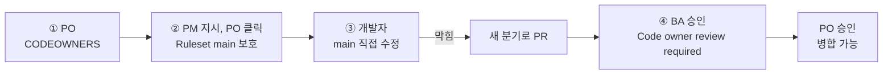

# 실습 7-2. 분기 보호와 CODEOWNERS

!!! abstract "이번 실습에서 할 것"
    - CODEOWNERS 파일로 경로마다 승인 책임자를 정합니다.
    - Ruleset `main 보호`로 PR, 승인, Code Owner 리뷰, 자동 검사 통과를 강제합니다.
    - 개발자가 main을 직접 고쳐 보며 정말 막히는지, 승인 후에만 병합되는지 확인합니다.

**소요 시간** 약 6분  **실습 장소** 팀 리포지토리 `lunch-picker-team<번호>`  **관련 교안** [권한 다섯 단계](index.md#permissions), [분기 보호](index.md#branch-protection), [CODEOWNERS](index.md#codeowners)

## 준비

- 팀 리포지토리 `lunch-picker-team<번호>`를 엽니다. 6교시에 열어 둔 PR이 있으면 먼저 병합하거나 닫아 주세요. 규칙이 걸리면 병합 조건이 바뀝니다.
- 팀원 모두의 GitHub 아이디를 메모해 둡니다. CODEOWNERS에 `@아이디`로 씁니다.

!!! warning "Settings 탭은 PO만 보입니다"
    개인 계정의 리포지토리에서 협력자(Collaborators)는 **Settings** 탭을 볼 수 없습니다. 분기 보호 규칙은 관리자 권한이 필요하므로, **PM이 옆에서 순서를 불러 주고 PO가 자기 화면에서 클릭**합니다. 팀 모두가 PO 화면을 함께 보세요.

!!! info "3인 팀은"
    PO가 PM을 겸합니다. CODEOWNERS의 `*` 줄은 PO, `docs/`는 BA, `site/`는 개발자로 쓰면 됩니다.

## 전체 흐름

| 순서 | 누가 | 무엇을 | 누구에게 넘김 |
|---|---|---|---|
| ① | PO | `.github/CODEOWNERS` 파일 만들기 | PM |
| ② | PM 지시, PO 클릭 | Ruleset `main 보호` 만들기 | 개발자 |
| ③ | 개발자 | main의 README를 직접 고쳐 보기(막힘 확인), 새 분기로 PR | BA, PO |
| ④ | BA, PO | BA 승인 후에도 막히는 것 확인, Code Owner인 PO 승인 후 병합 가능 확인 | PM |



## 역할별 할 일

=== "PO"

    **① CODEOWNERS 파일 만들기**

    1. **Code** 탭 → **Add file** ▼ → **Create new file**(새 파일 만들기) 클릭
    2. 파일 이름 칸에 아래를 입력합니다. `/`를 입력하면 폴더가 자동으로 나뉩니다.

        ```text
        .github/CODEOWNERS
        ```

    3. 내용에 아래를 붙여 넣고 아이디를 팀원 실제 아이디로 바꿉니다. `@`는 지우지 마세요.

        ```text
        *       @PO아이디
        docs/   @BA아이디
        site/   @개발자아이디
        ```

    4. **Commit changes...** → 메시지 `CODEOWNERS로 경로별 승인 책임자 지정` → **Commit directly to the main branch** → **Commit changes**
    5. 저장된 파일 화면 위쪽에 오류 표시가 없는지 봅니다. 아이디가 틀리면 그 줄에 경고가 뜹니다.

    확인: `.github/CODEOWNERS` 파일이 main에 있고 경고가 없습니다.

    !!! note "왜 `*`를 맨 위에 두나요?"
        CODEOWNERS는 아래쪽 규칙이 우선합니다. `*`를 맨 아래에 두면 모든 파일이 PO 담당이 되어 `docs/`, `site/` 줄이 무시됩니다. [교안의 CODEOWNERS](index.md#codeowners)를 참고하세요.

    **② Ruleset 만들기** (PM이 순서를 불러 줍니다)

    PM 탭의 순서대로 클릭합니다. PM이 "확인"이라고 하면 다음으로 넘어가세요.

    **④ Code Owner로 승인하기** (BA가 승인한 뒤)

    1. 개발자의 PR → **Files changed** → **Review changes** → **Approve** → **Submit review**

        ```text
        README는 Code Owner(PO) 승인 대상입니다. 확인했고 승인합니다.
        ```

    2. PR 아래쪽 병합 영역이 초록색으로 바뀌고 **Merge pull request**를 누를 수 있게 되는지 확인합니다.

    **기다리는 동안 할 일**

    - 개발자가 PR을 여는 동안 **Settings** → **Rules** → **Rulesets** → `main 보호`를 열어 규칙이 Active인지 다시 봅니다.

=== "PM"

    **② Ruleset `main 보호` 만들기** (PO 화면에서 순서를 불러 줍니다)

    PO 옆에서 아래 순서를 하나씩 읽어 주고, PO가 클릭하면 화면을 같이 확인합니다.

    1. 리포지토리 **Settings** 탭 → 왼쪽 **Code and automation** 아래 **Rules** → **Rulesets** 클릭
    2. **New ruleset** ▼ → **New branch ruleset**(새 분기 규칙) 클릭
    3. **Ruleset Name**(규칙 이름)에 입력

        ```text
        main 보호
        ```

    4. **Enforcement status**(적용 상태)를 `Disabled`에서 **Active**(적용)로 바꿉니다.
    5. **Target branches**(대상 분기) → **Add target** ▼ → **Include default branch**(기본 분기 포함) 클릭. 목록에 `Default`가 생깁니다.
    6. 아래 **Rules**(Branch rules) 영역에서 아래처럼 체크합니다.

        | 규칙 | 설정 |
        |---|---|
        | **Restrict deletions**(삭제 금지) | 체크 (기본으로 체크되어 있음) |
        | **Require a pull request before merging**(병합 전 PR 필수) | 체크 → 펼쳐진 **Required approvals**(필요한 승인 수)를 `1`로, **Require review from Code Owners**(Code Owner 리뷰 필수) 체크 |
        | **Require status checks to pass**(상태 검사 통과 필수) | 체크 → **Add checks** 클릭 → 검색 칸에 `check` 입력 → 목록의 `check` 클릭 |
        | **Block force pushes**(강제 push 금지) | 체크 (기본으로 체크되어 있음) |

    7. 맨 아래 **Create** 클릭
    8. **Rulesets** 목록에 `main 보호`가 생기고 Active로 보이는지 확인합니다.
    9. 개발자에게 넘깁니다. "이제 main을 직접 고쳐 보세요."

    확인: **Settings** → **Rules** → **Rulesets**에 `main 보호`가 Active 상태로 있습니다.

    !!! note "Add checks에 check가 안 나와요"
        최근 7일 안에 리포지토리에서 한 번 이상 실행된 검사만 목록에 나옵니다. 6교시 PR에서 `check`가 돌았다면 보입니다. 안 보이면 **Actions** → **메뉴 데이터 검사** → **Run workflow**로 한 번 실행한 뒤 다시 검색하세요.

    **④ 병합하기** (PO가 승인한 뒤)

    1. 개발자의 PR → **Squash and merge** → **Confirm squash and merge** → **Delete branch**

    **기다리는 동안 할 일**

    - 규칙 화면의 **Bypass list**(예외 목록)가 비어 있는지 봅니다. 비어 있으면 관리자(PO)도 규칙을 피할 수 없습니다.

=== "BA"

    **① CODEOWNERS 확인**

    1. PO가 만든 `.github/CODEOWNERS`를 열어 `docs/` 줄에 내 아이디가 맞게 들어갔는지 확인합니다.

    **④ 승인하고 그래도 막히는지 보기** (개발자가 PR을 열면)

    1. 개발자의 PR → **Files changed** → **Review changes** → **Approve** → **Submit review**

        ```text
        README 문구 확인했습니다. 승인합니다.
        ```

    2. **Conversation** 탭 아래쪽 병합 영역을 봅니다. 승인 1명은 채웠지만 아직 **Code owner review required**(Code Owner 리뷰 필요)가 남아 있습니다. README는 CODEOWNERS의 `*` 줄에 해당해서 담당자가 PO이기 때문입니다.
    3. PO에게 넘깁니다. `@PO아이디 README는 Code Owner 승인이 필요합니다. 승인 부탁드립니다.`

    확인: BA가 승인했는데도 병합 버튼이 막혀 있습니다.

    **기다리는 동안 할 일**

    - 내가 Code Owner인 `docs/` 파일을 바꾸면 어떻게 될지 생각해 봅니다. 도전 과제에서 직접 확인할 수 있습니다.

=== "개발자"

    **③ main을 직접 고쳐 보기** (PM이 규칙을 만들었다고 하면)

    1. **Code** 탭 → 분기가 `main`인지 확인 → `README.md` 클릭 → 연필 아이콘
    2. 맨 아래에 한 줄 추가합니다.

        ```markdown
        이 리포지토리의 main은 검토를 거쳐야만 바뀝니다.
        ```

    3. **Commit changes...** 클릭. 대화 상자를 봅니다.
        - **Commit directly to the main branch** 선택지가 없거나 눌러지지 않고, **Create a new branch for this commit and start a pull request**(새 분기를 만들고 PR 시작)만 고를 수 있습니다.
        - 또는 위쪽에 "You can't commit to main because it is a protected branch" 같은 안내가 보입니다.
    4. 분기 이름은 그대로 두거나 아래처럼 바꾸고 **Propose changes**(변경 제안) 클릭

        ```text
        readme-rule-test
        ```

    5. **Create pull request** 화면에서 제목을 입력하고 **Create pull request** 클릭

        ```text
        README에 main 보호 안내 추가
        ```

    6. PR 화면 아래쪽 병합 영역을 봅니다. 아래 표시가 보여야 합니다.
        - **Review required**(리뷰 필요): 승인 1명이 아직 없음
        - **Code owner review required**: Code Owner(README는 PO)의 승인이 아직 없음
        - **Merging is blocked**(병합 막힘), 회색 **Merge pull request** 버튼
    7. 오른쪽 **Reviewers**에 PO가 자동으로 들어가 있는지 확인합니다. CODEOWNERS가 자동으로 리뷰를 요청한 것입니다. BA도 리뷰어로 추가합니다.

    확인: main에 직접 커밋할 수 없고, PR의 병합 버튼이 막혀 있습니다.

    **기다리는 동안 할 일**

    - BA와 PO가 승인할 때마다 병합 영역의 문구가 어떻게 바뀌는지 새로 고침하며 지켜봅니다.

## 도전. Code Owner가 BA인 파일 바꿔 보기

시간이 남으면 개발자가 `docs/02_현행_업무.md`를 같은 방법으로 고쳐 새 분기로 PR을 엽니다. 이번에는 **Reviewers**에 BA가 자동으로 들어가고, BA가 승인하면 바로 병합할 수 있습니다. 파일 경로에 따라 승인 책임자가 달라지는 것을 확인할 수 있습니다.

## 성공하면

- [x] `.github/CODEOWNERS`에 `*`(PO), `docs/`(BA), `site/`(개발자) 세 줄이 있다
- [x] **Settings** → **Rules** → **Rulesets**에 `main 보호`가 Active로 있다
- [x] 개발자가 main에 직접 커밋할 수 없었다
- [x] PR에 Review required, Code owner review required가 표시되었다
- [x] Code Owner가 승인한 뒤에야 병합할 수 있었다

## 막히면

??? failure "PO 말고는 Settings 탭이 안 보여요"
    정상입니다. 개인 계정 리포지토리의 협력자는 Settings에 들어갈 수 없습니다. PO 화면에서 함께 진행합니다.

??? failure "CODEOWNERS 파일에 'Unknown owner' 경고가 떠요"
    아이디 오타이거나, 그 팀원이 협력자 초대를 수락하지 않은 경우입니다. Code Owner는 리포지토리에 쓰기 권한이 있어야 합니다. **Settings** → **Collaborators**에서 수락 여부를 확인하세요.

??? failure "규칙을 만들었는데 main에 그냥 커밋이 돼요"
    1) **Enforcement status**가 Active인지, 2) **Target branches**에 `Default`가 들어갔는지, 3) **Bypass list**에 누군가 들어가 있지 않은지 확인합니다. Ruleset 이름을 클릭하면 다시 고칠 수 있습니다.

??? failure "PO가 PR을 열었더니 아무도 승인할 수 없어요"
    README처럼 `*`에 해당하는 파일은 Code Owner가 PO 한 명뿐이라, PO가 연 PR은 PO 스스로 승인할 수 없어 막힙니다. 실무에서는 한 경로에 담당자를 두 명 이상(`*  @PO아이디 @PM아이디`) 둡니다. 실습에서는 개발자가 PR을 열면 됩니다.

??? failure "Require status checks에서 PR이 'Expected — Waiting for status to be reported'로 멈춰 있어요"
    검사가 아직 시작되지 않았거나, 고른 검사 이름이 다를 수 있습니다. 1~2분 기다린 뒤 새로 고침합니다. 계속 그대로면 Ruleset에서 고른 검사가 `check`인지 확인하세요.

## 다음 실습으로 넘어가기 전에

- Ruleset `main 보호`와 CODEOWNERS는 그대로 두세요. 교육 후 팀 리포지토리를 복습할 때도 같은 규칙으로 연습할 수 있습니다.
- 다음 [실습 7-3](lab-3.md)은 **각자 개인 계정**에서 합니다.
