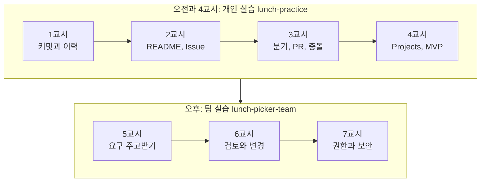

# 오늘의 정리

!!! abstract "이번 정리에서 할 것"
    - 하루 동안 배운 개념을 교시별로 한 번에 돌아봅니다.
    - 웹 화면 동작과 Git 명령을 다시 짝지어 봅니다.
    - 교육 후 리포지토리를 어떻게 남기고, 다음에 무엇을 하면 좋을지 정합니다.

**소요 시간** 약 5분  **관련 교안** [7교시 교안](index.md#lecture)

## 오늘 하루 배운 것

오전에는 GitHub의 핵심 개념을 각자 익혔고, 오후에는 그 개념으로 역할을 나눠 협업했습니다.

| 교시 | 핵심 개념 | 오늘 직접 한 것 |
|---|---|---|
| 1 | 버전 관리, 커밋, 스냅샷, 해시, 로컬과 원격 | `lunch-practice` 만들기, 웹에서 커밋, History |
| 2 | Markdown, README, Issue, 라벨, 마일스톤, 템플릿 | README 꾸미기, 이슈 등록과 분류, 이슈 템플릿, 하위 이슈와 멘션 |
| 3 | 분기, Pull Request, 리뷰, 병합, 충돌, Revert | 짝꿍 초대, PR과 리뷰, 충돌 해결, 되돌리기 |
| 4 | Projects, 필드, 보드 뷰, 자동화, 협업 역할 | 개인 보드, 팀 구성, 팀 리포지토리 |
| 5 | 사용자 스토리, 인수 조건, MoSCoW, Release | 요구 주고받기, MVP 확정, `v1.0` |
| 6 | Actions, Pages, 변경 요청 6단계, 이력 감사 | 스토리 구현과 검토, CR-001 처리, `v1.1`, 링크로 감사 답변 |
| 7 | Git 명령, Fork, 인증, 권한, 분기 보호, CODEOWNERS, .gitignore | 터미널 Git, `main 보호` Ruleset, 2단계 인증 |

!!! tip "핵심"
    요구사항, 결정, 변경 이력을 한 곳에 남기면 누구나 추적할 수 있습니다. 그것이 GitHub를 쓰는 이유입니다.

## 웹 동작과 Git 명령 정리

| 웹 화면에서 한 일 | Git 명령어 | 교시 |
|---|---|---|
| **Use this template**로 리포지토리 만들기 / 내 컴퓨터로 가져오기 | `git clone 주소` | 1, 7 |
| **Commit changes** | `git add 파일` + `git commit -m "메시지"` | 1, 7 |
| (웹은 바로 GitHub에 저장) | `git push` | 7 |
| 다른 사람의 변경 받기 | `git pull` | 7 |
| 분기 버튼에서 새 분기 만들기 | `git switch -c 분기이름` | 3, 7 |
| 분기 바꾸기 | `git switch 분기이름` | 3, 7 |
| **History** | `git log --oneline` | 1, 7 |
| 바뀐 파일 확인 | `git status` | 7 |
| **Revert** | `git revert 커밋해시` | 3 |
| **Blame** | `git blame 파일` | 3, 6 |
| **Merge pull request** | `git merge 분기이름` (PR 검토는 GitHub에서) | 3, 6 |

## 리포지토리 정리 방법

오늘 만든 리포지토리는 **지우지 말고 남겨 두세요.** 언제든 다시 들어가서 복습할 수 있습니다.

| 리포지토리 | 남겨 두면 좋은 것 | 정리할 것 |
|---|---|---|
| `lunch-practice` | 커밋 이력, 이슈, 이슈 템플릿, 개인 Projects `내 연습 보드` | Codespace는 삭제 (`https://github.com/codespaces`) |
| `lunch-picker-team<번호>` | 이슈, PR과 리뷰, Release `v1.0`, `v1.1`, Ruleset, CODEOWNERS | 없음. PO가 소유자이므로 팀원은 계속 협력자로 볼 수 있습니다 |

!!! note "Public 리포지토리입니다"
    두 리포지토리 모두 Public이라 누구나 볼 수 있습니다. 회사 내부 정보, 실명이 들어간 자료, 비밀번호는 올리지 마세요. 공개가 부담되면 **Settings** → 맨 아래 **Danger Zone** → **Change repository visibility**로 Private으로 바꿀 수 있습니다. 단, Private으로 바꾸면 무료 계정에서는 Pages와 Ruleset 일부가 동작하지 않을 수 있습니다.

## 다음 단계

| 다음 단계 | 내용 |
|---|---|
| 인증 시험 | **GitHub Foundations** 공식 인증. 오늘 배운 내용이 시험 범위와 거의 같습니다. 온라인으로 응시합니다 |
| 학습 경로 | Microsoft Learn에서 **GitHub Foundations** 학습 경로를 검색해 모듈을 순서대로 들으면 시험 준비가 됩니다 |
| 복습 | 이 가이드와 내 연습 리포지토리로 같은 실습을 다시 해 봅니다 |
| 설문 | 교육 설문이 메일로 갑니다. 의견을 남겨 주시면 다음 과정에 반영합니다 |

## 교육 후 혼자 해 볼 과제

| 번호 | 과제 | 완료 조건 |
|---|---|---|
| 1 | 내 업무 문서 하나(예: 회의록 양식, 업무 매뉴얼)를 Markdown으로 옮겨 새 Private 리포지토리에 올리고, 일주일 동안 고칠 때마다 커밋 메시지를 남겨 봅니다 | **History**에 커밋 5개 이상, 메시지만 읽어도 무엇을 왜 바꿨는지 알 수 있음 |
| 2 | 팀 리포지토리에서 `2차 출시` 마일스톤에 스토리 하나를 더 만들고, 분기, PR, 리뷰, 병합, `v1.2` 릴리스까지 혼자 한 바퀴 돌려 봅니다. 분기 보호가 걸려 있으니 팀원 한 명에게 승인을 부탁합니다 | `v1.1...v1.2` 비교 화면에 바뀐 파일이 보임 |
| 3 | 실습 7-1을 처음부터 다시 해 보되, 이번에는 터미널에서 `git switch main`, `git pull`까지 해서 main으로 돌아오는 것까지 합니다. 7-3의 2단계 인증을 아직 안 켰다면 이번에 켭니다 | `git log --oneline`으로 main과 `terminal-practice`의 차이를 설명할 수 있음, 2단계 인증 Enabled |

## 교육이 끝난 뒤 상태 확인

교육을 마치고 나갈 때 아래 상태인지 확인합니다. 나중에 복습할 때 이 상태에서 다시 시작합니다.

| 항목 | 이 상태여야 합니다 |
|---|---|
| 리포지토리 | 개인 `lunch-practice`, 팀 `lunch-picker-team<번호>` 둘 다 남아 있음 |
| 현재 분기 | 두 리포지토리 모두 `main`. 개인 리포지토리에는 7-1에서 만든 `terminal-practice` 분기가 남아 있어도 됩니다 |
| 남겨 둘 이슈, PR | 팀 리포지토리의 에픽, 스토리, CR-001 이슈와 병합된 PR, 리뷰 기록 전부 |
| 데이터 상태 | 팀 `menus.json` 메뉴 8개, 모든 메뉴에 `delivery` 항목. Release `v1.0`, `v1.1`. `main 보호` 규칙과 CODEOWNERS 적용 |
| 계정 | 2단계 인증 Enabled, 복구 코드 안전한 곳에 보관. Codespace는 삭제 |

하루 동안 고생 많으셨습니다.
