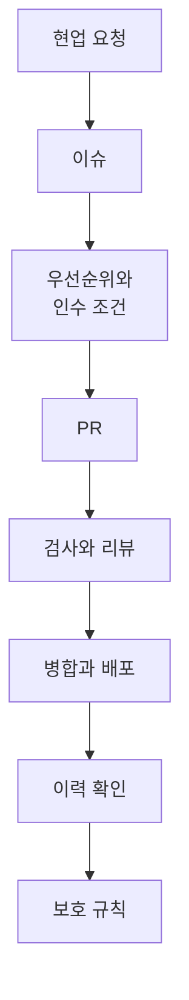

# GitHub 기초 (GH-900) 교안과 실습 가이드

GitHub 기초 과정의 교안과 실습 가이드입니다. 수업 시간에는 강사 화면과 이 가이드를 나란히 띄워 두고 따라 하면 됩니다. 수업이 끝난 뒤에는 각 교시의 **교안** 페이지만 읽어도 복습이 되도록 썼습니다.

!!! abstract "이 과정에서 배우는 것"
    - 버전 관리가 왜 필요한지, GitHub에 무엇이 어떻게 기록되는지
    - README, Issue, Label, Assignee, Projects로 요구사항과 우선순위를 관리하는 법
    - Branch, Pull Request, Review로 변경을 검토하고 반영하는 법, 충돌 해결과 되돌리기
    - PO, PM, BA, 개발자 역할을 맡아 요구를 주고받는 협업
    - 검토 없이는 바꿀 수 없게 만드는 운영 규칙과 계정 보안

## 하루를 관통하는 흐름

오늘 하루는 현업의 요청 하나가 실제 웹페이지에 반영되고, 그 기록이 남고, 규칙으로 지켜지기까지의 흐름을 따라갑니다. 각 교시 교안 맨 위에 "지금 위치"가 표시됩니다.

| 단계 | 하는 일 | 배우는 교시 | 팀으로 하는 교시 |
|---|---|---|---|
| 현업 요청 | 요청 메일과 회의록을 읽는다 | 2교시 | 5교시 |
| 이슈 | 요구를 이슈로 등록하고 질문, 답변, 결정을 주고받는다 | 2교시 | 5교시 |
| 우선순위와 인수 조건 | 무엇부터 할지(MVP), 언제 다 됐다고 볼지 정한다 | 4교시 | 5교시 |
| PR | 분기에서 고치고 변경안을 올린다 | 3교시 | 6교시 |
| 검사와 리뷰 | 자동 검사로 형식을, 동료가 인수 조건을 확인한다 | 3교시 | 6교시 |
| 병합과 배포 | 승인된 변경을 main에 합치면 웹페이지가 바뀐다 | 3교시 | 6교시 |
| 이력 확인 | 누가 언제 왜 바꿨는지 기록으로 증명한다 | 1교시, 3교시 | 6교시 |
| 보호 규칙 | 검토 없이는 바꿀 수 없게 막는다 | 7교시 | 7교시 |

## 하루 시간표

| 시간 | 교시 | 주제 | 방식 | 실습 장소 |
|---|---|---|---|---|
| 09:00~09:50 | [1교시](class1/index.md) | GitHub 시작하기 | 개념 + 개인 실습 | 개인 연습 리포지토리 |
| 10:00~10:50 | [2교시](class2/index.md) | 문서와 할 일 관리 | 개념 + 개인 실습 | 개인 연습 리포지토리 |
| 11:00~11:50 | [3교시](class3/index.md) | 변경 관리의 흐름 | 개념 + 개인 실습 + 짝 리뷰 | 개인 연습 리포지토리 |
| 12:00~13:15 | 점심 | | | |
| 13:15~14:05 | [4교시](class4/index.md) | 일정, 우선순위 관리와 팀 구성 | 개념 + 개인 실습 → 팀 구성 | 개인 → 팀 리포지토리 |
| 14:15~15:05 | [5교시](class5/index.md) | 팀 실습 ① 요구사항 주고받기 | 팀 역할극 | 팀 리포지토리 |
| 15:15~16:05 | [6교시](class6/index.md) | 팀 실습 ② 구현, 검토, 변경 | 팀 역할극 | 팀 리포지토리 |
| 16:15~17:00 | [7교시](class7/index.md) | 안전한 운영과 보안 (45분) | 기술 설명 + 실습 | 개인, 팀 리포지토리 |

**이론 약 40%, 실습 약 60%** 로 진행합니다. 모든 교시에 실습이 있습니다.

## 수업은 이렇게 진행됩니다

=== "오전 (1~3교시)"

    각자 **개인 연습 리포지토리** `lunch-practice`에서 GitHub의 핵심 기능을 하나씩 직접 해 봅니다.

    | 구간 | 시간 | 내용 |
    |---|---|---|
    | 개념 설명 | 15분 | 강사 화면으로 개념과 원리 설명 (각 교시 **교안** 페이지) |
    | 따라하기 | 20분 | 실습 페이지의 STEP을 그대로 따라 하기 |
    | 혼자 해보기 | 10분 | 같은 기능을 힌트만 보고 다시 해 보기 |
    | 확인 퀴즈 | 5분 | 개념을 잘 이해했는지 확인 |

=== "오후 (4~7교시)"

    3~4명이 한 팀이 되어 **PO, PM, BA, 개발자** 역할을 맡습니다. 팀 리포지토리 `lunch-picker-team<번호>`에서 요구를 주고받으며 하나의 서비스를 함께 만들어 갑니다.

    | 구간 | 시간 | 내용 |
    |---|---|---|
    | 복습과 설명 | 10~15분 | 오전 개념을 오늘 미션에 어떻게 쓰는지, 새 기술 원리 |
    | 역할극 미션 | 30~35분 | 역할 카드대로 요구를 주고받으며 공동 작업 |
    | 회고 | 5분 | 막혔던 점, 배운 점 정리 |

## 실습 사례: 점심 메뉴 추천 서비스

경영지원팀에서 "점심 메뉴 정하는 데 15~20분씩 걸려요. 줄여 주세요"라는 요청이 왔다는 가상 상황입니다. 업무 지식이 필요 없는 주제라 GitHub 기능 자체에 집중할 수 있습니다.

강사가 미리 준비한 **Starter Repository**에서 시작합니다.

| 들어 있는 것 | 쓰는 교시 |
|---|---|
| 현업 요청 메일, 킥오프 회의록, 현행 업무 문서 (`docs/`) | 2, 5교시 요구사항의 원재료 |
| 점심 메뉴 웹페이지와 메뉴 데이터 (`site/`) | 1, 3, 6교시 수정과 확인 |
| 메뉴 데이터 자동 검사, 웹페이지 자동 배포 (`.github/workflows/`) | 3, 6, 7교시 |

파일 내용은 [부록의 Starter 파일 보기](appendix/starter-files.md)에서 볼 수 있습니다.

## 하루가 끝나면 남는 것

별도 문서를 따로 만들지 않습니다. 팀이 작업한 모든 내용이 **팀 리포지토리 안에 기록으로** 남습니다.

| 결과물 | 남는 곳 |
|---|---|
| 요구사항 문서 | Code 탭 (README, docs 폴더) |
| 요구사항 이슈와 질의응답 | Issues 탭 |
| 우선순위와 MVP 범위 | Projects |
| 변경 내용과 리뷰, 승인 기록 | Pull requests 탭 |
| 동작하는 웹페이지 | GitHub Pages 주소 |
| 요구사항 기준선 v1.0, v1.1 | Releases |
| 운영 규칙 | Settings (분기 보호), CODEOWNERS 파일 |

## 시작하기 전에

[시작 전 준비](setup/1-account.md)부터 확인해 주세요. GitHub 계정과 로그인, 화면 구성, 막혔을 때 대처법이 있습니다.
